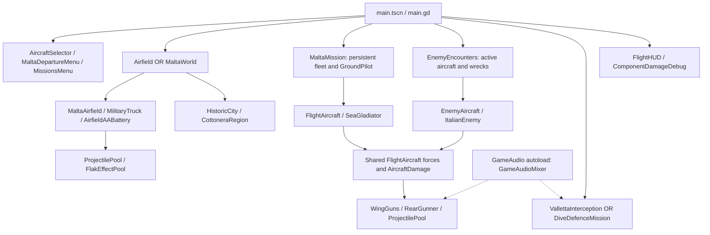

# Wings Over Malta — Complete Technical Development History and Architecture

**Source snapshot:** [588ac7b1b37b72014b73fe679871e790e5c79145](https://github.com/zelenski3398/codexproj1/commit/588ac7b1b37b72014b73fe679871e790e5c79145) · **Audit date:** 16 October 2026.

This consolidated document gives the essential evolution, architecture and present limitations. The [chapter set](development-history/README.md) contains detailed system behaviour, diffs, formulas, source links and the full commit index; it is the maintained technical reference behind this overview.

Current changes after this frozen snapshot are recorded in the [incremental update journal](development-updates/README.md), including the [four supplied diagram concepts](development-updates/reference-diagrams.md). The [root README](../README.md#development-history-and-update-boundary) records the latest documented source SHA.

## Contents

1. [Evidence and coverage](#evidence-and-coverage)
2. [Development chronology](#development-chronology)
3. [Present architecture](#present-architecture)
4. [Aircraft, combat and ground controls](#aircraft-combat-and-ground-controls)
5. [Continuous Malta and geographic reconstruction](#continuous-malta-and-geographic-reconstruction)
6. [Missions, AI and AA command](#missions-ai-and-aa-command)
7. [Audio and browser delivery](#audio-and-browser-delivery)
8. [Current state and next work](#current-state-and-next-work)
9. [Statistics and validation](#statistics-and-validation)

## Evidence and coverage

The available repository is https://github.com/zelenski3398/codexproj1, remote verified by Git. The audit inspected local `work` and safely fetched `origin/main`, both at the snapshot. `origin/main` initially held only a stale root pointer; the fetch advanced it without altering the working branch or rewriting history. The repository is not shallow. The remote advertised only main, no tags; all reachable refs contain **50 unique commits, one root, zero merges**. No earlier development is claimed beyond the root commit's already-playable code.

Actual author dates span **7 October 2026, 16:24:09 UTC to 16 October 2026, 06:59:46 UTC**. Original timestamp offsets and committer dates are retained in the [commit manifest](development-history/commit-evidence.json); activity charts normalize author dates to UTC. No author email addresses, credentials or private configuration values are included.

Public merged-PR and all/closed issue searches showed zero results; the release page reported no releases. REST history requests were blocked by the environment proxy (403), and the discussions URL returned 404. Deleted/private/unreachable branches, earlier commits and inaccessible workflow logs remain outside the evidence. Neither undocumented motives nor proposed features are treated as completed work.

**Interpretation:** historical changes come from commit diffs; present implementation comes from inspected live callers/resources. An older test report is not a fresh pass. A prepared asset is not automatically integrated geography. See [coverage methodology](development-history/README.md#history-coverage-and-access-limits).

## Development chronology

The [23 evidence-linked milestones](development-history/02-development-timeline.md) and [50-entry commit reference](development-history/14-commit-reference.md) document exact before/after changes. The main sequence is:

| UTC dates | Evolution | Representative evidence |
| --- | --- | --- |
| 7 October | Root First Sortie Spitfire flight/landing prototype; embedded keyboard fix | [64406b0](https://github.com/zelenski3398/codexproj1/commit/64406b082d49576bf5c0ec8c95367530dab9ab2c), [81703b4](https://github.com/zelenski3398/codexproj1/commit/81703b4933e0ca1391448c5c423ac28ae66b93f0) |
| 8–9 October | Eight wing guns, hull/effects and target; parser fix; flying Stuka; selectable Sea Gladiator | [b0bdb4f](https://github.com/zelenski3398/codexproj1/commit/b0bdb4f02babf34094c9ee2e1ff58e011672c721), [83e6073](https://github.com/zelenski3398/codexproj1/commit/83e60738746ed2a2b4c2dcd75316e8c62f9c8579), [236dbf0](https://github.com/zelenski3398/codexproj1/commit/236dbf093e2ba78afd3742a4dbd52b9df0685a56), [d3dea47](https://github.com/zelenski3398/codexproj1/commit/d3dea47a244651baacf17f334f4d14f2d8c3894a) |
| 10 October | Safer enemy lifecycle/teams, eight mechanical damage components, rear gunner/pursuit and human aiming; browser export; continuous Malta; supplied audio; controlled terrain rendering and landscape | [fc44efa](https://github.com/zelenski3398/codexproj1/commit/fc44efa7a43f2066de9a2edbf2b472e8d2c6f7d6), [f1b9d05](https://github.com/zelenski3398/codexproj1/commit/f1b9d0576c98425770df6809fdc7048f87ac04a0), [850e33c](https://github.com/zelenski3398/codexproj1/commit/850e33c953b3b3289dcacbbf40a34e2b94df8b35), [bf0a11c](https://github.com/zelenski3398/codexproj1/commit/bf0a11c9be53bb888cd0052b3111e5f43df295e2), [1f83c99](https://github.com/zelenski3398/codexproj1/commit/1f83c99653e2804b811dadc8905e88f94a72d208), [4a716c0](https://github.com/zelenski3398/codexproj1/commit/4a716c086b380b59ccfc68ad373ae6ee2045de87), [e2f8451](https://github.com/zelenski3398/codexproj1/commit/e2f84517d23337779a67f04d15ffc95e68a6e4bb) |
| 11–12 October | Direct browser menu, confirmed encounters/Survival, Italian airframes and interception; sequential navigation, radio, final two-checkpoint/1,200 m/90 s revision | [af88162](https://github.com/zelenski3398/codexproj1/commit/af8816231ea8e7acba182be5ce0a3e29906ce6c5), [ab97726](https://github.com/zelenski3398/codexproj1/commit/ab97726e08ff5e59691e28e8115cda4f152c04c3), [ac7fbac](https://github.com/zelenski3398/codexproj1/commit/ac7fbace7a0950d7d59e4413577a83a864a83553), [4a32579](https://github.com/zelenski3398/codexproj1/commit/4a32579b9cf1bfbc087df9847494d3104cffe84a), [00351b1](https://github.com/zelenski3398/codexproj1/commit/00351b1f3fee6623381b5ed19ce0c7e9bdc25339), [6729637](https://github.com/zelenski3398/codexproj1/commit/67296373d09e7f3768fed7eff69470fc96e3f1a9) |
| 13–14 October | Skinned RAF pilot, friendly AA then manual guns/truck, stronger flak; grounded airfields/roads; six-wave dive defence, base access, heavy/Bofors layering | [45a15f9](https://github.com/zelenski3398/codexproj1/commit/45a15f93a1c4ceee45a0c588f1c8c6e0aafe3265), [6a36276](https://github.com/zelenski3398/codexproj1/commit/6a362768d5065098bfce8f148181c382f6a93e6b), [5bbf563](https://github.com/zelenski3398/codexproj1/commit/5bbf563938cfd8544e40e205de8c645b51361525), [917c0da](https://github.com/zelenski3398/codexproj1/commit/917c0da15000ef138ba2b92eef85b4062c5fe34c), [451ad8b](https://github.com/zelenski3398/codexproj1/commit/451ad8b77dcf4ac2482c34e90cc9781bf3534619), [88e17ba](https://github.com/zelenski3398/codexproj1/commit/88e17baa97591a6000022d116e846a640bc4d000), [2157b72](https://github.com/zelenski3398/codexproj1/commit/2157b7227fe912762e000829a001c15294d9f097) |
| 15–16 October | Relative mouse/infinite autoreload, four-gun command posts, defence audio and continuous alarm; Valletta, Mdina, source-gated Cottonera preparation | [e26e5ed](https://github.com/zelenski3398/codexproj1/commit/e26e5edca54b0551bf27372109a26e8adfede36b), [eb5db64](https://github.com/zelenski3398/codexproj1/commit/eb5db645b24ac61e32de36e7aed320083e244c78), [6c0fbc9](https://github.com/zelenski3398/codexproj1/commit/6c0fbc90fdea1f0f46b5cca111c49c70e89d8ad9), [bf96f9a](https://github.com/zelenski3398/codexproj1/commit/bf96f9a7e54330fcd1f74815be220e6dfc27132c), [814e308](https://github.com/zelenski3398/codexproj1/commit/814e30850bea4f3dbe098787d9a1898d95a434ba), [588ac7b](https://github.com/zelenski3398/codexproj1/commit/588ac7b1b37b72014b73fe679871e790e5c79145) |

Several early behaviours were explicitly replaced: stationary target by flying enemy; autonomous friendly AA by manual operation; finite Bofors clips by unlimited autoreload; five-minute/single-then-five-checkpoint interception by the short two-checkpoint variant; raised runway slab collision by integrated terrain; initial Valletta blockout by a larger additive city. CNAME was added then removed. These are historical revisions, not parallel current features.

## Present architecture

[main.tscn](../main.tscn) contains a `FirstSortie` Node3D running [main.gd](../scripts/main.gd). The project constructs most entities and UI in scripts. There are two scenes total, including a standalone Cottonera review gallery; there are **no dedicated aircraft .tscn scenes**. Six airframe types come from classes/resources, with only Spitfire and Sea Gladiator selectable by the player.

`main.gd` composes selection, world, cameras, directors and cleanup. `MaltaWorld` owns all island terrain/fields/trucks/batteries/scenery. `MaltaMission` owns persistent player fleet, ground pilot and interactions. `EnemyEncounters` keeps live hostiles separate from wrecks; `VallettaInterception` and `DiveDefenceMission` own authored mission rules. `GameAudio` is the sole autoload, using `GameAudioMixer`. No campaign/save/streaming global manager is configured.

Signal and deferred-call guards matter: hull depletion emits once; encounter confirmation latches before deferral and checks generation; final checkpoint activation is one-shot; bomb impact is latched; mission resolution waits for same-tick callbacks and, in defence, outstanding ordnance. Full retry reconstructs a run, whereas boarding and stage confirmation preserve it. [Architecture details and dependencies](development-history/03-architecture.md) enumerate real classes, signals and collision bits.

## Aircraft, combat and ground controls

`FlightAircraft` remains a RigidBody3D force solver: dynamic-pressure/angle-of-attack lift, opposing drag, speed-dependent propeller thrust, gravity, control/stability torques and three ray-spring tyre contacts. Stalls fade lift and encourage a recoverable nose drop. Simplified coordinated yaw and central braking friction support approachable handling. Normal AI commands the same `PilotInput` fields; only explicit spawn/reset applies a new physics pose/velocity. [Flight chapter](development-history/04-aircraft-and-flight.md) documents formulas and tuning.

`WingGuns` fires visible ports with configurable convergence, spread, rate and lifetime. `ProjectilePool` sweeps full travelled segments, excludes shooter and own sensor RIDs, ignores coarse aircraft hulls when localized sensors are active, applies team rules and reuses tracer/spark slots. `AircraftHitbox.receive_projectile_hit()` routes to `AircraftDamage.apply_damage()`, which changes component integrity and hull HP. Wing loss alters lift/drag/balance; engine loss reduces power; tail/control damage reduces authority; tank damage may leak/ignite. `AircraftHealth` depletion disables thrust/guns once while airborne wreck physics continue.

Engine smoke/fire starts strictly below 50 hull HP. Independent fuel ignition can burn above that threshold. Pooled world-space smoke lingers briefly. There is no detachable-wing or anatomical crew simulation. Ground installations, guns and defence soldier have their own damage APIs; the truck currently has collision but no HP model. [Combat sequence and state diagrams](development-history/05-combat-and-damage.md) trace this actual chain.

Ground walking and the forgiving kinematic truck use CharacterBody3D collision/gravity. `AirfieldInteraction` routes exactly one active controller among on-foot, truck, gun/post and aircraft. Near E enters/exits normal entities; F enters/exits a command post. Aircraft exits require ground contact, stopped engine/throttle and safe space. Gun destruction ejects the operator safely. Aircraft switching retains airframe damage/fuel; no world reload occurs. AA defence deliberately disables aircraft fallback. The RAF character is an original skinned asset with Idle/Walk/Seated; no climb-in/out animations are integrated. [Ground chapter](development-history/06-ground-vehicles-and-soldiers.md) provides transition guards and limitations.

## Continuous Malta and geographic reconstruction

The supplied base comes from OSM coastline and Planning Authority DTM 2012, using a roughly 32 m overview rather than the advertised full 1 m LiDAR. Gap-filled/bilinear heights and an 80 m interior mesh limit fidelity. Source geometry is retained under `assets/malta/source/`; it is distinct from later runtime grading/roads.

The coordinate frame is EPSG:32633 relative to **14.4° E / 35.93° N**, X east, Y elevation, -Z north, one unit per metre. Longitude/latitude are projected, then origin easting/northing subtracted; Z negates northing delta. `MaltaGeography` shares chart normalization with world markers. Ta' Qali, Luqa and Ħal Far exist simultaneously; selection sets departure, not a separate terrain scene. World scale spans roughly 35.292 × 32.918 km. Airfield centres/layouts are approximate prototype values.

Initial raised runway decks were superseded by local terrain cut/fill, refinement and smooth blends; current visual surfaces have no duplicate floor collision. Historic-scan roads use a landmark warp and constrained geometry/UV masks, not floating strips. Alignment remains uncertain: recorded leave-one-anchor-out RMS is about 1.234 km. Modern terrain, artistic fields and inferred routes must not be called a verified wartime survey.

Original GLB `COLOR_0` contained an elevation heatmap without authored materials/textures. The explicit material fix first made beige normal and F4 debug intentional; later bundled landscape shader/maps became normal. White Windows terrain was not reproduced by that investigation and caching was not an established cause. Current runtime has 166 mesh records after patching, versus original 36 islands. Static collision remains loaded; scenery culling does not split gameplay worlds.

Valletta (880 generated buildings) and Mdina (242) are placed original approximations with separate structural collision. Mdina's stated geographic reference projects to X 277.515 / Z 4782.308 m at sampled height 196.111 m. Cottonera remains **awaiting_geodata**, with zero placed buildings/fortification/collision chunks. Thirteen unplaced templates and a guarded local importer/compiler are preparation, not a mapped Three Cities reconstruction. [Geography chapter](development-history/08-malta-terrain-and-geography.md) gives source provenance, formulas, exact field poses, pipeline/world diagrams and this distinction.

## Missions, AI and AA command

There are two generic progression modes and two authored missions:

- Encounters require confirmation to spawn one replacement without changing player state.
- Survival stages spawn 1,2,2,3,3 enemies, with two normals/one ace in the final batch. No next stage appears before confirmation; player loss blocks progression.
- Italian interception starts grounded/engine off, accepts two nearby airborne checkpoints and inserts one SM.79 plus C.200 at a computed 1,200 m 3D separation, 30° right, with modest height offset and safe clearance. Countdown/radio start once. Bomber-to-Valletta release geometry is separately paced for 90 s using real throttle. Historical regression reports measured about 89.44 s uninterrupted travel; this audit did not freshly fly the route. Early enemy losses do not end the mission before deadline; player loss fails immediately.
- Dive defence has six waves 1,1,2,2,3,1 (ten Stukas, final ace). Bomb/strafe states use normal force-driven controls. Operator death or all six local guns lost fails; all waves and hostile ordnance must clear for success. There is no abstract base-health pool.

Stuka rear fire was rebalanced using delayed human observations, imperfect range/lead/tracking, reaction, mechanical traverse, own-motion penalties and LOS/self-obstruction. Cadet/Pilot/Ace resources and component-hit telemetry expose behaviour. Enemy tactics select pursuit/break/yo-yo goals, not teleport manoeuvres. [Mission diagrams and rules](development-history/09-missions-and-ai.md) distinguish historical versions and current guards.

Each Malta field now has **four heavy AA, two Bofors and one command post**: 18 guns and three posts island-wide. Unoccupied guns do not aim/fire autonomously. Mouse aims, LMB fires, RMB sights, arrows remain optional; capture releases on menus/pause/dismount. Heavy AA reloads five seconds and needs a fresh press; Bofors holds at two rounds/s. Ammunition is infinite, with automatic reload and no clips/loaders.

The post lets the player designate an aircraft/area and order a staggered salvo. `AAFireControl` estimates gravity/velocity interception and timed fuze per muzzle, with uncertainty. Guns independently traverse, align, launch physical shells and reload. Destruction/dismount cancels orders. Heavy direct hits deliver devastating damage; blast decreases with distance to the nearest component and checks terrain cover, excluding the direct-hit aircraft from duplicate blast. Bofors is impact-only. [AA chapter](development-history/07-anti-aircraft-systems.md) details current resources and command flow.

## Audio and browser delivery

`GameAudioMixer` manages Music/Aircraft/Guns buses and saved user levels. Aircraft/gun sounds are spatial entity-owned sources; player radio is nonspatial. The supplied Italian line has subtitle and single-owner temporary ducking, restored on finish/cancel. A missing clip stays silent without fake speech/subtitles. The Harrington defence clip is integrated but has no verified transcript subtitle. The siren loops from mission start through waiting/waves, and the Jericho recording is gated by actual Stuka descent. Stuka engine audio remains an explicitly documented placeholder. [Audio chapter](development-history/10-audio-and-atmosphere.md) traces live asset consumers.

The project uses Compatibility/120 Hz physics; installer and CI pin Godot 4.6.3 with matching checksum-verified web templates. Single-thread WebGL 2 export bundles runtime resources and uses a direct-menu shell. GitHub Actions runs listed native/Xvfb checks, exports and uploads/deploys Pages. Not all Python or Playwright suites are invoked by CI. Current deployment availability is not established from config alone.

Pools, bounded effects/sounds, sampled AI scans, mesh/chunk LOD and separated coarse city collision control costs. Collision stays continuous; no live world streaming, origin rebasing or water buoyancy exists. Historical software-rendered native/ANGLE checks are not consumer-hardware benchmarks. [Performance/export chapter](development-history/11-performance-and-web-export.md) explains reproduction and limits.

## Current state and next work

This is a playable expanding prototype, not a finished historically surveyed simulator. [Technical decisions](development-history/12-technical-decisions.md) ground each choice/problem in diffs and source; undocumented rationale is explicitly unknown. [Current-state matrix and roadmap](development-history/13-current-state-and-roadmap.md) separate implemented, partial, removed and absent systems.

Recommended follow-up is to synchronize stale menu/docs text, make offline asset generation reproducible, extend CI to omitted data/browser checks, obtain licensed reviewed Cottonera geometry, then run representative hardware/native-web mission acceptance and profile actual costs. Tighter session interfaces and typed mission phases can follow when needed. These are recommendations, not invented project commitments.

## Statistics and validation

The snapshot contains **81 runtime + 56 test GDScripts**, two Python test scripts, ten browser-tool `.cjs` files, two scenes and 22 `.tres` resources. There are six aircraft types but zero dedicated aircraft scene files and two selectable player types. Tracked content grows from 26 files/59,167 bytes at root to 510 files/55,433,704 bytes at the snapshot, excluding .git/imports/exports. All 50 commits fall in October 2026. These counts are descriptive, not productivity measures.

The audit provides **17 unique Mermaid diagrams**, 23 milestones, a per-commit evidence manifest, historical size samples and UTC activity data. [Validation report](development-history/validation.md) records exact fresh checks, link/diagram validation, source/history coverage and docs-only diff review. Historical gameplay/audio/browser reports are attributed rather than re-labelled as current tests. Full interactive flight, combat balance and browser/native acceptance were not rerun for this documentation-only task.
