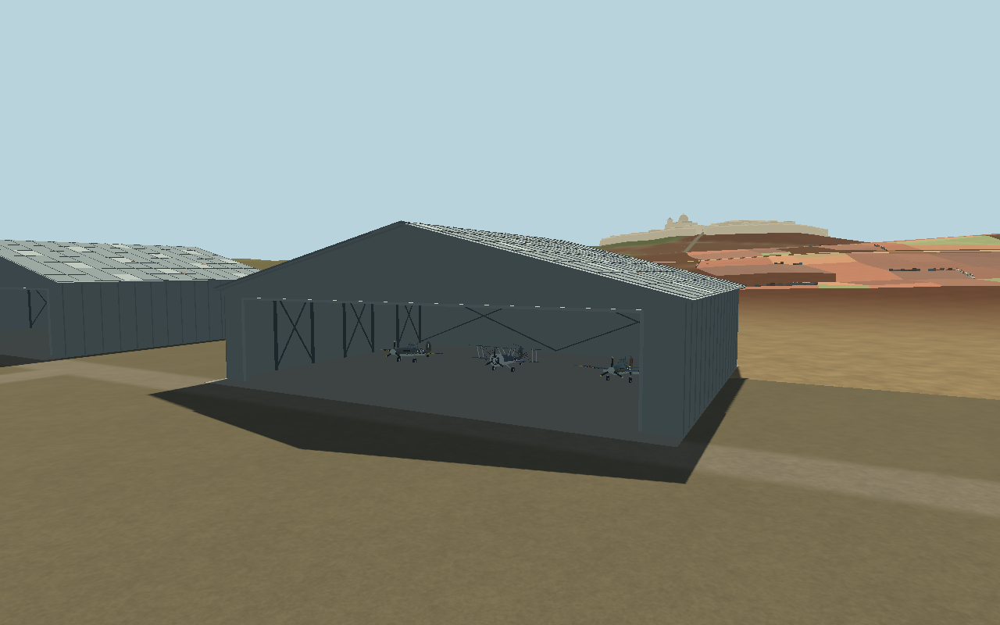
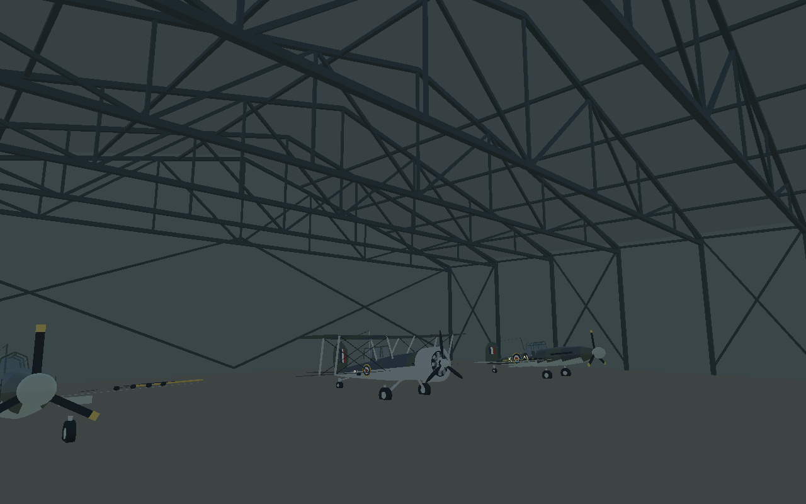

# Open steel-truss aircraft hangars

Original WWII-style hangars based on the user's hand-drawn reference replace the former solid boxes. This is a custom design, not a reconstruction of a specific historical Malta building.

## Where to find them

There are **two hangars at each Malta runway**: Ta' Qali, Luqa and Ħal Far (six in the continuous world). All Malta modes use this same world construction. The original test runway retains its three building sites, now also using the new hangars. No previous box hangar remains inside a replacement.

Entrances face the adjacent runway/apron. Malta footprints extend from field-local X=82 to 118 m, away from the X=78 driving lane, the former X=59 dispersal lane and X=37 AA line. Their centres use the existing field transform and Z offsets of −45 and −125 m from the apron centre. Their larger widths are along the runway. Geographic airfield positions, runway geometry and roads are unchanged. Available aircraft now use designated interior stands; see [the 20 October update](pilot-survival-and-recovery.md).

The soldier can walk inside, vehicles can drive inside, and aircraft can taxi through the entrance. **Available player aircraft now spawn inside the hangars at designated interior stands**; the three aircraft in the close previews below are preview-only scale references.

## Geometry and structure

| Element | Default |
|---|---|
| Main footprint | 48 m wide × 36 m deep |
| Clear entrance | 42 m wide × 8.8 m high |
| Eaves / ridge | 10 m / 16 m |
| Main roof thickness | 0.18 m |
| Eaves projection | 0.85 m |
| Trusses | Seven, approximately 6 m apart |

Two pitched roof slabs meet along a front-to-rear ridge. Closed triangular gables, narrow entrance jambs, a lintel, straight side walls and a rear wall form the shell. There is **no middle entrance pillar**.

Each truss has two top chords, a full-width horizontal bottom tie, vertical webs and alternating diagonals. Longitudinal purlins support the roof; columns stand only along the sides. Alternate side bays and the rear wall have diagonal bracing. This is visible 3D geometry, not a texture.

Roof sheet overlays form approximately 3 m × 4 m panels, with lap seams, raised ribs, a ridge cap and sparse rust strips. Muted grey materials vary slightly in colour and roughness. The floor follows each airfield's existing grade; walls remain upright. A shallow slab is buried under the existing terrain with its top approximately 2.5 cm above it. No terrain regeneration is required.

## Implementation and collision

- [AircraftHangar](../scripts/aircraft_hangar.gd) extends the existing [AirfieldInstallation](../scripts/airfield_installation.gd). `_shell`, `_structure` and `_sheets` generate reusable geometry. Dimensions, entrance, roof heights, truss spacing, eaves and floor grades are exported properties.
- [MaltaAirfield._ready](../scripts/malta_airfield.gd) retains two persistent installations per airfield and gives each the upright, runway-facing transform. `floor_grade_x` comes from the existing runway slope.
- [Airfield._buildings](../scripts/airfield.gd) replaces only the three test-runway boxes; its tower, hut and countryside remain.
- One static body owns each hangar. Independent box/convex shapes cover the slab, walls, gables, roof and main steel members. **There is no full-building box collider filling the entrance or interior.** Decorative ribs and individual rust marks have no separate physics bodies.
- The existing 250 HP installation damage API, team handling and one-shot destruction effect remain. Destroyed buildings become scorched persistent ruins; their collision remains. Returning to a field does not repair them. A full session restart recreates them.
- Geometry is merged into eight material batches per hangar. Repeated buildings share seven geometry resources and all intact materials; graded floors are built separately. Main shell visibility extends to 8 km, steel to 1.4 km, and panel/rib detail to 650 m. Fine roof layers do not cast shadows. Standard materials require no external textures or custom shaders.
- [Read-only browser diagnostics](../scripts/web_support.gd) expose count, dimensions, HP, trusses and shared roof resource identity only with `?smoke=1`; no transforms or controls are assigned by this hook.

## Previews

Captured from the real native Malta world using Godot 4.6.3 Compatibility, Mesa llvmpipe. These are game renders, not generated concept images.





[Ta' Qali aerial](previews/hangar-ta_qali-aerial.png) · [Luqa aerial](previews/hangar-luqa-aerial.png) · [Ħal Far aerial](previews/hangar-hal_far-aerial.png)

## Verification

Run the focused checks:

```bash
godot --headless --path . --editor --import --quit
godot --headless --path . --fixed-fps 120 --script res://tests/hangar_checks.gd
godot --headless --path . --fixed-fps 120 --script res://tests/airfield_ground_checks.gd
godot --headless --path . --fixed-fps 120 --script res://tests/base_access_checks.gd
godot --headless --path . --fixed-fps 120 --script res://tests/airfield_controls_checks.gd
```

The new hangar suite verifies real Spitfire and Sea Gladiator taxi entry, indexed/visible gables, open interior rays, wall/roof collision, sampled terrain fit, batch counts, preserved access lanes, damage, one-shot destruction and clean teardown/reconstruction. It is included in the publishing workflow. The truck collision fixture now aims at a solid side wall because the old test aimed at what is now an open entrance. The ground-grading test excludes hangar bodies from its downward rays so that expanded roofs do not get mistaken for terrain.

Additional regression checks cover Malta flight/boarding/landing, road driving, dive-defence waves, Faith/Hope/Charity departure and the two-checkpoint Italian interception departure. See the dated [development addendum](development-updates/2026-10-18-aircraft-hangars.md) for actual outcomes and limitations.

For manual review: depart from each airfield, walk along the apron into both hangars, look up at the seven trusses, drive through the opening and park, then taxi a fighter inside and back out. Verify the runway remains clear. Repeat after mission retry. Native previews use `tests/hangar_capture.gd`; the production-browser smoke uses `tools/hangar_web_smoke.cjs` after `bash tools/build_web.sh`.

The visual design is illustrative, not an engineering-certified structure. No moving doors, repair/refuelling service, automatic indoor repair/refuelling, extra aircraft or hangar-collapse simulation are introduced. Browser mouse-driven taxi manoeuvres are not part of the automated smoke test.
