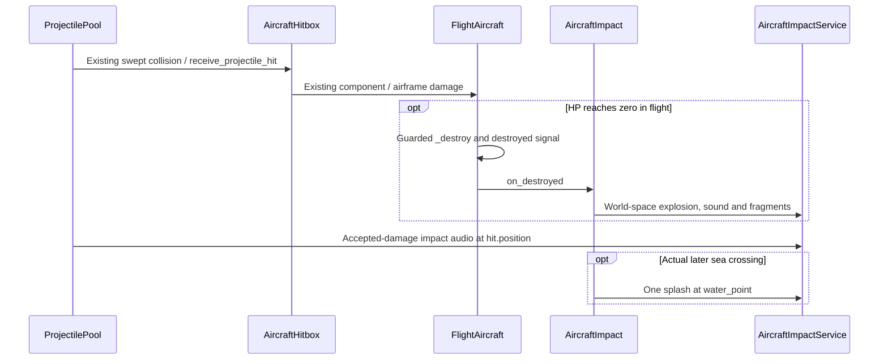
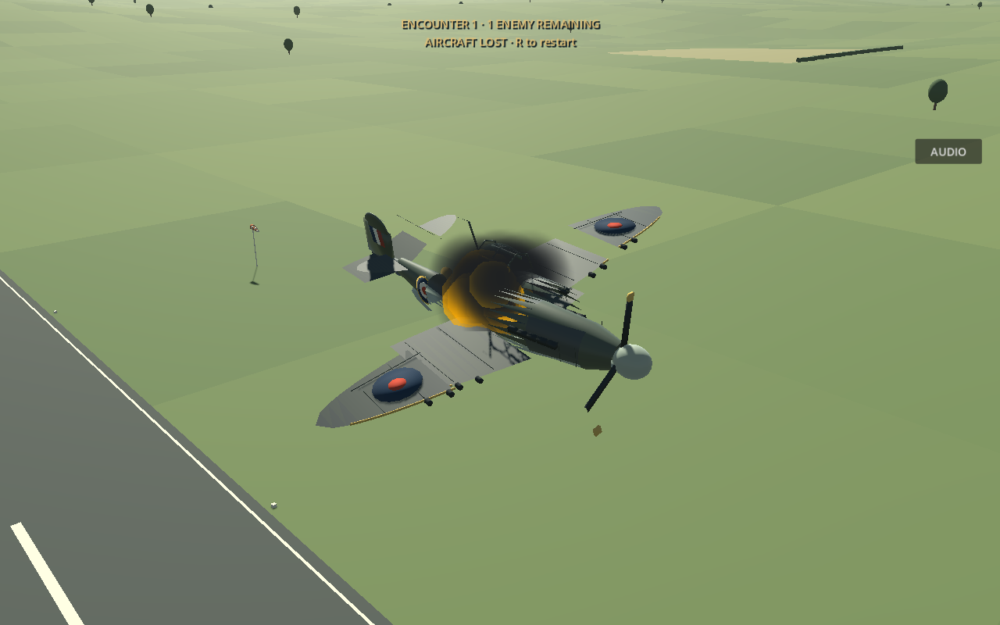
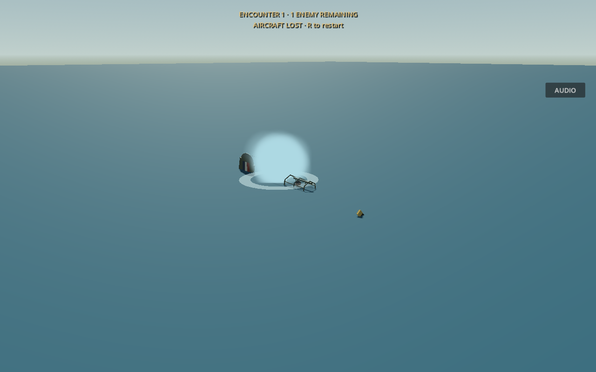

# Aircraft impacts, sea crashes and airborne destruction

This update adds confirmed-hit audio and immediate airborne destruction to the existing shared aircraft health, collision and crash system. Player and enemy aircraft use the same implementation; weapons still apply damage exactly once.

## Behaviour and architecture

`ProjectilePool._physics_process()` compares HP and struck-component integrity before/after its existing swept hit dispatch. Accepted damage produces a varied metallic sample at `hit.position`; misses, friendly exclusions and damage rejected after destruction do not. Existing hit sparks remain. AA shell definitions select the heavier impact sample. Rapid hits on one aircraft coalesce within 45 ms, while normal damage and hit telemetry continue unchanged.

`FlightAircraft._destroy()` remains the one guarded destruction transition. It stops engine/gun loops and asks `AircraftImpact.on_destroyed()` to explode immediately when there are no existing landing-gear contacts, no latched ground crash and no water impact. Enemy AI and rear guns stop through the existing subclass transition. Above-zero critical damage remains unchanged. Parked aircraft retain the previous ground-destruction path. The existing eight-way fracture code reuses real model triangles, excluding the pilot, rather than adding unrelated debris.

`AircraftImpact.integrate()` queries the exposed collision surface in the existing `aircraft_water` group. It rejects a water plane hidden beneath terrain/buildings and interpolates the previous/current lower-hull crossing against the actual surface normal. The test suite includes a sea plane at **Y=40 m**. Surface contact is never assumed to be Y=0. A healthy sea impact latches water first, emits spray/mist/foam and resolves fatal HP through the usual crash path without a fireball. Wreck motion then uses existing force-based water drag/sinking. A previously exploded wreck may later produce one splash at its real crossing; this does not emit another destruction/kill signal. Removing a wreck before contact does not schedule a fake splash.

`AircraftImpactService` is a lazy child of the existing `GameAudio` autoload, independent of projectiles and aircraft. It owns fixed audio voices and expiring world-space effects/debris. Reset/menu cleanup clears them; ordinary entity removal does not truncate tails. Per-owner reset generation guards prevent a stale deferred fracture from affecting a new life. Budgets default to **12 voices, 24 effects and 64 debris bodies globally**. Impact voices use the existing **Guns** bus, volume controls and radio ducking. Priority preserves explosions/own hits over remote pings; overlapping voices receive smooth cluster headroom.

## Assets and tuning

Open [audio_profiles/aircraft_impacts.tres](../audio_profiles/aircraft_impacts.tres) in the Inspector. Its [resource class](../scripts/aircraft_impact_profile.gd) exposes separate own/enemy hit levels, ranges, attenuation-distance multiplier, sample/pitch/volume variation, coalescing interval, splash speed/intensity limits, hull clearance, explosion intensity/level/range and voice/effect budgets. Own-aircraft impacts retain 3D panning but disable inverse-distance attenuation within their configured camera range, keeping cockpit/chase feedback readable. Remote hits use inverse-distance attenuation and a hard audible-range fade. `AircraftImpact` exports per-aircraft explosion override, debris lifetime/scatter and sinking/drag tuning. The shared profile supplies the default explosion asset.

**Temporary synthesized placeholders, not authentic recordings:**

- `assets/audio/impacts/metal_hit_{1,2,3}_placeholder.ogg`: varied metallic cracks/pings.
- `assets/audio/impacts/heavy_hit_placeholder.ogg`: heavier structural thud.
- `assets/audio/impacts/sea_plunge_placeholder.ogg`: initial crack, low plunge and churning tail.
- `assets/audio/aircraft_crash.ogg`: existing synthesized explosion/rumble, reused.

The new sounds are generated reproducibly by [tools/generate_impact_placeholders.py](../tools/generate_impact_placeholders.py). Replacement slots accept licensed **mono metallic aircraft-hit recordings, a heavier structural-hit recording, a layered sea-plunge/splash recording and optionally an explosion recording**. None was supplied for this task. Supplied engines, radio, sirens and machine guns remain unchanged.

## Native previews

These are real Godot 4.6.3 Compatibility renders of controlled fixtures, not an artist's illustration. The CPU effects are intentionally simple; screenshots do not establish subjective sound quality.

Reproduce with `DISPLAY=:99 godot --path . --audio-driver Dummy --fixed-fps 60 --script tests/aircraft_impact_capture.gd` on a configured X server. Captures go to `/tmp/aircraft-previews/`.

## Testing and manual checks

The new [25-check suite](../tests/impact_audio_checks.gd) exercises real swept hits, heavier shell selection, excluded misses/friendlies, both destruction paths, raised-water contact, speed scaling, effects surviving entity removal, one explosion/kill then one later splash, cleanup and bounded fragments. Actual native mixer capture measures stereo energy, near/far/out-of-range attenuation, own-aircraft cockpit/chase audibility and eight-voice peak headroom. It is included in the GitHub publishing checks.

Run it with `godot --headless --audio-driver Dummy --path . --fixed-fps 120 --script tests/impact_audio_checks.gd`. Existing combat, mission and audio regression results are recorded in the incremental history entry.

For manual review: approach an enemy closely and listen to left/right hit positioning; compare cockpit and chase incoming-fire feedback; reduce airborne HP to zero and confirm one airburst; repeat into the sea, then try a healthy low-speed ditch and a fast plunge. Retry/return to menu while effects linger and confirm cleanup. Listen with engines and radio active, including several simultaneous crashes, and tune the profile for the intended speakers/headphones. No human listening session or browser runtime test was completed here. This environment lacks web export templates, so export and browser audio/visual parity remain unverified for this revision. The implementation uses Compatibility CPU meshes, standard materials and the project's existing web sample-playback choice.
