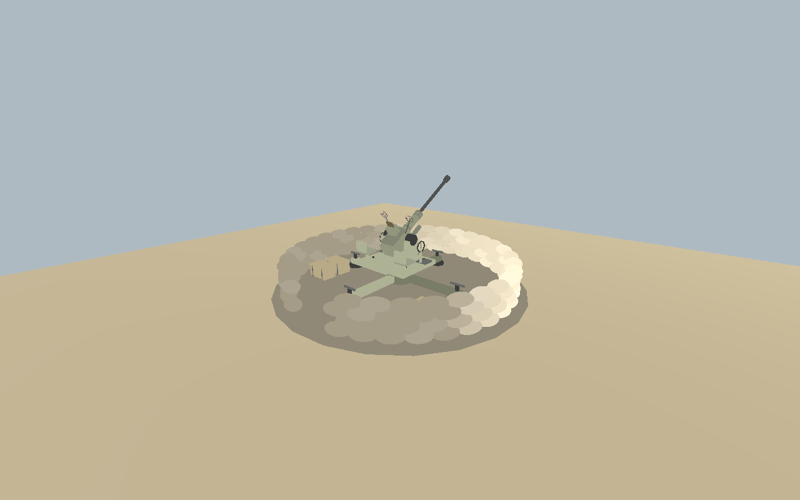

# Friendly airfield AA

Each existing Malta airfield has two British emplacements (six in total). This follows the repeated detailed placement requirement; the request's opening sentence said four. The original countryside test map is unchanged.

The supplied `British_AA_Emplacement.glb` is used at metre scale, including sandbags and crates. Its local -Z barrel direction, Y-axis `YawPivot`, X-axis `ElevationPivot`, initial 32° elevation and `Muzzle` position were checked against the GLB transforms and runtime aiming. Positions are on the opposite side of the runway from the dispersal apron: local X=-72 m, Z=±28% of runway length. A terrain ray locates each pad and its normal aligns the emplacement. No terrain or airfield coordinate changes are made.

## Components and tuning

- `airfield_aa_battery.gd`: world-owned six-gun battery, shared 96-shell pool, nearest component blast damage; 12 m radius and 8 maximum blast damage with linear falloff.
- `british_aa_gun.gd`: supplied visual hierarchy, coarse solid collision/damage hitboxes, targeting, traverse, recoil and positional sound. Defaults: 150 HP, 2,400 m range, 700 m/s shell speed, 1.4 shots/sec, 22 direct damage, 1.15° Gaussian aiming error, 1.5 s reaction delay, 65°/s traverse and 35°/s elevation. Elevation limits are 8–85°. Maximum shell lifetime is 4 s.
- `flak_effect_pool.gd`: 192 reusable CPU mesh particles for flashes, sparks, smoke, dirt and water effects. Each gun has one audio voice; the existing aircraft gun recording pitched down is a temporary sound, not an authentic Bofors recording.

Prediction deliberately under-leads by 6%; dispersion, finite projectile travel, reaction delay and mechanical aiming limits make this supporting fire rather than guaranteed damage. Target assignment discourages every gun choosing the same enemy. Scans run every 0.45–0.6 s, not every frame. Both the predicted aim and dispersed firing path must have a clear ray; friendly aircraft and installations block it. Shared team rules prevent damage to British aircraft even if one crosses a shot in flight.

AA uses the existing swept projectile pool, localized aircraft damage multipliers, critical hits, health, smoke/fire and one-shot destruction events. One shell never applies both direct and blast damage to the same aircraft. Blast chooses the nearest component and checks terrain/building occlusion. A fuzed aerial burst is a configurable gameplay abstraction for this Bofors-inspired asset, not an exact historical ammunition simulation. Shells follow the existing weapon system's straight finite-speed ballistics without gravity.

Enemy bullets and actual mission bomb impacts can damage the guns. Destroyed positions remain as obstacles/ruins and stop firing. Bomb blast defaults to 35 m radius and 180 maximum AA damage, subject to obstruction. Mission retry replaces the world-owned battery and its shells, effects and sounds; changing aircraft within the same world does not repair guns. AA kills flow through existing enemy destruction tracking. Interception continues to resolve at timer expiry even after early kills.

## Verification / play test

Run `godot --headless --path . --fixed-fps 120 --script res://tests/aa_checks.gd`. It checks all six placements and support rays, imported aiming nodes/axes, actual firing, bounded pools, swept direct hits, component blast damage, exclusion of double damage/friendly damage, obstructions, enemy bullets, bomb damage, ground/water impacts, destruction, actual enemy kill tracking and clean retry.

For a visual test, select Malta at each of Ta' Qali, Luqa and Ħal Far. Inspect the two positions across the runway from parking. Taxi and take off normally. Bring enemies above the airfield, watch traverse/elevation and muzzle recoil, flashes/tracers and compact grey aerial bursts. Fly between a gun and its target to check withheld shots. Watch enemy HP/component loss and mission counts. Retry and inspect six fresh positions. In interception, early AA kills must still wait for 01:30 expiry.

Native Compatibility preview and automated firing/collision checks are available. No human-controlled six-gun dogfight, subjective sound mix, frame-rate guarantee on the user's hardware, or exhaustive uneven-ground edge inspection is claimed. The asset is deliberately simple; collision approximates the gun and sandbag cover rather than every crate and individual bag. Visual geometry is not independently damageable by sub-part. The pooled particle cap may recycle the oldest puffs during heavy fire, keeping effects bounded.
