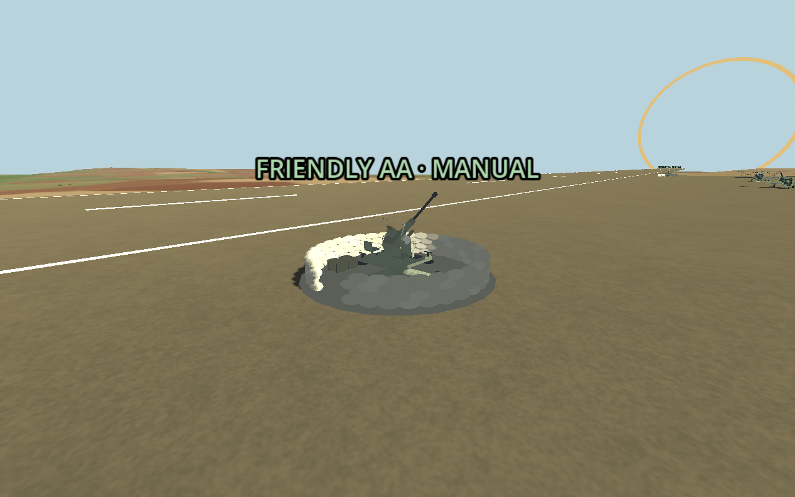
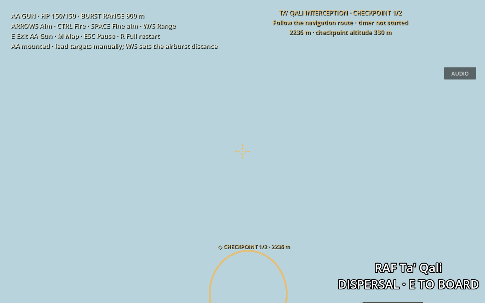
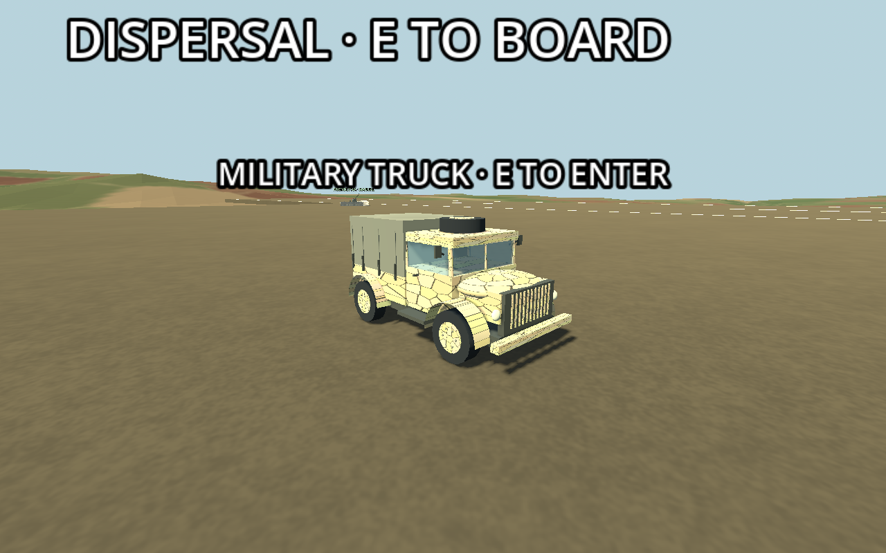

**Current AA controls/ammunition:** [Mouse aiming, sight zoom and unlimited automatic reloads](aa-mouse-controls.md). The finite ammunition/clip descriptions below document the earlier implementation and are superseded.

Current weapon configuration and damage values: [Layered AA](layered-aa.md). The descriptions below document the original manual-AA integration; weapon timing and battery counts were superseded by the layered AA upgrade.

# Manual AA and airfield truck

Every Malta airfield now has four manual heavy AA guns and two manual Bofors guns and one drivable military truck. The original countryside test map is unchanged. There is no autonomous targeting, aiming or firing in any friendly AA gun, including empty positions or positions the player has exited.

## Finding the guns

Both guns are on the **runway side of the dispersal apron**, at opposite apron ends. Their local positions are X=37 m, Z=31% of runway length ±90 m. The original terrain placement put Ta' Qali's guns 14–18 m below the graded runway, making them difficult to see. Their new positions are supported by the existing apron at runway height; no tall new platforms or changes to imported terrain are needed. The runway, parking slots and hangars stay clear.

The truck is beside the initial parking area at local X=78 m, Z=apron centre +12 m. Use the continuous apron lane between the parked aircraft and hangars, then approach either gun across the open apron end. Leave the truck and walk up to the gun; remote mounting is rejected.



## Controls

| Activity | Controls |
|---|---|
| Walking | Existing WASD movement, left/right arrows turn; E interacts with the nearest eligible object |
| AA gun | E mounts/exits; left/right arrows traverse; up/down arrows elevate/depress; Ctrl fires; hold Space for fine aiming; W/S increases/decreases burst range |
| Truck | E enters/exits; W drives forward; S reverses; A/D steers; Space brakes |
| All ground activities | M navigation map; Escape pause/resume; R full session retry |

The gunner camera sits ahead of the muzzle with a central reticle, leaving the barrel and breech out of its view. The HUD shows gun HP and the selected airburst range. Burst range holds its setting when W/S are released. Aim and firing use the supplied model's actual `YawPivot`, `ElevationPivot` and `Muzzle`. No target prediction is applied to a player-operated gun; lead moving aircraft manually.



Guns retain health and orientation on exit. Exit, destruction and mission completion stop firing and sound immediately. Destruction of an occupied gun restores walking and the walking camera at a capsule-checked ground position beside the wreck. If every nearby exit is blocked, the existing home pilot spawn is a last-resort safe fallback. Aircraft boarding remains available when both guns are lost.

The truck uses a forgiving `CharacterBody3D` vehicle controller with acceleration, gravity, floor snapping, swept collision, reverse steering, animated wheels and front-wheel steering. It cannot physically tip: the chassis remains upright. It collides with terrain, buildings, both aircraft factions and guns. It is a simplified airfield utility vehicle, not a full suspension/rigid-body driving simulation. Exit requires low speed and ground contact, with a capsule-checked clear position beside it. Empty trucks apply a parking brake and ignore driving keys.



The supplied photograph was inspected. The original mesh model takes its rounded bonnet, enclosed cab, four wheels, covered rear cargo body, spare tyre, steps and small equipment details from that reference. The stone camouflage texture is generated from original Voronoi cells; no photograph pixels, watermark or background are baked into it. It is a simplified model consistent with the game's placeholder aircraft, not a precise identified make or museum replica.

## Architecture and tuning

- `airfield_interaction.gd`: one ground interaction owner; exclusive walking/truck/gun/aircraft transitions, prompts, safe exits, destruction and mission-end handling. Gun mounting range 6 m; truck entry range 4.5 m. No transition recreates the battle or aircraft state.
- `british_aa_gun.gd`: 150 HP, 45°/s traverse, 30°/s elevation, 5–85° elevation limits, 0.35° dispersion; 700 m/s shells, 2 shots/sec, 180 direct damage. Range setting defaults to 900 m, adjustable 100–2,400 m; shell maximum lifetime 4 s. Space uses 18% of ordinary aiming speed.
- `airfield_aa_battery.gd`: exactly six guns, one world-owned 96-shell pool; 24 m burst radius, 75 maximum blast damage with linear falloff.
- `military_truck.gd`: 12 m/s forward, 4 m/s reverse, 4 m/s² acceleration, 16 m/s² braking; configurable wheelbase and floor-snap handling.
- `military_truck_model.gd`: original reusable procedural vehicle geometry, separate from driving controls; the RAF pilot asset supplies its seated driver.
- `flak_effect_pool.gd`: 192 reusable CPU effect particles. Shells and effects are world-owned; retry removes old objects and restores fresh guns/trucks exactly once.

Shared swept-projectile hit detection, factions, localized aircraft component damage, critical hits, smoke/fire, recoil, muzzle flashes, positional gun sound, aerial bursts, ground dust and sea splashes remain in use. A direct victim is excluded from the same shell's blast damage. Burst strength falls from 75 at the nearest component surface to zero at 24 m (default linear falloff; exponent configurable). Component and hull multipliers still apply. A direct 180-damage shell is devastating and generally destroys an engine/wing or the aircraft; this is gameplay tuning rather than an exact ordnance model. Airbursts are a configurable gameplay abstraction, not exact historical Bofors ammunition. The gun uses a dedicated original 0.43-second cannon effect, with a sharp initial crack and low-frequency boom/rumble. Each shot plays separately at two shots/sec. This is illustrative sound design, not a historical recording. Enemy name/distance tags remain available when the flight HUD is hidden for AA operation; nearby HP and behind-camera edge cues use the active sight camera. Aerial burst visuals use a configurable 4× scale, with independently configurable damage tuning. The truck has no dedicated engine recording, fuel or combat-damage model in this milestone.

## Verification and limits

Run:

```
godot --headless --path . --fixed-fps 120 --script res://tests/aa_checks.gd
godot --headless --path . --fixed-fps 120 --script res://tests/airfield_controls_checks.gd
```

AA checks cover all six visible apron placements, support, supplied hierarchy, empty-gun inactivity under fire/aim inputs, mounted aiming and actual muzzle shots, hit/critical-damage integration, friendly-fire protection, bomb damage, impact types, kill tracking and retry. Ground-control checks exercise both gun entries/exits, HP retention, real input-driven travel to both positions, braking/reverse, remote-mount prevention, solid collisions, safe exits, occupied-gun destruction, mission-end firing inhibition, aircraft fallback, exclusive controllers/cameras, and clean retry. A real Survival enemy continues moving in the same wave during driving. Fixture teleports are used only to set up isolated proximity/collision cases; the two-gun driving route uses ordinary controls without body transform changes.

The repository currently contains Encounter, Survival and the Valletta interception mission. It does **not** contain a separate airfield-defence/base-health mission; none was invented or reset by this update. Existing wave progress, enemy identities and interception timer rules are preserved. No subjective manual combat-balance, truck sound mix, high-speed cross-country handling or performance guarantee on the user's hardware is claimed. Entry/exit uses the existing instantaneous handoff, not new climb-in/out animations.
