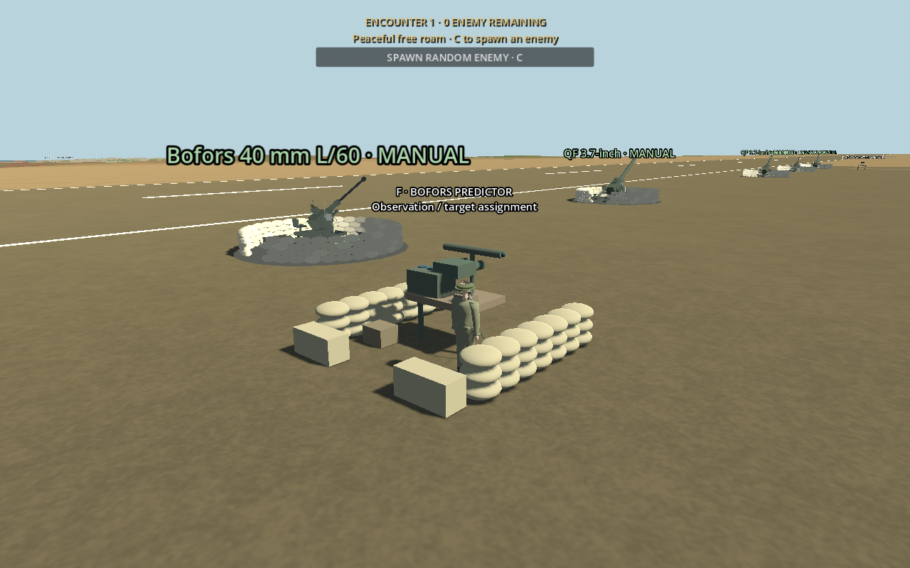
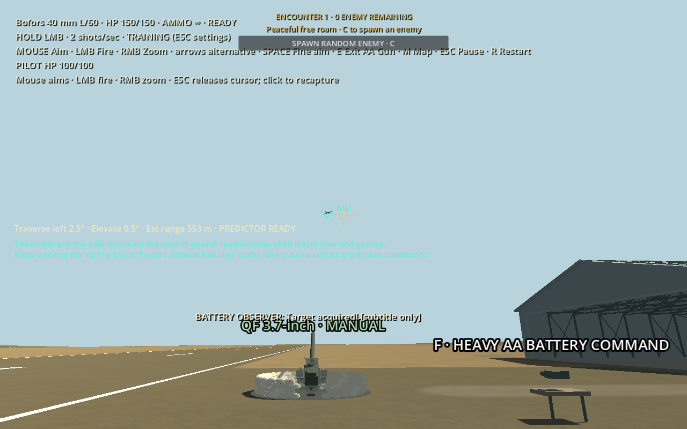
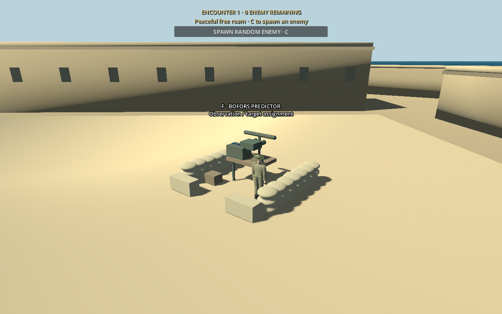

# Bofors command posts and predictor sights

Added 24 October 2026; extended on 26 October 2026 with direct player battery firing and switchable predictive assistance. These original, historically inspired models suggest a British AA observation position and Kerrison-style mechanical predictor; they do not reproduce a specific surveyed emplacement or an exact Kerrison mechanism.

## Where and how to operate

Each airfield has a predictor near its existing pair of Bofors guns. A fourth post serves Fort St Elmo's three guns, on the accessible upper courtyard near the original fort soldier spawn. The original three heavy-AA command stations remain separate.

| Location | Control |
|---|---|
| On foot, near a predictor | **F** enters; no remote mounting |
| Observation equipment | Mouse lays the connected guns; **RMB** magnifies; **hold LMB** fires |
| Observation equipment | **B** toggles battery aim assist; **Tab** selects a visible target |
| Observation equipment | **G** cycles whole-battery / individual-gun scope; **Enter** assigns the current target |
| Observation equipment | **F or E** exits to the soldier |
| At a Bofors | **E** mounts; mouse aims; **LMB** fires; **RMB** zooms |
| Mounted gun or post | **Esc** opens settings: choose Manual, Assisted or Training; resume and click to recapture the mouse |

The post now controls the existing guns while occupied. **Assist OFF** is the default: guns converge on the sight ray (terrain intersection or 1,500 m) without target leading or gravity correction. **B** enables measured predictive assistance: select a visible enemy with **Tab**, then **Enter** to assign it to the selected scope. Gun barrels move toward their individual lead solutions at their existing traverse/elevation rates. In either mode, only holding **LMB** authorizes shots; release stops further rounds. A changed mode/scope, Help, pause, dismount, destruction or mission end cancels the trigger authorization. All guns retain their independent 0.5-second reload and existing muzzle projectiles, dispersion, ballistics and damage.

Assignments remain while the player walks to the gun. The existing observer NPC maintains the already acquired track using line of sight; it does not discover new targets for the player. Each post tracks one aircraft at a time. Individual scope assigns only that gun; battery scope assigns the common target to every operational Bofors in that group.

## Individual-gun sight modes

These saved pause-menu modes apply to individually mounted gun sights. They are separate from the post’s **B** battery-assist toggle, which resets with a fresh world.

- **Manual** is the fresh-install default: the ordinary gold reticle, with no predictive marker.
- **Assisted** shows a cyan lead diamond, estimated range, traverse/elevation corrections and an approximate **ON TARGET** indication. The gold reticle follows the actual barrel. Amber indicates unsettled tracking.
- **Training** enlarges the diamond and adds short instructions explaining lead, shell travel time, gravity and manoeuvring uncertainty. The existing visible physical tracers remain enabled; no separate fake projectile path is drawn.

These modes replace the earlier automatic aim nudge. `BoforsAimAssist` now supplies read-only sight data: it does not select targets, move the barrel, fire or alter projectiles. Select the preferred mode in the pause panel; it is saved alongside sensitivity in `user://aa_controls.cfg`. An old enabled assist preference migrates to Assisted.

Heavy AA retains its original five-second single-shot reload and commanded salvo system. Bofors retain unlimited ammunition, automatic 0.5-second reload and existing dispersion/damage. Fort St Elmo's existing explicit **B** gunner relay is retained; the command post now supports player-directed laying and firing; no unoccupied post selects targets or initiates shots.

## Observation and prediction

The optics search only while occupied, at a throttled interval, within the camera frustum and a configurable 4,000 m observation range. Terrain, structures and friendly aircraft obstruct observations. Ordinary omnidirectional enemy HUD widgets are hidden while using the predictor; its navigation chart contains only the current measured contact. Other existing mission views retain their previous markers.

Target range, altitude and heading derive from noisy observations. Velocity is estimated from successive position measurements and smoothed; it is not copied from the aircraft's perfect live velocity. Sharp movement increases estimated acceleration and temporarily lowers confidence. Loss of line of sight immediately removes the current solution; sustained loss clears the track and assignment. It does not automatically reacquire when the obstruction clears.

`AAFireControl.solve` supplies the existing numerical constant-velocity intercept solution. Each gun uses its **own muzzle position**, weapon speed, projectile-pool gravity and maximum shell lifetime. Default Bofors values remain 850 m/s and 9.81 m/s². Range and the gun's actual elevation envelope also gate validity. An infeasible solution produces **OUTSIDE FIRING ENVELOPE**, both at the post and at the gun.

The cyan diamond is the straight sight direction needed to compensate shell drop; it differs from the aircraft's predicted future position. The real shell then follows gravity through `ProjectilePool` and must hit through swept collision. A steady-track solution is an estimate, not a promise of a hit against a manoeuvring aircraft. Alignment uses the configured 1.2° sight tolerance and sufficient tracking confidence.

```mermaid
flowchart LR
    P[Player aims, assigns and holds fire] --> O[BoforsCommandPost]
    O --> V[Frustum, range and line of sight]
    V --> T[Measured position and estimated velocity]
    T --> S[AAFireControl.solve per gun muzzle]
    P --> C[Occupied post manual sight or assisted laying]
    S --> C
    C --> L[Rate-limited gun traverse and elevation]
    L --> F[Held player trigger and per-gun reload]
    F --> G
    S --> D[BoforsAimAssist read-only data]
    D --> H[AAAimReticle lead diamond and corrections]
    H --> M[Player manually aims and fires]
    M --> G[BritishAAGun actual barrel]
    G --> R[ProjectilePool gravity and swept collision]
    R --> A[Existing aircraft component damage]
```

## Damage, personnel and calls

The post has 150 HP using the existing British AA damage API. Its equipment and sandbag colliders receive real bullets and bomb blasts. Destroying the post invalidates assignments and ejects a mounted player to a checked exit; it does not destroy or repair connected guns. Independent mission failure rules still apply, including the player's death.

The observer reuses the existing khaki British avatar, helmet, health and walking transitions, with a ground-level standing position. If that observer dies, an unoccupied post cannot maintain assistance. The player can still operate surviving equipment personally, but cannot simultaneously replace a dead observer and operate a remote gun. A full retry restores the original personnel and equipment.

The radio queue provides bearing, yards, acquisition, assignment, readiness, fire and lost-target calls. **No new recordings were supplied for these lines. They use labelled subtitle fallbacks.** Optional recordings can be assigned through `BoforsCommandPost.call_recordings`: `acquired`, `assigned`, `ready`, `fire`, `lost`. Variable reports require exact keys such as `bearing_090` or `range_1500`, so a fixed recording cannot announce the wrong value. No unrelated speech is substituted. Calls share existing radio arbitration and ducking when a recording is assigned.

## Implementation and tuning

- [BoforsCommandPost](../scripts/bofors_command_post.gd) reuses `AACommandStation` construction, health, optics and interaction type; overrides heavy single-salvo handling with a held player trigger, manual sight convergence or optional measured predictor laying.
- [AirfieldAABattery](../scripts/airfield_aa_battery.gd) owns a separate `bofors_posts` collection, connects existing guns and emits a late-placement registration signal. The original heavy `command_stations` collection remains three stations.
- [StElmoBattery](../scripts/st_elmo_battery.gd) waits for physics registration, checks sky-facing floor height and footprint support, then casts a soldier capsule along the approach route. It never changes fort geometry.
- [AirfieldInteraction](../scripts/airfield_interaction.gd) supplies nearby F entry, exclusive input, camera restoration, safe exits and destruction handling.
- [BoforsObserverCrew](../scripts/bofors_observer_crew.gd) adapts the existing observer avatar's stance and transitions.
- [AAMouseControls](../scripts/aa_mouse_controls.gd), [BoforsAimAssist](../scripts/bofors_aim_assist.gd) and [AAAimReticle](../scripts/aa_aim_reticle.gd) supply saved modes and display without steering.
- [BritishAAGun](../scripts/british_aa_gun.gd) associates the post with its existing weapon; [AAWeaponDefinition](../scripts/aa_weapon_definition.gd) exposes alignment tolerance. Neither changes projectile ballistics.
- [MaltaMission](../scripts/malta_mission.gd) supplies mode settings and measured chart contacts; [EnemyEncounters](../scripts/enemy_encounters.gd) hides omnidirectional widgets only in predictor optics. [WebSupport](../scripts/web_support.gd) adds opt-in smoke-test telemetry.
- [DiveDefenceMission](../scripts/dive_defence_mission.gd) allows the existing Stuka ground-attack controller to select the local predictor. Existing bomb blast receivers also include the fort post; harbour bomber objectives remain the forts.

Exported post parameters include `manual_sight_range` (1,500 m), `battery_aim_assist` (false), inherited `firing_tolerance_degrees`, observation range/interval, lost-track allowance, settling time, measurement error and optional recordings. `AAWeaponDefinition.predictor_alignment_degrees` controls the sight tolerance. The one-observer search is throttled and only known tracks are maintained; it does not run map-wide searches for every gun every frame.

## Short test procedure

1. Spawn at St Elmo, walk to the nearby predictor and press F. Confirm binocular zoom and that unseen aircraft have no automatic labels.
2. With assist OFF, mouse-aim above the horizon and hold LMB: connected operational guns should fire from their own barrels. Release and verify immediate cessation. Use G to select one gun or the whole battery.
3. Press B for assist ON, select an aircraft with Tab, then assign with Enter. Read estimated range/altitude/heading; hold LMB for assisted fire. Switch B off to resume manual laying.
4. Exit, mount an assigned Bofors and choose Assisted or Training. Put the gold reticle on the cyan diamond and fire. Confirm no firing occurs until you press fire.
5. Compare stationary, crossing and sharply turning targets. Compare the lead for separated guns; move outside the range/elevation envelope and check the warning.
6. Obscure the target behind terrain or a structure. The solution should disappear, followed by Target lost; it must not silently track through cover.
7. Destroy the predictor. Operate a surviving gun manually. Retry and confirm four healthy, unassigned posts and the original guns.

The [latest battery-fire report](development-updates/2026-10-26-bofors-post-fire.md) records current checks and limits. The [original predictor report](development-updates/2026-10-24-bofors-predictor.md) preserves validation of the former observation-only design. Screenshots use controlled target/camera fixtures; they are not a complete human combat playthrough. The instrument is a simplified original model, and dedicated hand-on-instrument animations are not supplied.
