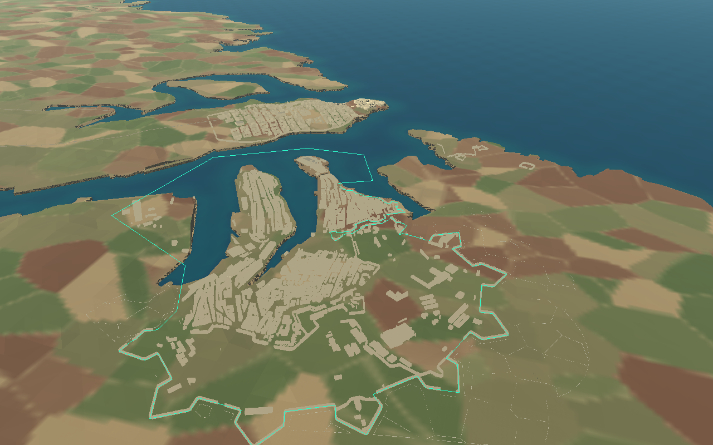

# Cottonera enclosure and Maltese rubble walls

Cottonera now retains generated buildings only inside the reviewed outer enclosure. It contains **2,230 ordinary buildings**, compared with 2,575 previously compiled. The footprint filter accepts 2,250 building/warehouse/church records before the existing terrain, road-clearance and height checks, and excludes **350 records: 346 outside and four crossing**. Filtering occurs before any building model, windows, roof, balcony or collision is generated. No source footprints or other Malta settlements were edited.

## Boundary and individual crossing review

The boundary uses the original supplied Overpass extract, not a convex hull or city-name grouping:

- Outer Cottonera Lines: **`way/691540426`**, all 107 supplied stations. The existing AOI selection had clipped this into a MultiLineString, which the previous compiler skipped. The compiler now accepts multi-part lines and renders the complete original outer alignment, retaining road/gate clearance.
- Harbour-facing Birgu landfront: **`way/397742452`**, source vertices 0–55. The remaining stations double back around the wall face; they are not used as a second perimeter edge. The visual source feature remains untouched.
- Inner Santa Margherita alignments, including **`way/47325460`, `way/47325522`, `way/148709248`, `way/154154764`**, remain rendered but do not define building eligibility.
- The open landward wall is closed through the harbour and western dockyard using explicit reviewed geographic vertices in [landscape_rules.json](../assets/malta/cottonera/landscape_rules.json). This **editorial enclosure is not a claim that a defensive wall spans the water or dockyard**. It includes Birgu, Senglea and Bormla while excluding exterior development. All coordinates use the existing EPSG:32633 → metre-scale Godot projection. Terrain/coastline remain unchanged.

Whole polygon footprints, including every vertex and courtyard hole, must be covered by the boundary. No centroid rule is used. The four crossings were inspected as individual plan outlines and have explicit decisions:

| Supplied footprint | Decision |
|---|---|
| `way/85258354` | Remove the long shed straddling the western dockyard closure; avoid leaving half a shed. |
| `way/138441490` | Remove the large western footprint lying predominantly outside. |
| `way/397967726` | Remove the structure crossing the Birgu junction/bastion alignment; preserve fortifications. |
| `way/399234883` | Remove the exterior structure with only a tiny interior sliver. |

A new crossing without a review entry stops generation with an error. This prevents future data changes silently introducing chopped buildings. Forts, bastions, wall meshes, gates, lookout structures, roads and military objects bypass the building filter. Independently generated Valletta, Mdina and other Malta scenery are preserved, even if visible beyond the enclosure.

In Godot's **Remote** scene tree, select `MaltaWorld/CottoneraRegion` and enable **Show Boundary Debug**. It draws the exact eligibility enclosure in cyan, without collision; default is off. The line across harbour water is the documented editorial closure, not newly generated wall geometry.

## Inferred agricultural layout

The supplied extract has no agricultural parcel boundaries. Its two farmyard tags do not supply a field network, and the existing painted terrain patches are visual colour regions rather than surveyed plots. The new **102 irregular plots** are explicitly inferred, seeded deterministically with 1942. They use jittered 125 m Voronoi cells clipped to open land within 260 m of the outer wall, inside the existing Cottonera generation area. They are independent of removed building footprints: a cleared house does not become a separate field. Roads and preserved structures can split a plot; fragments below 650 m² are omitted.

Approximately **10,276 m** of ħitan tas-sejjieħ follow their noded shared boundaries. Neighbours share a wall rather than overlapping copies. Deliberate access gaps supplement mapped road/footway openings. Wall envelopes stay outside the fortified interior, at least 12 m from the coast, clear of defensive geometry and gates, and beyond mapped road/footway widths plus a 3.5 m margin. Existing gameplay road corridors are included. No wall is placed in water or through retained buildings/fortifications.

Walls are approximately **0.8–1.2 m high**, with a **0.68 m base narrowing to 0.38 m**, irregular courses and irregular chipped stones in muted limestone colours. Sections sample the actual terrain at both ends and midpoint; steep discontinuities are omitted. Bases are inset slightly into the ground. Existing terrain is not flattened or recoloured.

## Files, regeneration and performance

- [tools/cottonera/landscape.py](../tools/cottonera/landscape.py): boundary, footprint audit, inferred plots, road/structure exclusions, access gaps, reusable stone topology and terrain fitting.
- [tools/build_cottonera.py](../tools/build_cottonera.py): pre-generation building exclusion, complete outer-line handling, separate field batches, and deletion of obsolete generated GLBs/import metadata.
- [landscape_rules.json](../assets/malta/cottonera/landscape_rules.json): geographic source IDs, closure, individual reviews and field dimensions/seed/clearances.
- `assets/malta/cottonera/region.json` and generated region GLBs: updated visual tiers, collision, audit, plot/section records and optional debug points. Removed building chunks/import files are deleted rather than left orphaned.
- [scripts/cottonera_region.gd](../scripts/cottonera_region.gd): optional overlay and field-specific distance tiers.
- Python/Godot checks and capture fixtures; this guide, updated Cottonera guide/README and incremental history.

The offline generator needs NumPy, Shapely 2, trimesh, pyproj, matplotlib and triangle; these are already installed in this environment’s GIS virtual environment. No GIS library is required by the game. Run `/tmp/malta-geo-venv/bin/python tools/build_cottonera.py`, then `godot --headless --editor --import --quit`. Source preparation remains unchanged. The compiler only writes Cottonera-generated files. A full second build into a temporary directory checks reproducibility against the shipped assets.

Stone geometry is merged into **42 field batches**, using the same material and reusable topology. Close stones appear below 160 m, simpler irregular wall courses from 160–2,500 m and coarse silhouettes from 2,500–8,000 m. Simple merged strips handle collision; no stone has a separate physics body. The complete region has **130 persistent collision chunks**, compared with 145 before this change. Visual tiers together contain about **3.05 million triangles**; these alternatives are not all displayed together. This adds close-range detail and download size; native capture is not a frame-rate guarantee for every browser/device.

## Validation and limits

Available checks passed: **20 Cottonera runtime, 17 Valletta, 24 Mdina, 39 airfield-ground, 21 landscape, 10 compiler pipeline, 14 importer and 15 source assertions — 160 total**. These include full footprints/clearances, real collision rays, cleared exterior roof locations, retry and protected-world hashes. A full temporary regeneration compares every one of the 622 generated GLBs and all landscape metadata. Native aerial, boundary-overlay and walking-height captures use the actual continuous world through [tests/cottonera_landscape_capture.gd](../tests/cottonera_landscape_capture.gd). The initial render revealed inward stone faces; winding was corrected before the final rebuild.

This remains a source-based, approximate WWII-inspired environment, not a wartime cadastral survey. The dockyard closure and agricultural plots are editorial inferences. Existing unsupported polygon-gate templates, modern-source uncertainty, schematic fort details and coarse coastal terrain remain limitations. No human walked/drove every field opening or gun interaction. Web export/browser rendering and device-specific performance were not tested in this environment; web templates are unavailable. No gameplay controller, mission, gun or airfield-placement code was changed.
