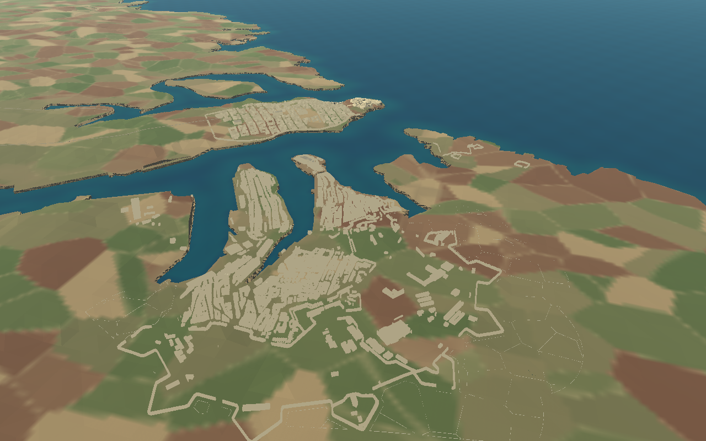
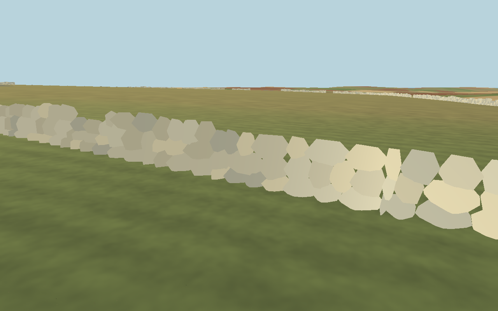

# Cottonera — supplied-footprint 3D environment

Cottonera is now populated in every continuous Malta environment using the
user-supplied `cottonera.geojson`. The terrain, coastline, geographical scale,
roads, airfields and mission coordinates remain unchanged. Fly southeast across
Grand Harbour from Valletta, or use **M** and the Birgu, Isla and Bormla labels.
This is a source-based, historically inspired model, **not a verified 1942 survey**.

The [outer-enclosure and inferred field-wall update](cottonera-fields.md) removes exterior generated buildings and adds terrain-fitted agricultural walls.

## What is built

- **2,230 buildings** derived from actual supplied OSM footprints, with flat
  roofs, parapets, windows, doors, balconies and retained courtyard holes.
- **39 mapped fortification features**, using limestone walls and battered faces.
- Fort St Angelo on its supplied polygon, with schematic terraces and batteries.
- Saint Lawrence, Immaculate Conception, a Gardjola lookout and other source
  churches; their architectural details remain original schematic templates.
- Mapped street/footway surfaces and reserved clearance around existing game roads.
- **130 persistent collision chunks** and three distance-based visual tiers.
  Buildings and walls block existing physical bodies and swept projectile rays.




The original unfiltered city captures remain as historical previews; the images above show the current revision.

## Data selection and projection

The supplied file identifies itself as an Overpass Turbo OpenStreetMap extract,
timestamp **2026-10-16T17:43:36Z**, licensed **ODbL**. It contains **7,551** features
and includes Valletta and neighbouring districts. The untouched input is retained
in `assets/malta/cottonera/source/supplied-cottonera.geojson`.

[prepare_supplied_cottonera.py](../tools/prepare_supplied_cottonera.py) defines an
explicit editorial area of interest south of Grand Harbour to avoid rebuilding
Valletta. That polygon is a selection envelope, **not a municipal or historic
boundary**. It selects 4,231 records; the existing importer accepts 4,209 after
excluding unsupported context and known modern features. All imported polygon
vertices and courtyard holes remain identical to the input. Long road alignments
may be clipped at the selection envelope. The normalized dataset records the
input SHA-256, licence, skipped records and selection extent.

Nearest GeoNames anchors assign features to four **rendering groups** named
Birgu, Senglea, Bormla and Kalkara. These labels do not establish municipal
ownership or reviewed historic boundaries. They do not move geometry. Specific
landmark roles use supplied feature IDs/names rather than random placement.

The existing projection is EPSG:32633, relative to `(14.4 E, 35.93 N)`:
**X = easting − origin easting; Z = origin northing − northing; one unit = one
metre.** Heights are sampled from the unchanged imported Malta terrain, including
existing road-ground patches. SHA-256 checks protect `terrain.glb`, coastline,
`world_data.json` and `roads/world_paths.json`.

## Generation and runtime

```sh
/tmp/malta-geo-venv/bin/python tools/prepare_supplied_cottonera.py \
  assets/malta/cottonera/source/supplied-cottonera.geojson
/tmp/malta-geo-venv/bin/python tools/build_cottonera.py
godot --headless --editor --import --quit
```

The compiler uses the existing reusable template library and emits 180 m mesh
batches. `CottoneraRegion` loads one region inside the same `MaltaWorld`, with no
travel transitions. Detailed facade meshes appear below 700 m, structure meshes
below 5 km and simplified skyline masses from 5–16 km. Collision remains loaded
across visual LOD changes. Compiled visual tiers total approximately 3.05 million
triangles; this counts alternative representations together, not simultaneous
on-screen triangles. Static batching, visibility culling and imported mesh LODs
limit rendering cost. Full-region frame-rate guarantees are not established.

The source GeoJSON and processing files are excluded from the web runtime export;
compiled models, manifest and required attribution are shipped. No network/GIS
runtime dependency is introduced. Mission retry frees and recreates one populated
Cottonera region, preventing accumulated geometry/collision duplicates.

## Limits and historical accuracy

Modern OSM footprints do not prove wartime layouts. Explicitly dated post-1942
construction is filtered, but undated modern buildings may remain. There are no
fabricated bomb ruins, yachts or arbitrary replacement docks. The two historic
defensive systems are distinguished in the [reviewed enclosure and rubble-wall update](cottonera-fields.md). The outer source line is now rendered even where the old selection produced multi-part geometry. Generic unnamed walls retain their existing classification. The dockyard/dry-dock reconstruction and Inquisitor's Palace identification remain incomplete. Two polygon gate features are still reported as unsupported rather than filled with solid blocks. One excessive building height remains skipped.

Fort St Angelo and church exteriors are recognizable procedural interpretations
inside their mapped footprints, not measured facade replicas. Buildings do not
have complete interiors. Continuous on-foot/driving traversal of every street
and historical landmark access are not yet manually verified. The existing
unplaced-template gallery remains available with F6 on
`scenes/cottonera_asset_review.tscn`; it is separate from the mapped scenery.

## Checks

Source checks verify retained polygon geometry, provenance, landmark roles,
editorial scope, generated geometry/collision and protected-world hashes.
Native region checks verify actual mesh/collision loading, grouping, debug
visibility, LOD distances, gate-template ray collision, existing airfield/AA
counts and clean region recreation. Native captures above render the real Malta
world through Compatibility. Detailed results are recorded with the final change.

Current enclosure/field-wall revision: **160 checks/assertions passed**, including 20 native Cottonera checks, protected-world hashes, actual collision rays and surrounding-city/airfield regressions. Full regeneration matches all 622 compiled GLBs and landscape metadata. The [current guide](cottonera-fields.md) has the complete boundary, test counts and limitations. Native Compatibility screenshots above show this revision.

Historical supplied-data baseline validation included a web export and Chromium/ANGLE checks (28/28). Those results predate the enclosure/field changes and do not establish current browser behaviour. Web export/runtime was not retested for this revision because this environment has no web templates. Full-city walking/driving and device-specific performance remain unverified.
