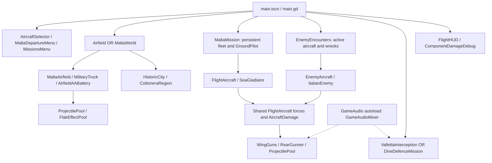

# 01 — Project overview

[Contents](README.md) · [Timeline](02-development-timeline.md) · [Architecture](03-architecture.md)

## Origin and scope expansion

The earliest available commit, [64406b0](https://github.com/zelenski3398/codexproj1/commit/64406b082d49576bf5c0ec8c95367530dab9ab2c) on 7 October, describes **First Sortie**, a single-player Spitfire flight trial over a procedural countryside airfield. Its actual tree contains force-driven aircraft motion, three-wheel ground handling, a chase camera, HUD, pause/reset and flight checks. It explicitly excludes combat in that version's README. The repository begins with that working implementation; it does not reveal the preceding modelling or design process.

Combat arrived on 8 October through eight wing guns, pooled swept projectiles, hull health, smoke/fire and a stationary test target ([b0bdb4f](https://github.com/zelenski3398/codexproj1/commit/b0bdb4f02babf34094c9ee2e1ff58e011672c721)). A flying Stuka then replaced the target in the running encounter ([236dbf0](https://github.com/zelenski3398/codexproj1/commit/236dbf093e2ba78afd3742a4dbd52b9df0685a56)). Sea Gladiator selection followed on 9 October ([d3dea47](https://github.com/zelenski3398/codexproj1/commit/d3dea47a244651baacf17f334f4d14f2d8c3894a)). On 10 October the project added localized damage, a rear gunner, web export and the continuous Malta world. Later commits added ground boarding, vehicles, distinct mission directors, heavy/light AA, battery command, sounds and additive historic cities. These are observed feature additions; the history does not establish an overarching original design rationale for the expansion.

## Present game

At the snapshot this is a single-player WWII Malta flight-and-ground combat prototype. The original countryside environment remains selectable. Malta is one continuous world with Ta' Qali, Luqa and Ħal Far, parked flyable aircraft and persistent state during a session. Implemented modes are ordinary encounters, five-stage Malta Survival, the Italian interception and six-wave ground AA defence. The latter is an AA-only mission, despite earlier requests discussing aircraft fallback; see [mission rules](09-missions-and-ai.md).

The two player airframes are Spitfire Mk I and Gloster Sea Gladiator. The Sea Gladiator is an interwar design used during WWII, not a WWI aircraft. Four enemy types are represented by `EnemyAircraft`/`ItalianEnemy`: Ju 87 Stuka, Macchi C.200, Fiat CR.42 and SM.79. Their visuals are original prototype geometry, not licensed production aircraft models. The technology is suitable for accessible gameplay rather than engineering-grade aircraft simulation.

## Technology and composition

| Layer | Verified implementation |
| --- | --- |
| Runtime | Godot 4, GDScript; Compatibility renderer; 120 Hz physics configured in [project.godot](../../project.godot) |
| Entry | [main.tscn](../../main.tscn), Node3D `FirstSortie`, composed by [main.gd](../../scripts/main.gd) |
| Physics | `RigidBody3D` aircraft; `CharacterBody3D` walking/truck; static terrain and city colliders |
| Gameplay assets | Procedural mesh classes, imported GLBs, `.tres` tuning resources, offline-generated JSON |
| Geography/tooling | Python GIS/mesh generators; bundled terrain, textures and charts; no Python/GIS runtime dependency |
| Audio | Ogg resources, spatial aircraft/gun sources, `GameAudio` autoload and mission radio |
| Browser | Single-thread WebGL 2 export, custom HTML shell, GitHub Actions/Pages |
| Checks | Native GDScript fixtures, Python data-pipeline checks and Playwright browser scripts |

There are **2 tracked scenes**, not one aircraft scene per airframe: the playable main scene and a standalone Cottonera review gallery. Aircraft are constructed by scripts and resource definitions. See the [statistics](02-development-timeline.md#development-statistics) for precise counting rules.

## Current high-level architecture

The diagram follows construction in `main.gd`, `MaltaWorld._ready`, `MaltaMission._ready` and `FlightAircraft._ready`. `EnemyEncounters` tracks active aircraft and falling wrecks, while separate directors own mission-specific conditions. `GameAudio` is the sole project autoload; no global world-streaming, campaign or save manager is configured.

## Boundaries and limitations

Valletta and Mdina are placed, terrain-fitted, reference-inspired scenery. They are not surveyed wartime reconstructions. Cottonera is **awaiting geographic data**, with empty runtime chunks and unplaced review templates ([588ac7b](https://github.com/zelenski3398/codexproj1/commit/588ac7b1b37b72014b73fe679871e790e5c79145), [manifest](../../assets/malta/cottonera/region.json)). Road alignment and airfield layouts are approximate. Persistence is within the live mission, not a disk save; no refuelling service or campaign is implemented. See [current state](13-current-state-and-roadmap.md) for source-backed limitations and testing distinctions.
