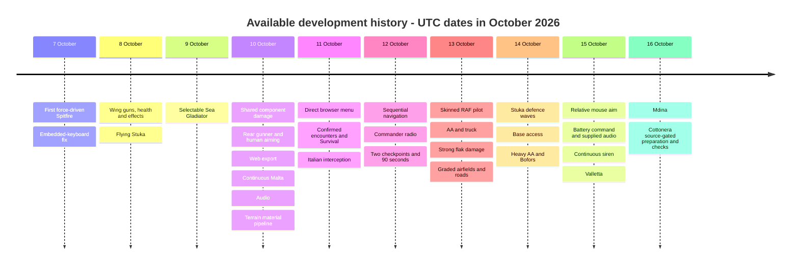
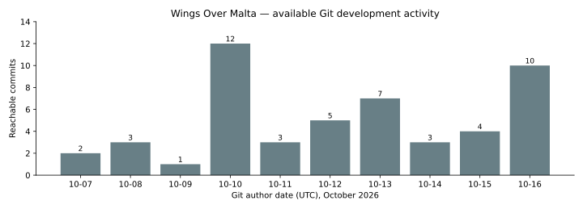

# 02 — Complete available development timeline

[Contents](README.md) · [Every commit](14-commit-reference.md)

The **23 milestones** below group all 50 inspected commits once each. Related changes may span non-contiguous commits; dates reflect actual author timestamps in UTC, not inferred work duration. Within each milestone the commit links expose original diffs. These groups are a reader's organization, not Git tags/releases or claims of independent shipped versions.

## Milestone evidence table

| ID | UTC date/range | Milestone | Historical evidence |
| --- | --- | --- | --- |
| M01 | 2026-10-07 | [Flight prototype and embedded input](#m01) | [64406b0](https://github.com/zelenski3398/codexproj1/commit/64406b082d49576bf5c0ec8c95367530dab9ab2c), [81703b4](https://github.com/zelenski3398/codexproj1/commit/81703b4933e0ca1391448c5c423ac28ae66b93f0) |
| M02 | 2026-10-08 | [Wing weapons, health and parser correction](#m02) | [b0bdb4f](https://github.com/zelenski3398/codexproj1/commit/b0bdb4f02babf34094c9ee2e1ff58e011672c721), [83e6073](https://github.com/zelenski3398/codexproj1/commit/83e60738746ed2a2b4c2dcd75316e8c62f9c8579) |
| M03 | 2026-10-08 | [First flying hostile](#m03) | [236dbf0](https://github.com/zelenski3398/codexproj1/commit/236dbf093e2ba78afd3742a4dbd52b9df0685a56) |
| M04 | 2026-10-09 | [Selectable Sea Gladiator](#m04) | [d3dea47](https://github.com/zelenski3398/codexproj1/commit/d3dea47a244651baacf17f334f4d14f2d8c3894a) |
| M05 | 2026-10-10 | [AI safety, teams and wreck lifecycle](#m05) | [fc44efa](https://github.com/zelenski3398/codexproj1/commit/fc44efa7a43f2066de9a2edbf2b472e8d2c6f7d6) |
| M06 | 2026-10-10 | [Mechanical component damage](#m06) | [f1b9d05](https://github.com/zelenski3398/codexproj1/commit/f1b9d0576c98425770df6809fdc7048f87ac04a0) |
| M07 | 2026-10-10 | [Rear defence and human aiming](#m07) | [63d4277](https://github.com/zelenski3398/codexproj1/commit/63d427747d0709d756d36ae3f33c24cc11157894), [850e33c](https://github.com/zelenski3398/codexproj1/commit/850e33c953b3b3289dcacbbf40a34e2b94df8b35) |
| M08 | 2026-10-10 | [Web delivery and transient domain edits](#m08) | [bf0a11c](https://github.com/zelenski3398/codexproj1/commit/bf0a11c9be53bb888cd0052b3111e5f43df295e2), [c7b1f6c](https://github.com/zelenski3398/codexproj1/commit/c7b1f6cc7a9acc5d49b39472a31e411b00aa3534), [3f16951](https://github.com/zelenski3398/codexproj1/commit/3f1695169907679e4e43bea42e452c346993cc4d), [b093bc2](https://github.com/zelenski3398/codexproj1/commit/b093bc28793648fd28ebb7ef963513086ada5055) |
| M09 | 2026-10-10 | [Continuous Malta and ground fleet](#m09) | [1f83c99](https://github.com/zelenski3398/codexproj1/commit/1f83c99653e2804b811dadc8905e88f94a72d208) |
| M10 | 2026-10-10 | [Supplied audio and mixer](#m10) | [f5d9e76](https://github.com/zelenski3398/codexproj1/commit/f5d9e76f94e652b336f05afc993af24f0fa23d48) |
| M11 | 2026-10-10 | [Controlled terrain appearance and landscape](#m11) | [4a716c0](https://github.com/zelenski3398/codexproj1/commit/4a716c086b380b59ccfc68ad373ae6ee2045de87), [e2f8451](https://github.com/zelenski3398/codexproj1/commit/e2f84517d23337779a67f04d15ffc95e68a6e4bb) |
| M12 | 2026-10-11 | [Browser opens game menu](#m12) | [af88162](https://github.com/zelenski3398/codexproj1/commit/af8816231ea8e7acba182be5ce0a3e29906ce6c5) |
| M13 | 2026-10-11 | [Continuous encounters and Survival](#m13) | [ab97726](https://github.com/zelenski3398/codexproj1/commit/ab97726e08ff5e59691e28e8115cda4f152c04c3) |
| M14 | 2026-10-11 to 2026-10-12 | [Italian airframes and interception revisions](#m14) | [ac7fbac](https://github.com/zelenski3398/codexproj1/commit/ac7fbace7a0950d7d59e4413577a83a864a83553), [4a32579](https://github.com/zelenski3398/codexproj1/commit/4a32579b9cf1bfbc087df9847494d3104cffe84a), [90c99ef](https://github.com/zelenski3398/codexproj1/commit/90c99ef06854b6220e8690bd68657f518a6d7d86), [00351b1](https://github.com/zelenski3398/codexproj1/commit/00351b1f3fee6623381b5ed19ce0c7e9bdc25339), [7fe44a7](https://github.com/zelenski3398/codexproj1/commit/7fe44a78a74e81c67426c6852a2dc8211ceee7a9), [6729637](https://github.com/zelenski3398/codexproj1/commit/67296373d09e7f3768fed7eff69470fc96e3f1a9) |
| M15 | 2026-10-13 | [Original skinned RAF character](#m15) | [45a15f9](https://github.com/zelenski3398/codexproj1/commit/45a15f93a1c4ceee45a0c588f1c8c6e0aafe3265) |
| M16 | 2026-10-13 | [Friendly AA, manual conversion, truck and stronger flak](#m16) | [6a36276](https://github.com/zelenski3398/codexproj1/commit/6a362768d5065098bfce8f148181c382f6a93e6b), [5bbf563](https://github.com/zelenski3398/codexproj1/commit/5bbf563938cfd8544e40e205de8c645b51361525), [71b5195](https://github.com/zelenski3398/codexproj1/commit/71b5195c1f13751792fc75ddade4a8ca84409375), [8218544](https://github.com/zelenski3398/codexproj1/commit/82185442419146017a250afd730d17ed1cc998cd) |
| M17 | 2026-10-13 to 2026-10-14 | [Grounded airfields, island roads and base access](#m17) | [917c0da](https://github.com/zelenski3398/codexproj1/commit/917c0da15000ef138ba2b92eef85b4062c5fe34c), [451ad8b](https://github.com/zelenski3398/codexproj1/commit/451ad8b77dcf4ac2482c34e90cc9781bf3534619), [b135cdc](https://github.com/zelenski3398/codexproj1/commit/b135cdcb627bae94092c2781ea17503ce7e12b91) |
| M18 | 2026-10-14 | [Under Dive-Bomber Attack](#m18) | [88e17ba](https://github.com/zelenski3398/codexproj1/commit/88e17baa97591a6000022d116e846a640bc4d000) |
| M19 | 2026-10-14 to 2026-10-15 | [Heavy/light layering and mouse control](#m19) | [2157b72](https://github.com/zelenski3398/codexproj1/commit/2157b7227fe912762e000829a001c15294d9f097), [e26e5ed](https://github.com/zelenski3398/codexproj1/commit/e26e5edca54b0551bf27372109a26e8adfede36b) |
| M20 | 2026-10-15 | [Player-directed battery and supplied defence audio](#m20) | [eb5db64](https://github.com/zelenski3398/codexproj1/commit/eb5db645b24ac61e32de36e7aed320083e244c78), [6c0fbc9](https://github.com/zelenski3398/codexproj1/commit/6c0fbc90fdea1f0f46b5cca111c49c70e89d8ad9) |
| M21 | 2026-10-15 | [Fortified Valletta](#m21) | [bf96f9a](https://github.com/zelenski3398/codexproj1/commit/bf96f9a7e54330fcd1f74815be220e6dfc27132c) |
| M22 | 2026-10-16 | [Georeferenced Mdina and city loader reuse](#m22) | [814e308](https://github.com/zelenski3398/codexproj1/commit/814e30850bea4f3dbe098787d9a1898d95a434ba) |
| M23 | 2026-10-16 | [Cottonera source-gated preparation](#m23) | [29dc713](https://github.com/zelenski3398/codexproj1/commit/29dc7139900e16ab377fe263526e771f44aae3cf), [d3ca959](https://github.com/zelenski3398/codexproj1/commit/d3ca95977463bf2bcdd81235fd60055584af58d9), [dd9049a](https://github.com/zelenski3398/codexproj1/commit/dd9049a18c1896bb40ede5cd81781131da00ac08), [de2dd12](https://github.com/zelenski3398/codexproj1/commit/de2dd12ef323399919ae3ed63edddcd757a23755), [170f758](https://github.com/zelenski3398/codexproj1/commit/170f758220295caefde9890695b1e22718531253), [154a952](https://github.com/zelenski3398/codexproj1/commit/154a95239344d0190d4755be4e2834e7140f8d4f), [a4bf624](https://github.com/zelenski3398/codexproj1/commit/a4bf624afbf2a2ef6ad56580363ae174fc7a9ed8), [410ef4b](https://github.com/zelenski3398/codexproj1/commit/410ef4bb777e7efea0fe953cc6541ea2036f0b24), [588ac7b](https://github.com/zelenski3398/codexproj1/commit/588ac7b1b37b72014b73fe679871e790e5c79145) |

## Development statistics

| Measure | Value and interpretation |
| --- | --- |
| Reachable commits | 50 unique commits across inspected refs; zero merges |
| First available author date | 7 October 2026, 16:24:09 UTC |
| Snapshot author date | 16 October 2026, 06:59:46 UTC |
| Commits per month | October 2026: 50; no other months in available history |
| Runtime GDScript | 81 files under scripts/ |
| Test GDScript | 56 files under tests/; total tracked GDScript 137 |
| Python test scripts | 2; tests/ has 58 tracked code files excluding .uid |
| Browser test tools | 10 tracked tools/*.cjs scripts, counted separately from tests/ |
| Godot scenes | 2: main and standalone Cottonera asset gallery |
| Aircraft scenes | 0 dedicated aircraft .tscn files; six airframe types constructed by scripts/resources |
| Authored missions | 2 directors/definitions, plus generic encounter and Survival progression |
| Tracked resources | 22 .tres files |
| Snapshot tracked files | 510, before these new documentation files |
| Snapshot tracked blob bytes | 55,433,704 bytes; not working-tree/import-cache/export size |

[Daily CSV](activity.csv) and [machine-readable statistics](statistics.json) give the source values. All activity falls within ten calendar dates; no prior activity is inferred from the root's already-developed code. Commit/file/byte counts measure repository contents and timestamps, not effort, productivity or code quality.

### Historical project-size samples

`git ls-tree -r -l <sha>` supplies tracked blob sizes, including docs/assets and .uid files. Counts omit .git storage, untracked downloads, .godot imports and web build outputs. A file existing at multiple commits is counted once in each snapshot, not summed across history.

| Snapshot | Tracked files | GDScript including tests | Scenes | Tracked blob bytes |
| --- | ---: | ---: | ---: | ---: |
| [64406b0](https://github.com/zelenski3398/codexproj1/commit/64406b082d49576bf5c0ec8c95367530dab9ab2c) | 26 | 11 | 1 | 59,167 |
| [b0bdb4f](https://github.com/zelenski3398/codexproj1/commit/b0bdb4f02babf34094c9ee2e1ff58e011672c721) | 40 | 18 | 1 | 101,630 |
| [d3dea47](https://github.com/zelenski3398/codexproj1/commit/d3dea47a244651baacf17f334f4d14f2d8c3894a) | 56 | 26 | 1 | 171,441 |
| [1f83c99](https://github.com/zelenski3398/codexproj1/commit/1f83c99653e2804b811dadc8905e88f94a72d208) | 149 | 55 | 1 | 9,348,444 |
| [e2f8451](https://github.com/zelenski3398/codexproj1/commit/e2f84517d23337779a67f04d15ffc95e68a6e4bb) | 210 | 63 | 1 | 12,809,733 |
| [2157b72](https://github.com/zelenski3398/codexproj1/commit/2157b7227fe912762e000829a001c15294d9f097) | 411 | 116 | 1 | 41,875,870 |
| [bf96f9a](https://github.com/zelenski3398/codexproj1/commit/bf96f9a7e54330fcd1f74815be220e6dfc27132c) | 459 | 129 | 1 | 49,881,172 |
| [814e308](https://github.com/zelenski3398/codexproj1/commit/814e30850bea4f3dbe098787d9a1898d95a434ba) | 479 | 133 | 1 | 55,115,290 |
| [588ac7b](https://github.com/zelenski3398/codexproj1/commit/588ac7b1b37b72014b73fe679871e790e5c79145) | 510 | 137 | 2 | 55,433,704 |

## Milestone details

### M01 — Flight prototype and embedded input

**Date:** 2026-10-07. **Commits:** [64406b0](https://github.com/zelenski3398/codexproj1/commit/64406b082d49576bf5c0ec8c95367530dab9ab2c), [81703b4](https://github.com/zelenski3398/codexproj1/commit/81703b4933e0ca1391448c5c423ac28ae66b93f0).

**Before:** No earlier tree is available.

**Change and capability:** Playable single Spitfire, countryside runway, physical lift/ground support and keyboard-forwarding fix.

**Technical consequence / current status:** Shared flight core retained; controls expanded.

**Key changed files:** [main.tscn](../../main.tscn), [scripts/aircraft.gd](../../scripts/aircraft.gd), [scripts/airfield.gd](../../scripts/airfield.gd), [scripts/chase_camera.gd](../../scripts/chase_camera.gd), [scripts/hud.gd](../../scripts/hud.gd), [scripts/landing_gear.gd](../../scripts/landing_gear.gd), [scripts/main.gd](../../scripts/main.gd), [scripts/mesh_kit.gd](../../scripts/mesh_kit.gd)

**Problems and fixes:** Stores physical and logical key bindings in project.godot, handles HUD shortcuts before GUI navigation, removes runtime-only binding construction and adds keycode-forwarding regression tests.

### M02 — Wing weapons, health and parser correction

**Date:** 2026-10-08. **Commits:** [b0bdb4f](https://github.com/zelenski3398/codexproj1/commit/b0bdb4f02babf34094c9ee2e1ff58e011672c721), [83e6073](https://github.com/zelenski3398/codexproj1/commit/83e60738746ed2a2b4c2dcd75316e8c62f9c8579).

**Before:** Flight only, no weapons/HP.

**Change and capability:** Eight ports, swept pooled shots, hull/effects and stationary target; explicit parser-safe locals.

**Technical consequence / current status:** Core retained; stationary runtime target replaced.

**Key changed files:** [scripts/aircraft.gd](../../scripts/aircraft.gd), [scripts/damage_effects.gd](../../scripts/damage_effects.gd), [scripts/health.gd](../../scripts/health.gd), [scripts/hud.gd](../../scripts/hud.gd), [scripts/main.gd](../../scripts/main.gd), [scripts/pilot_input.gd](../../scripts/pilot_input.gd), [scripts/practice_target.gd](../../scripts/practice_target.gd), [scripts/projectile_pool.gd](../../scripts/projectile_pool.gd)

**Problems and fixes:** Changes inferred locals to explicit StandardMaterial3D, MeshInstance3D, Vector3, int and bool types in wing_guns.gd and weapons checks; observable runtime firing logic is otherwise retained.

### M03 — First flying hostile

**Date:** 2026-10-08. **Commits:** [236dbf0](https://github.com/zelenski3398/codexproj1/commit/236dbf093e2ba78afd3742a4dbd52b9df0685a56).

**Before:** Stationary test target.

**Change and capability:** Procedural Stuka, pursuit and return fire through shared flight controller.

**Technical consequence / current status:** Retained and extensively extended.

**Key changed files:** [scripts/aircraft.gd](../../scripts/aircraft.gd), [scripts/enemy_aircraft.gd](../../scripts/enemy_aircraft.gd), [scripts/enemy_pilot.gd](../../scripts/enemy_pilot.gd), [scripts/hud.gd](../../scripts/hud.gd), [scripts/main.gd](../../scripts/main.gd), [scripts/projectile_pool.gd](../../scripts/projectile_pool.gd), [scripts/stuka_model.gd](../../scripts/stuka_model.gd), [scripts/wing_guns.gd](../../scripts/wing_guns.gd)

**Problems and fixes:** No separate defect rationale established beyond the linked diffs; limitations and follow-up revisions are described in the relevant system chapter.

### M04 — Selectable Sea Gladiator

**Date:** 2026-10-09. **Commits:** [d3dea47](https://github.com/zelenski3398/codexproj1/commit/d3dea47a244651baacf17f334f4d14f2d8c3894a).

**Before:** Only Spitfire player choice.

**Change and capability:** Startup airframe selection, biplane mesh, fixed gear and lower force-driven performance.

**Technical consequence / current status:** Two player choices retained.

**Key changed files:** [scripts/aircraft.gd](../../scripts/aircraft.gd), [scripts/aircraft_selector.gd](../../scripts/aircraft_selector.gd), [scripts/hud.gd](../../scripts/hud.gd), [scripts/landing_gear.gd](../../scripts/landing_gear.gd), [scripts/main.gd](../../scripts/main.gd), [scripts/sea_gladiator.gd](../../scripts/sea_gladiator.gd), [scripts/sea_gladiator_model.gd](../../scripts/sea_gladiator_model.gd)

**Problems and fixes:** No separate defect rationale established beyond the linked diffs; limitations and follow-up revisions are described in the relevant system chapter.

### M05 — AI safety, teams and wreck lifecycle

**Date:** 2026-10-10. **Commits:** [fc44efa](https://github.com/zelenski3398/codexproj1/commit/fc44efa7a43f2066de9a2edbf2b472e8d2c6f7d6).

**Before:** Basic pursuit/loss handling.

**Change and capability:** Terrain forecasts, bounded manoeuvres, teams, impact notification and delayed wreck disposal.

**Technical consequence / current status:** Shared by later enemies.

**Key changed files:** [scripts/aircraft.gd](../../scripts/aircraft.gd), [scripts/combat_teams.gd](../../scripts/combat_teams.gd), [scripts/destruction_burst.gd](../../scripts/destruction_burst.gd), [scripts/enemy_aircraft.gd](../../scripts/enemy_aircraft.gd), [scripts/enemy_pilot.gd](../../scripts/enemy_pilot.gd), [scripts/health.gd](../../scripts/health.gd), [scripts/hud.gd](../../scripts/hud.gd), [scripts/main.gd](../../scripts/main.gd)

**Problems and fixes:** No separate defect rationale established beyond the linked diffs; limitations and follow-up revisions are described in the relevant system chapter.

### M06 — Mechanical component damage

**Date:** 2026-10-10. **Commits:** [f1b9d05](https://github.com/zelenski3398/codexproj1/commit/f1b9d0576c98425770df6809fdc7048f87ac04a0).

**Before:** Hull HP alone controlled losses/effects.

**Change and capability:** Eight sensors/profiles, integrity-to-force/control factors, fuel hazards and F3 inspection.

**Technical consequence / current status:** Shared across six airframe profiles.

**Key changed files:** [scripts/aircraft.gd](../../scripts/aircraft.gd), [scripts/aircraft_component_definition.gd](../../scripts/aircraft_component_definition.gd), [scripts/aircraft_damage.gd](../../scripts/aircraft_damage.gd), [scripts/aircraft_damage_profile.gd](../../scripts/aircraft_damage_profile.gd), [scripts/aircraft_hitbox.gd](../../scripts/aircraft_hitbox.gd), [scripts/component_damage_debug.gd](../../scripts/component_damage_debug.gd), [scripts/damage_effects.gd](../../scripts/damage_effects.gd), [scripts/damage_hitbox_spec.gd](../../scripts/damage_hitbox_spec.gd)

**Problems and fixes:** No separate defect rationale established beyond the linked diffs; limitations and follow-up revisions are described in the relevant system chapter.

### M07 — Rear defence and human aiming

**Date:** 2026-10-10. **Commits:** [63d4277](https://github.com/zelenski3398/codexproj1/commit/63d427747d0709d756d36ae3f33c24cc11157894), [850e33c](https://github.com/zelenski3398/codexproj1/commit/850e33c953b3b3289dcacbbf40a34e2b94df8b35).

**Before:** No rear fire and limited pursuit; first gunner later over-effective.

**Change and capability:** Rear mount/tactics followed by sampled imperfect tracking, skill resources and hit telemetry.

**Technical consequence / current status:** Current human-limited rear gunner.

**Key changed files:** [scripts/enemy_aircraft.gd](../../scripts/enemy_aircraft.gd), [scripts/enemy_pilot.gd](../../scripts/enemy_pilot.gd), [scripts/hud.gd](../../scripts/hud.gd), [scripts/main.gd](../../scripts/main.gd), [scripts/rear_gunner.gd](../../scripts/rear_gunner.gd), [scripts/stuka_model.gd](../../scripts/stuka_model.gd), [scripts/wing_guns.gd](../../scripts/wing_guns.gd), [scripts/aircraft.gd](../../scripts/aircraft.gd)

**Problems and fixes:** No separate defect rationale established beyond the linked diffs; limitations and follow-up revisions are described in the relevant system chapter.

### M08 — Web delivery and transient domain edits

**Date:** 2026-10-10. **Commits:** [bf0a11c](https://github.com/zelenski3398/codexproj1/commit/bf0a11c9be53bb888cd0052b3111e5f43df295e2), [c7b1f6c](https://github.com/zelenski3398/codexproj1/commit/c7b1f6cc7a9acc5d49b39472a31e411b00aa3534), [3f16951](https://github.com/zelenski3398/codexproj1/commit/3f1695169907679e4e43bea42e452c346993cc4d), [b093bc2](https://github.com/zelenski3398/codexproj1/commit/b093bc28793648fd28ebb7ef963513086ada5055).

**Before:** Native project only.

**Change and capability:** Single-thread export, checked tools, Pages CI; deployment report and CNAME add/remove.

**Technical consequence / current status:** Export/CI retained; no CNAME or verified current live deployment.

**Key changed files:** [.github/workflows/web.yml](../../.github/workflows/web.yml), [export_presets.cfg](../../export_presets.cfg), [scripts/aircraft_selector.gd](../../scripts/aircraft_selector.gd), [scripts/hud.gd](../../scripts/hud.gd), [scripts/main.gd](../../scripts/main.gd), [scripts/web_support.gd](../../scripts/web_support.gd)

**Problems and fixes:** No separate defect rationale established beyond the linked diffs; limitations and follow-up revisions are described in the relevant system chapter.

### M09 — Continuous Malta and ground fleet

**Date:** 2026-10-10. **Commits:** [1f83c99](https://github.com/zelenski3398/codexproj1/commit/1f83c99653e2804b811dadc8905e88f94a72d208).

**Before:** Countryside mission with one player aircraft.

**Change and capability:** Projected terrain/chart, three coexisting fields, on-foot engine-off start and persistent boarding.

**Technical consequence / current status:** Retained; original raised ground replaced later.

**Key changed files:** [.github/workflows/web.yml](../../.github/workflows/web.yml), [assets/malta/source/build_terrain.py](../../assets/malta/source/build_terrain.py), [export_presets.cfg](../../export_presets.cfg), [scripts/aircraft.gd](../../scripts/aircraft.gd), [scripts/aircraft_selector.gd](../../scripts/aircraft_selector.gd), [scripts/airfield_installation.gd](../../scripts/airfield_installation.gd), [scripts/enemy_pilot.gd](../../scripts/enemy_pilot.gd), [scripts/ground_pilot.gd](../../scripts/ground_pilot.gd)

**Problems and fixes:** No separate defect rationale established beyond the linked diffs; limitations and follow-up revisions are described in the relevant system chapter.

### M10 — Supplied audio and mixer

**Date:** 2026-10-10. **Commits:** [f5d9e76](https://github.com/zelenski3398/codexproj1/commit/f5d9e76f94e652b336f05afc993af24f0fa23d48).

**Before:** Visual/combat game without integrated supplied audio.

**Change and capability:** Menu/engine/weapons sources, buses, settings and per-entity cleanup.

**Technical consequence / current status:** Extended by mission radio and defence sounds.

**Key changed files:** [.github/workflows/web.yml](../../.github/workflows/web.yml), [scripts/aircraft.gd](../../scripts/aircraft.gd), [scripts/aircraft_audio.gd](../../scripts/aircraft_audio.gd), [scripts/game_audio.gd](../../scripts/game_audio.gd), [scripts/main.gd](../../scripts/main.gd), [scripts/weapon_audio.gd](../../scripts/weapon_audio.gd), [scripts/web_support.gd](../../scripts/web_support.gd), [scripts/wing_guns.gd](../../scripts/wing_guns.gd)

**Problems and fixes:** No separate defect rationale established beyond the linked diffs; limitations and follow-up revisions are described in the relevant system chapter.

### M11 — Controlled terrain appearance and landscape

**Date:** 2026-10-10. **Commits:** [4a716c0](https://github.com/zelenski3398/codexproj1/commit/4a716c086b380b59ccfc68ad373ae6ee2045de87), [e2f8451](https://github.com/zelenski3398/codexproj1/commit/e2f84517d23337779a67f04d15ffc95e68a6e4bb).

**Before:** Importer exposed elevation colours in normal play.

**Change and capability:** Explicit neutral override then bundled landscape shader; F4 opt-in heatmap.

**Technical consequence / current status:** Landscape is normal; neutral material diagnostic; Windows white cause unproven.

**Key changed files:** [.github/workflows/web.yml](../../.github/workflows/web.yml), [scripts/malta_terrain_appearance.gd](../../scripts/malta_terrain_appearance.gd), [scripts/malta_world.gd](../../scripts/malta_world.gd), [scripts/web_support.gd](../../scripts/web_support.gd), [export_presets.cfg](../../export_presets.cfg), [scripts/malta_airfield.gd](../../scripts/malta_airfield.gd), [scripts/malta_landscape_details.gd](../../scripts/malta_landscape_details.gd), [tools/generate_malta_landscape.py](../../tools/generate_malta_landscape.py)

**Problems and fixes:** Adds explicit neutral StandardMaterial terrain override and separate default-off F4 heatmap; records the material-less COLOR_0 source and the un-reproduced Windows white appearance. Geometry, coordinates and flight remain unchanged in this commit.

### M12 — Browser opens game menu

**Date:** 2026-10-11. **Commits:** [af88162](https://github.com/zelenski3398/codexproj1/commit/af8816231ea8e7acba182be5ce0a3e29906ce6c5).

**Before:** Outer promotional landing/Play page.

**Change and capability:** Direct engine boot with loading/error overlay, no promotional repo footer.

**Technical consequence / current status:** Wrapper removed.

**Key changed files:** Hosting configuration and documentation; see exact per-commit inventory.

**Problems and fixes:** Removes the promotional landing/Play wrapper and repository footer link from the exported HTML shell, starts loading the engine automatically and opens the actual Godot game menu after a minimal progress/error overlay.

### M13 — Continuous encounters and Survival

**Date:** 2026-10-11. **Commits:** [ab97726](https://github.com/zelenski3398/codexproj1/commit/ab97726e08ff5e59691e28e8115cda4f152c04c3).

**Before:** Single enemy lifecycle/restart.

**Change and capability:** Plural tracking, explicit confirmation and five stages without world/player repair.

**Technical consequence / current status:** Current generic progression modes.

**Key changed files:** [.github/workflows/web.yml](../../.github/workflows/web.yml), [scripts/component_damage_debug.gd](../../scripts/component_damage_debug.gd), [scripts/enemy_aircraft.gd](../../scripts/enemy_aircraft.gd), [scripts/enemy_encounters.gd](../../scripts/enemy_encounters.gd), [scripts/hud.gd](../../scripts/hud.gd), [scripts/main.gd](../../scripts/main.gd), [scripts/malta_chart.gd](../../scripts/malta_chart.gd), [scripts/malta_departure_menu.gd](../../scripts/malta_departure_menu.gd)

**Problems and fixes:** No separate defect rationale established beyond the linked diffs; limitations and follow-up revisions are described in the relevant system chapter.

### M14 — Italian airframes and interception revisions

**Date:** 2026-10-11 to 2026-10-12. **Commits:** [ac7fbac](https://github.com/zelenski3398/codexproj1/commit/ac7fbace7a0950d7d59e4413577a83a864a83553), [4a32579](https://github.com/zelenski3398/codexproj1/commit/4a32579b9cf1bfbc087df9847494d3104cffe84a), [90c99ef](https://github.com/zelenski3398/codexproj1/commit/90c99ef06854b6220e8690bd68657f518a6d7d86), [00351b1](https://github.com/zelenski3398/codexproj1/commit/00351b1f3fee6623381b5ed19ce0c7e9bdc25339), [7fe44a7](https://github.com/zelenski3398/codexproj1/commit/7fe44a78a74e81c67426c6852a2dc8211ceee7a9), [6729637](https://github.com/zelenski3398/codexproj1/commit/67296373d09e7f3768fed7eff69470fc96e3f1a9).

**Before:** Stuka encounters only, no authored Italian mission.

**Change and capability:** C.200/CR.42/SM.79, mission menu, single then five then two checkpoints, radio, 1200 m/90 s final rules.

**Technical consequence / current status:** Two-checkpoint deadline-based variant retained; old routes/timers superseded.

**Key changed files:** [.github/workflows/web.yml](../../.github/workflows/web.yml), [scripts/aircraft_selector.gd](../../scripts/aircraft_selector.gd), [scripts/bomber_pilot.gd](../../scripts/bomber_pilot.gd), [scripts/component_damage_debug.gd](../../scripts/component_damage_debug.gd), [scripts/damage_effects.gd](../../scripts/damage_effects.gd), [scripts/defensive_gun_mount.gd](../../scripts/defensive_gun_mount.gd), [scripts/enemy_aircraft.gd](../../scripts/enemy_aircraft.gd), [scripts/enemy_aircraft_definition.gd](../../scripts/enemy_aircraft_definition.gd)

**Problems and fixes:** Clears the old enemy-placeholder status when interception has no spawned enemy, so checkpoint navigation does not misleadingly show a waiting or destroyed Stuka. Adds observable telemetry/assertion coverage. Waits until playing is false, subtitle hidden and radio channel released, accounting for the later finished callback. Documents the audio-thread/idle cleanup ordering; no speech or mission logic replacement.

### M15 — Original skinned RAF character

**Date:** 2026-10-13. **Commits:** [45a15f9](https://github.com/zelenski3398/codexproj1/commit/45a15f93a1c4ceee45a0c588f1c8c6e0aafe3265).

**Before:** Primitive walking visual, no skeleton.

**Change and capability:** Generated uniform GLB with Idle/Walk/Seated, reusable wrapper and cockpit seating.

**Technical consequence / current status:** Retained; no authored entry/exit animations.

**Key changed files:** [.github/workflows/web.yml](../../.github/workflows/web.yml), [scripts/aircraft.gd](../../scripts/aircraft.gd), [scripts/ground_pilot.gd](../../scripts/ground_pilot.gd), [scripts/malta_mission.gd](../../scripts/malta_mission.gd), [scripts/raf_pilot_avatar.gd](../../scripts/raf_pilot_avatar.gd), [scripts/sea_gladiator_model.gd](../../scripts/sea_gladiator_model.gd), [scripts/spitfire_model.gd](../../scripts/spitfire_model.gd), [tools/build_raf_pilot.py](../../tools/build_raf_pilot.py)

**Problems and fixes:** No separate defect rationale established beyond the linked diffs; limitations and follow-up revisions are described in the relevant system chapter.

### M16 — Friendly AA, manual conversion, truck and stronger flak

**Date:** 2026-10-13. **Commits:** [6a36276](https://github.com/zelenski3398/codexproj1/commit/6a362768d5065098bfce8f148181c382f6a93e6b), [5bbf563](https://github.com/zelenski3398/codexproj1/commit/5bbf563938cfd8544e40e205de8c645b51361525), [71b5195](https://github.com/zelenski3398/codexproj1/commit/71b5195c1f13751792fc75ddade4a8ca84409375), [8218544](https://github.com/zelenski3398/codexproj1/commit/82185442419146017a250afd730d17ed1cc998cd).

**Before:** No ground airfield defence weapon/truck.

**Change and capability:** Imported guns initially autonomous, then manual-only with truck; gunner tags, cannon reports and severe distance damage.

**Technical consequence / current status:** Manual architecture retained; later heavy/light layering expands count.

**Key changed files:** [.github/workflows/web.yml](../../.github/workflows/web.yml), [assets/ground/british_aa/source/build_model.py](../../assets/ground/british_aa/source/build_model.py), [scripts/aircraft.gd](../../scripts/aircraft.gd), [scripts/airfield_aa_battery.gd](../../scripts/airfield_aa_battery.gd), [scripts/british_aa_gun.gd](../../scripts/british_aa_gun.gd), [scripts/flak_effect_pool.gd](../../scripts/flak_effect_pool.gd), [scripts/malta_world.gd](../../scripts/malta_world.gd), [scripts/mission_bomb.gd](../../scripts/mission_bomb.gd)

**Problems and fixes:** Keeps hostile labels when the flight HUD is hidden for ground/gunner cameras; enlarges flak visuals, caps report voices and adds cannon-like AA sound at a two-shots/s cadence instead of the earlier machine-gun-like report.

### M17 — Grounded airfields, island roads and base access

**Date:** 2026-10-13 to 2026-10-14. **Commits:** [917c0da](https://github.com/zelenski3398/codexproj1/commit/917c0da15000ef138ba2b92eef85b4062c5fe34c), [451ad8b](https://github.com/zelenski3398/codexproj1/commit/451ad8b77dcf4ac2482c34e90cc9781bf3534619), [b135cdc](https://github.com/zelenski3398/codexproj1/commit/b135cdcb627bae94092c2781ea17503ce7e12b91).

**Before:** Raised decks and no integrated driving network.

**Change and capability:** Local grade/refinement, road UV/ground patches and parking/AA access.

**Technical consequence / current status:** Mechanically integrated; historical road alignment remains approximate.

**Key changed files:** [.github/workflows/web.yml](../../.github/workflows/web.yml), [scripts/malta_airfield.gd](../../scripts/malta_airfield.gd), [tools/grade_malta_terrain.py](../../tools/grade_malta_terrain.py), [scripts/malta_world.gd](../../scripts/malta_world.gd), [tools/malta_road_surface.py](../../tools/malta_road_surface.py), [tools/malta_road_trace.py](../../tools/malta_road_trace.py), [export_presets.cfg](../../export_presets.cfg), [scripts/malta_base_access.gd](../../scripts/malta_base_access.gd)

**Problems and fixes:** Retains original source GLB but locally refines/grades runtime island mesh at airfield footprints with smooth transitions/coastal protection. Replaces raised slab floor collision with terrain-only support and millimetre-offset visual runway/apron surfaces.

### M18 — Under Dive-Bomber Attack

**Date:** 2026-10-14. **Commits:** [88e17ba](https://github.com/zelenski3398/codexproj1/commit/88e17baa97591a6000022d116e846a640bc4d000).

**Before:** Free ground interactions but no Stuka-wave ground mission.

**Change and capability:** Six attack waves, operator vulnerability, bombs/strafe AI and ordnance-drained outcomes.

**Technical consequence / current status:** Retained with six guns/post and ongoing siren.

**Key changed files:** [.github/workflows/web.yml](../../.github/workflows/web.yml), [scripts/airfield_interaction.gd](../../scripts/airfield_interaction.gd), [scripts/dive_attack_pilot.gd](../../scripts/dive_attack_pilot.gd), [scripts/dive_defence_definition.gd](../../scripts/dive_defence_definition.gd), [scripts/dive_defence_mission.gd](../../scripts/dive_defence_mission.gd), [scripts/enemy_encounters.gd](../../scripts/enemy_encounters.gd), [scripts/ground_pilot.gd](../../scripts/ground_pilot.gd), [scripts/main.gd](../../scripts/main.gd)

**Problems and fixes:** No separate defect rationale established beyond the linked diffs; limitations and follow-up revisions are described in the relevant system chapter.

### M19 — Heavy/light layering and mouse control

**Date:** 2026-10-14 to 2026-10-15. **Commits:** [2157b72](https://github.com/zelenski3398/codexproj1/commit/2157b7227fe912762e000829a001c15294d9f097), [e26e5ed](https://github.com/zelenski3398/codexproj1/commit/e26e5edca54b0551bf27372109a26e8adfede36b).

**Before:** One generic two-Hz manual emplacement type per field.

**Change and capability:** Four heavy/two light, timed/impact shells; brief clip/stock rules replaced by unlimited autoreload and mouse sight.

**Technical consequence / current status:** 18 guns total, no clips/loaders.

**Key changed files:** [.github/workflows/web.yml](../../.github/workflows/web.yml), [scripts/aa_weapon_definition.gd](../../scripts/aa_weapon_definition.gd), [scripts/airfield_aa_battery.gd](../../scripts/airfield_aa_battery.gd), [scripts/airfield_interaction.gd](../../scripts/airfield_interaction.gd), [scripts/british_aa_gun.gd](../../scripts/british_aa_gun.gd), [scripts/dive_defence_mission.gd](../../scripts/dive_defence_mission.gd), [scripts/malta_mission.gd](../../scripts/malta_mission.gd), [scripts/projectile_pool.gd](../../scripts/projectile_pool.gd)

**Problems and fixes:** No separate defect rationale established beyond the linked diffs; limitations and follow-up revisions are described in the relevant system chapter.

### M20 — Player-directed battery and supplied defence audio

**Date:** 2026-10-15. **Commits:** [eb5db64](https://github.com/zelenski3398/codexproj1/commit/eb5db645b24ac61e32de36e7aed320083e244c78), [6c0fbc9](https://github.com/zelenski3398/codexproj1/commit/6c0fbc90fdea1f0f46b5cca111c49c70e89d8ad9).

**Before:** Individual guns only; no supplied defence soundtrack.

**Change and capability:** Four-gun coordinated physical salvos, predictor post, briefing/dive loops; alarm revised to mission-long.

**Technical consequence / current status:** Three damageable posts, player fire decisions only.

**Key changed files:** [.github/workflows/web.yml](../../.github/workflows/web.yml), [scripts/aa_command_station.gd](../../scripts/aa_command_station.gd), [scripts/aa_fire_control.gd](../../scripts/aa_fire_control.gd), [scripts/aa_mouse_controls.gd](../../scripts/aa_mouse_controls.gd), [scripts/airfield_aa_battery.gd](../../scripts/airfield_aa_battery.gd), [scripts/airfield_interaction.gd](../../scripts/airfield_interaction.gd), [scripts/british_aa_gun.gd](../../scripts/british_aa_gun.gd), [scripts/dive_defence_audio.gd](../../scripts/dive_defence_audio.gd)

**Problems and fixes:** Starts one looped air-raid siren at defence mission audio startup, keeps it through waiting/travel/waves and stops on outcome/cancel. Removes the previous per-wave/approach gating logic.

### M21 — Fortified Valletta

**Date:** 2026-10-15. **Commits:** [bf96f9a](https://github.com/zelenski3398/codexproj1/commit/bf96f9a7e54330fcd1f74815be220e6dfc27132c).

**Before:** Small generic skyline blockout in landscape details.

**Change and capability:** Original 880-building chunked city with persistent structural collision.

**Technical consequence / current status:** Placed reference-inspired approximation.

**Key changed files:** [.github/workflows/web.yml](../../.github/workflows/web.yml), [scripts/malta_landscape_details.gd](../../scripts/malta_landscape_details.gd), [scripts/malta_world.gd](../../scripts/malta_world.gd), [scripts/valletta_city.gd](../../scripts/valletta_city.gd), [scripts/web_support.gd](../../scripts/web_support.gd), [tools/generate_valletta.py](../../tools/generate_valletta.py)

**Problems and fixes:** No separate defect rationale established beyond the linked diffs; limitations and follow-up revisions are described in the relevant system chapter.

### M22 — Georeferenced Mdina and city loader reuse

**Date:** 2026-10-16. **Commits:** [814e308](https://github.com/zelenski3398/codexproj1/commit/814e30850bea4f3dbe098787d9a1898d95a434ba).

**Before:** Valletta-specific loader, Mdina not constructed.

**Change and capability:** Hilltop projected city, irregular walls/gates/cathedral; shared HistoricCity base.

**Technical consequence / current status:** Placed approximation; terrain and roads preserved.

**Key changed files:** [.github/workflows/web.yml](../../.github/workflows/web.yml), [scripts/historic_city.gd](../../scripts/historic_city.gd), [scripts/malta_geography.gd](../../scripts/malta_geography.gd), [scripts/malta_landscape_details.gd](../../scripts/malta_landscape_details.gd), [scripts/malta_world.gd](../../scripts/malta_world.gd), [scripts/mdina_city.gd](../../scripts/mdina_city.gd), [scripts/valletta_city.gd](../../scripts/valletta_city.gd), [scripts/web_support.gd](../../scripts/web_support.gd)

**Problems and fixes:** No separate defect rationale established beyond the linked diffs; limitations and follow-up revisions are described in the relevant system chapter.

### M23 — Cottonera source-gated preparation

**Date:** 2026-10-16. **Commits:** [29dc713](https://github.com/zelenski3398/codexproj1/commit/29dc7139900e16ab377fe263526e771f44aae3cf), [d3ca959](https://github.com/zelenski3398/codexproj1/commit/d3ca95977463bf2bcdd81235fd60055584af58d9), [dd9049a](https://github.com/zelenski3398/codexproj1/commit/dd9049a18c1896bb40ede5cd81781131da00ac08), [de2dd12](https://github.com/zelenski3398/codexproj1/commit/de2dd12ef323399919ae3ed63edddcd757a23755), [170f758](https://github.com/zelenski3398/codexproj1/commit/170f758220295caefde9890695b1e22718531253), [154a952](https://github.com/zelenski3398/codexproj1/commit/154a95239344d0190d4755be4e2834e7140f8d4f), [a4bf624](https://github.com/zelenski3398/codexproj1/commit/a4bf624afbf2a2ef6ad56580363ae174fc7a9ed8), [410ef4b](https://github.com/zelenski3398/codexproj1/commit/410ef4bb777e7efea0fe953cc6541ea2036f0b24), [588ac7b](https://github.com/zelenski3398/codexproj1/commit/588ac7b1b37b72014b73fe679871e790e5c79145).

**Before:** No usable mapped Three Cities geometry.

**Change and capability:** Cited anchors, 13 review templates, strict local import/compiler, conditional LOD/collision and tests.

**Technical consequence / current status:** Partial: awaiting_geodata, zero placed buildings/fortification/collision chunks.

**Key changed files:** [tools/cottonera/geography.py](../../tools/cottonera/geography.py), [tools/prepare_cottonera.py](../../tools/prepare_cottonera.py), [tools/cottonera/models.py](../../tools/cottonera/models.py), [tools/import_cottonera.py](../../tools/import_cottonera.py), [scenes/cottonera_asset_review.tscn](../../scenes/cottonera_asset_review.tscn), [scripts/cottonera_asset_review.gd](../../scripts/cottonera_asset_review.gd), [scripts/cottonera_region.gd](../../scripts/cottonera_region.gd), [scripts/malta_geography.gd](../../scripts/malta_geography.gd)

**Problems and fixes:** Adds importer/compiler/native/browser regression coverage and missing-data documentation; rejects incomplete source assemblies, corrects template dome normals, improves LOD/collision checks and gallery framing. Confirms safe empty fallback, not a completed populated Cottonera.
