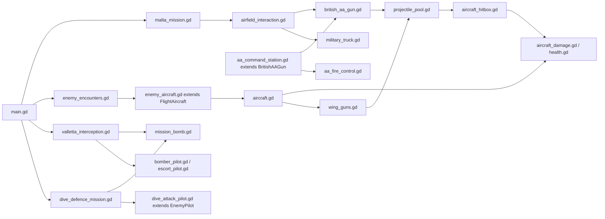

# 03 — Current technical architecture

[Contents](README.md) · [Source snapshot](14-commit-reference.md)

## Main scene and ownership

[main.tscn](../../main.tscn) is deliberately small: `FirstSortie` is a `Node3D` running [main.gd](../../scripts/main.gd). `_ready()` creates web diagnostics when appropriate, the countryside `Airfield`, session effects and `EnemyEncounters`, then opens selection. Runtime objects and much of the UI are built in GDScript; there is no large authored scene hierarchy hidden behind the main scene.

`show_selection()` cancels the active mission director, clears encounters and Malta ownership, unpauses and detaches old input/HUD/camera nodes before deferred deletion. `start_flight()` constructs the countryside aircraft. `start_malta(field_id, kind, selected_mode)` validates selection, creates one `MaltaWorld`, then a `MaltaMission` owning its fleet and pilot. `attach_malta_player()` replaces only player-facing chase/HUD/debug objects when boarding another persistent aircraft. `restart_malta()` saves the departure selection, tears down the run and builds a fresh one. Ordinary boarding, encounter confirmation and Survival progression do not call this restart path.

## Major modules and actual dependencies

| Ownership boundary | Concrete classes and responsibilities |
| --- | --- |
| Session composition | `main.gd`: creation, selection, cleanup, difficulty retention, active HUD focus |
| World | `MaltaWorld`: island collision/rendering, sea, all fields, trucks, batteries, scenery |
| Persistent player entities | `MaltaMission`: fleet, on-foot pilot, engine/boarding checks, navigation; `AirfieldInteraction`: exclusive truck/gun/post routing |
| Aircraft mechanics | `FlightAircraft`: forces; `PilotInput`: command values; `LandingGear`: contact forces; subclasses configure airframes |
| Damage | `AircraftDamage` with data profiles and `AircraftHitbox` sensors; `AircraftHealth` depletion latch; `DamageEffects` |
| Enemy decisions | `EnemyPilot`, `BomberPilot`, `EscortPilot`, `DiveAttackPilot`; visual models are separate |
| Combat | `WingGuns`, `RearGunner`, `BritishAAGun`, `ProjectilePool`, `MissionBomb`, `AirfieldAABattery` blast |
| Mission progression | `EnemyEncounters`, `VallettaInterception`, `DiveDefenceMission` |
| Presentation | `FlightHUD`, selectors, charts, debug panels, `ChaseCamera`; `GameAudioMixer` autoload |

## Signals and deferred work

Important actual interfaces include:

- `AircraftHealth.changed(hp, maximum)` → damage effects and UI; `depleted` → aircraft/ground-pilot loss handling.
- `FlightAircraft.destroyed` → encounter tracking and mission conditions; `crashed(reason)` → crash failure/effect handling; `reset_completed` → enemy life initialization/session reset routing.
- `EnemyAircraft.ground_impact(point)` → session `DestructionBurst`; `wreck_removed` → remove from wreck tracking.
- `ProjectilePool.round_finished(point, collider, team)` → heavy burst or light impact effects. It is emitted on collisions and lifetime expiry; light misses expire silently.
- `WingGuns.salvo_fired(rounds)` / `cleared` → `WeaponAudio` lifecycle.
- `VallettaInterception.checkpoint_reached(number)`, `formation_detected(distance)` and `finished(success, reason)` → guidance, radio and results.
- `BritishAAGun.destroyed` → safe operator ejection and defence result checks.

Confirmation, mission results, collision-triggered visuals and world placements use deferred calls where their callers run in physics or input callbacks. Generation tokens in `EnemyEncounters` invalidate stale deferred confirmations after restart. Boolean latches prevent repeated aircraft destruction, bomb impacts and checkpoint activation. These mechanisms are visible in source; they are not an inferred generic event bus.

## Input and processing

Actions are defined in [project.godot](../../project.godot), accepting physical and logical key events after {commit('81703b4')}. `PilotInput.sample()` writes continuous command values; AI sets `automated` and supplies the same command fields. Discrete gear/damage shortcuts check player `input_enabled`. HUD owns pause/reset shortcuts.

On-foot, truck, individual gun, post and aircraft ownership is routed through `MaltaMission`/`AirfieldInteraction`. AA-relative mouse handling is scoped to the mounted gun by `AAMouseControls`; it does not globally map LMB to aircraft fire. Menus, lost focus and pause block AA firing and release pointer capture. Some UI components use `PROCESS_MODE_ALWAYS` so overlays work while the tree is paused; physics is not intentionally advanced by those UI handlers.

## Collision contract

Numeric values below are **bit masks**, not one-based editor layer labels.

| Bit | Typical owners/use |
| --- | --- |
| 1 | Terrain, buildings, sea, AA static bodies, truck; ground rays/camera obstruction |
| 2 | Player aircraft rigid body |
| 4 | Enemy aircraft rigid body |
| 8 | `AircraftHitbox` projectile-only `Area3D` sensors |
| 16 | `GroundPilot`, damage enabled for defence mission |

`ProjectilePool.hit_mask` defaults to 15. It enables area queries and explicitly skips coarse aircraft bodies when component sensors are enabled. Shooter body and own hitbox RIDs are excluded. Defence hostile pools include bit 16. Truck collision mask 23 includes ground, both airframes and pilot. Aircraft masks vary by context; Malta player fleet uses 7. Exact mask use is more informative than pretending all entity types share one static layer policy.

## Resources and architectural tradeoffs

Airframe/AI tunings are a mixture of exported script defaults and `.tres` resources: three Italian definitions, six component profiles, three gunner skill profiles, two mission definitions and two AA definitions. Mutable per-life integrity is held in `AircraftDamage`, not shared profile resources. Interception duplicates its mission definition before calculating per-run release lead.

The code reuses a stable force controller and pooled projectiles, but the root coordinator and Malta interaction layer are tightly coupled through direct references (`session.aircraft`, `session.encounters`, `session.hud`). String-valued mission phases and legacy singular `session.enemy` coexist with plural active tracking. These are current architecture risks, not claims that refactoring has already occurred; see [decisions](12-technical-decisions.md) and [roadmap](13-current-state-and-roadmap.md).

## Source-method evidence index

Line anchors identify the audited snapshot; update them when source changes.

| Interface | Source at audit |
| --- | --- |
| `start_malta()` | [scripts/main.gd L278](../../scripts/main.gd#L278) |
| `attach_malta_player()` | [scripts/main.gd L336](../../scripts/main.gd#L336) |
| `restart_malta()` | [scripts/main.gd L360](../../scripts/main.gd#L360) |
| `_integrate_forces()` | [scripts/aircraft.gd L174](../../scripts/aircraft.gd#L174) |
| `_destroy()` | [scripts/aircraft.gd L160](../../scripts/aircraft.gd#L160) |
| `integrate()` | [scripts/landing_gear.gd L39](../../scripts/landing_gear.gd#L39) |
| `spawn()` | [scripts/projectile_pool.gd L63](../../scripts/projectile_pool.gd#L63) |
| `_physics_process()` | [scripts/projectile_pool.gd L92](../../scripts/projectile_pool.gd#L92) |
| `receive_projectile_hit()` | [scripts/aircraft_hitbox.gd L54](../../scripts/aircraft_hitbox.gd#L54) |
| `apply_damage()` | [scripts/aircraft_damage.gd L57](../../scripts/aircraft_damage.gd#L57) |
| `balance_torque()` | [scripts/aircraft_damage.gd L114](../../scripts/aircraft_damage.gd#L114) |
| `confirm()` | [scripts/enemy_encounters.gd L100](../../scripts/enemy_encounters.gd#L100) |
| `_destroyed()` | [scripts/enemy_encounters.gd L174](../../scripts/enemy_encounters.gd#L174) |
| `activate()` | [scripts/valletta_interception.gd L265](../../scripts/valletta_interception.gd#L265) |
| `_formation_spawn()` | [scripts/valletta_interception.gd L231](../../scripts/valletta_interception.gd#L231) |
| `_resolve()` | [scripts/valletta_interception.gd L348](../../scripts/valletta_interception.gd#L348) |
| `_retain_hostile_rounds()` | [scripts/dive_defence_mission.gd L173](../../scripts/dive_defence_mission.gd#L173) |
| `_resolve()` | [scripts/dive_defence_mission.gd L205](../../scripts/dive_defence_mission.gd#L205) |
| `board_aircraft()` | [scripts/malta_mission.gd L170](../../scripts/malta_mission.gd#L170) |
| `leave_aircraft()` | [scripts/malta_mission.gd L188](../../scripts/malta_mission.gd#L188) |
| `mount_gun()` | [scripts/airfield_interaction.gd L73](../../scripts/airfield_interaction.gd#L73) |
| `leave_vehicle()` | [scripts/airfield_interaction.gd L134](../../scripts/airfield_interaction.gd#L134) |
| `fire_round()` | [scripts/aa_command_station.gd L217](../../scripts/aa_command_station.gd#L217) |
| `drive_gun()` | [scripts/aa_command_station.gd L230](../../scripts/aa_command_station.gd#L230) |
| `solve()` | [scripts/aa_fire_control.gd L5](../../scripts/aa_fire_control.gd#L5) |
| `_prepare_terrain()` | [scripts/malta_world.gd L78](../../scripts/malta_world.gd#L78) |
| `chart_uv()` | [scripts/malta_geography.gd L24](../../scripts/malta_geography.gd#L24) |
| `transmit_formation()` | [scripts/mission_radio.gd L56](../../scripts/mission_radio.gd#L56) |
| `_start_mission_audio()` | [scripts/dive_defence_audio.gd L26](../../scripts/dive_defence_audio.gd#L26) |
