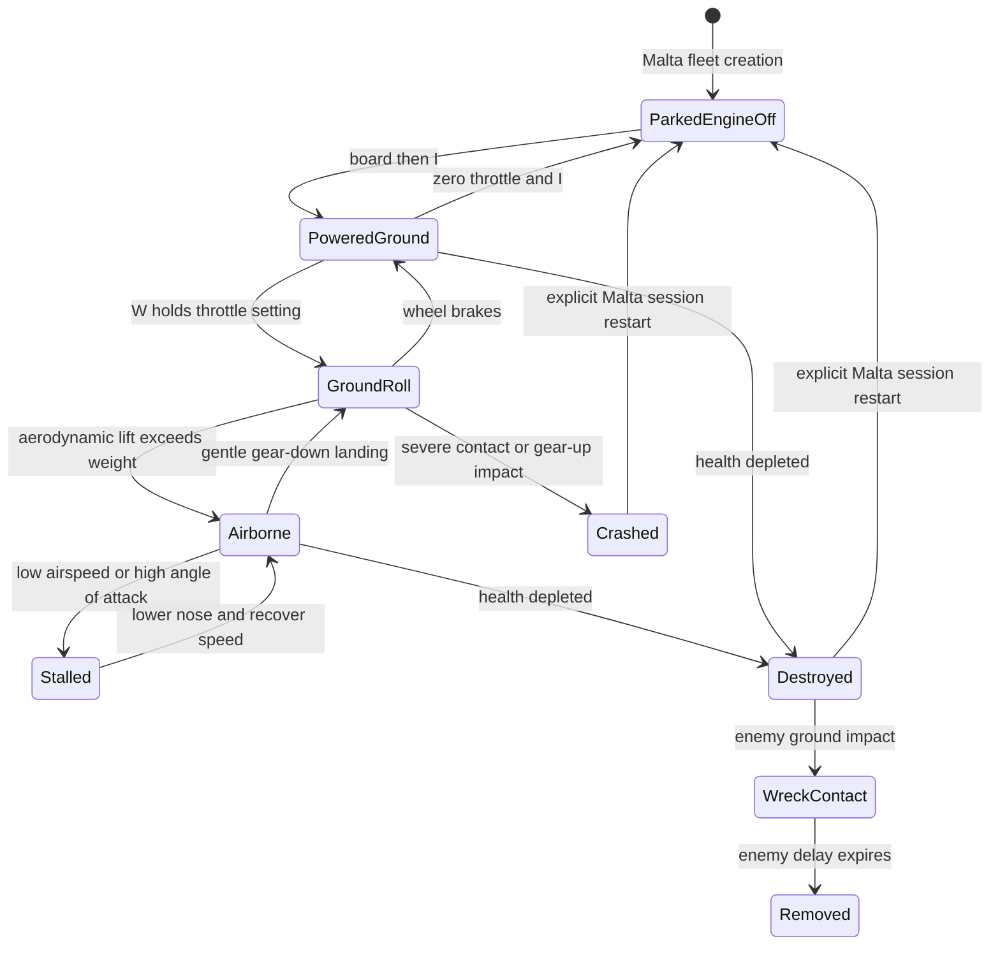

# 04 — Aircraft and flight systems

[Contents](README.md) · [Combat](05-combat-and-damage.md)

## Evolution

[64406b0](https://github.com/zelenski3398/codexproj1/commit/64406b082d49576bf5c0ec8c95367530dab9ab2c) introduced `FlightAircraft`, `PilotInput`, `LandingGear`, `SpitfireModel`, `ChaseCamera` and `FlightHUD`. Keyboard handling moved into persistent Input Map bindings and early `_input` shortcuts in [81703b4](https://github.com/zelenski3398/codexproj1/commit/81703b4933e0ca1391448c5c423ac28ae66b93f0). [236dbf0](https://github.com/zelenski3398/codexproj1/commit/236dbf093e2ba78afd3742a4dbd52b9df0685a56) added subclass-based Stuka flight and automated pilot commands without replacing the rigid body. [d3dea47](https://github.com/zelenski3398/codexproj1/commit/d3dea47a244651baacf17f334f4d14f2d8c3894a) added the selectable Sea Gladiator, fixed gear and a slower biplane tuning. [f1b9d05](https://github.com/zelenski3398/codexproj1/commit/f1b9d0576c98425770df6809fdc7048f87ac04a0) inserted component damage factors into existing forces. Malta engine gating, normal fuel consumption and boarding came in [1f83c99](https://github.com/zelenski3398/codexproj1/commit/1f83c99653e2804b811dadc8905e88f94a72d208); Italian definitions and pilots in [ac7fbac](https://github.com/zelenski3398/codexproj1/commit/ac7fbace7a0950d7d59e4413577a83a864a83553). Later gun, mission and scenery work continued to use this controller.

## Force integration

[FlightAircraft._integrate_forces](../../scripts/aircraft.gd) owns movement. Gravity comes from Godot. In ordinary flight it calls `state.apply_central_force`, `apply_force` and `apply_torque`; it does not translate the transform along the nose. Explicit reset/spawn fixtures set physics state in the reset branch, which is distinct from ongoing navigation.

The local forward axis is **-Z**. The controller derives angle of attack from local velocity using `atan2(-local_velocity.y, forward_speed)`. Dynamic pressure is `q = 0.5 * air_density * forward_speed²`. Lift uses wing area and a clamped linear coefficient, multiplied by a smooth stall fade and component lift factor. Lift direction is the aircraft up axis projected perpendicular to travel. Drag opposes actual velocity and includes parasite, induced, stall, gear and damage terms. Thrust acts along forward, decreases with speed, and is gated by engine running, throttle and component power.

Pitch, roll and rudder are torques with speed-dependent authority. Passive stability/damping remain, and gentle coordinated yaw helps banked flight turn. Destroyed aircraft have zero commanded torque and thrust while passive lift/drag/gravity continue. The stall is a forgiving lift reduction toward residual lift, with a nose-down tendency; it is not a full wing-section simulation or scripted fall. AI never overrides these damage-modified forces.

## Controls and aircraft configuration

`PilotInput.sample()` preserves throttle after key release; its default slew is 0.3 per second. Up/Down pitch down/up, Left/Right roll, A/D rudder, W/S throttle, G gear, Space ground brakes. Ctrl fires aircraft guns; F is a browser-friendly alternative. I is the Malta engine toggle. R explicitly restarts; Escape pauses. Debug H subtracts 10 hull HP and F3 inspects components. Context-specific interaction keys are documented in [ground gameplay](06-ground-vehicles-and-soldiers.md).

| Airframe | Configuration mechanism | Present characteristics |
| --- | --- | --- |
| Spitfire Mk I | `FlightAircraft` + `SpitfireModel` | 3,000 kg baseline; 22.5 m² wing, 12,500 N thrust default; eight wing ports, retractable gear |
| Sea Gladiator | [SeaGladiator](../../scripts/sea_gladiator.gd) + `SeaGladiatorModel` | 2,200 kg; 30 m² wing, 8,500 N thrust, greater drag, lower stall speed, four ports, fixed gear |
| Ju 87 Stuka | [EnemyAircraft.configure_airframe](../../scripts/enemy_aircraft.gd) + `StukaModel` | 26 m² wing, 11,500 N thrust; gull-wing/tandem/fixed-spat model; forward pair and rear gunner |
| C.200 / CR.42 / SM.79 | [ItalianEnemy](../../scripts/italian_enemy.gd), [definitions](../../aircraft_definitions/c200.tres) | Resource-defined mass, inertia, drag, thrust, contact shapes and weapons; bomber/escort pilot specialization |

These are tunable gameplay values, not verified historical performance measurements. Spitfire takeoff guidance is 160–180 km/h; Gladiator 115–135 km/h. There are two selectable player types, not all six as flyable choices. The SM.79's two defensive mounts use shared `RearGunner`; it does not use forward fighter fire in its bomber configuration.

## Ground handling and recovery

[LandingGear.integrate](../../scripts/landing_gear.gd) uses three ray-spring contacts: two main tyres and a tailwheel. Compression and damping produce normal forces at wheel anchors. Lateral/rolling friction is bounded by load. A documented simplification applies tyre braking centrally to reduce taildragger nose-over. Gear retraction is blocked under wheel load, and fixed-gear aircraft reject the toggle.

Severe airborne-to-ground sink, excessive rigid-body impact or gear-up contact can invoke `_crash`. Player crash and zero-HP destruction are separate flags; enemy `_crash` converts fatal contact into shared HP depletion for consistent kill tracking. `EnemyAircraft` waits for real ground contact before impact effects, freezes only after contact and removes the wreck after four seconds by default.

This diagram is a behavioural view of actual guards, not a claim that the controller has a single enum for these states. The countryside starts powered on the runway; Malta starts on foot with parked engines off.

## Damage coupling and fuel

`AircraftDamage` supplies lift, drag, asymmetric wing moments, engine-power and control-authority factors. `EnemyPilot._fly_toward()` uses bounded damage trim through normal pilot commands; it cannot restore a failed engine or missing authority. Malta fleet fuel consumption is normalized tank fraction at `1/7200` per second at full throttle, plus leak/fire loss. Default countryside/enemy normal consumption is zero unless configured. No refuelling service is wired into boarding.

`ChaseCamera` smooths position and checks terrain obstruction. Ground, truck and gun cameras are separate context cameras. `RafPilotAvatar` supplies a seated visual in the two player cockpits. First-person body hiding exists as an API hook; this snapshot still uses chase cameras for aircraft.

## Checks and limits

[flight_checks.gd](../../tests/flight_checks.gd), [keyboard_checks.gd](../../tests/keyboard_checks.gd), [malta_journey_checks.gd](../../tests/malta_journey_checks.gd), and mission departure checks cover force-based takeoff/turning/landing and control paths. Historical README results describe scripted flight and disclosed fixtures, not proof of every human-flown approach. This documentation task does not re-test interactive handling, cockpit clipping on every angle or historical performance fidelity.
