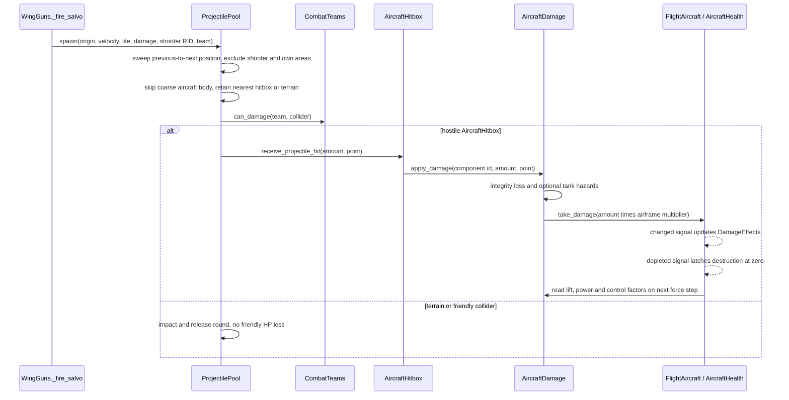
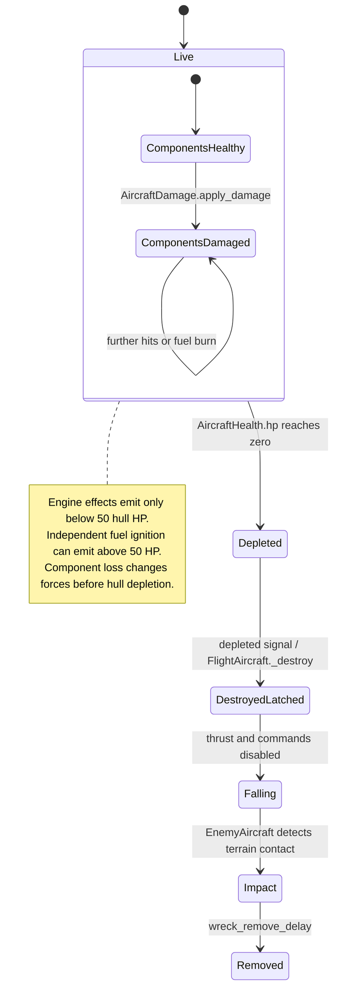

# 05 — Combat and damage architecture

[Contents](README.md) · [AA-specific shell behaviour](07-anti-aircraft-systems.md)

## Historical layers

[b0bdb4f](https://github.com/zelenski3398/codexproj1/commit/b0bdb4f02babf34094c9ee2e1ff58e011672c721) introduced eight leading-edge gun origins, `WingGuns`, `ProjectilePool`, `AircraftHealth`, `DamageEffects` and a stationary `PracticeTarget`. [83e6073](https://github.com/zelenski3398/codexproj1/commit/83e60738746ed2a2b4c2dcd75316e8c62f9c8579) added explicit GDScript types to resolve parser inference failures; it did not redesign ballistics. The flying enemy replaced the stationary target in session construction in [236dbf0](https://github.com/zelenski3398/codexproj1/commit/236dbf093e2ba78afd3742a4dbd52b9df0685a56). Teams and one-shot wreck handling followed in [fc44efa](https://github.com/zelenski3398/codexproj1/commit/fc44efa7a43f2066de9a2edbf2b472e8d2c6f7d6); eight component sensors and force coupling in [f1b9d05](https://github.com/zelenski3398/codexproj1/commit/f1b9d0576c98425770df6809fdc7048f87ac04a0); shot/hit/range/component telemetry in [850e33c](https://github.com/zelenski3398/codexproj1/commit/850e33c953b3b3289dcacbbf40a34e2b94df8b35). AA added gravity, blast and location-adjusted damage on this same pool rather than replacing aircraft combat.

`practice_target.gd` remains a support asset, but `main.gd` no longer constructs it in normal play. Survival and mission counts use actual destruction signals, not smoke, hit effects or disappearance from view.

## Weapon-to-hit path

[WingGuns](../../scripts/wing_guns.gd) selects visible model ports and emits salvos. Spitfire uses eight wing ports, Gladiator four mounts; alternative flexible mounts provide their own `firing_ports`. Default player tuning is 12 rounds/s **per gun**, 850 m/s muzzle speed, 2 s lifetime, four raw damage and 250 m convergence. Velocity includes shooter linear velocity. Occasional tracers are presentation; invisible rounds use the same collision checks. A bounded catch-up loop maintains fractional timing under varying physics ticks.

[ProjectilePool](../../scripts/projectile_pool.gd) is a fixed-capacity world-space slot pool, default 384. It stores position, velocity, age, damage, shooter RID, team and statistics generation in arrays; it does not allocate one rigid body or timer per bullet. Tracer nodes and 32 impact sparks are pre-created. Exhaustion increments `dropped_rounds` rather than allocating unbounded replacements.

Every step sweeps the entire previous-to-next segment, including the last partial lifetime step. The query includes component areas. It excludes shooter body and all shooter component RIDs, skips coarse aircraft rigid-body shapes, and keeps the first real hitbox/terrain/ordinary receiver. `CombatTeams.can_damage()` prevents same-team HP changes; friendly geometry still stops a round. Neutral receivers or receivers without a team API are damageable. This is a concrete rule, not universal collision immunity for friendlies.

## Localized component model

[AircraftDamage.IDS](../../scripts/aircraft_damage.gd) defines fuselage, left wing, right wing, engine, cockpit, rudder, elevator and fuel tank. Six [damage profiles](../../damage_profiles/spitfire.tres) provide per-airframe box positions, sizes and component/airframe multipliers through `AircraftComponentDefinition` and `DamageHitboxSpec`. `AircraftHitbox` builds actual `Area3D` box sensors on bit 8. Landing still uses coarse rigid-body collision; bullets use the localized areas.

`apply_damage(id, amount, point)` subtracts `amount * damage_multiplier` from component integrity and transfers `amount * airframe_multiplier` to hull HP. Integrity is clamped at zero; hull HP is clamped by `AircraftHealth`. The distinction allows mechanical degradation before whole-airframe destruction.

| Component | Existing mechanical consequence |
| --- | --- |
| Left/right wing | Average lift loss; added drag; asymmetric lift/drag torque around a spanwise lever arm; higher effective stall speed |
| Engine | Power factor is integrity ratio raised to `engine_power_exponent` (default 1.3); empty fuel also produces zero power |
| Rudder | Reduced yaw-control and lateral-stability factors, default authority floor 0.1 |
| Elevator | Reduced pitch-control/stability authority, default floor 0.1 |
| Cockpit | Combined control factor, default floor 0.45; not a separate crew death simulation |
| Fuselage | Added parasite drag and configurable hull transfer |
| Fuel tank | Configurable per-hit leak/ignition probability, continuing fuel loss and burn damage |

Fuel defaults in `AircraftDamageProfile` are leak probability 0.4, fire probability 0.12 and seeded RNG. Leakage scales with tank integrity loss. Fire independently consumes fuel, component integrity and hull HP. This is a simplified probability/hazard model, not a physical fuel-line simulation. No detachable-wing mesh or procedural structural breakup system is implemented by these integrity factors.

## Health, effects and critical state

[AircraftHealth](../../scripts/health.gd) starts at max HP (100 for player/Stuka), ignores invalid/nonpositive damage and emits depletion once until reset. Changing health above zero after depletion does not revive the aircraft's latched destroyed life. `FlightAircraft._destroy()` disables commands and guns; engines produce no thrust. Enemy destruction disables AI and rear mounts, then preserves airborne wreck physics.

[DamageEffects.set_health](../../scripts/damage_effects.gd) emits engine smoke/fire strictly below **50 hull HP**; exactly 50 does not start engine emission. Existing world-space particles linger until their lifetimes end after emission stops. Component fuel fire is a **separate** emitter and may occur above 50 HP. Describing all fire as forbidden above 50 would contradict the later component-damage implementation.

Effects are pooled, CPU-updated meshes/billboards using Compatibility materials. They do not require GPU particle features. `DestructionBurst` produces short impact effects; `EnemyAircraft.impact_started`, health depletion and bomb `resolved` guards prevent repeats.

## Ground targets and soldiers

[AirfieldInstallation](../../scripts/airfield_installation.gd) has 250 HP by default and retains colliding darkened ruins after destruction; it is neutral, not a shared mission base-health pool. `BritishAAGun` and command posts have independent 150 HP. `GroundPilot` reuses `AircraftHealth` but accepts damage only with `combat_enabled`, enabled by AA defence. Enemy defence bullet pools include the pilot bit. [MissionBomb.explode](../../scripts/mission_bomb.gd) snapshots covered pilot/gun receivers before destruction can eject the operator, then applies one impact's damage once. The truck is collidable cover with a player team API; it has no general health/destruction component in its current script.

## Verification and debugging

F3 opens `ComponentDamageDebug` with player/enemy selection, component integrity, wire boxes, raw damage, forced tank hazards and test repair; H removes 10 hull HP. `GunnerDebugPanel`/`WeaponStatistics` expose rear/player/forward shots, hits, percentages, components, engagement buckets and travel times. Debug repair is not an in-world repair service.

Existing [weapons checks](../../tests/weapons_checks.gd), [component checks](../../tests/component_damage_checks.gd), [flak checks](../../tests/flak_damage_checks.gd) and gunner balance tools substantiate intended regression coverage. Current source establishes the mechanisms above; test existence alone is not a new pass claim. See [audit validation](validation.md) for checks actually executed for this document.
