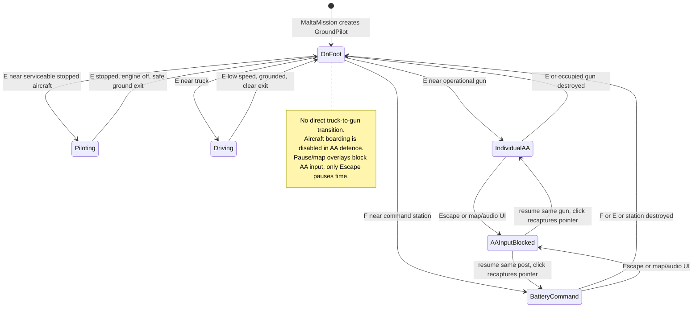

# 06 — Soldiers, vehicles and control transitions

[Contents](README.md) · [AA](07-anti-aircraft-systems.md)

## Introduction and later revisions

Ground play entered with the continuous Malta commit [1f83c99](https://github.com/zelenski3398/codexproj1/commit/1f83c99653e2804b811dadc8905e88f94a72d208): a simple walking `GroundPilot`, serviceability/proximity checks, parked fleet, engine toggle and safe aircraft boarding/exiting. The character was originally primitive geometry with no skeleton. [45a15f9](https://github.com/zelenski3398/codexproj1/commit/45a15f93a1c4ceee45a0c588f1c8c6e0aafe3265) replaced that visual with an original skinned RAF pilot, preserving the capsule, movement and interaction paths. [5bbf563](https://github.com/zelenski3398/codexproj1/commit/5bbf563938cfd8544e40e205de8c645b51361525) added the truck, manual AA mounting and a common exclusive interaction router. Defence [88e17ba](https://github.com/zelenski3398/codexproj1/commit/88e17baa97591a6000022d116e846a640bc4d000) added opt-in operator vulnerability; battery command [eb5db64](https://github.com/zelenski3398/codexproj1/commit/eb5db645b24ac61e32de36e7aed320083e244c78) extended the same mounting architecture.

## Soldier implementation and character asset

[GroundPilot](../../scripts/ground_pilot.gd) extends `CharacterBody3D`, with a 1.8 m capsule, radius 0.35 m, 5 m/s walking speed and collision mask 7. WASD reuses rudder/throttle actions for relative movement; horizontal arrows turn the walking heading. Gravity and `move_and_slide()` handle support. A following camera rays against obstacles and has a 100 km far plane for the island world.

[RafPilotAvatar](../../scripts/raf_pilot_avatar.gd) instantiates [raf_pilot.glb](../../assets/characters/raf_pilot.glb), finds `Skeleton3D`/`AnimationPlayer`, and selects clips by suffix. [build_raf_pilot.py](../../tools/build_raf_pilot.py) produces the original skinned uniform geometry. The recorded asset has an 18-bone skin, two combined meshes and Idle, Walk and Seated clips; [character notes](../raf-pilot.md) include native front, side and cockpit previews. Short jacket, collar/pockets and muted RAF palette are visual modelling choices, not recovered colour measurements from a monochrome photo.

`animate_walk()` selects Idle/Walk and scales animation speed; aircraft create a seated avatar at airframe-specific offsets. Empty parked aircraft hide it. `set_first_person_hidden()` exists for future cockpit camera use; the current flight camera is third person. **There are no climb-in or climb-out clips:** interaction remains an instantaneous control/visibility handoff. No original skeleton was preserved because the primitive predecessor had none. Hand anatomy and all-angle cockpit clipping remain prototype limitations.

## Persistent fleet and boarding

[MaltaMission._ready](../../scripts/malta_mission.gd) constructs all stationed aircraft from `world_data.json`, two per field in the current data. Each receives its parking transform, disabled player input, stopped engine and automated braking commands. `board_aircraft()` validates that the candidate is nearest, within 8 m, grounded, stopped and not destroyed/crashed. It activates the existing aircraft, shows its seated avatar and calls `session.attach_malta_player()` and `encounters.set_target()`; it does not instantiate a replacement or repair the old airframe.

`leave_aircraft()` requires speed at or below 1.5 m/s, wheel contact, zero throttle and engine off. It searches either side using ground rays and a capsule overlap query. On success it brakes the parked aircraft and restores the on-foot pilot. Damage, component integrity, fuel and surviving bullets remain attached to the original aircraft. R is explicitly a full mission restart, which is a different operation.

## Truck implementation

[MilitaryTruck](../../scripts/military_truck.gd) is a forgiving **kinematic** `CharacterBody3D`, not a `VehicleBody3D` or rigid-chassis suspension simulation. It has a 1.9 × 2.25 × 4.6 m box, gravity, floor snap and a 32° floor limit. W/S request forward/reverse speed (12/4 m/s), A/D steer, Space brakes; unoccupied trucks brake automatically. Yaw follows a simple wheelbase/speed rule. The [model](../../scripts/military_truck_model.gd) supplies animated wheels, steering, driver visual and canvas-backed military silhouette. The reference-inspired paint is generated offline by [build_truck_texture.py](../../tools/build_truck_texture.py).

The truck uses collision mask 23 to collide with ground/buildings/guns, both aircraft teams and the soldier. Obstacles stop accumulated drive speed. Its camera rays against obstacles and smooths the chase position. It does not physically tip, so minor irregularities cannot overturn a rigid chassis. This is an intentional accessible handling implementation documented in source, not realistic automotive dynamics.

One truck is created at each Malta field. `AirfieldInteraction.enter_vehicle()` requires proximity (4.5 m), an inactive conflicting controller and a stopped truck. Exit requires low speed, grounded state and a clear ground capsule. There is no remote gun mounting from inside the truck. The truck has no implemented fuel inventory or HP system.

## Exclusive controller state

[AirfieldInteraction](../../scripts/airfield_interaction.gd) owns `occupied_gun` and `occupied_vehicle`; `MaltaMission.occupied` identifies the aircraft. `_hide_pilot()` disables walking, hides flight HUD/input and clears the airborne target. `_restore_pilot()` restores position, velocity, activity, camera, visibility and previous mouse mode. For defence, the hidden pilot retains a live damage capsule at the operator/driver location. Destroying an occupied gun/post forces a safe return to foot control, with a home-spawn fallback if no nearby exit exists.

## Mission restrictions and testing

AA defence deliberately rejects aircraft boarding in both `nearest_serviceable()` and `board_aircraft()`; the latter displays “no aircraft fallback.” This differs from earlier requested fallback behaviour and must not be described as implemented. Other Malta modes retain aircraft changes. Gun/post mission-end handling stops operation and returns to foot control; full retry tears down the owned world, fleet, trucks and batteries.

Tests present include [airfield controls](../../tests/airfield_controls_checks.gd), [pilot character](../../tests/pilot_character_checks.gd), [base access](../../tests/base_access_checks.gd), [Malta integration](../../tests/malta_checks.gd) and [journey](../../tests/malta_journey_checks.gd). The older journey report documents a command-driven continuous flight/landing/aircraft-switch fixture, not a fresh manual run during this documentation task. Long driving sessions, every exit edge case and every camera-angle character intersection require interactive review.
