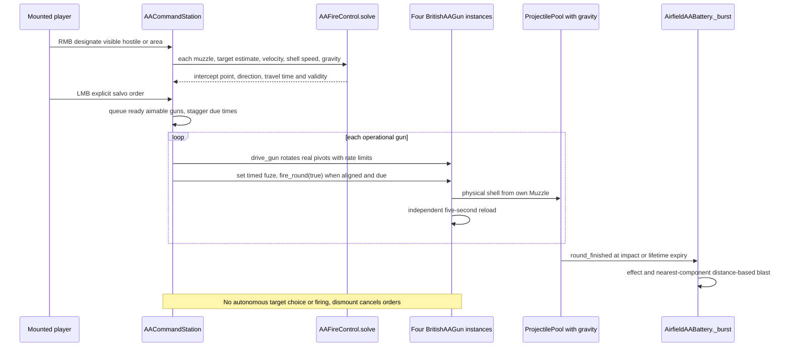

# 07 — Anti-aircraft development and present architecture

[Contents](README.md) · [Missions](09-missions-and-ai.md)

## Development sequence and replaced behaviour

| Commit | Observed change | Status at snapshot |
| --- | --- | --- |
| [6a36276](https://github.com/zelenski3398/codexproj1/commit/6a362768d5065098bfce8f148181c382f6a93e6b) | Two friendly imported emplacements per airfield, autonomous target selection, physical shells and effects | Superseded control model/count |
| [5bbf563](https://github.com/zelenski3398/codexproj1/commit/5bbf563938cfd8544e40e205de8c645b51361525) | Removed autonomous selection/aim/fire; manual mount/camera/recoil, truck and interaction router | Manual-only remains |
| [71b5195](https://github.com/zelenski3398/codexproj1/commit/71b5195c1f13751792fc75ddade4a8ca84409375) | Ground-gunner enemy tags, larger bursts and cannon report at about 2 Hz | Retained/extended |
| [8218544](https://github.com/zelenski3398/codexproj1/commit/82185442419146017a250afd730d17ed1cc998cd) | Strong distance-based blast and devastating direct impact | Reused in heavy AA resource |
| [88e17ba](https://github.com/zelenski3398/codexproj1/commit/88e17baa97591a6000022d116e846a640bc4d000) | Six-wave Stuka attack director and damageable operator | Retained with six local guns |
| [2157b72](https://github.com/zelenski3398/codexproj1/commit/2157b7227fe912762e000829a001c15294d9f097) | Four heavy plus two Bofors per field; resource ballistics, finite ammunition and Bofors clips | Layering retained; ammunition/clip rules removed |
| [e26e5ed](https://github.com/zelenski3398/codexproj1/commit/e26e5edca54b0551bf27372109a26e8adfede36b) | Relative mouse, rate-limited tracking, sight zoom; removed finite stock/clip logic | Current individual controls |
| [eb5db64](https://github.com/zelenski3398/codexproj1/commit/eb5db645b24ac61e32de36e7aed320083e244c78) | Four-gun player-directed command post, gravity predictor and staggered orders | Current battery coordination |

This history explains why older requests and some surviving text refer to six total guns or clip reloads. Current [AirfieldAABattery._place](../../scripts/airfield_aa_battery.gd) creates **six guns per field**: four heavy and two light, across three fields (**18 guns**) plus **three command posts**. `_place()` guards against a second placement on the same owner. Retry frees that world owner and its pools before recreating it.

## Placement and model

[BritishAAGun._ready](../../scripts/british_aa_gun.gd) instantiates the supplied [British_AA_Emplacement.glb](../../assets/ground/british_aa/British_AA_Emplacement.glb), including emplacement scenery. It locates `YawPivot`, `ElevationPivot` and `Muzzle` recursively. Forward is local -Z. Heavy variants add an original larger cradle/barrel and move the muzzle to -4 m within the elevation pivot. Collision uses simple static boxes, not every sandbag triangle. Each field's graded transform positions guns on its apron with separated longitudinal slots; driving/parking lanes stay outside their nominal positions.

The actual gunner `Camera3D` is a child of Muzzle, ahead of the barrel, so both camera orientation and shell direction follow real pivot orientation. Visuals cull at 3.5 km. Health defaults to 150; zero HP latches destruction, ceases operation, emits an effect and notifies interaction/mission systems. Entering/exiting does not reset health.

## Individual controls and current ballistics

[AAMouseControls](../../scripts/aa_mouse_controls.gd) captures relative mouse only when mounted. X changes yaw target, Y elevation target. It uses `screen_relative`, exponential response, a bounded 20° queued yaw error and mechanical rate limits. Space fine-aim scales input to 0.18. Global sensitivity is persisted in `user://aa_controls.cfg`, range 0.2–3×. LMB fires; RMB zooms from 58° toward 30°. Arrows are optional alternative input. Map/audio panels, lost focus or pause release capture/block fire; a user click reacquires browser pointer lock without firing the loaded heavy gun. E exits individual guns; F enters/exits a command post nearby.

| Parameter | Heavy QF 3.7-inch | Bofors 40 mm |
| --- | --- | --- |
| Resource | [heavy_aa.tres](../../weapon_definitions/heavy_aa.tres), defaults in [AAWeaponDefinition](../../scripts/aa_weapon_definition.gd) | [bofors_aa.tres](../../weapon_definitions/bofors_aa.tres) |
| Muzzle speed | 790 m/s | 850 m/s |
| Reload | 5 s; fresh trigger press per shot | 0.5 s; hold for 2 shots/s |
| Gravity | 9.81 m/s² | 9.81 m/s² |
| Fuze | Timed lifetime, W/S adjustable manually; command predictor sets it | Impact only; miss expires without timed flak |
| Max lifetime | 8 s | 5 s |
| Traverse/elevation speeds | 60°/s / 45°/s | 110°/s / 85°/s |
| Elevation limits | 5–85° default | 5–85° default |
| Direct aircraft hull damage | 200 HP | Default 40, component-specific final values |
| Blast | 15 m nearest-component radius | None |
| Ammunition | Infinite, automatic reload | Infinite, no four-round clip state |

Both gun types use gaussian angular dispersion and physical sweeps through `ProjectilePool`, in separate 96-slot pools with gravity. Friendly bodies block shots and are not damage targets. There is **no AI loader, finite ammunition or autonomous target selection** in the current gun script. A `candidates()` list in the battery supports blast receivers and command designation, not unattended targeting.

## Heavy burst damage and presentation

`AirfieldAABattery._burst()` receives the actual impact/expiry point, picks air/ground/water visuals and evaluates each live enemy's nearest hitbox surface. Fragment damage is interpolated from configurable knots: 150 at zero distance, 100 at 3 m, 50 at 8 m, 15 at 14 m and zero at 15 m. A terrain/building LOS check blocks covered blast. The aircraft directly struck is excluded from the additional blast loop, avoiding unintended double damage. Hull/component multipliers are converted exactly once before calling the shared hitbox API. Bofors uses final location damage (e.g. 80 engine, 100 cockpit) through the same component transfer.

[FlakEffectPool](../../scripts/flak_effect_pool.gd) caps reusable effect meshes; muzzle smoke, brief flash, recoil, aerial dark puffs, ground dust and water effects originate at real shot/impact positions. The heavy report comes from `aa_heavy_shot.ogg`; light uses `aa_cannon_shot.ogg`. Positional sources cap simultaneous reports. This is a configurable gameplay flak model, not a verified fragmentation/ammunition reconstruction.

## Central battery command

[AACommandStation](../../scripts/aa_command_station.gd) subclasses `BritishAAGun` to reuse operation, damage and mouse interfaces. It gathers the **four heavy guns at its own field**, not all guns on the island. RMB designates a hostile aircraft near the sight ray or a point/area. There is no automatic target choice or self-initiated salvo.

[AAFireControl.solve](../../scripts/aa_fire_control.gd) seeks the low-time constant-velocity intercept with shell gravity. It samples for a root then bisects, returning aim direction, predicted point, travel time and validity. If no exact solution is found, an approximate solution is allowed when mechanically aimable. The post injects tracking delay, velocity/prediction/manoeuvre errors and per-gun jitter. Predictions are not instantaneous guaranteed damage.

LMB queues ready, aimable guns; default staggering is 0.3 s, order expiry 6 s. Each `drive_gun()` obeys its traverse/elevation speeds, waits until aligned and due, sets timed fuze, then calls `gun.fire_round(true)` from that gun's own muzzle. Every gun independently reloads for five seconds. Loss/dismount cancels orders. Surviving guns remain mountable when the post is destroyed.

The UI shows selected target/range, operational and ready counts, validity, pending orders and per-gun reload. Predictions drive an interception marker. Each post has independent HP and bomb vulnerability. It is not an invisible invulnerable global controller.

## Verification boundaries

[aa_checks.gd](../../tests/aa_checks.gd), [aa_mouse_checks.gd](../../tests/aa_mouse_checks.gd), [layered_aa_checks.gd](../../tests/layered_aa_checks.gd), [battery_command_checks.gd](../../tests/battery_command_checks.gd), [battery_engagement_checks.gd](../../tests/battery_engagement_checks.gd), UI checks and browser fixtures exercise these interfaces. Existing docs record native/Chromium results; this audit does not freshly fly a Stuka against each gun or benchmark 18 simultaneous firing emplacements. Some mission menu text still says two guns/arrows and needs editorial synchronization with current controls/counts.
