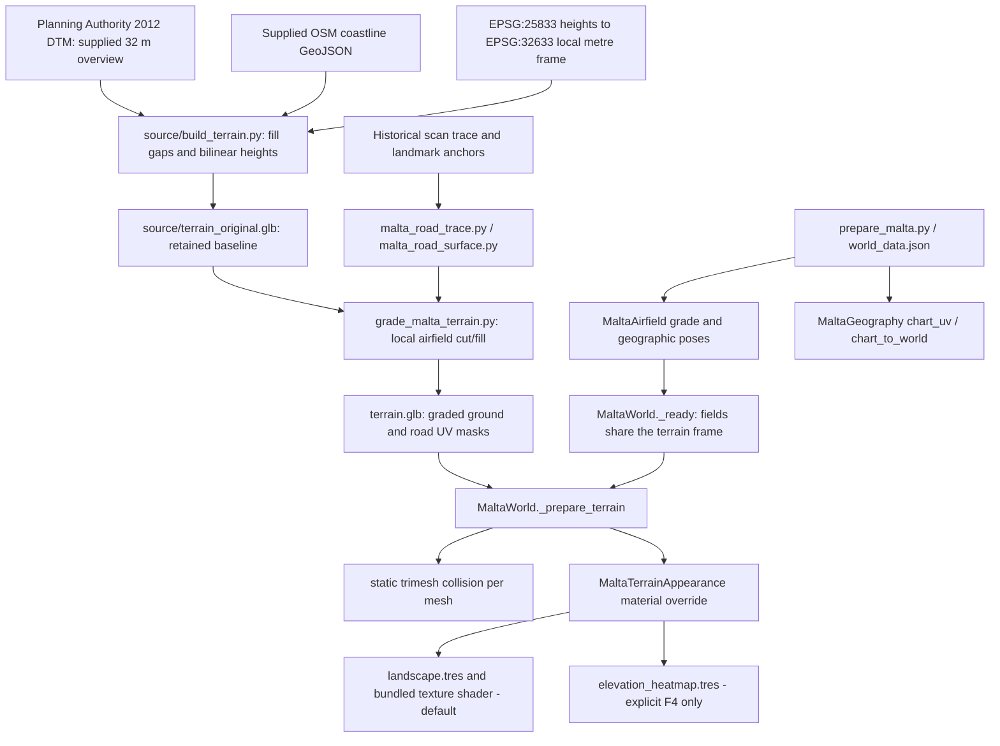
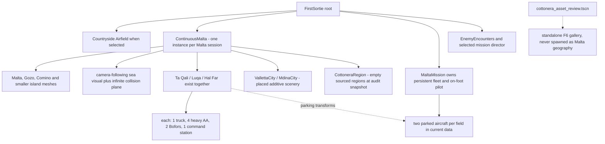

# 08 — Malta terrain, geographic data and built environment

[Contents](README.md) · [World organization](03-architecture.md) · [Current limitations](13-current-state-and-roadmap.md)

## Historical sequence

1. [64406b0](https://github.com/zelenski3398/codexproj1/commit/64406b082d49576bf5c0ec8c95367530dab9ab2c): procedural countryside `Airfield`, mathematical rolling ground and a runway; not Malta geography.
2. [1f83c99](https://github.com/zelenski3398/codexproj1/commit/1f83c99653e2804b811dadc8905e88f94a72d208): supplied elevated GLB, all-island continuous `MaltaWorld`, shared chart transform, approximate field coordinates and raised graded runway/apron decks.
3. [4a716c0](https://github.com/zelenski3398/codexproj1/commit/4a716c086b380b59ccfc68ad373ae6ee2045de87): explicit normal limestone material, opt-in elevation debug; geometry preserved for that fix.
4. [e2f8451](https://github.com/zelenski3398/codexproj1/commit/e2f84517d23337779a67f04d15ffc95e68a6e4bb): bundled Mediterranean landscape shader/textures, distance-managed detail and an early simplified Valletta blockout.
5. [917c0da](https://github.com/zelenski3398/codexproj1/commit/917c0da15000ef138ba2b92eef85b4062c5fe34c): local cut/fill and mesh refinement to integrate airfields; replaces raised ground platforms with visual-only surfaces.
6. [451ad8b](https://github.com/zelenski3398/codexproj1/commit/451ad8b77dcf4ac2482c34e90cc9781bf3534619): trace-derived roads baked into refined terrain geometry/UV masks, no separate road floor colliders.
7. [b135cdc](https://github.com/zelenski3398/codexproj1/commit/b135cdcb627bae94092c2781ea17503ce7e12b91): base-entry routes to parking and AA with focused access-surface corrections.
8. [bf96f9a](https://github.com/zelenski3398/codexproj1/commit/bf96f9a7e54330fcd1f74815be220e6dfc27132c): full original reference-inspired Valletta additive city replaces the earlier cheap blockout.
9. [814e308](https://github.com/zelenski3398/codexproj1/commit/814e30850bea4f3dbe098787d9a1898d95a434ba): projected Mdina hilltop reconstruction and shared `HistoricCity` loader.
10. [29dc713](https://github.com/zelenski3398/codexproj1/commit/29dc7139900e16ab377fe263526e771f44aae3cf)–[588ac7b](https://github.com/zelenski3398/codexproj1/commit/588ac7b1b37b72014b73fe679871e790e5c79145): Cottonera source alignment, unplaced architecture templates, local importer/compiler and conditional region loader; mapped geography remains missing.

Older [Malta world notes](../malta-world.md) still describe byte-identical terrain and raised deck collision. Those statements apply to the initial world commit, not the present graded/road-refined mesh. Later geometry changes are explicit and separately evidenced; do not mistake the material-only fix for a terrain regeneration.

## Supplied source and elevation provenance

The bundled [source README](../../assets/malta/source/README.md), [metadata](../../assets/malta/source/Terrain-Metadata.json) and [build_terrain.py](../../assets/malta/source/build_terrain.py) document the pipeline: OSM coastline data and Malta Planning Authority's terrain-only DTM 2012. The source catalogue describes 1 m LiDAR, but the supplied starter actually samples its **approximately 32 m raster overview**, with 80 m interior mesh spacing. No full-resolution LiDAR is loaded by the game.

Elevation gaps are filled from nearest valid raster samples, then bilinearly interpolated. Source notes identify 5,486 sample locations more than 100 m from valid pixels, with maximum distance about 333 m. Heights there are approximations. Vertical datum has not been independently checked against local survey marks. Original output has 36 closed island meshes and 152,000 triangles, retaining coastline vertices, with an artificial bottom cap at -30 m. Highest sampled vertex is about 250.865 m. The source GLB is preserved as [terrain_original.glb](../../assets/malta/source/terrain_original.glb); current runtime geometry has later local modifications.

The source model combines modern coastline and 2012 relief, not a verified 1940–42 terrain reconstruction. Licences and attribution are retained in [ATTRIBUTION.txt](../../assets/malta/ATTRIBUTION.txt). The source data are bundled for offline reproducibility and excluded from the web game export.

## Coordinate conversion and scale

[prepare_malta.py](../../tools/prepare_malta.py) projects WGS84 longitude/latitude into **EPSG:32633**, subtracting the projected origin at **14.4° E, 35.93° N**:

```text
(E, N) = project_EPSG_32633(longitude, latitude)
(E0, N0) = project_EPSG_32633(14.4, 35.93)
world.x = E - E0
world.y = terrain elevation (metres)
world.z = -(N - N0)
```

The elevation generator handles its raster's EPSG:25833 frame before assigning these local positions. One Godot unit is one metre; X is east, Y up, -Z north. Verified supplied bounds are about X -19,403.959…15,887.997 m, Z -16,980.369…15,938.015 m, Y -30…250.865 m: an approximately 35.292 × 32.918 km span without vertical exaggeration.

[MaltaGeography](../../scripts/malta_geography.gd) reads [world_data.json](../../assets/malta/world_data.json). `chart_uv()` normalizes X/Z using chart bounds [-21,000, -18,500] to [18,000, 17,500]; `chart_to_world()` is its inverse. Selection, moving player marker, heading, objectives and landmarks share this conversion. The chart's north-up orientation is not inferred from arbitrary screen coordinates.

## Airfields and graded support

| Field | Reference longitude / latitude | World X, Y, Z (m; rounded) | Heading / length |
| --- | --- | --- | --- |
| Ta' Qali | 14.4153 / 35.8953 | 1,357.155 / 109.333 / 3,857.118 | 130° / 1,450 m |
| Luqa | 14.4775 / 35.8586 | 6,948.822 / 76.689 / 7,959.455 | 140° / 1,600 m |
| Ħal Far | 14.5067 / 35.8153 | 9,561.062 / 62.656 / 12,775.674 | 130° / 1,400 m |

These are approximate site centres and prototype strip layouts, **not surveyed wartime runways**. Current width is 54 m. [MaltaAirfield](../../scripts/malta_airfield.gd) combines geographic yaw with fitted grade, supplies parking/pilot transforms, hangars and surface markings. It constructs every field together; selection changes only home/departure state.

[grade_malta_terrain.py](../../tools/grade_malta_terrain.py) starts from retained original geometry, fits local runway/apron/base grades and blends usable footprints into surrounding heights over 360 m. It refines the core to 8 m and transitions to 24 m. The recorded first grading report changes 845 original vertices while leaving 45,309 original top vertices untouched; it preserves coastal X/Z/guard geometry and other islands. Maximum local cut/fill about 44.46 m shows this is gameplay grading, not a surveyed civil-engineering model. Current fitted grades are +0.506%, +0.716%, -0.800%.

Runway/apron planes are now **visual only**, about 15 mm above the grade. Terrain is the sole ground collider underneath, avoiding the old overlapping slabs. Buildings retain separate collision. `tools/prepare_malta.py` retains the old initial raised-grade generation logic, so blindly rerunning it alone would not reproduce the final graded/access state. The generation sequence matters.

## Roads and access routes

[reference_trace.json](../../assets/malta/roads/reference_trace.json) stores editable historic-scan pixel paths, junctions and anchors. [malta_road_trace.py](../../tools/malta_road_trace.py) uses projected landmark controls and a thin-plate warp, not modern OSM road centre-lines. The recorded affine residual is about **559 m RMS**; leave-one-anchor-out error about **1,234 m RMS**, maximum **2,524 m**. Exact control-point fitting is not evidence of accurate intermediate roads. Omitted/uncertain areas and inferred base links are disclosed in [road notes](../malta-road-network.md).

[malta_road_surface.py](../../tools/malta_road_surface.py) samples terrain, limits local road cut/fill to ±1.5 m, refines at roughly 4 m stations and constrained-triangulates boundaries. Dusty lanes are nominally 4.5 m wide with blended shoulders. Coast/runway masks prevent water coverage and runway interruption. UV coverage feeds the shared landscape shader rather than floating road ribbons. Affected terrain is partitioned into 512 m patches with matching permanent collision.

[build_base_access.py](../../tools/build_base_access.py) adds reviewed prototype entrance/apron routes around hangars and aircraft/gun parking. [MaltaBaseAccess](../../scripts/malta_base_access.gd) paints matching surface masks; metadata live in [base_access.json](../../assets/malta/roads/base_access.json). Road completeness/historical alignment remains partial even though driving/collision paths exist.

## Rendering discrepancy and its actual resolution

The original runtime GLB contained positions and normalized `COLOR_0` elevation colours but **no authored materials, images or textures**. `MaltaWorld` originally left importer-generated materials in place. A clean Godot 4.6.3 import used vertex colours as albedo, explaining the rainbow terrain. The white Windows appearance was **not reproduced** in the documented investigation; importer/version/cache differences were possible, unproven explanations. There was no missing landscape texture to recover at that stage, and no demonstrated GitHub Pages cache cause.

[4a716c0](https://github.com/zelenski3398/codexproj1/commit/4a716c086b380b59ccfc68ad373ae6ee2045de87) assigned explicit shared `limestone.tres` with vertex-albedo disabled and `elevation_heatmap.tres` only when F4 enabled. It did not change heights, coastline or lighting. [e2f8451](https://github.com/zelenski3398/codexproj1/commit/e2f84517d23337779a67f04d15ffc95e68a6e4bb) subsequently made [landscape.tres](../../assets/malta/materials/landscape.tres) the normal material with bundled landcover, surface and cliff textures through [landscape.gdshader](../../assets/malta/materials/landscape.gdshader). Neutral limestone remains a diagnostic resource; it is **not the current normal appearance**. No displacement or live runtime texture/GIS download is used.

[MaltaTerrainAppearance.register_mesh](../../scripts/malta_terrain_appearance.gd) applies the normal override to every imported runtime mesh. `debug_heatmap_enabled` defaults false; explicit F4 toggles it and the labelled debug banner, hiding scenery detail/cities while debugging. Current GLB has **166 mesh records**, not the original 36, after road partitioning. Road/mainland LOD handling preserves narrow masks/seams, while other island meshes retain distance LOD. Historical counts in rendering-fix docs refer to their earlier snapshot.




## Continuous world organization

[MaltaWorld](../../scripts/malta_world.gd) instantiates terrain once and recursively creates static trimesh collision. Collision does not unload as visual detail culls. A 240 km sea display follows camera X/Z; an infinite collision plane keeps open-sea queries functional. Water remains solid prototype contact, not a buoyancy/ditching simulation. No travel triggers reload islands or switch airfield scenes.




## Cities: placed approximations versus gated preparation

[VallettaCity](../../scripts/valletta_city.gd) and [MdinaCity](../../scripts/mdina_city.gd) now subclass [HistoricCity](../../scripts/historic_city.gd). Offline generators sample existing terrain, create visual chunks and separate coarse structural collision. Detail culls earlier than skyline masses; collision remains. Valletta's layout records 880 buildings, 42 visual chunks and 162,816 triangles. Mdina records 242 buildings with an irregular wall/bastion approximation and cathedral. Mdina's WGS84 reference 14.4034 E / 35.8869 N projects to X **277.515**, Z **4,782.308**; sampled reference height is **196.111 m**. The loader origin Y is zero because generated vertex heights are already absolute terrain-fitted elevations; adding the hill height again would incorrectly elevate the city.

The cities preserve the underlying terrain/roads; their outlines/architecture are reference-inspired approximations, not independently surveyed footprints. Earlier landscape scatter/blockout was removed or suppressed to avoid overlapping the newer city regions. Recorded building/triangle counts describe generated assets, not historical urban census data.

[CottoneraRegion](../../scripts/cottonera_region.gd) is different: [region.json](../../assets/malta/cottonera/region.json) says `awaiting_geodata`, `building_count: 0`, `fortification_count: 0`, `collision_chunks: 0`; all four named regional chunks are empty. GeoNames anchors provide names/locations, **not inferred city boundaries or fort outlines**. Thirteen templates are review assets only in [cottonera_asset_review.tscn](../../scenes/cottonera_asset_review.tscn). They are never placed as actual cities in the playable world.

[import_cottonera.py](../../tools/import_cottonera.py) accepts local WGS84 GeoJSON, OSM XML and Overpass JSON, requires source/licence/epoch and explicit city assignment/review, preserves multipolygon holes and rejects missing geometry. [build_cottonera.py](../../tools/build_cottonera.py) conditionally emits source-driven 180 m chunks, persistent structural collision and near/mid/far visuals (detail to 700 m, structure to 5 km, skyline 5–16 km). Separate Cottonera and Santa Margherita systems are not collapsed into an invented enclosing wall. Empty input creates no fabricated city; synthetic fixtures cannot overwrite shipped geography. Source-host access failures and pending historical alignment are recorded in [Cottonera notes](../cottonera-region.md).

## Validation limits

Existing terrain/material, road, base-ground, city, journey and browser checks cover source hashes, transforms, collision and integration. Historical reports include native/ANGLE rendering comparisons but did not reproduce the original user's Windows white terrain. Precise historic road layouts, every landing surface and a populated Cottonera walk/drive/flyover remain unverified. The [audit report](validation.md) distinguishes static/source measurements and fresh data-tool checks from earlier execution reports.
