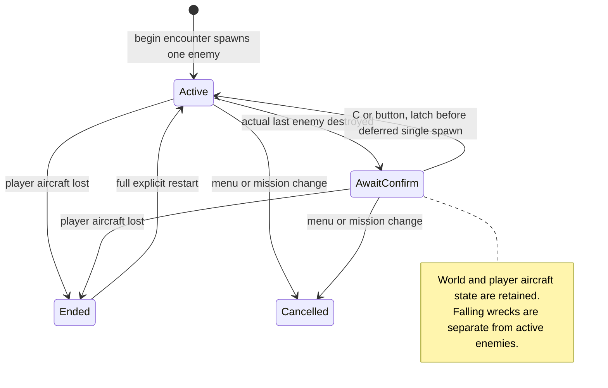
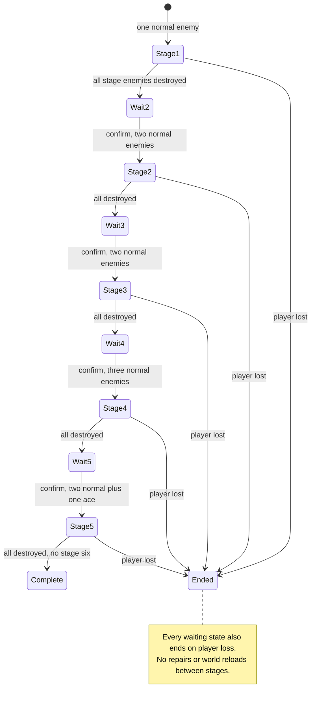
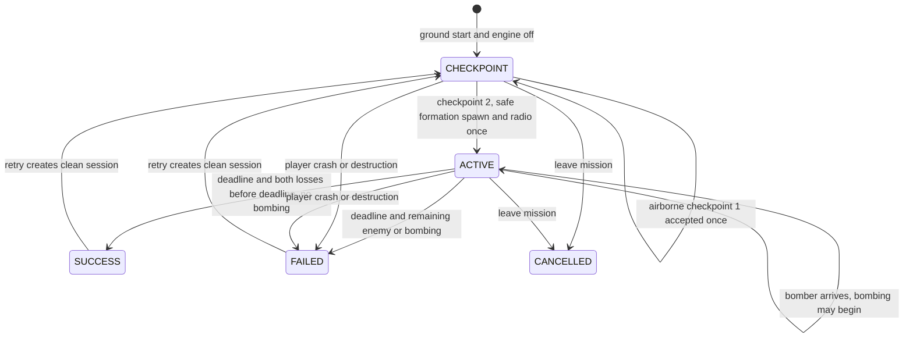
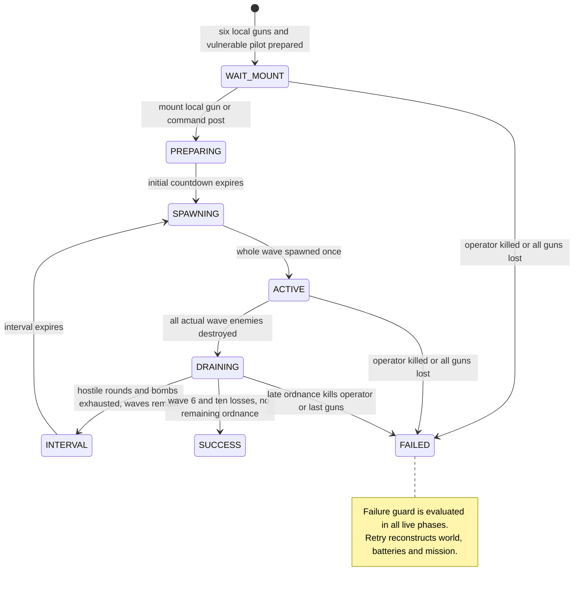
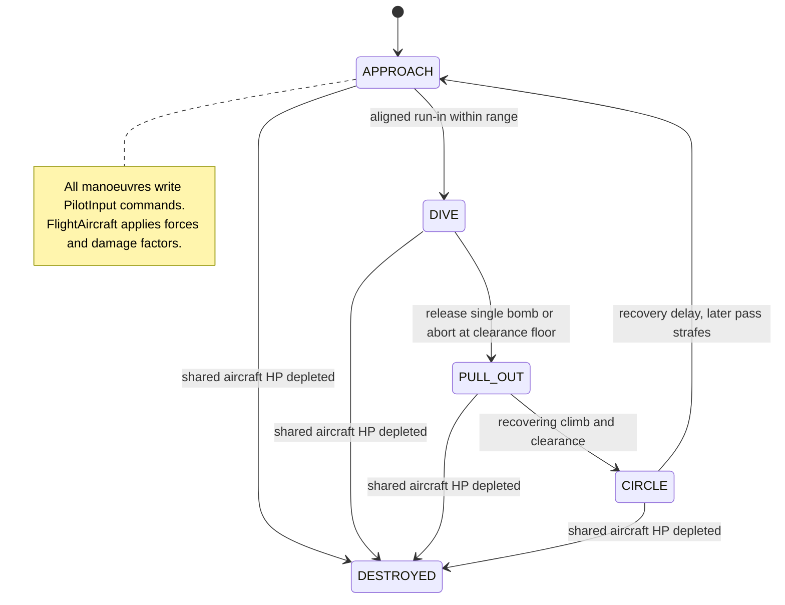

# 09 — Encounters, missions and enemy AI

[Contents](README.md) · [AA systems](07-anti-aircraft-systems.md)

## Mode inventory and ownership

[main.start_malta](../../scripts/main.gd) accepts four identifiers: `encounter`, `survival`, `interception`, `aa_defence`. Countryside retains ordinary encounter flight. [MaltaDepartureMenu](../../scripts/malta_departure_menu.gd) selects encounter/Survival and a home field; [MissionsMenu](../../scripts/missions_menu.gd) lists two authored mission implementations. There is one continuous Malta world, not a distinct terrain level per mode or field.

| Mode | Director | Start / progression / end |
| --- | --- | --- |
| Ordinary encounter | `EnemyEncounters` | One airborne hostile; after a kill, explicit C/button spawns one replacement; player loss ends progression |
| Malta Survival | `EnemyEncounters` | Five stages 1,2,2,3,3; explicit confirmation between; last stage includes one ace; complete after final losses |
| Defend Valletta — Ta' Qali Interception | `VallettaInterception` | Ground/engine-off start; two airborne checkpoints; bomber + escort; 90 s deadline |
| Under Dive-Bomber Attack — Luqa | `DiveDefenceMission` | On foot near batteries; six Stuka waves; survive and destroy ten attackers |

Authored mission definitions are [valletta.tres](../../mission_definitions/valletta.tres) and [dive_defence.tres](../../mission_definitions/dive_defence.tres). Thus there are **two authored mission implementations plus two generic progression modes**, not four authored campaigns.

## Shared enemy tracking and spawn safety

[ab97726](https://github.com/zelenski3398/codexproj1/commit/ab97726e08ff5e59691e28e8115cda4f152c04c3) moved progression from a singular enemy lifecycle into [EnemyEncounters](../../scripts/enemy_encounters.gd). `active` and `wrecks` are separate arrays. `track_enemy()` connects actual `destroyed`/`wreck_removed` signals once, builds markers and avoids duplicate tracking. `_destroyed()` immediately removes the enemy from active counts and stores its falling wreck. Smoke, low HP, range and visibility never clear a stage.

`confirm()` latches `awaiting_confirmation` before deferring the spawn and carries a generation token to reject stale callbacks. Full batch positions are planned before constructing a Survival stage; failure cannot silently create a smaller “complete” stage. Default ordinary spawn distance is 1,400 m, minimum 650 m, terrain clearance 160 m and separation 180 m; sphere overlaps check player/terrain/other actors. Malta adds a minimum 500 m spawn altitude. Specific mission directors implement their own guarded formations.

Confirmation preserves player pose, velocity, health, engine/fuel/components and world state. The final Survival stage comprises two normals and one ace; default ace forward aiming-error scale is 0.20 and dispersion scale 0.25. Normal tuning is retained separately and does not inherit previous ace overrides. Ace accuracy still produces physical rounds, not unavoidable damage. Player loss blocks spawning; full R restart creates a fresh session.

## Stuka pilot evolution and current decisions

The first enemy pilot in [236dbf0](https://github.com/zelenski3398/codexproj1/commit/236dbf093e2ba78afd3742a4dbd52b9df0685a56) steered the shared aircraft toward a target and returned fire. [fc44efa](https://github.com/zelenski3398/codexproj1/commit/fc44efa7a43f2066de9a2edbf2b472e8d2c6f7d6) added patrol/engage/evade/destroyed handling, terrain lookahead, airborne grace and clean wreck ownership. [63d4277](https://github.com/zelenski3398/codexproj1/commit/63d427747d0709d756d36ae3f33c24cc11157894) removed overly restrictive reacquisition conditions and added persistent pursuit with defensive breaks, alternating scissors-like goals and high/low yo-yo navigation goals. These are simplified goals, not reconstructed historical combat doctrines or scripted aerobatic trajectories.

[EnemyPilot](../../scripts/enemy_pilot.gd) writes bounded, slewed `pilot.pitch`, `roll`, `rudder`, `throttle` and `fire`. It uses corridor rays every 0.15 s, minimum clearance and lookahead to select a safer aim point. Measured Malta terrain replaces countryside analytic heights. Detection (3,200 m default), pursuit release (7,500 m default), 8 s airborne grace and target AGL guards control acquisition; Malta expands established pursuit range to allow island-wide travel. No normal AI method teleports or forces velocities during manoeuvres.

A pilot fires only within its forward range/cone, burst/rest window and clear LOS; default Stuka forward range is 650 m, cone 6°, burst 0.75 s, rest 1.25 s. Limited assisted aim remains bounded by the firing cone and uses dispersed physical bullets. `EnemyPilot` damage trim compensates through existing controls, respecting loss of power and control authority. Bomber, escort and dive subclasses specialize goals without replacing the force controller.

## Rear gunner and fair combat

[850e33c](https://github.com/zelenski3398/codexproj1/commit/850e33c953b3b3289dcacbbf40a34e2b94df8b35) replaced idealized rear targeting with sampled observation, reaction/reacquisition delay, learned velocity, range/lead errors, silhouette bias, angular-motion penalties, vibration and own-aircraft manoeuvre error. [RearGunner](../../scripts/rear_gunner.gd) uses Cadet/Pilot/Ace [profiles](../../gunner_profiles/pilot.tres). It observes the aircraft as a whole rather than engine/component positions and does not read the target's exact velocity for a perfect intercept. Mechanical arcs, finite traverse, cockpit damage, current-shot self-geometry clearance and terrain/friendly LOS constrain firing. Actual shot dispersion and flight time remain in shared `WingGuns`/`ProjectilePool`.

Default rear weapon values are 765 m/s, 16.67 rounds/s, 1.5 raw damage, 1.15 s lifetime and 0.15° spread; player forward values are 850 m/s, 12 rounds/s per port, four damage, 2 s lifetime and configurable convergence. These intentional differences are visible in source; they are not equalized by a hidden player damage rule. The rebalancing did not simply install an arbitrary 500 m accuracy wall. Telemetry and historical balance results are linked in [gunner notes](../gunner-balance.md).

## Italian interception: revisions and final rules

[ac7fbac](https://github.com/zelenski3398/codexproj1/commit/ac7fbace7a0950d7d59e4413577a83a864a83553) introduced Italian definitions and the original single-checkpoint five-minute mission. [4a32579](https://github.com/zelenski3398/codexproj1/commit/4a32579b9cf1bfbc087df9847494d3104cffe84a) changed to **five navigation checkpoints**, a 2,500 m player-to-formation spawn and paced flight toward Valletta. [90c99ef](https://github.com/zelenski3398/codexproj1/commit/90c99ef06854b6220e8690bd68657f518a6d7d86) removed misleading pre-spawn enemy HUD placeholder text. [00351b1](https://github.com/zelenski3398/codexproj1/commit/00351b1f3fee6623381b5ed19ce0c7e9bdc25339) attached the commander call and 30° right bearing. [7fe44a7](https://github.com/zelenski3398/codexproj1/commit/7fe44a78a74e81c67426c6852a2dc8211ceee7a9) fixed the radio test's wait for asynchronous cleanup. [6729637](https://github.com/zelenski3398/codexproj1/commit/67296373d09e7f3768fed7eff69470fc96e3f1a9) shortened the physical route to **two nearby checkpoints**, **1,200 m**, **90 s**, and deadline-based results with immediate player-loss failure. The current mode is not still a five-minute mission.

The definition contains checkpoint centres **(2600,330,5000)** and **(3900,430,5050)** in world metres, radius 350 m, vertical tolerance 100 m and minimum 80 m AGL. Checkpoint guards require a boarded airborne player. `_advance_checkpoint(expected_index)` rejects stale indices; `activate()` requires exactly the final index and a one-shot latch. Countdown is stopped throughout navigation; enemies do not exist before final activation.

`_formation_spawn()` uses player nose heading flattened to XZ, rotated **30° clockwise/right**, adding 60 m height where safe. Horizontal radius is solved from the desired **1,200 m three-dimensional separation**, not simply added beneath an altitude offset. Height difference is capped at 150 m; terrain clearance is checked. The escort is displaced laterally by 230 m, aft 120 m and up 40 m from the bomber's route direction. Sphere queries and separation guards reject unsafe insertion. The player is not moved or repaired.

The bomber initially faces the derived release waypoint toward the fixed Valletta target. `_release_waypoint()` accounts for bomb fall time; it does **not** confuse the player-to-bomber distance with bomber-to-target distance. `BomberPilot.assign_route()` paces ordinary throttle using remaining distance/time, speed bounds 48–80 m/s and bounded integral correction. Damage can prevent arrival; no teleport or frozen hold guarantees it. Existing departure documentation reports approximately **1,200 m activation** and **89.44 s** uninterrupted bomber travel in a later ground-departure regression. This audit verifies the formula/configuration, **does not claim a new measured flight**, and retains those figures as historical test evidence in [interception notes](../valletta-interception.md) and [road notes](../malta-road-network.md).

`formation_detected(distance)` starts the nonspatial radio once. `elapsed` only advances after activation. Early enemy losses are recorded with kill times and do not resolve success before the deadline. At expiry, bombing means failure; both losses strictly before the deadline without bombing mean success; otherwise failure. Player crash or destruction fails immediately. Enemy crash enters shared destruction and counts as a loss without early mission completion. Result guards settle same-tick callbacks once. Retry cancels old radio/deferred work and reconstructs checkpoint/enemy/timer state.

## Under Dive-Bomber Attack

[88e17ba](https://github.com/zelenski3398/codexproj1/commit/88e17baa97591a6000022d116e846a640bc4d000) added [DiveDefenceMission](../../scripts/dive_defence_mission.gd), [DiveAttackPilot](../../scripts/dive_attack_pilot.gd) and vulnerable operator bomb/fire handling. Later layering expanded its local objective from two guns to **four heavy and two Bofors**. It prepares the Luqa soldier near the batteries; mounting a local gun/post starts the initial countdown. Wave counts are **1,1,2,2,3,1**: ten Stukas, with the final aircraft an ace.

`choose_target()` distributes attacks among surviving guns, periodically preferring an occupied gun/post. `DiveAttackPilot` approaches, dives, releases one finite bomb, pulls out, circles and re-enters for strafing. It uses command-based navigation, clearance floors, bank/rate limits and imperfect bomb/strafe aim. The rear gunner is disabled in this dedicated ground-attack director. Bombs inherit velocity/gravity and use swept ground/pilot contact. Mission health is individual gun and operator HP, **not an abstract base-health bar**.

`DRAINING` waits for released bombs and hostile projectiles even after the last aircraft dies. Before depleted aircraft clear their gun pools, `_retain_hostile_rounds()` reparents live pools to mission effects, preventing last-second ordnance from disappearing and granting premature success. Failure occurs on operator death or all six local guns lost. Success requires wave six, all ten actual losses and no outstanding hostile ordnance. Aircraft fallback is disabled. The post can be lost while other guns remain usable.

## Validation and remaining uncertainty

Regression sources include [survival checks](../../tests/survival_checks.gd), [Italian airframes](../../tests/italian_aircraft_checks.gd), [interception checks](../../tests/interception_checks.gd), [combat outcomes](../../tests/interception_combat_checks.gd), [departure flight](../../tests/interception_departure_checks.gd), [defence checks](../../tests/dive_defence_checks.gd) and [dive attacks](../../tests/dive_attack_checks.gd). CI invokes these suites. Existence/CI wiring is verified; fresh mission timing, human dogfight difficulty and browser tracking were not exercised by this documentation-only audit. Historical reports and recommendations remain separate from implemented conditions.
