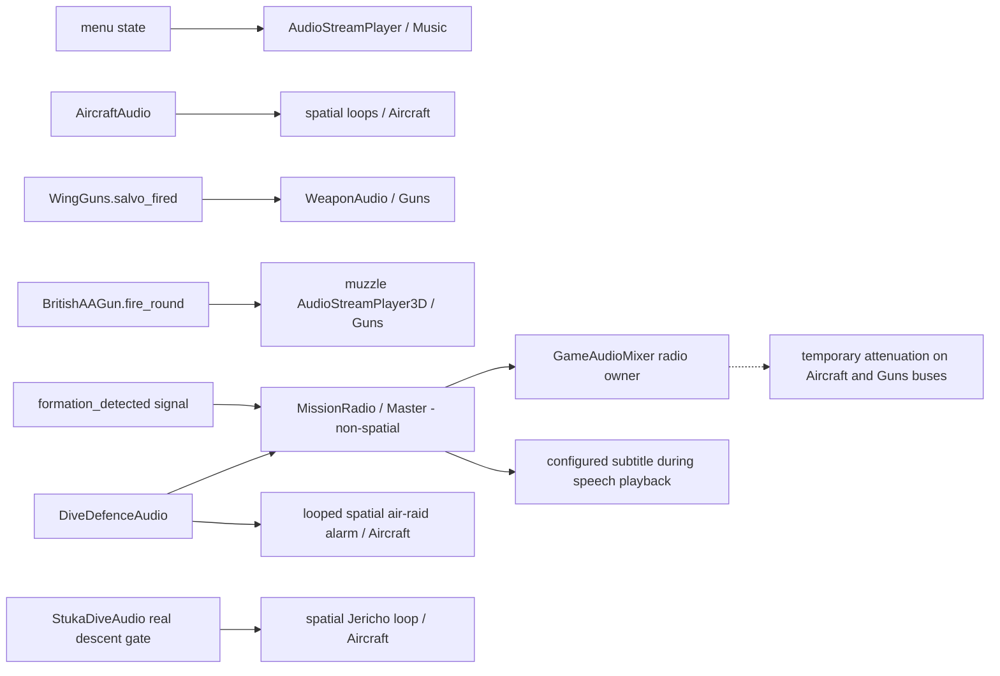

# 10 — Audio and atmosphere

[Contents](README.md) · [Detailed audio notes](../audio.md)

## Evolution and integrated assets

[f5d9e76](https://github.com/zelenski3398/codexproj1/commit/f5d9e76f94e652b336f05afc993af24f0fa23d48) added supplied menu/aircraft/gun recordings, offline conversion, spatial playback and the `GameAudio` autoload. [00351b1](https://github.com/zelenski3398/codexproj1/commit/00351b1f3fee6623381b5ed19ce0c7e9bdc25339) integrated the supplied Italian detection voice through `MissionRadio`; [7fe44a7](https://github.com/zelenski3398/codexproj1/commit/7fe44a78a74e81c67426c6852a2dc8211ceee7a9) adjusted its completion test to wait for the actual finished callback and duck/subtitle cleanup. [71b5195](https://github.com/zelenski3398/codexproj1/commit/71b5195c1f13751792fc75ddade4a8ca84409375) replaced a machine-gun-like AA report with generated cannon sound; [2157b72](https://github.com/zelenski3398/codexproj1/commit/2157b7227fe912762e000829a001c15294d9f097) added a separate heavy report. [eb5db64](https://github.com/zelenski3398/codexproj1/commit/eb5db645b24ac61e32de36e7aed320083e244c78) integrated the supplied Stuka trumpet, raid siren and Harrington intro. [6c0fbc9](https://github.com/zelenski3398/codexproj1/commit/6c0fbc90fdea1f0f46b5cca111c49c70e89d8ad9) replaced approach/wave-triggered alarms with one continuous loop from defence mission start.

| Runtime asset/path | Trigger and consumer | Spatial/mix behaviour |
| --- | --- | --- |
| `assets/audio/main_menu.ogg` | `main.gd` selection/menu → `GameAudioMixer.set_menu_active` | Nonspatial Music bus, fade into/out of menus |
| `spitfire_engine_idle_loop.ogg`, `spitfire_engine_flight_loop.ogg` | [AircraftAudio](../../scripts/aircraft_audio.gd), live aircraft engine/throttle | Aircraft bus; crossfade/pitch/level, aircraft-owned spatial sources |
| `gladiator_engine_idle_loop.ogg`, `gladiator_engine_flight_loop.ogg` | `AircraftAudio` for `SeaGladiator` | Same lifecycle, radial recordings |
| `spitfire_303_guns_burst.ogg`, `gladiator_303_guns_burst.ogg` | [WeaponAudio](../../scripts/weapon_audio.gd), `WingGuns.salvo_fired` | Guns bus, weapon/aircraft-owned playback |
| [commander_formation_detected.ogg](../../assets/audio/commander_formation_detected.ogg) | `VallettaInterception.formation_detected` → `MissionRadio.transmit_formation` | Master bus, nonspatial player radio with subtitle and temporary duck |
| [aa_cannon_shot.ogg](../../assets/audio/aa_cannon_shot.ogg) / [aa_heavy_shot.ogg](../../assets/audio/aa_heavy_shot.ogg) | `BritishAAGun.fire_round` at actual muzzle | Guns bus; positional source, bounded overlapping reports |
| [defence/harrington_intro.ogg](../../assets/audio/defence/harrington_intro.ogg) | `DiveDefenceAudio` mission start | Once through shared radio, -8 dB duck; subtitle intentionally empty |
| [defence/air_raid_siren.ogg](../../assets/audio/defence/air_raid_siren.ogg) | `_start_mission_audio` | Looped spatial source at defended field, continues while waiting/travelling/between waves |
| [defence/jericho_trumpet.ogg](../../assets/audio/defence/jericho_trumpet.ogg) | `StukaDiveAudio.should_sound` | Aircraft spatial loop gated by actual dive/descent; fades and modest speed-based pitch |

The intro subtitle is empty because a verified transcript was not supplied, not because the recording is unused. All listed assets have live source references. Merely having an audio file in the repository would not establish integration.

## Mixer and lifetime management

[GameAudioMixer](../../scripts/game_audio.gd) is registered as **GameAudio** in [project.godot](../../project.godot), the only autoload. [default_bus_layout.tres](../../default_bus_layout.tres) defines Master plus Music, Aircraft and Guns. Saved volume/mute settings live in `user://audio.cfg`. Runtime uses a saved layout rather than inserting buses incrementally: source comments identify a Godot 4.6.3 web sample-mixer bus-reorder/send-loop problem addressed by that implementation.

Sources select streaming playback natively and sample playback on web. Headless runs disable real playback unless explicitly enabled by a lifecycle fixture. Thus a headless physics pass cannot by itself prove audible correctness. Selection previews do not own running engine sounds. Aircraft/weapon teardown stops and clears their sources; pause/menu/session transitions have explicit cleanup.

## Radio channel, subtitle and ducking

[MissionRadio](../../scripts/mission_radio.gd) uses one nonspatial `AudioStreamPlayer` at consistent player-relative volume. The actual Italian subtitle is “Italian formation detected, one o’clock — intercept!” Voice filtering, subtle static and transmission clicks are baked offline by [prepare_radio.py](../../tools/prepare_radio.py); no runtime speech synthesis is claimed.

`transmit_formation()` sets its trigger latch before attempting playback. A missing clip emits a warning and remains silent without fake speech, subtitle or mix attenuation. `GameAudioMixer.begin_radio()` arbitrates a single owner, preventing overlap. Ducking overlays -4 dB by default on Aircraft and Guns; it does not overwrite stored user settings. `finished → stop()`, mission cancel and `_exit_tree()` stop speech, hide subtitle and return those buses to their configured levels. New retry-owned radio objects reset the one-shot state.

The radio test correction is historically meaningful: `playing` can become false before the `finished` callback executes on the idle thread. The repaired test waits for playback, subtitle and channel ownership to finish, rather than asserting cleanup a frame early. It changes test synchronization, not the spoken content.

## Defence alarm and Stuka descent

[DiveDefenceAudio](../../scripts/dive_defence_audio.gd) creates one looping siren, follows the defended centre and stops on mission outcome/cancel. In the current code it begins immediately when mission audio starts, including the initial wait-to-mount period; it does not wait for an enemy range gate or restart per wave.

[StukaDiveAudio](../../scripts/stuka_dive_audio.gd) is attached only to this mission's attackers. It requires a live `DiveAttackPilot`, DIVE/PULL OUT phase, actual downward velocity beyond 5 m/s, downward nose component below -0.10 and speed above 35 m/s. It ceases as descent ends or the aircraft/mission is lost. This is a real-motion gate, not an always-on enemy sound.

## Provenance, placeholders and checks

[prepare_audio.py](../../tools/prepare_audio.py), `prepare_radio.py` and [prepare_defence_audio.py](../../tools/prepare_defence_audio.py) prepare supplied sources into bundled Ogg; [audio attribution](../../assets/audio/ATTRIBUTION.txt) records provenance. Generated AA reports are separate from supplied speech. The mixer explicitly uses Spitfire inline samples as a **Stuka engine placeholder**; it is not a Jumo recording. Other types are selected through existing radial/type logic, not a complete historically matched audio library.

[audio_checks.gd](../../tests/audio_checks.gd), [mission_radio_checks.gd](../../tests/mission_radio_checks.gd), [defence_sound_checks.gd](../../tests/defence_sound_checks.gd) and browser smoke scripts cover triggering/mix teardown and sample paths. Historical records include actual native/browser playback checks. This audit does not claim a fresh listening test, speech transcription or equivalent results on every browser/device.
