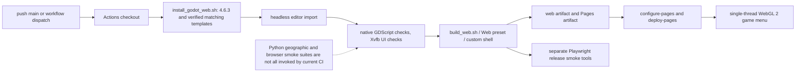

# 11 — Performance, checks and browser delivery

[Contents](README.md) · [Web-hosting notes](../web-hosting.md)

## Evolution

[bf0a11c](https://github.com/zelenski3398/codexproj1/commit/bf0a11c9be53bb888cd0052b3111e5f43df295e2) introduced a tested browser export, custom shell, font/attribution support, Godot installer, smoke tools and GitHub Pages workflow. [c7b1f6c](https://github.com/zelenski3398/codexproj1/commit/c7b1f6cc7a9acc5d49b39472a31e411b00aa3534) recorded the first build/artifact success and Pages activation state; this was documentation, not a second export-system implementation. A CNAME file was added and removed in [3f16951](https://github.com/zelenski3398/codexproj1/commit/3f1695169907679e4e43bea42e452c346993cc4d) / [b093bc2](https://github.com/zelenski3398/codexproj1/commit/b093bc28793648fd28ebb7ef963513086ada5055); it is absent at the snapshot. [af88162](https://github.com/zelenski3398/codexproj1/commit/af8816231ea8e7acba182be5ce0a3e29906ce6c5) removed the outer promotional landing screen/repository link and booted directly into the Godot menu after a loading overlay.

Malta added larger bundled terrain/resources, longer camera far planes and scene-owned persistence. Landscape/roads introduced texture detail fading, MultiMesh scatter, patch culling and selective LOD retention. City commits split visual detail from permanent coarse structural collision. Cottonera adds a gated multi-tier compiler but its empty shipping regions do not establish populated-city performance.

## Current build chain

[install_godot_web.sh](../../tools/install_godot_web.sh) pins **4.6.3** and official matching single-thread debug/release templates. Downloads are checked against SHA-512 checksums; cached template contents are verified. Godot 4.3 is the project feature baseline, not the build version pinned by CI.

[build_web.sh](../../tools/build_web.sh) imports via headless editor then exports the Web preset to `builds/web/index.html`. It copies engine/font/terrain/audio/pilot/AA/vehicle attribution notices and `.nojekyll`. [export_presets.cfg](../../export_presets.cfg) uses all runtime resources, explicit JSON includes, and excludes tests/docs/tools/raw Malta source. [web/shell.html](../../web/shell.html) is passed as the custom template, so its source-directory export exclusion does not remove the generated shell. PCK encryption, extensions, threads and PWA are disabled. WebGL 2 Compatibility avoids requirements for multithread cross-origin isolation; all export files must be served together over HTTP.




[.github/workflows/web.yml](../../.github/workflows/web.yml) runs on pushes to main or workflow dispatch, Ubuntu 24.04, with a cancel-in-progress Pages concurrency group. It imports and runs listed GDScript suites, including Xvfb-dependent AA mouse and command UI tests, exports, saves a downloadable artifact and deploys Pages with the required Pages/id-token permissions in a separate job. It does not prove that any particular deployment is currently live: accessible repository config and recorded historical build reports are different evidence from live-site inspection.

**Current CI gaps:** the workflow does not invoke every tracked test, including the Python Cottonera tools and the standalone Playwright release suites. The existence of 58 files under tests does not mean all run on every push. Browser tools are maintained separately under `tools/*_smoke.cjs`; their results should be recorded per exported build.

## Runtime cost controls and tradeoffs

- `ProjectilePool` stores fixed-size arrays and reuses tracer/spark nodes. Aircraft default capacity 384; heavy/light AA pools 96 each. Dropped-round counts reveal saturation. More aircraft still multiply per-airframe pool/particle allocations.
- `DamageEffects` uses 128 CPU-managed world-space particles per aircraft. `FlakEffectPool` has capacity 192, with bounded sound overlap and short lifetimes. These are Compatibility-safe, but many active emitters and translucent layers can still be expensive.
- Enemy terrain scanning runs at 0.15 s intervals rather than exhaustive searches every frame. Rear observation/command prediction have configurable sample rates. No unattended AA target search runs at all after the manual conversion.
- Imported terrain/cities use mesh LOD and frustum/distance culling. Narrow road patches/mainland keep high LOD bias to preserve UV boundaries/seams, trading some triangle cost for stable ground presentation. Terrain shadows are off; sun shadow distance is bounded.
- Valletta/Mdina split structural and trim chunks; structural collision stays loaded regardless of visual range. Cottonera's prospective 180 m chunks separate 700 m trim, 5 km structure and 16 km skyline layers. Empty regions currently cost no mapped geometry.
- Sea display follows the camera without relocating terrain/aircraft. Far planes reach 100 km. There is no world-origin rebasing, seamless background asset streaming or dynamic collider unloading system. World physics remains continuous.
- Full restart removes scene owners, projectiles/effects and old controllers; this ownership approach avoids accumulating replacement guns/worlds across retries. During a live session, unused parked aircraft still have physics and damage state.

These are verified mechanisms, **not a measured consumer-GPU frame-rate guarantee**. Historical rendering tests used native software OpenGL and browser software ANGLE; their timings cannot be extrapolated into hardware performance claims.

## Input and browser constraints

Physical/logical key pairs address embedded Godot input forwarding. Browser F is an alternative to Ctrl weapon fire; context routing reserves F for command posts only in nearby ground interaction. Relative AA mouse uses browser pointer lock and user-gesture recapture; right-click context menu is suppressed on the canvas. Autoplay audio can still depend on a user's first interaction. Mouse/keyboard paths are PC-focused; a mobile/touch control scheme is not implemented by the virtual-keyboard flag.

The material discrepancy was not proof of different authored native/web shaders. Both use Compatibility paths; the explicit terrain override bundles the intended material. Stable PCK/WASM filenames can be browser-cached, while PWA service-worker caching is disabled. No current cache-header/deployment inspection was possible here; do not label caching as the established cause.

## Reproduction and test scope

From repository root, with matching tools:

```sh
godot --headless --path . --editor --import --quit
godot --headless --path . --fixed-fps 120 --script res://tests/keyboard_checks.gd
godot --headless --path . --fixed-fps 120 --script res://tests/interception_checks.gd
bash tools/build_web.sh
node tools/web_smoke.cjs
```

More focused commands live in the existing topic docs and CI. Some scripts mutate test fixtures, require Xvfb/Playwright or use disclosed positioning/automation; inspect each before interpreting results. Offline terrain/city generators should not be run casually because they can rewrite generated assets. For this task, gameplay was kept unchanged and only the explicitly identified audit checks in [validation.md](validation.md) are fresh results.
