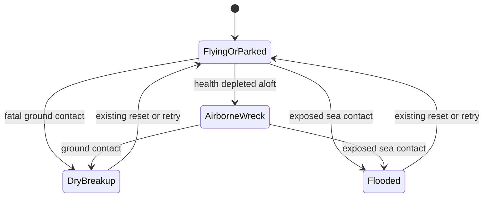
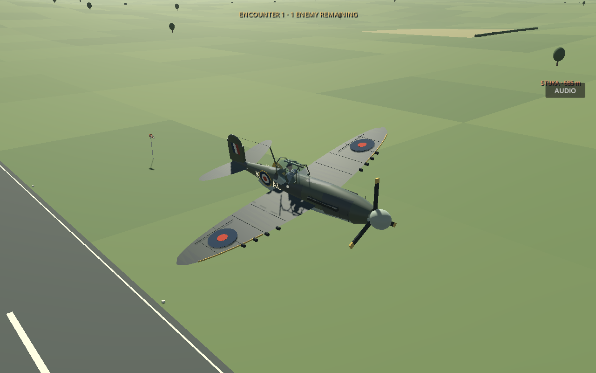
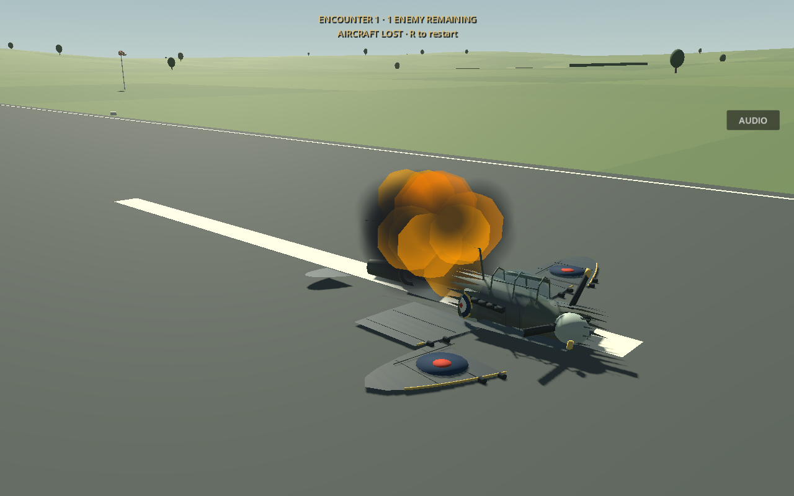
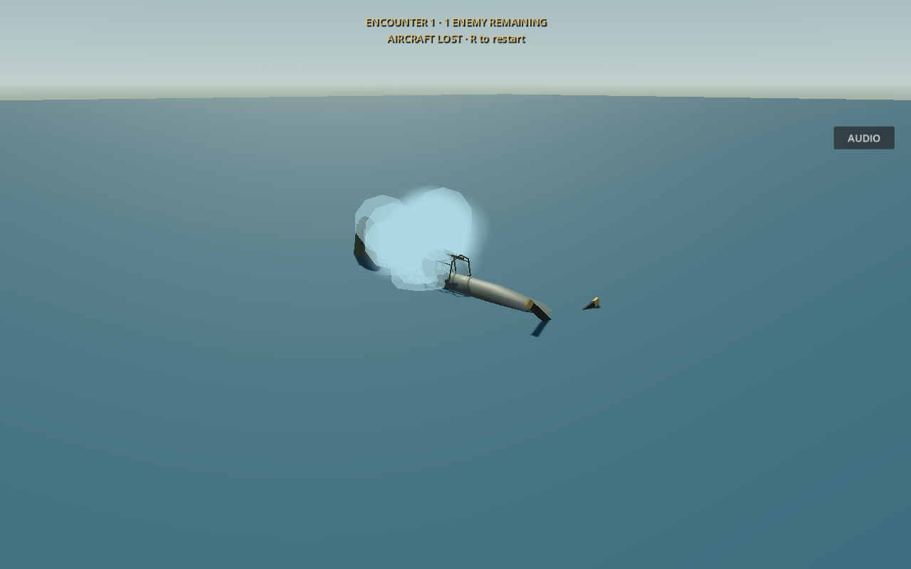

# 16 October 2026 — Aircraft breakup, sea impacts and Spitfire finish

## Evidence boundary

Reviewed `ace5393b3ebc4d37d0d9057ba4980a0df67b9711..edd402ff336f611eac20cbd37917d68a5cb68325` on branch `work`, remote `https://github.com/zelenski3398/codexproj1.git`.

- [`1e52c0a`](https://github.com/zelenski3398/codexproj1/commit/1e52c0a): documentation publication of the preceding St Elmo work; no additional gameplay implementation.
- [`edd402f`](https://github.com/zelenski3398/codexproj1/commit/edd402ff336f611eac20cbd37917d68a5cb68325): shared physical crash fragments, sea plunge, Spitfire detail pass, original crash sound, checks and CI entry.

The original complete report remains a frozen historical snapshot. This addendum records the newer source implementation rather than rewriting earlier claims.

## Before and after

Previously, aircraft retained their intact visual mesh after fatal contact. Session/interception handlers created impact bursts, but there was no shared breakup presentation. Malta's `MediterraneanSea` world-boundary collision plane also supported suspension rays and aircraft hulls, allowing aircraft to rest on the sea.

Now [AircraftImpact](../../scripts/aircraft_impact.gd) belongs to every `FlightAircraft`, including enemy subclasses. Fatal dry contact splits the actual visible model triangles into eight spatial groups: inner/outer left and right wings, engine/front fuselage, cockpit/middle fuselage, rear fuselage and tail. Each group becomes a separate rigid body with inherited motion plus a scatter velocity and spin. Fragments are centred on their own geometry, retain surface materials, and use approximate box contacts. The intact visual disappears. The pilot avatar is excluded from fragmentation.

The fragment limit is eight per aircraft and 64 across the scene tree. Individual fragments expire after 12 seconds or earlier if the aircraft/session is removed; reset clears them. They collide with the world, but do not create secondary combat damage. `EnemyAircraft.wreck_remove_delay` is now 12 seconds so its pieces remain visible longer. Previously it was four seconds.

[FlightAircraft._integrate_forces](../../scripts/aircraft.gd) still performs normal aerodynamic and suspension integration. An aircraft destroyed while airborne continues falling under that physics. Breakup starts only at contact. Healthy gentle landings retain the original suspension and crash thresholds. The existing crash flag and health-depletion signal remain separate lifecycle paths; a fatal collision does not require changing the global damage rules.

## Water behaviour

[MaltaWorld](../../scripts/malta_world.gd) marks its existing sea collision body with `aircraft_water`. Each aircraft registers a collision exception against those bodies; [LandingGear.integrate](../../scripts/landing_gear.gd) excludes their RIDs from its suspension rays. The sea remains available to soldier, vehicle, projectile and other world queries. No geographic mesh, coastline, elevation or airfield position changed.

Near sea level, a downward query from above the aircraft checks that the uppermost world surface is exposed water, rather than terrain over the infinite plane. A sea impact emits one pale splash and enters the existing fatal aircraft lifecycle. The visible hull remains intact while it physically submerges. A simplified flooded-airframe force damps forward motion and balances gravity/vertical resistance toward the configurable sinking speed. Angular damping and a modest pitch torque replace flight control after flooding. This is a gameplay approximation, not fluid or buoyancy simulation.

Enemy sea wrecks emit their normal one-shot impact event but remain unfrozen while sinking. The existing chase camera's terrain/sea clearance keeps the camera above the surface. Below 25 metres depth, the flooded visual is hidden. All impact-driven engine smoke/fire is cleared, preventing underwater fire emission.

`AircraftImpact.started`, the existing enemy impact latch and the mission result latches prevent repeated presentation or kill notifications. The session/interception impact containers remain for their existing accounting and cleanup; their duplicate visual bursts are disabled. The shared aircraft component renders the single dry explosion or water splash.

## Spitfire appearance

[SpitfireModel](../../scripts/spitfire_model.gd) has original reference-inspired green/grey paint, pale undersides, elliptical upper/lower wing surfaces, red/blue upper-wing roundels, yellow-bordered fuselage roundels, larger pale code letters, a fictional serial, framed canopy, six exhaust blocks per side, panel/aileron lines, yellow leading edges and an aerial mast/wire. Old raised oval wing camouflage blobs were removed. Paint uses explicit `StandardMaterial3D` surfaces without external textures. The shared fuselage helper retains its previous appearance for other aircraft unless the base Spitfire explicitly enables the reference finish.

The eight actual wing gun markers, aircraft collision shapes, flight constants and existing pilot seating remain intact. This is a procedural game model and does not reproduce photographic detail or claim exact historical markings. The screenshot informed the appearance; its image, lighting and watermarks are not used as model textures.

## Effects and audio

[DestructionBurst](../../scripts/destruction_burst.gd) supports configurable size and a pale water variant using CPU mesh particles. Other callers retain the original default effect strength; aircraft request a larger burst. The shared component clears engine damage effects after impact, while preserving them on an airborne damaged wreck before contact.

`assets/audio/aircraft_crash.ogg` is an original synthetic impact thump/crack/rumble. [The generator](../../tools/generate_crash_audio.py) records its deterministic construction. It is a positional sound on the existing `Guns` bus, capped at four simultaneous crash sources and cleaned with its burst. It is not a sampled or historically authenticated crash recording. Audio balance still needs listening on the player's hardware.

## Tuning and manual procedure

`AircraftImpact` exports `debris_lifetime`, `fragment_speed`, `water_drag`, `sinking_speed` and `crash_sound`. `EnemyAircraft` exposes its wreck removal delay; `DestructionBurst.strength` controls effect size. Source limits cap debris and simultaneous sounds.

1. Start either player aircraft on the countryside runway; take off and perform a gentle gear-down landing. Confirm normal controls, suspension and brakes.
2. Reset and make a severe ground impact or belly landing. Confirm one explosion, separated moving wings/fuselage/tail and an intact-model disappearance. Press the existing reset key and check that no fragments remain.
3. In Malta, fly out over the sea and descend into it with either gear setting. Confirm a splash, loss state, forward deceleration and continued submersion, without wheel support or an underwater fireball.
4. Shoot down an enemy over land and over sea. Confirm normal mission loss accounting once, dry breakup on land and a sinking sea wreck.
5. Retry the session and verify healthy parked aircraft, clear effects and normal controls. Inspect the revised Spitfire in sunlight and in flight.

## Validation and limits

Godot 4.6.3 Compatibility native checks: **383 passed** across `aircraft_impact_checks` (20), `flight_checks` (35), `interception_checks` (77), `weapons_checks` (36), `component_damage_checks` (148), `aircraft_choice_checks` (31) and `malta_checks` (36). These cover actual rigid-body movement, real Malta sea registration and submersion, biplane breakup, enemy water lifecycle, retry cleanup, safe landing and existing weapons/damage/mission behaviour. The new impact suite is included in `.github/workflows/web.yml`.

`tools/build_web.sh` imported and exported successfully. Chromium/ANGLE release-game checks in [aircraft_impact_web_smoke.cjs](../../tools/aircraft_impact_web_smoke.cjs) passed **5/5** using actual keyboard input: intact Spitfire, real ground destruction, eight fragments, dry-impact selection, reset and absence of script/resource/WebGL errors. The opt-in `?smoke=1` diagnostic only reads impact state.

Native rendered fixtures were launched on Xvfb/llvmpipe and inspected. They use the real model/effect/physics code with controlled scenario initial positions, not an uninterrupted player-flown mission. No complete interactive sea approach was flown in a browser; browser water visuals and hardware-specific audio balance remain unverified. Live GitHub Pages deployment status was inaccessible from this environment. No claim of deployment success is made from export success alone.

Fracture is a coarse eight-piece visual approximation: cut edges are not capped, markings implemented as labels do not become debris, and box collisions do not reproduce each irregular fragment. The sea uses a flat surface without waves, buoyant floating debris or underwater rendering. The smoke/fireball is deliberately lightweight Compatibility geometry.

## Rendered previews

Controlled native fixtures from [aircraft_impact_capture.gd](../../tests/aircraft_impact_capture.gd):

