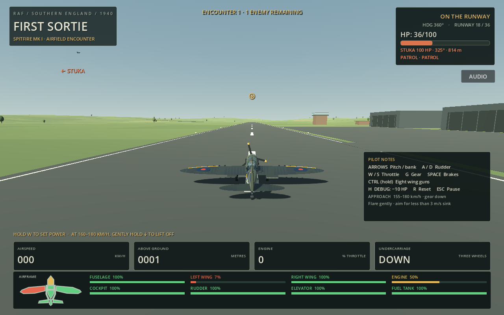

# 16 October 2026 — Live component health HUD

Source snapshot: [`3fee516556e501ef93d4768b1d3f5f555d048b14`](https://github.com/zelenski3398/codexproj1/commit/3fee516556e501ef93d4768b1d3f5f555d048b14). Reviewed range: `edd402ff336f611eac20cbd37917d68a5cb68325..3fee516556e501ef93d4768b1d3f5f555d048b14`. The intervening `9b3c6fa` published the preceding crash documentation without further gameplay changes.

[AircraftDamageHUD](../../scripts/aircraft_damage_hud.gd) adds an always-visible top-down diagram and eight labelled integrity percentages/bars to the bottom of the flight screen. It reads `AircraftDamage.integrity_ratio` for fuselage, left/right wings, engine, cockpit, rudder, elevator and fuel tank. Each value is normalized against its actual airframe profile's maximum integrity. Whole-aircraft HP remains a separate existing measurement.

Colours interpolate continuously through green at 100%, amber at 50% and red at 0%. Distinct wing, nose, cockpit, central tank, fuselage and tail patches show where the damage is. Percentages and bars supplement colour. The schematic indicates systems rather than reproducing a particular airframe's physical hitbox geometry.

[FlightHUD](../../scripts/hud.gd) refreshes the read-only display with the active aircraft and moves existing instruments/notes upward to make room. The display redraws only when component ratios change; it does not capture input. Existing HUD creation on aircraft boarding/switching binds the correct aircraft. Reset/repair returns values to green automatically. On-foot, vehicle and AA operation retain their existing flight-HUD visibility rules. No damage calculation, flight physics, controls or weapon logic changed.

For manual verification, open F3, select a component, apply damage and close the inspector. The matching patch, percentage and bar should change while unrelated healthy parts stay green. Existing reset restores every component; changing aircraft must show that aircraft's retained state. H applies global HP damage and does not identify a component.

Validation: **26/26 new HUD checks**, **148/148 component checks**, **24/24 keyboard checks**. Tests cover actual profile-scaled hits to every part, colour endpoints/interpolation, layout bounds in viewport coordinates, reset and Gladiator switching. Godot 4.6.3 Compatibility imported/exported the web game successfully. Chromium/ANGLE release-game tests passed **8/8**, including initial eight-part visibility, actual F3 component damage changing the correct browser readout/colour and reset restoring all values. No browser script, resource or WebGL errors were recorded. The HUD suite was added to the existing publishing workflow.

Native Xvfb/llvmpipe preview below is a controlled fixture using actual left-wing and engine damage. It is not a claim of a full manually flown mission. Accessibility on unusually small displays and a live GitHub Pages deployment have not been separately verified.

