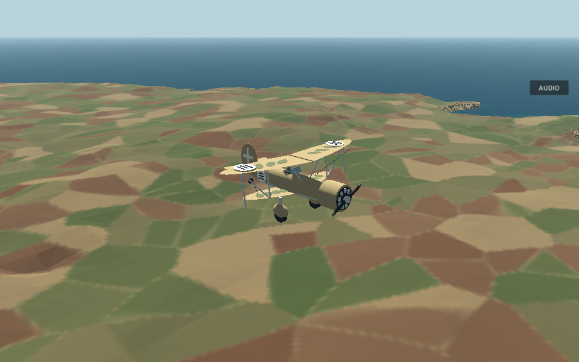
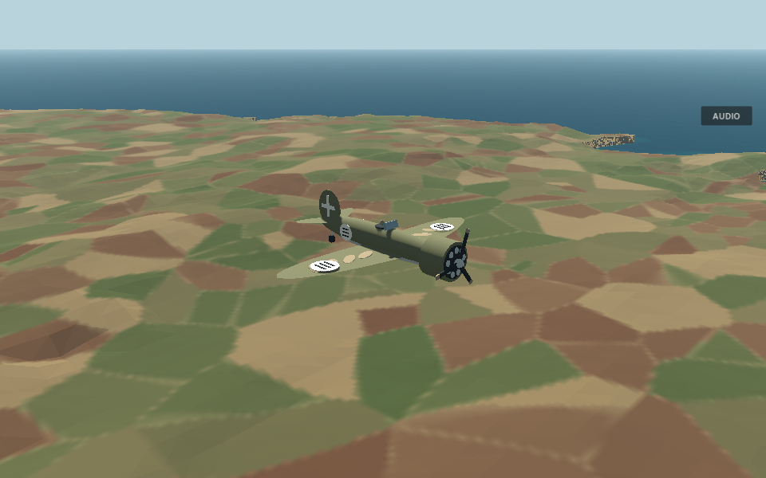
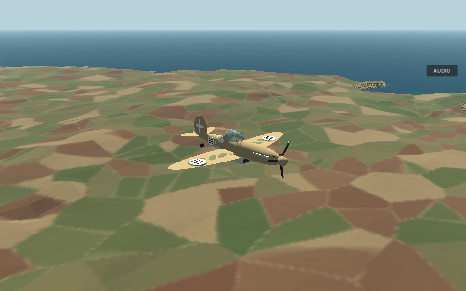

# 16 October 2026 — Player-requested random Malta encounters

[Update index](README.md) · [Supplied reference diagrams](reference-diagrams.md) · [Original history](../development-history/README.md)

## Evidence boundary

Implementation: **`e13cef200ed63bc10efca04e0342e16efc3b1cbf`** ([GitHub diff](https://github.com/zelenski3398/codexproj1/commit/e13cef200ed63bc10efca04e0342e16efc3b1cbf)).

The original report covered through `588ac7b1b37b72014b73fe679871e790e5c79145`. Its publication, [`c151258`](https://github.com/zelenski3398/codexproj1/commit/c1512585b0222b13f38d7d6270090857eb2bfeb8), added documentation only. This addendum covers that publication and the gameplay commit above; it does not silently replace the original 50-commit evidence manifest or its historical counts. The root README and [update state](state.json) record the full new source boundary for future exclusive-range reviews.

## Before and after

Malta's ordinary encounter mode previously created one Stuka on departure/retry and used the existing confirmation action only after a kill. CR.42 and C.200 already existed as functional Italian aircraft; C.202 did not. The scripted interception used a fixed SM.79/C.200 formation.

Now choose **Malta → FREE ROAM** and depart from any field: there are **no initial enemies**. Press **C** or click **Spawn Random Enemy** when ready. One live enemy is selected uniformly from **Stuka, CR.42, C.200 and C.202**. Defeat it, then request another using **Spawn Next Random Enemy / C**. Random selection may repeat a type; it is not a fixed rotation or a guaranteed no-repeat bag. SM.79 remains an authored-mission aircraft and is not part of this free-roam roster.

The same active/wreck tracking, one-shot destruction signals, deferred confirmation latch and generation token prevent duplicate or stale spawns. Pressing C while an enemy is active does not add another. Departure, boarding, aircraft changes and elapsed time do not request combat. Retry clears the world and returns to peaceful free roam. The countryside still starts with its Stuka; Survival still starts stage 1 immediately and uses its existing five-stage roster; authored missions retain their own timing/counts.

[EnemyEncounters](../../scripts/enemy_encounters.gd) adds `initial_spawn_pending`, `is_manual_free_roam()`, `_enemy_kind()` and `_spawn_anchor()`. Initial confirmation starts encounter 1; later confirmations increment it. Only the free-roam path uses the configurable `free_roam_enemy_types` and randomized generator. Existing safe-position terrain rays, sphere clearance and wreck separation remain in use. The anchor follows the occupied aircraft/truck/gun or walking pilot, rather than spawning near an abandoned aircraft at the departure base.

[main.encounter_tracking_changed](../../scripts/main.gd) distinguishes an initial peaceful world from an enemy kill, so it does not show “Enemy destroyed” before combat. [MaltaDepartureMenu](../../scripts/malta_departure_menu.gd) explains the C action; [WebSupport](../../scripts/web_support.gd) exposes pending state and enemy kinds only through existing opt-in smoke telemetry.

No activation path resets player aircraft position, velocity, throttle, engine state, health, fuel, component integrity or existing projectiles. Controllers and world ownership remain as documented in the original report.

## Aircraft models and integration

[ItalianAircraftModel](../../scripts/italian_aircraft_model.gd) remains separate from flight/AI/health. CR.42 gains muted sand/green camouflage, unequal-span biplane bracing and a recognition band. C.200 retains its radial-engine/open-cockpit monoplane silhouette with additional camouflage/band details. Both retain their existing performance and weapon definitions.

The new **Macchi C.202 Folgore** has a visibly different slim inline-engine cowling, three-blade spinner/propeller, enclosed framed canopy, exhaust stacks, side intake and ventral radiator. [c202.tres](../../aircraft_definitions/c202.tres) registers its mass/inertia, thrust, drag, cruise target and control values through the existing `EnemyAircraftDefinition` factory. Its [damage profile](../../damage_profiles/c202.tres) reuses the eight-component framework with a narrower/longer engine sensor and enclosed-cockpit fit.

| Tuning | CR.42 | C.200 | C.202 |
| --- | ---: | ---: | ---: |
| Configured mass | 2,400 kg | 2,600 kg | 2,930 kg |
| Configured cruise target | 55 m/s | 75 m/s | 92 m/s |
| Engine thrust | 9,800 N | 12,500 N | 16,500 N |
| Parasite drag coefficient | 0.055 | 0.035 | 0.032 |
| Gear | Fixed fairings | Retractable | Retractable |

These are accessible-game tuning values, not historical flight-test claims. The 60-second real-force patrol fixture measured approximately 54.0, 81.0 and 102.9 m/s respectively with safe altitude. Controller targets are not hard speed caps. C.202's two forward guns, team, lead/steering, swept rounds, component damage, HP/effects and destruction all use `ItalianEnemy` and the shared systems; it has no fictitious rear gunner. Player aircraft choices remain Spitfire and Sea Gladiator.

There are now **seven represented airframe types**: two player types and five enemy types (Stuka, CR.42, C.200, C.202, SM.79). This supersedes the original snapshot's six-type count without rewriting its frozen statistics.

## Rendered model previews

These are actual native Godot 4.6.3 Compatibility/llvmpipe captures using a review camera, not source photographs or claimed interactive dogfights.

| CR.42 | C.200 | C.202 |
| --- | --- | --- |
|  |  |  |

The linked image host returned proxy 403 for all three supplied reference URLs. Consequently no exact photograph inspection/matching is claimed. Models are original simplified geometry based on the named airframes and their distinctive characteristics; no downloaded or paid 3D asset is substituted.

## Checks performed

| Native suite | Result and scope |
| --- | --- |
| `malta_encounter_checks.gd` | 33/33: peaceful start, explicit button/key, pause/repeat guards, preserved state/bullets, actual spawning of all four types, seeded selection, current-location anchor, kill wait, retry/stale callback/player loss, unchanged countryside/Survival |
| `italian_aircraft_checks.gd` | 47/47: four Italian factories including SM.79/C.202, silhouette identity, 60-second physical patrols, swept component hits, reciprocal player damage, exact smoke threshold and destruction |
| `survival_checks.gd` | 84/84: all five stage counts, final ace, confirmation/state retention and loss/retry |
| `malta_checks.gd` | 36/36: boarding, engine, force-driven takeoff, landing/braking, persistent airframe changes and peaceful retry |
| `aa_presentation_checks.gd` | 14/14: explicitly requested hostile markers, manual gun camera/fire/effects |
| `interception_checks.gd` | 77/77: checkpoints, formation, timing, outcomes and retry remain intact |
| `interception_combat_checks.gd` | 7/7: bomber defensive mounts, damage and physical route |
| `keyboard_checks.gd` | 24/24: established flight controls and pause/reset |
| `dive_defence_checks.gd` | 47/47: scripted waves, operator/gun damage and mission outcomes |

**369 native assertions passed**, with no failures in the final runs. Import and Web release export completed without script/shader/resource errors. Native visual capture rendered all three fighter types and the existing bomber.

The actual single-thread WebGL 2 release passed **16/16 focused Malta browser checks** and **31/31 broad browser checks** in Chromium/ANGLE: 47 total. These used real button/key input for peaceful departure, a random requested hostile, repeat prevention, boarding, engine control, guns/damage, pause, retained aircraft state and peaceful full retry. Neither suite reported Godot/JavaScript runtime errors.

The new native encounter suite is included in [.github/workflows/web.yml](../../.github/workflows/web.yml). Existing native/browser tests that assumed a mandatory first Malta enemy were updated to explicitly request it when their fixture needs combat, or to expect peaceful departure/retry. The terrain/audio browser helpers' changed expectations were syntax-checked; their full dedicated suites were not rerun for this change. Documentation folders have `.gdignore` sentinels so Godot does not treat activity CSVs as translation inputs or import documentation-only diagrams.

All **21 unique Mermaid sources** (17 original plus four supplied concepts) parsed and rendered in Chromium using Mermaid 11.12.0. Relative Markdown links, the original 50-commit manifest, source existence and the new README/state commit boundary were checked. The original report remains clearly labelled at its older source snapshot.

## Remaining interactive checks

The native encounter suite uses disclosed frozen-airframe/travel fixtures for exact state assertions; the Italian suite includes actual physical patrols and swept-hit scenarios. Browser tests use the real exported WebGL build and menu/key/button input. They do not establish human-flown dogfight balance, every native OS input path, all four random types visually inspected in the browser or historical aerodynamic accuracy. A manual C.202-versus-Spitfire/Gladiator encounter and representative consumer-GPU performance remain unverified.

To review manually: depart Malta without pressing C, board/start/take off peacefully, press C once airborne, fight the indicated opponent, then press C after its destruction. Confirm damage/fuel remain unchanged between fights. Retry should again leave no enemy. Random repeats are expected; all four types can be forced individually for testing by setting `EnemyEncounters.free_roam_enemy_types` to a one-entry list in a fixture, without changing other modes.
