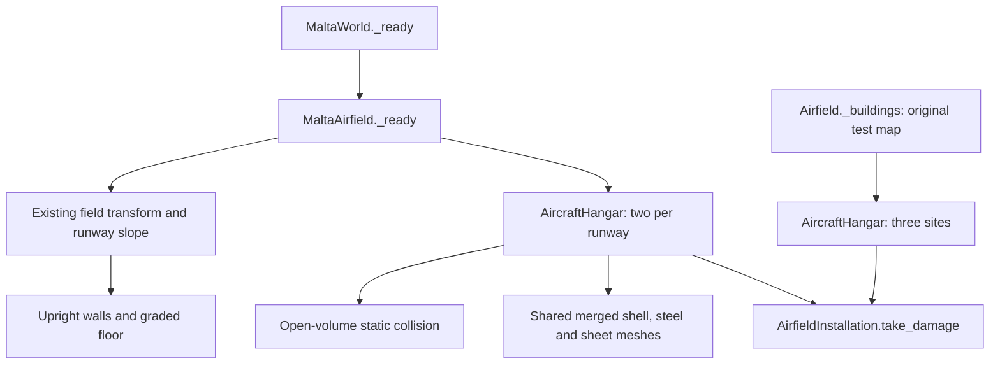

# 18 October 2026 — open steel-truss hangars at every runway

Previous documented source boundary: [`aea836f41aa952a3ed41c88d31808b1804d68b49`](https://github.com/zelenski3398/codexproj1/commit/aea836f41aa952a3ed41c88d31808b1804d68b49).

Current source snapshot: [`632470873e456728cf44d0b90af3bc7ade5dd6b2`](https://github.com/zelenski3398/codexproj1/commit/632470873e456728cf44d0b90af3bc7ade5dd6b2). This addendum covers the exclusive range from that previous boundary to this snapshot. The original full-history report remains frozen at `588ac7b`.

## Evidence and evolution

| Commit | Observable change |
|---|---|
| [`6fb32bb`](https://github.com/zelenski3398/codexproj1/commit/6fb32bb9b8198092e885ca599206a3730817f548) | Documentation maintenance: published the previous universal-damage implementation/validation and advanced its source boundary. No hangar implementation. |
| [`6324708`](https://github.com/zelenski3398/codexproj1/commit/632470873e456728cf44d0b90af3bc7ade5dd6b2) | Replaced solid-box hangars with original open buildings, retained installation damage, added ground-fit/clearance/taxi/restart checks and native previews. |

Before this change, Malta had two solid installation boxes per airfield, and the test airfield had three solid building boxes with door-like exterior decoration. Their apparent doors could not be entered. The current implementation keeps those site counts but provides open interiors, roof thickness, sheet seams, closed triangular gables, repeated trusses, purlins, side columns and wall bracing.

The user's sketch establishes the design, not historical dimensions. The selected 48 × 36 m footprint, 42 × 8.8 m opening, 10 m eaves and 16 m ridge are inferred game-scale dimensions. Existing Spitfire geometry has an 11.2 m wingspan, so three fighters fit side by side with clearance. No claim of an exact historic Malta hangar is made.

## Current architecture

The same subclass is used in both environments. `_shell`, `_structure` and `_sheets` in [aircraft_hangar.gd](../../scripts/aircraft_hangar.gd) own all building generation; aircraft, missions, projectiles and soldier controllers do not gain hangar-specific logic. The subclass uses the existing installation damage API and persistent ruined state. All intact materials and seven mesh resources are shared, with one separately graded floor per building and distance culling of detail.

Placement changes only the two former box buildings in [MaltaAirfield](../../scripts/malta_airfield.gd) and the three in [Airfield](../../scripts/airfield.gd). Larger Malta footprints extend outward from the same X=82 m apron-facing frontage. Airfield geographical transforms, terrain, roads, runway mesh, parked aircraft, trucks, guns, commander posts and pilot spawn coordinates are unchanged.

## Checks actually performed

**Nine native suites: 338/338 assertions passed. Seven production-browser checks: 7/7 passed.** [Machine-readable evidence inventory](validation/hangars-2026-10-18.json).

| Native suite | Passed |
|---|---:|
| New hangar geometry, collision, taxi, damage and retry | 89 |
| Airfield ground grading | 39 |
| Public-road → apron → AA truck driving | 27 |
| Soldier/vehicle/gun control transitions and collision | 61 |
| Malta flight, boarding, landing and persistence | 36 |
| Malta road integration | 11 |
| Dive-defence waves and outcomes | 47 |
| Harbour mission ground start and departure | 9 |
| Italian interception takeoff/checkpoints/timing | 19 |

`bash tools/build_web.sh` completed a production release export using official SHA-512-verified 4.6.3 templates. Chromium/ANGLE SwiftShader then exercised the actual poster/menu, original test runway, Luqa departure, all six Malta hangars, shared geometry, unchanged aircraft/AA counts and a full retry. No JavaScript, shader, missing-resource or HTTP errors were observed. This was an integration smoke check, not a browser taxi flight.

The focused suite measures terrain underneath the new floor at nine points per building. Maximum measured floor-plane/terrain differences were 0.000 m for the test runway, up to 0.006 m at Ta' Qali, 0.010 m at Luqa and 0.006 m at Ħal Far. The slab top adds approximately 0.025 m. These are sampled checks, not an exhaustive survey of every point.

Native captures were rendered from the actual Malta world through Compatibility/OpenGL with Mesa llvmpipe. A V-Sync capability warning from the dummy display remains; no native shader/resource errors were reported. [Exterior, interior and three aerial previews](../aircraft-hangars.md#previews) show the resulting geometry. The three aircraft inside the close views are preview-only models; live missions retain their existing dispersal positions.

Limitations: no manual human playthrough at all nine hangars, no browser taxi manoeuvre, and no mobile performance benchmark. Automated native taxi checks use real flight forces after an initial position fixture. Building geometry is an artistic military design, with no structural engineering certification, moving doors or automatic indoor services.

## Documentation and future updates

[Feature guide](../aircraft-hangars.md) records placement, exported tuning, implementation, screenshots and a repeatable manual procedure. The README and machine-readable state advance to the source snapshot above. The subsequent documentation publication commit is intentionally outside its own boundary and belongs in the next review.
