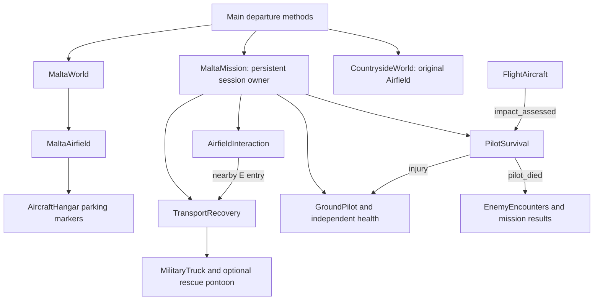

# 20 October 2026 — hangar departures, pilot survival and recovery

Previous documented source boundary: [`632470873e456728cf44d0b90af3bc7ade5dd6b2`](https://github.com/zelenski3398/codexproj1/commit/632470873e456728cf44d0b90af3bc7ade5dd6b2).

Current source snapshot: [`8f01e46f43ed77c33847f5bc0c2e6456a8333a14`](https://github.com/zelenski3398/codexproj1/commit/8f01e46f43ed77c33847f5bc0c2e6456a8333a14). This addendum covers only the exclusive range from that boundary to this snapshot. The complete historical report remains frozen at its original `588ac7b` snapshot.

## Evidence and evolution

| Commit | Observable change |
|---|---|
| [`c316e39`](https://github.com/zelenski3398/codexproj1/commit/c316e39f454943922eef4a69e428906ec8e40c64) | Published the previous hangar integration/validation and its source boundary. Documentation maintenance. |
| [`8f01e46`](https://github.com/zelenski3398/codexproj1/commit/8f01e46f43ed77c33847f5bc0c2e6456a8333a14) | Interior aircraft stands, persistent human health, recovery transport, safe wreck exits/remnants, countryside adapter, Malta default menu action and independent poster playback. |

Before this change the new hangars were usable buildings but player-available aircraft still spawned on the apron. `MaltaMission.leave_aircraft` rejected wrecks, several mission/director paths treated hull loss as pilot death, and the primary menu Fly action selected the countryside controller. Recovery transport did not exist. The poster inherited pause behaviour and decoded video/audio together.

Current source verifies the following changes:

- `AircraftHangar.parking_points` / `parking_pose` and `MaltaAirfield._ready` produce designated interior poses. `MaltaMission` consumes those poses for its original fleet, rather than creating replacement aircraft on demand.
- `PilotSurvival` connects actual impact assessments and cockpit hits to the existing independent `GroundPilot.health`. It also handles nearby fire/explosive exposure, one-shot death UI and mission/director death notifications. Hull depletion itself applies no pilot injury.
- `AircraftImpact` emits `impact_assessed` for terrain and water, and optionally retains central player-wreck geometry after transient fragments expire. The underlying aerodynamic controller and weapons remain in place.
- `TransportRecovery` owns one request and temporary truck, checks road/apron/terrain pickup support and clearance, handles sea-pontoon pickup and requires nearby E entry before the faded return. `safe_base_point` prefers a surviving replacement and rechecks clearance. No mission/world restart or healing occurs.
- `AirfieldInteraction` dispatches recovery-truck entry through the same E interaction path. `GroundPilot` supports buoyant water movement. Normal vehicle controls remain; unoccupied trucks now positively hold their parking brake after settling.
- `EnemyEncounters`, `VallettaInterception` and `HarbourInterception` use persistent pilot health for player loss. Independent objectives, waves, enemy losses and interception deadline rules remain. `DiveDefenceMission` starts beside the hangar aircraft and retains failure on loss of all six guns.
- `CountrysideWorld` reuses the original `Airfield` terrain/buildings through the same persistent owner, retaining a separate public test-map option. The old low-level `start_flight` API remains for isolated regression fixtures, not public departures.
- `Main.start_free_roam` selects Malta directly with initialized fighter/airfield defaults. Backing out of configuration retains choices. `restart_malta` preserves the selected environment for both public map types.
- `GameIntro` explicitly processes during pause, starts after layout, guards repeated transitions, loops the animation and has a bounded stall watchdog. The video-only Theora stream and separately preserved Music-bus soundtrack remove the video/audio-clock coupling. Return to title creates one fresh moving poster; mission retry bypasses it.

## Diagnosed problems and consequences

The actual nose-first collision probe exposed a double-rotated contact normal. The old calculation measured roughly 2.63 m/s normal speed in a 62.46 m/s collision and classified it as controlled. Using the engine-returned world-axis normal measured roughly 62.41 m/s and severity 5.41, producing the intended fatal pilot injury. The regression now tests a genuinely fatal nose-first impact; a level aircraft that slows to a survivable belly impact is not forced to kill its pilot.

The exit capsule's exclusion list must be assigned after adding the sea RID: mutating the array returned by the physics query getter did not update the query and incorrectly blocked every sea exit. The corrected query permits swimming while still testing wreck/terrain/structure clearance.

A returning survivor originally arrived beside the now-empty selected stand; destination selection now favours a living replacement. Pickup originally preferred the exterior road while overlooking a closer painted driving lane; it now considers both. Taking another usable aircraft or using existing map travel cancels stale pickup so it cannot block a later request.

The native poster test reproduces pause-independent processing and checks changing decoded texture data through a full loop and a title return. The browser test checks moving frames and a loop before its first gesture. The user's original intermittent device-specific freeze was not directly recorded; the documentation distinguishes the corrected pause/audio-clock dependencies from an unproven claim of a unique cause on every device.

## Validation actually performed

**53 native suites: 1,833 passing assertions. Production browser: 14/14 checks passed, with no observed JavaScript, shader, resource or HTTP errors.** [Per-suite evidence inventory](validation/pilot-recovery-2026-10-20.json).

New focused results: shared pilot/recovery **70/70**, inverted exit/remnants/retry/options **13/13**, countryside departure/recovery **12/12**, and rendered native poster playback **9/9**. Existing interception now passes **78/78**, Survival **84/84**, airfield controls **61/61**, and pilot-character integration **22/22** with the intentionally damageable hidden seat capsule. The wider inventory covers the existing flight, weapons, component damage, Italian aircraft, harbour missions/radio, AA, terrain, cities, roads, audio and UI suites. Failed intermediate runs were corrected and the affected suites rerun; their passing replacements appear in the inventory, not as ignored failures.

The final exporter completed with bundled road JSON, silent video, separate soundtrack and all new scripts. FFprobe verified that the movie has one Theora video stream and no audio stream. Frame-MD5 comparison against the prior committed movie verified all 121 video frames unchanged. No replacement speech or generated audio was used.

The native preview harness saved [hangar departure](../previews/recovery-hangar-departure.png), [ground pickup](../previews/recovery-truck-pickup.png) and [sea pickup](../previews/recovery-sea-pontoon.png). It uses explicit aircraft-location fixtures and is not a manual sortie recording. Its llvmpipe shutdown reported four 256-pixel texture cleanup errors after image saving; these are reported separately from successful assertions and the error-free browser smoke. The existing keyboard suite also reports ObjectDB/resource cleanup diagnostics at exit; AA tests emit some colinear look-at warnings, and the intentional missing-radio-asset branch emits its expected warning.

## Limits and follow-up testing

- No human completed an uninterrupted manually flown takeoff → survivable crash → truck recovery → second takeoff in every mode. Native crash-location fixtures isolate recovery; separate existing tests perform real takeoff/flight/landing and fatal collision physics. The browser uses real menu, H hull-debug, E, V and walking inputs without assigning gameplay state.
- Water movement uses the existing avatar, with no dedicated swimming animation. The truck-carrying rescue pontoon is an explicit functional placeholder, not a historical vessel reconstruction.
- Exit/pickup searches are finite clearance/support samples; arbitrary inaccessible arrangements and every possible road approach are not formally proven reachable.
- No mobile or hardware-performance benchmark was performed. Chromium used software ANGLE/SwiftShader and runs substantially slower than real time on this environment.
- Recovery preserves damage; it adds no repair, refuelling, revival or indefinite dynamic debris. Independent mission objective failures remain valid even if the pilot survives.

[Current controls, tuning, architecture and manual procedure](../pilot-survival-and-recovery.md). The README/state boundary advances to the source snapshot above; the subsequent publication commit belongs to the next incremental review.
