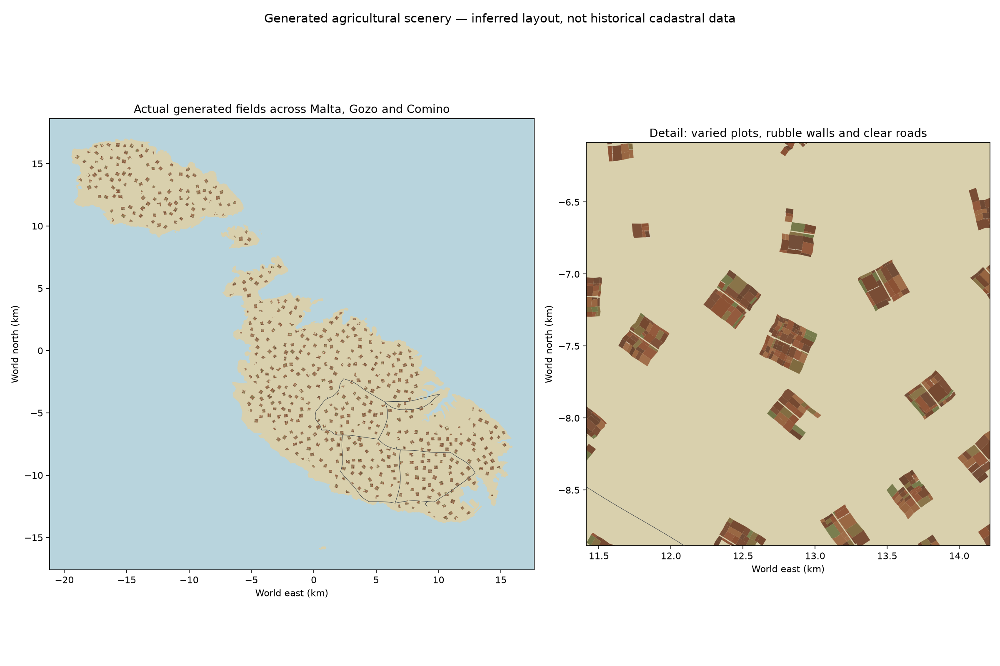

# 24 October 2026 — island-wide rural fields and interception sirens

Source boundary: [`cebd3f7ffd61c870b7fef77cf29f2fc891ad2dd9`](https://github.com/zelenski3398/codexproj1/commit/cebd3f7ffd61c870b7fef77cf29f2fc891ad2dd9). Previous documented source: `eb17dfe2b8e60c92d08386c33d84b83afe291743`. The exclusive range contains the previous documentation publication `9bd67d5` and this feature commit. The original complete history remains frozen at its original snapshot.

## Scenery evolution

The previous countryside had 115 clusters, 4,332 plots and a 15 km wall budget. Most of Malta remained outside these scattered additions. The [generator](../../tools/generate_malta_countryside.py) now samples more eligible centres, removes the road-proximity requirement for remote countryside, and uses configurable separation and broader unequal plot sizes. Roads remain exclusions, including their original seven-metre field margin. Settlement, coastline, terrain-slope and military-airfield masks remain in force.

The generated result has **556 clusters, 17,977 plots, 540 dirt-track pieces and 44,999.25 m of rubble walls**. Of these, 432 clusters are on Malta and 124 across Gozo/Comino. Every one of the 64 substantial eligible 2.5 km coverage cells has both fields and walls. These cells are a validation grid, not a grid of identical field geometry. Layouts remain inferred agricultural scenery rather than surveyed historical parcels.

Wall selection traverses cluster edge groups in round-robin order, distributing the limited length budget across regions. Whole plot footprints and wall envelopes must fit the permitted land; shared wall edges, access gaps, terrain draping and existing exclusions remain. The source checks verify zero overlapping fields and no intrusion into protected road corridors. Protected terrain, road, city, airfield-data and Cottonera hashes are unchanged.

Five-hundred-metre spatial batches reduce the expanded layout from 1,680 batches in the initial expansion to **950 batches / 4,260 GLBs**. Close detail loads within 530 m and unloads beyond 900 m; the existing maximum of six close batches and two asynchronous requests remains. Static collision and coarse scenery remain loaded. The asset footprint increases to about 315 MiB, with a roughly 349 MiB exported game pack; larger coverage is not cost-free. No hardware performance guarantee is inferred from successful loading.

[Current countryside guide, native aerial/ground captures and regeneration procedure](../malta-countryside.md).

## Mission audio

[InterceptionSiren](../../scripts/interception_siren.gd) reuses the supplied `assets/audio/defence/air_raid_siren.ogg` recording. [EnemyEncounters](../../scripts/enemy_encounters.gd) owns one alarm and derives its request from the existing mission/active-enemy state; no spawning, objectives, timer or damage rules change.

| Mode | Alarm lifecycle |
|---|---|
| Defend Valletta / Ta' Qali interception | Departure and checkpoints through battle; fade on result |
| Faith, Hope and Charity | Departure, combat and regroup intervals; fade on result |
| Survival | Live enemies in each stage; quiet while waiting for confirmation or after completion/death |
| Ordinary free roam | Quiet initially; alarm while a manually spawned enemy is active |
| AA defence | Existing mission-long positional siren retained; no second alarm |

The new alarm is a quiet listener-relative loop on the existing Aircraft bus, so it works from an aircraft, truck, on foot or at a gun and inherits radio ducking. Exported volume defaults to -22 dB with a one-second fade. Leaving a session immediately stops it; retry reuses the single player with a fresh start. No fabricated speech or substitute sound was added.

## Checks actually performed

- **24 GIS/source checks:** diverse sizes/orientations, all-region coverage, full-footprint exclusions, underlying triangle slopes, shared wall boundaries, actual terrain heights, protected source hashes, unchanged default Cottonera stone output, materials/normals and asset references.
- **Full deterministic rebuild:** a separate temporary build reproduced all 4,260 GLBs byte for byte and retained field/wall metadata. Its coverage-enhanced manifest became the shipped manifest.
- **301 native Godot assertions:** countryside 10; new siren lifecycle 22; interception 78; harbour 50; Survival 84; defence sounds 20; audio 37. Final runs have no script/resource errors or failed assertions.
- **Seven production browser checks:** real menu selection, expanded countryside counts/detail budget, one looping harbour alarm, original serviceable fleet, boarding, same-world dismount and no JavaScript/WebGL/HTTP/resource errors. Chromium used ANGLE/SwiftShader.
- Native Compatibility captures at field altitude, ground level and regional altitude were rendered and inspected. Historical preview files are retained; new captures use `countryside-expanded-*` filenames.
- Final web export completed without script, resource or shader errors. Markdown links, protected-file scope and `git diff --check` were checked.

[Machine-readable validation](validation/countryside-and-sirens-2026-10-24.json).

No exhaustive manual drive along every road, complete combat sortie, subjective listening evaluation on physical speakers, mobile test or hardware frame-rate benchmark was performed. The browser checks verify alarm playback state and resource loading, not human perception of the final mix. Live GitHub Pages deployment is separate from the local export checks.
