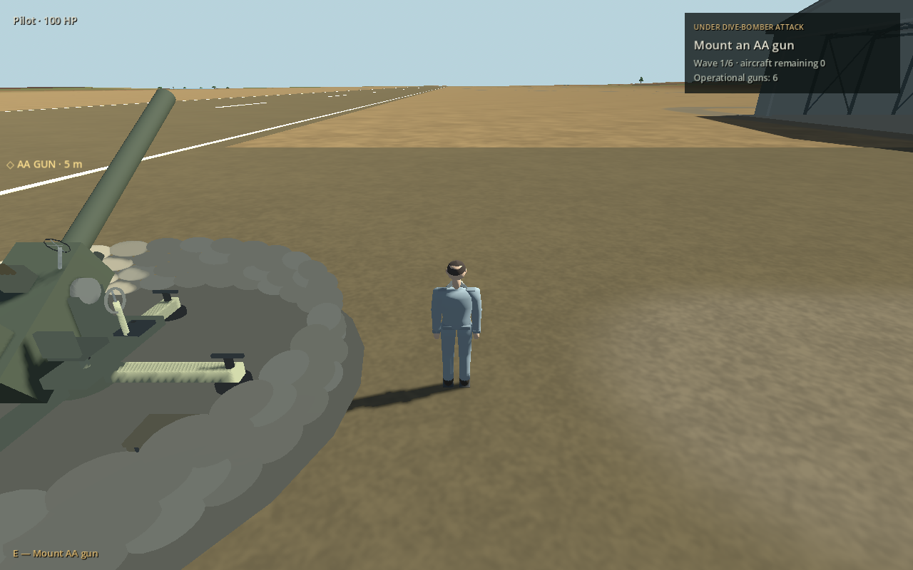
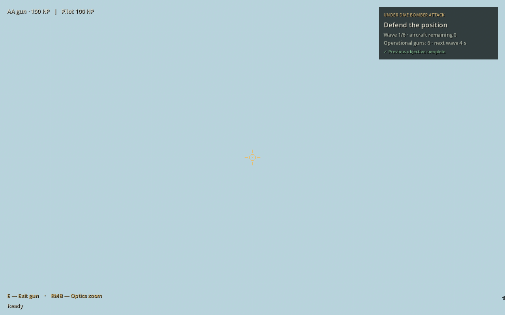
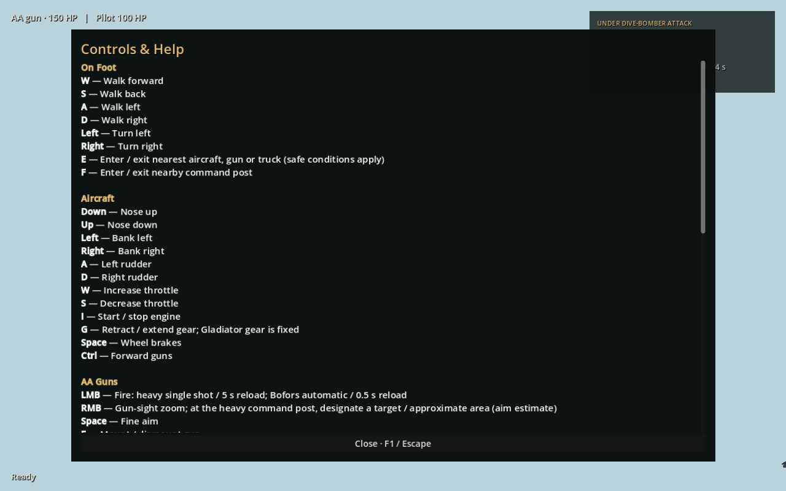

# 26 October 2026 — AA mission contextual text

Source boundary: [`9fc9a131afc6a532dd15c0dea5ad6e6b71545a03`](https://github.com/zelenski3398/codexproj1/commit/9fc9a131afc6a532dd15c0dea5ad6e6b71545a03). Previous documented source: `9ae7f845634149f5d6b54e79cf5b9e12de08a5d7`; intervening `8355e4b` published the countryside report.

## Reference and implementation

Commit [`20a4bb090ab8b1cc8cade2061b5bf0f612bb4723`](https://github.com/zelenski3398/codexproj1/commit/20a4bb090ab8b1cc8cade2061b5bf0f612bb4723) was accessible locally. It is a documentation publication describing source `827bd9c`, rather than a separate UI implementation. Its complete tree and report were inspected, along with the current shared HUD and interaction code. Implementation commits are `f2cb38b` (shared AA presentation) `e9fe48d` (keep the initial mount objective when travelling by truck before first mounting), and `9fc9a13` (browser layout synchronization). No historical checkout or reset was used. The subsequent return-and-land objective override is retained.

The existing `GameplayHUD` layout is reused: 20-pixel edge margins, 16-pixel upper-left health, 340-pixel upper-right mission tracker with 12/19/14-pixel title/objective/supporting text, and bottom contextual actions/status. F1 opens the same scrollable Controls & Help, also available through Pause. InputMap supplies bindings; the existing pause, camera restoration, fire release and browser click-to-recapture policies are preserved.

AA objectives now read **Mount an AA gun**, then **Defend the position**. Supporting text contains wave, actual remaining aircraft and operational-gun count; preparation/interval countdown and outstanding-ordnance status remain concise. No base-health system was invented for this mission. Occupied gun and pilot health, ready/reload status and truck speed use the existing shared status positions.

`AirfieldInteraction.prompt()` delegates to `GameplayHUD.context_actions()` instead of maintaining a second instruction paragraph. Occupied state suppresses nearby entry and transport prompts; nearest-object lookups reject dead players and finished missions. Mount messages no longer duplicate controls as five-second notifications. Controller changes clear pending old notices; terminal state suppresses notifications and actions. Current-distance queries naturally reacquire eligible prompts after exit or relocation. The permanent truck entry instruction is removed, and equipment world captions are hidden in the AA mission to avoid close-camera oversized labels. The AA navigation marker is hidden while driving, mounted, dead or inactive.

Help explicitly distinguishes RMB gun optics from the heavy command post's target/approximate-area designation (aim estimate). It also retains mouse/arrows aiming, firing/reload behaviour, predictor assignments, mounting, vehicles and transport recovery. The change does not add an automatic aim aid or alter any weapon, damage, wave, victory, failure or landing rule.

## Changed files

| Files | Role |
|---|---|
| [gameplay_hud.gd](../../scripts/gameplay_hud.gd) | Context lifecycle, compact objectives, help wording, caption suppression |
| [airfield_interaction.gd](../../scripts/airfield_interaction.gd) | Shared prompt adapter, terminal eligibility, removal of verbose mounting notices |
| [dive_defence_mission.gd](../../scripts/dive_defence_mission.gd) | Presentation-only marker eligibility |
| [military_truck.gd](../../scripts/military_truck.gd) | Neutral equipment caption |
| [aa_hud_context_checks.gd](../../tests/aa_hud_context_checks.gd) | New AA-specific interaction/modal regression checks |
| [aa_hud_context_capture.gd](../../tests/aa_hud_context_capture.gd) | Repeatable native screenshots; tests have matching Godot UID files |
| [airfield_controls_checks.gd](../../tests/airfield_controls_checks.gd), [battery_command_checks.gd](../../tests/battery_command_checks.gd), [bofors_predictor_checks.gd](../../tests/bofors_predictor_checks.gd) | Expect the new shared concise wording rather than obsolete hidden paragraphs |
| [minimal_hud_web_smoke.cjs](../../tools/minimal_hud_web_smoke.cjs) | Wait for updated resize coordinates and the rendered pause panel before asserting |
| [web.yml](../../.github/workflows/web.yml) | Run the new AA checks during publishing |

## Validation and limits

Godot 4.6.3 Compatibility:

| Native suite | Passed assertions |
|---|---:|
| AA HUD context | 27 |
| Shared minimal HUD | 61 |
| Dive defence | 47 |
| Airfield/vehicle controls | 61 |
| Bofors predictor | 59 |
| Heavy battery command | 36 |
| **Total** | **291** |

The AA checks exercise nearby entry, immediate mounted prompt selection, dismount/range eligibility, truck/gun switching, mounted/vehicle help, frozen actual wave timer and gun while help is open, cleared held fire, camera restoration, occupied-gun destruction, relocation, active/draining/interval text, death, pause-menu help and leaving the mission. Existing defence checks cover actual wave and ordnance completion, failure and retry. Existing ground controls physically drive between guns during the continuing battle.

The final production web export succeeded. Chromium ANGLE/SwiftShader passed all **9/9** shared-HUD browser checks, including F1, gameplay shortcut blocking, boarding prompt removal, resized close-button activation, restored pause state, unchanged world identity and absence of JavaScript/resource/engine errors. An earlier run exposed asynchronous layout/telemetry timing; the smoke tool now waits for actual updated button coordinates and pause-panel visibility rather than assuming a fixed delay.

The relocation assertion directly places the pilot at base to isolate text invalidation; it is **not** a newly tested full recovery-truck journey. The browser smoke covers shared help and walking/aircraft transitions, **not** a full browser AA battle. No exhaustive human six-wave playthrough or live Pages deployment is claimed. Native screenshots were rendered and inspected using Mesa llvmpipe; that renderer reported texture-allocation leaks on capture-process shutdown, while headless gameplay checks were clean.

[Machine-readable validation](validation/aa-hud-context-2026-10-26.json).

## Previews

## Manual procedure

1. Start Under Dive-Bomber Attack. Approach a gun: only the eligible mount action appears.
2. Mount: entry text disappears; objective becomes Defend the position. Dismount and walk away: entry text is distance-gated.
3. Enter a truck and drive to another gun. Exit before mounting; confirm no nearby entry text remains while driving or mounted.
4. Press F1 on foot, mounted and driving. Try movement/fire; nothing should operate behind Help. Close with F1/Escape; camera and prior pause state return. Also open Help through Pause.
5. Observe preparation, active waves, ordnance draining and intervals. Counters remain in the upper-right tracker without control paragraphs.
6. Destroy the occupied gun, relocate using recovery, and retry. Confirm only the current eligible action is shown; terminal screens have no stale interaction text.
