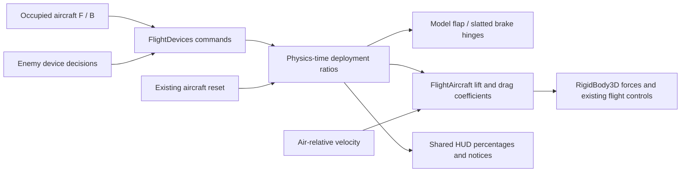

# 6 November 2026 — Flaps, dive brakes and aerodynamic deceleration

Source boundary: [`7723f2f4ac36e07bd431ec346e42ea88b534097a`](https://github.com/zelenski3398/codexproj1/commit/7723f2f4ac36e07bd431ec346e42ea88b534097a), `feat(flight): add flaps dive brakes and force-based idle deceleration`.

Previous documented source: `52a5e685f3bd5e8ec22e2fac234133b473726c31`. Intervening `2d6d3d7` publishes the preceding CI investigation. This update records the new source change; it does not rewrite the frozen complete-history report.

## Observed problem and change

The force audit found no artificial minimum-speed enforcement and no positive thrust at zero throttle. Healthy idle/windmilling propeller drag was absent, however, and gear drag was a hard-coded coefficient. The existing warning called `stall_speed` was not a minimum-speed clamp. The change adds idle drag and adjustable gear/device coefficients without replacing the flight controller.

FlightDevices owns smooth deployment ratios, commands, notices and simple hinged visual surfaces. FlightAircraft adds flap lift/maximum-lift and drag, plus dedicated airbrake drag, to its existing forces. Air-relative velocity accounts for optional wind; gravity, angular control, post-stall lift fade, component damage and tyre-contact brakes remain. Commands never assign body velocity or altitude. W/S, Space, gear, guns, health, input transitions and reset remain in their original systems.

F is now flap deployment; B is airbrake deployment. Browser gunfire moves from conflicting F to J; native guns remain Ctrl. Ground command-post F and mounted AA assist B remain scoped to their existing contexts. F1 / pause help uses existing input bindings. The compact instrument line adds percentages / N/A and wraps on narrower displays; overspeed uses the shared notification.

Equipment is explicit: Spitfire/Hurricane/C.200/C.202/SM.79 have landing flaps but no dedicated airbrakes; Gladiator and CR.42 have neither; Ju 87-inspired aircraft have both. An exported, default-off gameplay-assist option adds ahistorical brakes and labels them as assist. Limits and coefficients are gameplay presets, not verified historical flight-manual performance. The [full guide](../flight-devices.md) lists all values, configuration paths and a manual test procedure.

AI calls the shared device commands, retracting during ordinary manoeuvres and using fitted brakes in fast dives. Regression testing caught a failed Stuka pullout when brakes remained fully deployed throughout its dive. Speed hysteresis (deploy above 80 m/s, retract below 70 m/s) preserves recovery energy without changing physics or assigning AI motion. The final real-flight attack test completes dive, pullout, circle and subsequent projectile strafe with minimum recorded AGL approximately 247.58 m.

## Files and architecture

| Files | Effect |
| --- | --- |
| [aircraft.gd](../../scripts/aircraft.gd), new [flight_devices.gd](../../scripts/flight_devices.gd) | Existing force integration plus shared device state / visual hinges |
| [enemy_aircraft.gd](../../scripts/enemy_aircraft.gd), [sea_gladiator.gd](../../scripts/sea_gladiator.gd) | Ju 87 and Gladiator equipment presets |
| [enemy_aircraft_definition.gd](../../scripts/enemy_aircraft_definition.gd), [italian_enemy.gd](../../scripts/italian_enemy.gd), [CR.42 definition](../../aircraft_definitions/cr42.tres), [Hurricane scene](../../aircraft/hurricane_mk_i.tscn) | Per-type configuration, including Italian resource coefficients |
| [project.godot](../../project.godot), [web_support.gd](../../scripts/web_support.gd) | F/B actions, J web fallback, read-only device test telemetry |
| [gameplay_hud.gd](../../scripts/gameplay_hud.gd), [hud.gd](../../scripts/hud.gd), [aircraft_selector.gd](../../scripts/aircraft_selector.gd) | State, warnings and updated controls |
| [flight_devices_checks.gd](../../tests/flight_devices_checks.gd), [dive_attack_checks.gd](../../tests/dive_attack_checks.gd), [publishing_checks.json](../../tests/publishing_checks.json) | Aerodynamic/state checks and actual AI brake/recovery regression; publishing manifest becomes 66 suites |
| [flight_devices_web_smoke.cjs](../../tools/flight_devices_web_smoke.cjs), [web_smoke.cjs](../../tools/web_smoke.cjs), [audio_web_smoke.cjs](../../tools/audio_web_smoke.cjs) | Production-export device checks and corrected browser gunfire inputs |

## Checks actually performed

Godot 4.6.3 import passed. Eighteen distinct targeted Godot suites passed: **676 assertions** in the latest successful execution of each suite, including 24 new device assertions, 35 original flight assertions, aircraft failure/damage, weapons, keyboard, Hurricane/Italian aircraft, shared HUD, mission return, AA controls, dive defence and actual dive attack, Valletta interception/combat/continuous departure and harbour flight. The four publishing-runner Python self-tests also passed. An early dive regression was fixed and rerun; it is not counted as a success.

The device suite also passed **24/24 at 60 Hz physics**, separately from the 120 Hz default. Six-second coast fixtures start at 65 m/s, idle, gear up, the same Spitfire mass and attitude controller, with optional airbrake assist explicitly enabled:

| Devices | 120 Hz ending speed | 60 Hz ending speed |
| --- | --- | --- |
| Retracted | 56.803 m/s | 56.826 m/s |
| Flaps | 43.201 m/s | 43.221 m/s |
| Airbrakes | 34.471 m/s | 34.477 m/s |
| Both | 29.180 m/s | 29.181 m/s |

Maximum timestep difference is below 0.024 m/s. These controlled runs compare actual force-driven trajectories, not an energy-preserving level-flight lock. In the steep-dive comparison, clean ending speed was 93.396 m/s and braked speed 53.633 m/s. A separate slower, steeper initial dive still accelerated with full brakes. Tests also cover flap lift/retraction, low-speed stall, overspeed rejection, visual-angle synchronisation, wreck command rejection, reset and no airborne wheel-brake effect. Original flight checks cover real takeoff, gentle touchdown, wheel-brake stopping and another takeoff without reset.

The continuously flown Valletta mission still captures the formation at 1199.9999 m, reaches contact 77.625 seconds after liftoff, and its bomber reaches the target after 179.4 simulated seconds. Mission timing/spawn rules are unchanged.

Matching-template web export passed. Chromium with ANGLE/SwiftShader ran the production payload: **7/7 device/input checks**, including actual menu boarding, F deployment/retraction, no F gunfire, J gunfire, unavailable Spitfire brakes, paused help input suppression, and no resource/script/JavaScript errors. The final rerun also resizes to 800×500 before taking its screenshot. Local captures are `/tmp/flight-devices-browser-deployed.png` and `/tmp/flight-devices-browser.png`; screenshots are observations of the automated fixture, not a human flight test. The full 66-suite publishing manifest was not rerun for this change.

[Machine-readable measurements and suite results](validation/flight-devices-2026-11-06.json) retain the exact source boundary and separate test scopes.

## Remaining limits

No human-flown native/browser landing approach or subjective handling review was performed. Automated original-controller takeoff/landing and AI flight ran, but they do not establish a certified flight envelope. The old simplified stall/propeller model remains, with added device coefficients rather than a blade-element simulation. Aircraft surface geometry is a hinged addition to existing placeholder wings, not a new rigged aircraft asset; close-up overlap and exact variant-specific outlines need art review. No Firefox, Safari or hardware GPU performance claim is made. Ground AA and aircraft keep their original independent damage/collision systems; device panels do not introduce separate new damageable components.
