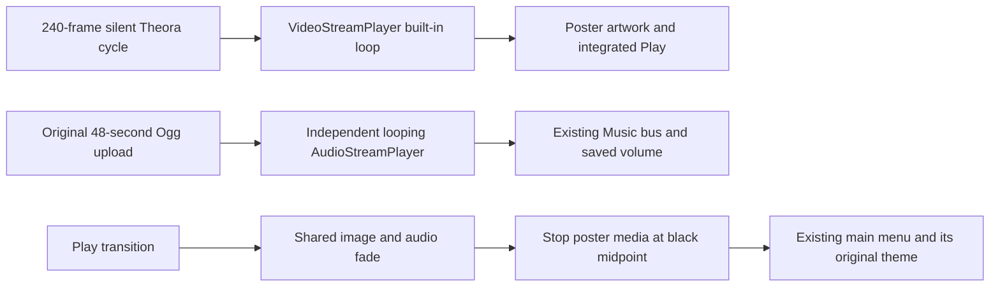

# 6 November 2026 — Cinematic March and continuous poster motion

Source: [`4d304da234829ebc8ec69dae8a26e41c11433675`](https://github.com/zelenski3398/codexproj1/commit/4d304da234829ebc8ec69dae8a26e41c11433675), `feat(intro): add cinematic march and continuous poster motion`. Previous source boundary `5dd8456c015a6d5b329841739b8c35d5ce015856`; intervening `340ab9c` publishes that binding correction.

## What changed and why

The existing five-second video already had Godot's loop option enabled. Its final aircraft pose differed substantially from its first, so repeating it produced a visible positional reset. Separately, the old watchdog stopped and restarted the video when its clock did not change for two seconds, which could mistake slow rendering or background-tab throttling for failure.

The active video is now a ten-second **forward-and-return cycle**: all 121 original forward frames, then the 119 intermediate frames in reverse. Endpoint duplication is omitted. It repeats naturally from frame 1 to frame 0 instead of jumping from the former final aircraft pose to the start. This deliberately reverses the original motion in the return half; it does not generate new endless forward-flight footage. No transition fades the animation to black at video wraps. The still fallback remains underneath the decoder, and the integrated Play button and portrait framing remain.

The watchdog no longer resets an actively playing decoder because its clock stayed unchanged. Recovery is restricted to an unexpectedly stopped player. Godot's built-in looping owns normal video wraps; the additional finished-signal restart was removed.

The uploaded **Wings_over_Malta_Cinematic_March.ogg** was copied without transcoding or editing. Its SHA-256 is `fcbb2063f18f2678b40f281e3d663ccec8a086afacaeb8fba9f54999f5c58150`: 48.000 seconds, 44.1 kHz stereo Vorbis, 738,003 bytes. GameIntro duplicates this preloaded stream for its own looping AudioStreamPlayer on the existing Music bus. It is not part of the video decoder, is not restarted at video wraps, and does not overlap the old menu theme. The previous video soundtrack remains an unused historical asset.

The march fades with the poster, stops at the black midpoint after Play, and the unchanged main-menu theme then returns. Existing Music/Master settings and mute remain effective. `poster_music_volume_db` defaults to −3 dB before those bus controls. A user gesture retries a blocked initial audio request without restarting an already playing track; browser autoplay restrictions still apply.

## Modified resources and code

- [GameIntro](../../scripts/game_intro.gd): supplied-track preload, separate audio startup, gain export, user-gesture retry and restricted stopped-decoder recovery.
- [WebSupport](../../scripts/web_support.gd): opt-in read-only poster audio asset, position and start-count telemetry.
- [malta_poster.ogv](../../assets/intro/malta_poster.ogv): regenerated 240-frame/10-second forward-and-return Theora cycle, 834×1112, 24 fps, no audio.
- [Cinematic March](../../assets/intro/wings_over_malta_cinematic_march.ogg) and its Godot importer metadata: exact supplied bytes.
- [build_poster_loop.py](../../tools/build_poster_loop.py): reproducible FFmpeg conversion, explicit source frame rate, validation of frame count and silent single-stream output. The unedited forward source is recoverable from commit `340ab9c`; [asset inventory](../../assets/intro/README.md) gives the exact command.
- [Intro checks](../../tests/intro_checks.gd), [native playback checks](../../tests/intro_playback_checks.gd), [browser smoke](../../tools/poster_music_web_smoke.cjs): track identity, independent playback, loop continuity and media/menu lifecycle.
- README, [startup guide](../startup-poster.md), asset inventory and this incremental journal describe the current implementation. Gameplay controls, physics, missions, weapons and damage were not changed.

## Validation actually completed

- Godot 4.6.3 Compatibility import passed.
- Headless intro **20/20** and existing audio **37/37** checks passed.
- Native Xvfb/llvmpipe actual playback **11/11** checks passed: changing decoded frames, paused-game presentation, playback beyond one complete video cycle without watchdog restart, march still playing with exactly one start and more than ten seconds of audio position, duplicate Play suppression, menu reveal, return-to-title playback and bypass/cleanup. Dummy audio output verifies playback state, not human listening quality.
- FFprobe confirms one video stream, **240 frames / 10.000 s / 24 fps / 834×1112**, and no embedded audio. Source Ogg checksum matches the uploaded file exactly.
- A 96×128 greyscale comparison measured former final-to-first mean absolute luminance difference **20.483/255**, reduced to **0.396/255** in the edited loop. The first ordinary motion step is **0.144/255**. This measures the discontinuity and lossy codec variation, not subjective animation quality.
- Matching-template web export passed. Actual exported Chromium ANGLE/SwiftShader smoke checks passed **8/8**: correct music resource, gesture without leaving poster, actual ten-second video wrap with zero manual restarts, advancing independent march with one start, no menu-music overlap, repeated gesture without restart, integrated Play/menu music, and no resource/script/JavaScript errors. The observed pre-wrap video position was 9.8221 s followed by 0, while the march continued at 45.3834 s with one start request.
- Local browser screenshot: `/tmp/poster-march-browser.png`. The software-rendered browser progressed more slowly than real time; the loop check allows for that instead of requiring ten seconds of video to finish within a fixed short wall-clock timeout.
- Documentation links and `git diff --check` passed. No full 66-suite gameplay rerun was necessary for this media-only change.

[Machine-readable results and measurements](validation/poster-march-2026-11-06.json) retain the exact source boundary.

## Limits

No human listening session or hardware-GPU/browser performance assessment was performed. Other browsers were not tested. Automatic audible playback still depends on browser policy; a background click can unlock audio without pressing Play. The 48-second track is configured to loop by the audio engine; the checks establish independent playback across the shorter video cycle, not a separately observed complete 48-second native audio wrap. The animation repeats back and forth; new unique forward motion would require new source footage.
