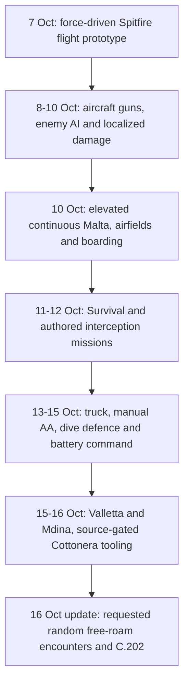
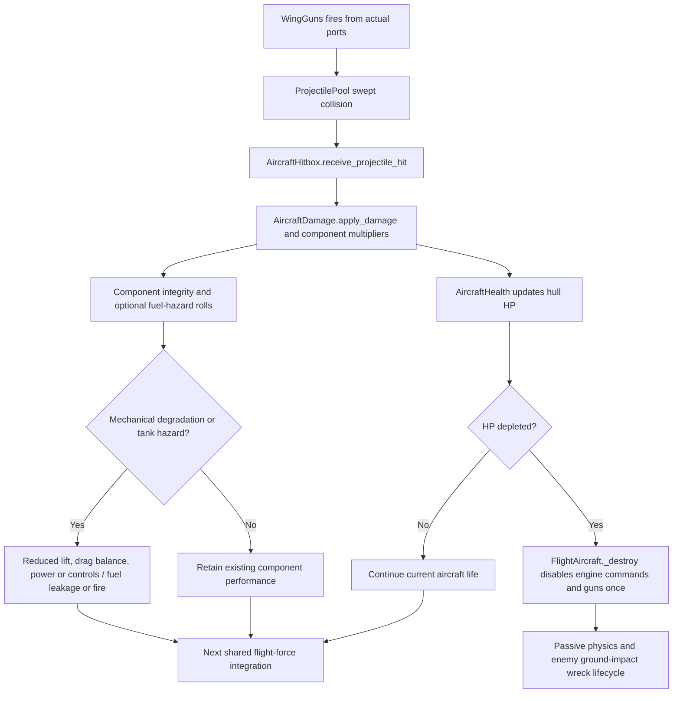
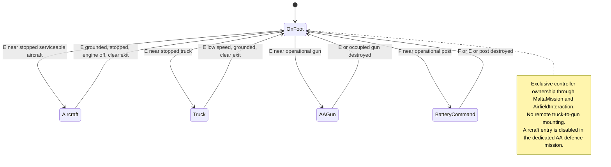
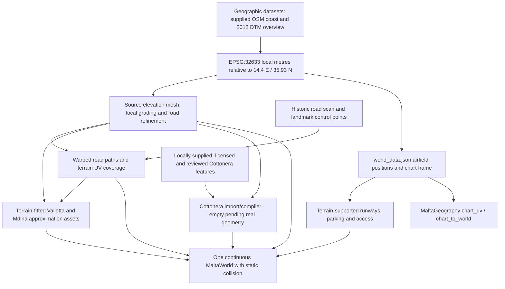

# Supplied reference diagrams, reconstructed against the source

[Documentation updates](README.md) · [Complete historical report](../WWII-Malta-Development-Complete.md)

These four diagrams preserve the concepts in the user's pasted text: development evolution, aircraft damage/combat, player interaction and Malta geography. The paste contained rendered-chart CSS and concatenated labels rather than editable Mermaid or recoverable edge definitions. They have therefore been redrawn as clean Mermaid, using inspected implementation rather than copying styling or claiming the lost layout was recovered exactly.

## 1. Development evolution

The original illustrative grouping put “combat and missions” before Malta. Git shows basic combat before Malta, but authored missions after it; this chronology separates them. Earlier dates and changes are traceable through the [23-milestone timeline](../development-history/02-development-timeline.md). The final update is documented separately in the [encounter addendum](2026-10-16-random-encounters.md).

## 2. Aircraft damage and combat flow

The supplied “Critical hit?” concept is shown as actual component-integrity degradation and fuel-hazard rolls. There is no invented standalone critical-hit manager. Hull transfer occurs alongside integrity loss; mechanical failure need not wait for zero hull HP. Source: [ProjectilePool](../../scripts/projectile_pool.gd), [AircraftHitbox](../../scripts/aircraft_hitbox.gd), [AircraftDamage](../../scripts/aircraft_damage.gd), [AircraftHealth](../../scripts/health.gd) and [FlightAircraft](../../scripts/aircraft.gd).

## 3. Player interaction state machine

The original OnFoot/Aircraft/Truck/AAGun diagram is retained and extended with the implemented battery post. Guards come from [MaltaMission](../../scripts/malta_mission.gd) and [AirfieldInteraction](../../scripts/airfield_interaction.gd). These are behavioural states, not a claim that one controller enum owns every entity. Free-roam C requests an enemy without changing this control state.

## 4. Malta geographic data pipeline

This is a conceptual data-flow diagram, not a fabricated geographic map. Source: [prepare_malta.py](../../tools/prepare_malta.py), [grade_malta_terrain.py](../../tools/grade_malta_terrain.py), [malta_road_surface.py](../../tools/malta_road_surface.py), [HistoricCity](../../scripts/historic_city.gd) and [MaltaWorld](../../scripts/malta_world.gd). Historical settlements are additive assets; they do not regenerate the island. Cottonera remains gated by missing source geometry.

The original audit's [17 detailed diagrams](../development-history/diagrams/README.md) remain unchanged. These four supplemental sources add readable overviews without rewriting the frozen history snapshot.
