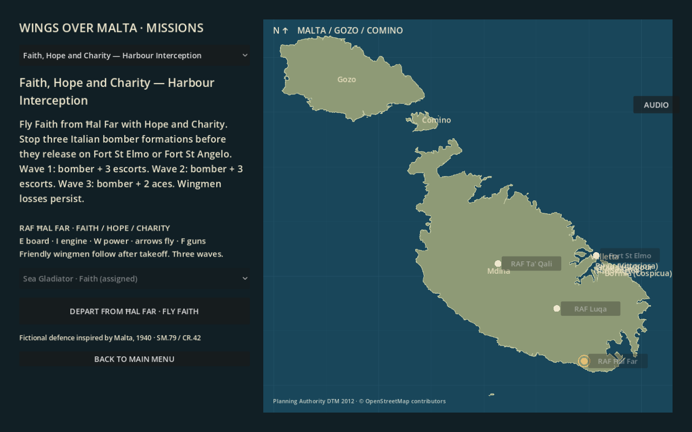
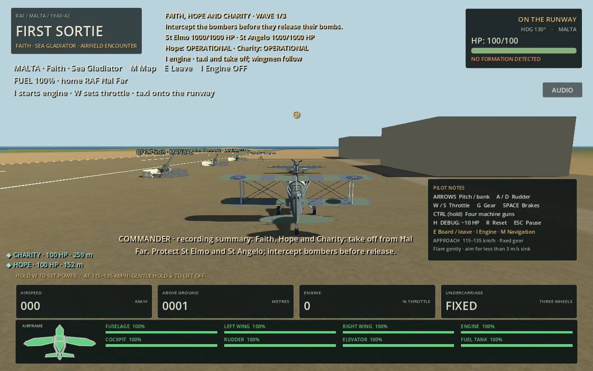
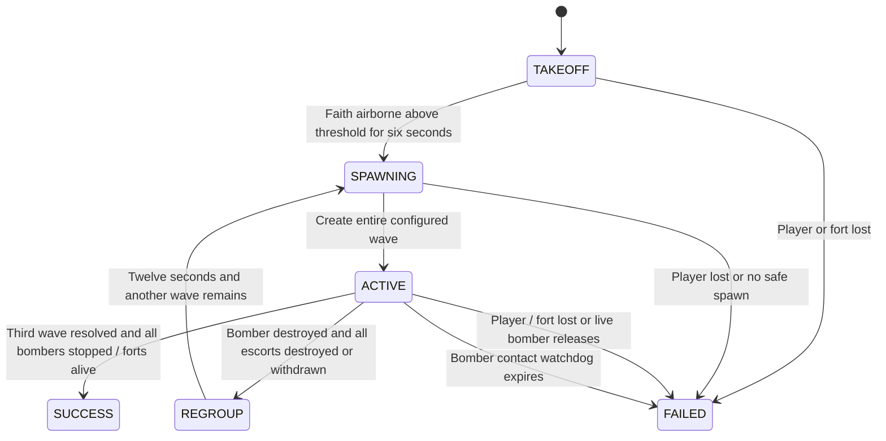
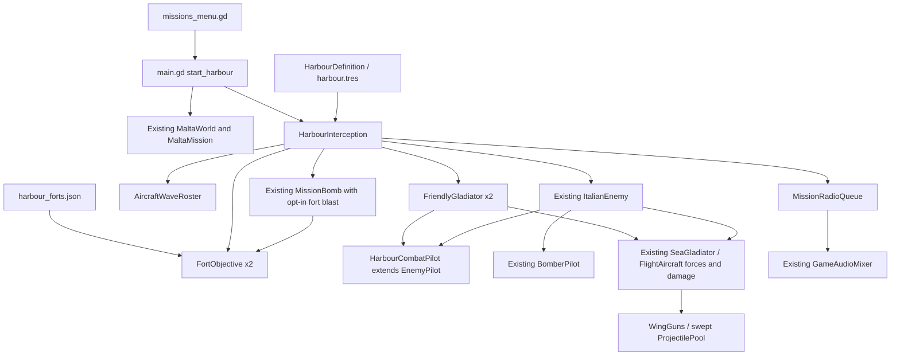
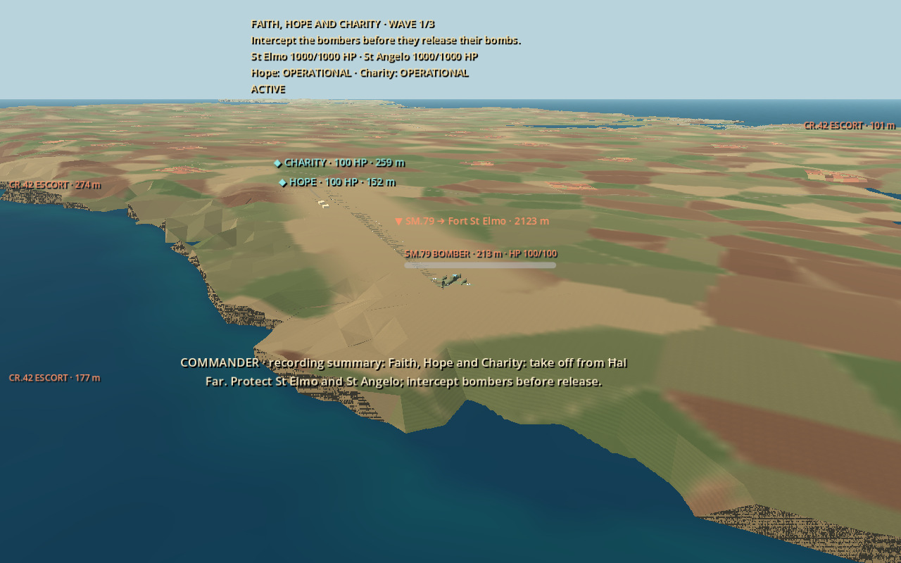

# Faith, Hope and Charity — Harbour Interception

**20 October update:** available player aircraft now depart from hangar stands. Pilot health is independent from hull HP; a surviving pilot can exit a wreck and use **V → E truck entry** recovery without resetting this mission. Aircraft loss alone no longer fails the attempt. [Current survival/recovery rules](pilot-survival-and-recovery.md).

A **fictional** three-wave mission inspired by Malta's early air defence, not a reconstruction of a documented engagement. Launch it from **Main menu → Missions → Faith, Hope and Charity → Depart from Ħal Far**. The existing continuous Malta world, terrain, cities, military installations and flight controllers are retained.

## Playing

Start beside **Faith**, a Sea Gladiator with its engine stopped. Press **E** to board, **I** to start the engine, **W/S** for throttle, arrows for pitch/bank, **A/D** for rudder and **F or Ctrl** for guns. Taxi onto the runway and take off. **M** opens navigation, **Esc** pauses, and **R** restarts the complete mission. Other parked aircraft cannot replace Faith in this mission.

**Hope** and **Charity** are actual friendly Sea Gladiators with the same flight forces, four guns, component damage, fuel and crash systems. They wait more than 100 m apart behind the player's departure corridor, then take off at staggered intervals after Faith sustains flight above 65 m AGL for six seconds. They steer using normal pilot commands. Their takeoff success never gates the first wave. Cyan markers identify them, with status and HP; their losses persist and wreck removal cannot recreate them.

| Wave | Formation | Target |
|---|---|---|
| 1 | 1 SM.79 + 3 normal CR.42 escorts | Fort St Elmo |
| 2 | 1 SM.79 + 3 normal CR.42 escorts | Fort St Angelo |
| 3 | 1 SM.79 + 2 ace CR.42 escorts | Lower-health fort at this wave's start; St Elmo breaks a tie |

Totals: **3 bombers, 6 normal escorts, 2 ace escorts**. These use the game's existing procedural SM.79 and CR.42 models: recognisable simplified aircraft rather than newly acquired detailed historical models. The existing aircraft/audio systems and their current engine/gun assets are reused; no new type-specific Italian engine recordings are supplied here.

Wingmen distribute targets, increasingly prioritising the bomber within 2,300 m of its target fort. Escorts select threats near their bomber and return to formation outside the protection area. Ace escorts have less aim error and dispersion, longer navigation prediction and stronger target distribution. Projectile speed, damage, gun rate, swept collision and component multipliers remain those of the normal CR.42. Fire still requires alignment and line of sight. Formation and pursuit separation steer through normal control inputs; they do not move aircraft transforms.

## Wave and outcome rules

Bombers navigate toward a ballistic release point upstream of the actual fort. Fall time is estimated from release height and gravity; inherited horizontal velocity carries **physical `MissionBomb` objects** toward it. Swept impacts produce the existing explosion effects. Only the resulting blast positions subtract fort HP, using distance to the real footprint and a vertical allowance for the fort's masonry. There is no countdown-driven fort damage.

A release immediately fails the interception objective. The released bombs continue falling and the live bomber continues beyond the target. Killing a bomber before release prevents release, even if a stale arrival callback follows it. Player crash/destruction, on-foot pilot death, and either fort reaching zero HP also fail immediately. Results are latched once. The result panel keeps fort HP current while outstanding bombs land.

Each fort starts with a configurable **1,000 HP**; no existing whole-fort health component was present. These mission receivers add no geometry or collision bodies and do not replace city meshes. Their stored footprints come from the existing St Elmo outline and supplied Cottonera **OSM `way/54896162`** for St Angelo. St Elmo uses the existing Valletta peninsula axes; St Angelo uses the existing **EPSG:32633** origin **14.4° E, 35.93° N**, with north as negative Z and units in metres. Interior target points are approximately `(10681.53, sampled Y, 3132.48)` and `(10662.06, sampled Y, 4294.61)` respectively. Heights are sampled from live collision. Source geographic anchors are also retained in the JSON. No terrain, coastline, airfield or fort geometry is moved.

Surviving escorts remain alive after a bomber kill. After 110 seconds they receive a physical withdrawal order. They retire beyond 5,500 m from Faith, or after another 110 seconds under the explicit contact-cleanup policy. They are recorded as **withdrawn, not destroyed**, even on timeout. This deliberately allows eventual cleanup of a stuck escort. A bomber that cannot complete its route within 300 seconds fails as contact lost; it is never awarded as an intercepted bomber. A 12-second regroup separates waves. Health, damage, fuel, world state and aircraft positions are retained.

`AircraftWaveRoster` resolves each member once as destruction or escape. Only shared aircraft destruction signals produce losses. `ProjectilePool` snapshots the shooter's instance ID when firing and records the last hostile hit before applying damage, including a fatal hit. Kill credit uses that ID within 20 simulated seconds: player, friendly AI, or other loss. Environmental/AA losses still advance objectives but are not invented as player or wingman kills. This is a last-hit policy, not an assist system.

The end panel reports bombers intercepted, escorts destroyed/withdrawn, player/friendly/other losses, surviving wingmen and both forts' HP. Success requires all three bombers intercepted before release, every wave resolved, and both forts alive. Retry rebuilds this mission and clears its aircraft, bombs, effects, health receivers and radio queue. Leaving returns to the existing mission selection.

## Interactive pilot radio

Press **T** while flying Faith to request surviving wingmen's live status and observed contacts. Three additional supplied pilot recordings provide truthful identification calls, with detailed speaker-labelled subtitles and shared commander queue priority. See the [interactive radio guide](wingman-radio.md) for voice assignments, spotting rules, controls, settings, missing dialogue and validation.

## Commander recordings

Both supplied MP3s are integrated as prepared mono Ogg assets:

| Source | Runtime asset | Trigger |
|---|---|---|
| `Faith hope and charity mission intro.mp3` | `assets/audio/harbour/intro.ogg` | Once on mission start / fresh retry |
| `Faith hope and charity mission congratz.mp3` | `assets/audio/harbour/congratulations.ogg` | Once on mission success |

The existing `tools.prepare_radio.prepare` function retains the supplied speech, applies a 180–3,800 Hz band-pass and -16 LUFS normalization, and adds very quiet static and brief clicks. JSON sidecars record source filenames, SHA-256 hashes, processing and durations (~19.4 and ~14.6 seconds). No speech is generated. Originals remain the user's supplied uploads; runtime assets contain that voice, not a replacement.

`MissionRadioQueue` uses one non-positional `AudioStreamPlayer` on Master, desktop streaming / browser sample playback, with non-looping clips. Aircraft and Guns buses temporarily duck by 4 dB through the existing `GameAudioMixer` ownership API. Queuing prevents overlap; results preempt obsolete queued calls. Stop/menu exit releases the mixer and playback. Retry creates a fresh queue.

**The two recorded-call captions are explicitly labelled recording summaries, not verified verbatim transcripts.** Detection, attack-run, ace, regroup, withdrawal, wingman-loss and failure cues have subtitle-only text by default. Optional voice slots are exposed in `cue_voices`: `wave_1`–`wave_3`, `attack_1`–`attack_3`, `regroup_1`–`regroup_2`, `withdraw_1`–`withdraw_3`, `lost_Hope`, `lost_Charity`, `failure`. Missing speech never plays a beep or substitutes a siren.

## Components and tuning

Main tuning is in [`harbour_definition.gd`](../scripts/harbour_definition.gd) and [`harbour.tres`](../mission_definitions/harbour.tres): incoming distance 2,100 m, minimum player clearance 1,000 m, approach altitude at least 420 m MSL / 220 m terrain clearance, bomber speed 49 m/s, escort spacing 180 m, regroup 12 s, attack warning 24 s, four bombs at 0.6 s intervals, blast radius 90 m and maximum fort damage 520 per impact. Default ace aim and dispersion scales are 0.20 and 0.25. These are gameplay tuning values, not claims of exact historical performance.

Formation placement is a crossing inbound route relative to Faith and the target fort, rather than a faster bomber simply fleeing ahead. A 3,800 m minimum fort approach distance keeps room for interception when Faith is near the harbour. Height adapts to the player and measured terrain. Planned positions are checked for collision, mutual spacing and player separation before the entire wave is inserted. Unsafe insertion fails explicitly and offers retry.

Files added: mission definition/resource and projected fort footprints; `harbour_interception.gd`, `harbour_combat_pilot.gd`, `friendly_gladiator.gd`, `aircraft_wave_roster.gd`, `fort_objective.gd`, `mission_radio_queue.gd`; two audio assets and manifests; four test scripts plus native capture. Existing menu/main, boarding eligibility, end-panel routing, physical bomb blast and projectile attribution have small integration changes. Web export explicitly includes the new fort JSON; CI runs the four new suites.

## Validation and limitations

Available checks on Godot **4.6.3 Compatibility**:

- **48 mission checks:** ground/manual start; identities/teams; exact 4/4/3 formations; real swept player/friendly kill attribution; one-shot wingman loss; removed-wreck references; destruction before release; escort persistence, withdrawal and no false kills; all three waves, aces, success; forts, payload failure, retry and menu cleanup.
- **13 radio checks:** actual supplied streams, one-shot/non-looping playback, serial queue, summary/subtitle-only captions, priority result, mixer duck/restoration, stop and cancelled-cue rejection. These use a Dummy audio device and do not constitute a listening test.
- **7 physical flight/bombing checks:** only Faith starts from an explicit airborne pose fixture. Both wingmen take off from real Ħal Far ground positions. Thereafter all aircraft navigate using forces and controls, with weapon damage disabled to isolate the approach. Four physical bombs impact the world and damage St Elmo. The measured initial separation was about **2,101 m**, and the approximately **10,226 m** release route completed with bomb impacts around **227 simulated seconds** after the fixture run began. Closest blast distance to the fort footprint was **0 m**.
- **9 full departure checks:** no pose/velocity fixtures. Board, start via I, taxi around waiting wingmen, align, take off, climb and activate one formation using the unchanged Sea Gladiator physics.
- **358 existing regression checks:** weapons 36, original commander radio 22, enemy 31, Valletta interception 77, ground/vehicle/AA controls 61, Survival 84, Italian aircraft 47. Repeated runs are not counted twice.

Native selection, ground and staged airborne formation previews were rendered and inspected with Mesa llvmpipe. The formation view below is a debug camera fixture, not a screenshot of a human-flown engagement. Import/resource parsing and `git diff --check` are checked separately.

**Not verified:** human completion of all three waves; subjective combat balance/wingman effectiveness in every manoeuvre; audible quality on speakers/headphones; mobile performance; browser interaction/audio. The environment lacks Web export templates, so a browser build/runtime cannot be claimed tested. The project retains its web-compatible audio playback path and the new JSON export inclusion, with native tests added to publishing CI. Formation layout, bomber pacing and wingman tactics are simplified game AI rather than a historical formation simulation. Recorded captions need a verified transcript if verbatim accessibility subtitles are desired.
