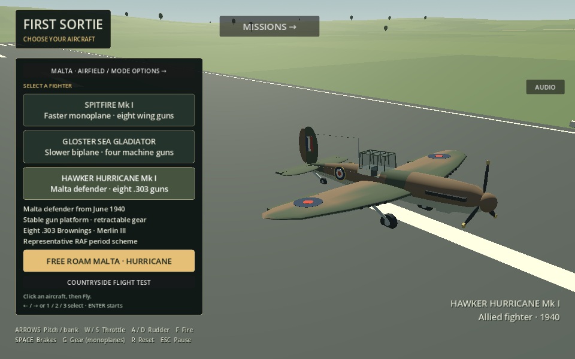
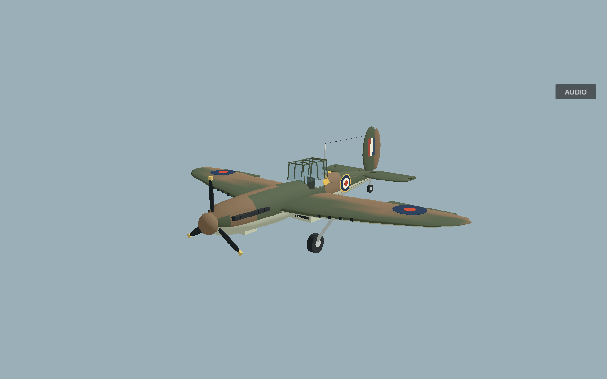
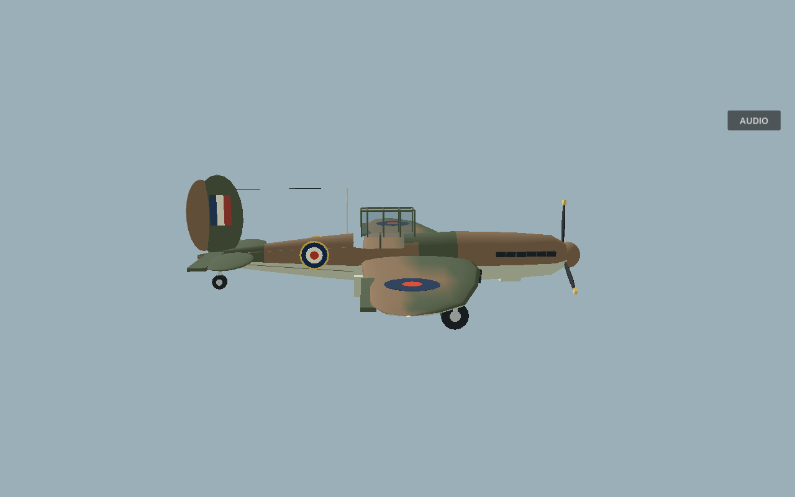
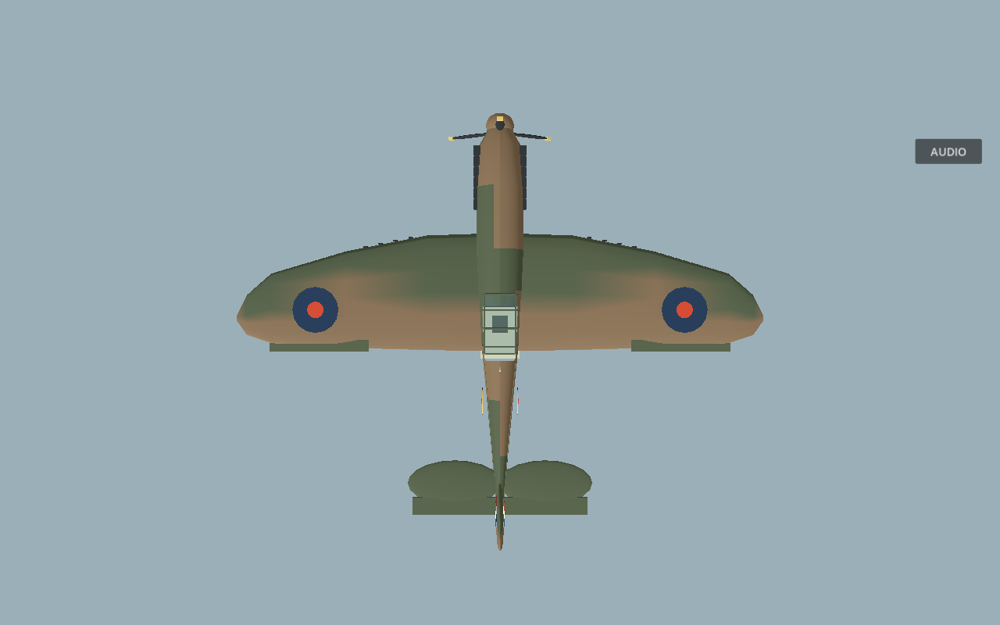
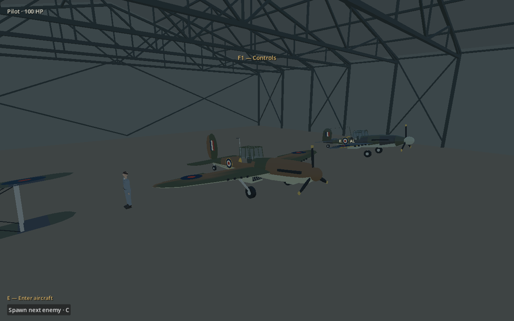
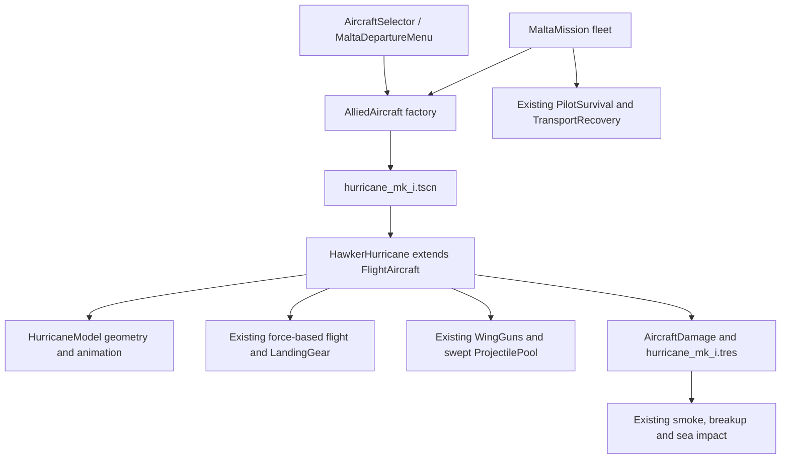

# Hawker Hurricane Mk I

Added 27 October 2026. Select **Hawker Hurricane Mk I** in the main aircraft menu (click, **3**, or cycle with arrows), then **Free Roam Malta**. The existing airfield/mode options also offer it. Departure places the living pilot beside the exact selected aircraft, parked in a hangar with engine stopped.

## Configuration and historical boundary

This is a **Mk I with Merlin III, three-bladed propeller, eight wing-mounted .303 Browning machine guns, retractable main gear and a fixed tailwheel**. It is not an LF363/Mk IIc cannon configuration. The supplied photograph informed the overall Hurricane silhouette; its cannon barrels, serial, squadron codes and decorative markings were not copied.

The original model uses a representative dark-green/dark-earth and light-underside RAF scheme, upper-wing blue/red roundels, yellow-bordered fuselage roundels and a fin flash. **It is not an authenticated Malta aircraft identity or surveyed paint reconstruction.** No historical pilot, serial or squadron identity is asserted.

The brief supplies the early Malta role and June 1940 arrival context. The requested [Malta Aviation Museum article](https://www.maltaaviationmuseum.com/2023/12/11/the-rise-and-fall-of-hurricanes-in-malta-during-wwii/), an attempted RAF Museum Hurricane I collection endpoint, and [RAF aircraft page](https://www.raf.mod.uk/aircraft/hurricane/) all failed here with HTTP tunnel **403 Forbidden** on 27 October 2026. Their content was **not read or independently verified**. In particular, a current RAF memorial-flight Hurricane page must not be treated as evidence for Mk I specifications without checking its variant.

The **12.19 m span, approximately 9.84 m model length, 23.92 m² wing area and 2,994 kg loaded mass** are provisional commonly cited Mk I reference values used for implementation; museum/RAF confirmation remains outstanding. No published historical top-speed, horsepower-to-thrust conversion or climb figure is claimed as measured simulation accuracy. The engine/armament identity is consistent with the user-specified configuration.

## Original 3D asset

[HurricaneModel](../scripts/hurricane_model.gd) creates actual metre-scale meshes through the existing SurfaceTool/MeshKit workflow. It implements the existing `SpitfireModel` **interface** and reuses roundel/seat helpers; it does not reuse the Spitfire fuselage or wing geometry.

- Thick, tapering rounded-tip monoplane wings with separate ailerons.
- Fuller nose/cowling, six exhaust outlets per side, raised framed cockpit and aft fabric/stringer contours.
- Central underside radiator/intake, spinner and three separate blades.
- Tailplane, separate elevators and rudder, fin flash and antenna wire.
- Eight flush MG ports, four per wing. These Marker3D nodes are the actual weapon origins.
- Main wheels and connected struts animate into the wing; tailwheel remains visible. Shared suspension anchors remain the physics source of truth.
- Opaque rough camouflage and metal materials; only the small canopy uses alpha, like the existing aircraft. No external runtime texture, photo billboard or watermark is used. This is a stylized original game model rather than a museum-quality scanned replica.

## Shared systems and tuning

[aircraft/hurricane_mk_i.tscn](../aircraft/hurricane_mk_i.tscn) is the reusable definition. Its exported settings configure the unchanged `FlightAircraft` aerodynamic controller. [HawkerHurricane](../scripts/hawker_hurricane.gd) adds model/profile selection, mass/inertia, suspension geometry, pilot seat and configurable gun defaults.

| Property | Hurricane setting | Meaning |
|---|---:|---|
| Wing area | 23.92 m² | Provisional Mk I baseline |
| Loaded mass | 2,994 kg | Provisional Mk I baseline |
| Engine thrust | 11,200 N | **Gameplay approximation**, not a verified Merlin thrust figure |
| Parasite / induced drag | 0.038 / 0.059 | Higher than the existing Spitfire |
| Stall speed parameter | 29 m/s | Forgiving shared-model stall threshold |
| Pitch / roll / rudder torque | 17,500 / 19,500 / 12,500 | Shared-controller gameplay tuning |
| Takeoff / approach guidance | 150–170 / 145–165 km/h | Player guidance, not certified limits |
| Gun velocity / damage | 850 m/s / 4 | Existing player rifle-calibre balance |
| Gun cadence | 12 rounds/s per gun | Same conservative game rate as Spitfire; not an asserted cyclic rate specification |
| Convergence | 250 m | Existing shared wing-gun convergence |
| Ammunition | Existing unlimited rules | No new ammunition system |

Do not interpret the force coefficients, guidance or test speeds as a historical flight-model calibration. Existing density, low-speed authority, stall fade, propeller speed-efficiency and gear drag remain unchanged.

The [Hurricane damage profile](../damage_profiles/hurricane_mk_i.tres) retains the universal component roles/failure rules with hitboxes fitted to the larger wing span and longer fuselage; the tail is marked as fabric. Engine power loss, controls, fuel leakage/fire, health, smoke, marks, detached components, pilot survival, aircraft collisions, dry breakup and physical sea sinking use the existing systems.

## Fleet and interaction

`AlliedAircraft` centralizes kind validation, creation, display names and identity across the menu, new flights and boarding. Free-roam/Survival rosters append one Hurricane per base to the existing Spitfire/Gladiator pair: **nine stationed aircraft across Malta**. The selected aircraft is first in its home hangar. Original geographic records remain untouched; the roster extension is applied in code. Scripted interception, AA and Faith/Hope/Charity formations and parked rosters are not automatically extended.

Existing hangars have six 14 m-spaced stands. Hurricane bounds and three-wheel support were checked at all three bases. No runway, hangar, road or spawn-site geometry changed. Exiting, recovery and returning to another aircraft reuse the existing fleet rather than creating a new plane. Full retry recreates one clean fleet. Recovery offers another serviceable aircraft; it does not promise an infinite same-type Hurricane replacement after the only local Hurricane is lost.

The retained countryside test environment keeps its original roster for existing aircraft selections; explicitly selecting a Hurricane there adds it for testing. The scene can also be instantiated for Allied AI and driven through the existing automated PilotInput command interface; this update does not insert Hurricane AI into scripted formations.

The ordinary concise HUD and F1 Help are unchanged. Aircraft identity is preserved after boarding, reset and return to the menu. The Hurricane entry prompt clears on boarding.

## Measured game behaviour

[Reproducible comparison](../tests/hurricane_performance_checks.gd): same 800 m initial altitude, 55 m/s starting speed, full throttle, shared altitude controller, 120 fixed physics ticks/s. Retractable gear is up; Gladiator retains fixed gear. Level-speed sample follows 45 seconds, followed by 20 seconds at the same 0.10-radian climb-attitude target. A separate reset tests five seconds power-off from 80 m/s.

| Measurement | Sea Gladiator | Hurricane Mk I | Spitfire Mk I |
|---|---:|---:|---:|
| Speed after 45 s full power | 230.3 km/h | 340.0 km/h | 377.5 km/h |
| Speed after first 5 s | 203.1 km/h | 223.4 km/h | 230.5 km/h |
| Average climb during 20 s test | 7.84 m/s | 14.08 m/s | 16.90 m/s |
| Power-off speed after 5 s | 62.49 m/s | 71.81 m/s | 72.72 m/s |

These are repeatable **game-test outputs**, not historical maximum performance claims. The Hurricane improves on Gladiator speed, acceleration, climb and energy retention while remaining slower and draggier than the configured Spitfire.

## Validation and remaining limits

[Full dated report, files and checks](development-updates/2026-10-27-hurricane.md).

- **331 native/headless assertions** passed across aircraft integration, real flight, performance, Malta, existing aircraft choice, harbour hangars, countryside departure, minimal HUD, recovery and St Elmo.
- **Nine production-browser checks** passed in Chromium ANGLE/SwiftShader: actual selection, Malta launch, nine healthy parked aircraft, eight ports per Hurricane, entry text, manual engine start, firing, Help blocking and exit without new entities/errors.
- Native Compatibility previews were rendered and inspected from front-quarter, side, planform and inside a real hangar. The software renderer reports existing texture-allocation leaks on capture shutdown; gameplay checks and browser run had no script/resource/shader errors.
- Flight checks use real force-driven taxi/takeoff and normal gear/control inputs on the retained test airfield. Landing, weapons, collisions and water entry use explicit initial-position fixtures. Recovery uses an explicit open-ground loss fixture followed by the actual request/truck/return interaction.
- No single uninterrupted human Hurricane flight from a Malta hangar through taxi, takeoff, combat and landing was performed. Browser testing did not include airborne flight. Dedicated mobile/low-end FPS, every cockpit angle and a human handling/balance pass remain outstanding. Historical museum-source verification is still blocked; no authenticated Malta paint scheme is claimed. Live Pages deployment was not verified.
