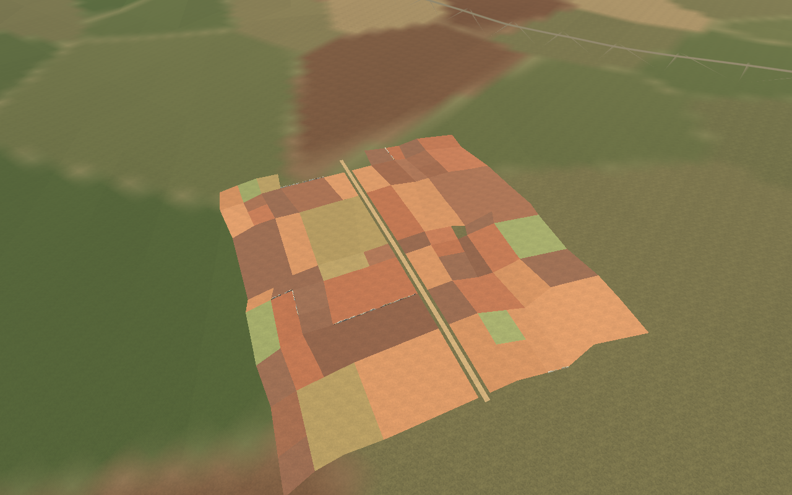
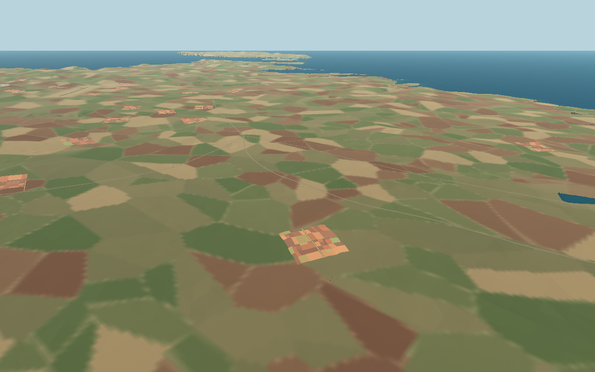
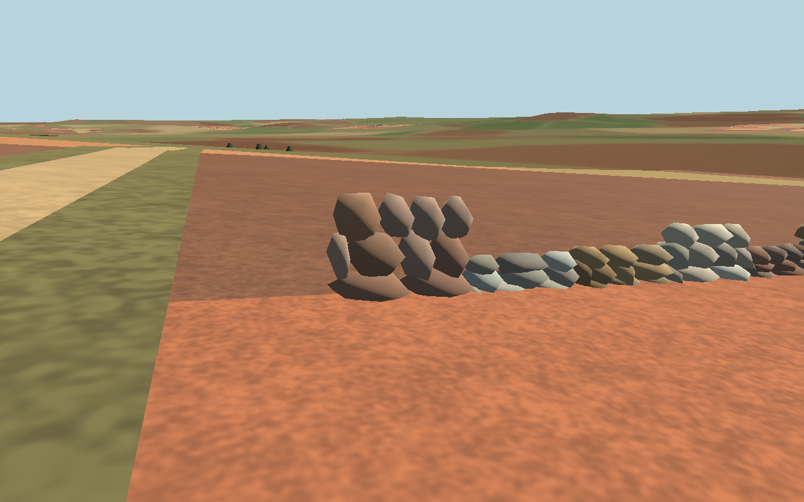

# Procedural Maltese countryside — 17 October 2026

The continuous Malta world now includes **4,332 inferred agricultural plots in 115 rural clusters**, **112 dirt-track pieces**, and approximately **15 km of physical rubble walls**. These supplement the existing terrain/material system; they do not replace the islands or change ground elevation, coastline, roads, airfields or settlements.

## Visual principle and geographic scope

The supplied comparison is used as a design reference: unequal rectangles/trapezoids, smaller subdivisions, longer merged plots, offset T-junctions, subtly uneven corners and coherent local orientations. A repeated global grid of identical green squares is deliberately avoided. Most parcels remain quadrilaterals; a minority have extra corners where adjacent parcels merge or an access lane cuts them. The palette favours red/brown earth, warm harvested tones and restrained olive/stubble rather than uniformly lush green.



Clusters are scattered deterministically, with open country between them. They turn with local contours on hillsides, or nearby rural-road directions on flatter land. Separate island samplers reuse the existing Malta, Gozo and Comino mesh data; no island is moved or regenerated. The current placement has 74 clusters on Malta, 40 on Gozo and one on Comino. These counts describe the inferred layout, not verified historic agricultural use. No field cadastral dataset was available: **these are inferred visual plots, not surveyed 1940–1942 parcels or verified historic crop distributions**. The old broad painted landscape remains as the underlying material outside these additions.

The following are excluded:

- Actual coastline plus a 70 m inland guard, invalid terrain and steep ground.
- Existing Valletta and Mdina geometry bounds with margins; the whole Cottonera generation area and its existing field-wall system.
- Conservative latitude/longitude buffers around other historic settlement centres. These are editorial exclusion masks, not municipal boundary claims.
- All supplied building/fort/wall evidence in the Cottonera source extract, including structures outside its selected model area.
- All existing world-road corridors, plus clearance for wall envelopes and loose stones.
- Broad rotated operational envelopes around every airfield, covering runway ends, taxi/parking, trucks, AA guns and command stations.

Every actual source terrain triangle intersecting a field must pass the slope guard, including interior ridges which corner-only sampling could miss. The masks and generation seed are read-only with respect to existing world data.

## Fields, contour strips and tracks

Cluster sizes are initially 190–285 m. Configurable plot-width classes are 12–25 m, 25–55 m and 55–90 m, with medium widths favoured. These are artistic ranges, not universal historical measurements; merged plots can be longer. Shared grid nodes drift coherently, some neighbouring cells merge and other cells split, breaking full rows into offset joins without overlapping neighbours.

Contour-aligned, narrower hillside strips and stone boundaries suggest traditional terraced agriculture. **No physical cut/fill benches or perfectly level terrace platforms were carved into the original terrain.** Fields follow the supplied slopes. This preserves the existing terrain/collision contract; it is an approximate hillside treatment rather than surveyed terrace earthworks.

Soil and tracks are thin **render-only skins clipped to the existing terrain triangles**, rather than a second terrain or collision mesh. Heights are interpolated from the original surfaces. A small shader depth bias prevents flicker at flight distances without lifting physical ground. The shader uses existing bundled procedural soil detail. Dirt lanes cross clusters, with short spurs toward existing road corridors and clear approaches; they have no obstructing collision. Very steep tracks are rejected.



## Rubble walls



The existing Cottonera stone generator is reused through an **optional rural style**; its default output remains unchanged. New walls use several irregular rock variants, varied rotation/dimensions, wider foundations, smaller upper stones, uneven courses, occasional low/collapsed sections and loose stones at the base. Explicit normal buffers give the new meshes 3D lighting rather than flat silhouettes.

The artistic palette mixes pale limestone `#DDD8C8`, white-grey `#BFC0B8`, warm limestone `#C9B38B`, ochre `#B89467`, reddish limestone `#A67B65` and red-brown `#89624F`. Each section has a predominant tone with per-rock variation; some lower rocks are darker or stained. Most remain limestone-coloured. Geometry/materials are stylized and consistent with the game's existing detail level, not photogrammetric stonework.

Typical walls are 0.7–1.4 m high, with a roughly 0.68 m base and 0.38 m top. Occasional low sections use 0.42–0.68 m, with rarer collapsed portions. Plot boundaries are unioned into one noded edge graph before selected walls are created. Shared edges are not duplicated. Access gaps vary from 2.6–4.8 m; track and road approaches are kept clear. Only a selected portion of edges receives walls, bounded by a configurable 15 km budget, so fields are not all sealed enclosures.

Each section samples actual ground at both ends and its midpoint. Discontinuous/steep sections are skipped. Simple continuous collision strips sit on terrain; there are **no separate stone physics bodies**. The physical strips intentionally approximate gaps between individual rocks.

## Runtime and performance

`MaltaWorld` owns one `MaltaCountryside` node in the existing scene. Soil, tracks, coarse wall visuals and static wall collisions remain available throughout the mission. No region transition resets the world or player.

- 352 spatial batches, with 1,373 compiled GLBs across alternative representations.
- About 29,690 soil triangles and 2,745 track triangles; the exact terrain-clipping approach avoids dense extra terrain grids.
- Detailed rocks below 160 m; simpler walls at 160–2,500 m; distant silhouettes at 2,500–8,000 m. Soil/track skins have a 13 km visibility limit.
- Close rock scenes load through Godot's asynchronous resource loader, with at most two pending requests and six active detail batches. Farthest detail can be replaced by nearer chunks. Ordinary flight never waits for a load.
- Simple collision remains loaded even when detailed stones disappear. Only complete world disposal drains pending scenery requests; retries free the old owner.
- Existing F4 heatmap mode hides countryside rendering and restores it on return; collision persists.

The close tier totals about 1.85 million triangles across the entire world, **not all active at once**. Assets add download/storage cost, and static collisions have a persistent memory cost. Native scripted captures do not establish browser or low-end-device frame-rate guarantees. No gameplay controller, engine, weapon, AI, health or mission logic was rewritten.

## Files and tuning

- [tools/generate_malta_countryside.py](../tools/generate_malta_countryside.py): read-only island sampling, exclusions, clustered plots, tracks, exact terrain draping, wall selection, export and stale-output cleanup.
- [tools/cottonera/landscape.py](../tools/cottonera/landscape.py): reused rock library with optional rural variants, palette, staining and collapse/loose-stone controls.
- [assets/malta/countryside/settings.json](../assets/malta/countryside/settings.json): seed, cluster count/probability/spacing, plot classes, slope/coast/road guards, urban buffers, track widths, access gaps, wall-length budget, palette and dimensions.
- `assets/malta/countryside/manifest.json`, `farm_*.glb`: deterministic plot/track/wall metadata and compiled scenes/collision.
- [scripts/malta_countryside.gd](../scripts/malta_countryside.gd): batch loading, LOD, near-detail streaming and collision ownership; detail distances/budget are exported properties.
- [countryside_soil.gdshader](../assets/malta/materials/countryside_soil.gdshader): Compatibility/WebGL-compatible soil detail and depth bias, with the existing `surface_detail.png` asset.
- [scripts/malta_world.gd](../scripts/malta_world.gd): ownership and existing heatmap visibility integration.
- New Python/Godot tests, capture fixture, publishing-check entry and documentation.

Using the existing GIS environment (NumPy, SciPy, Shapely 2, trimesh, pyproj, matplotlib, triangle):

```sh
/tmp/malta-geo-venv/bin/python tools/generate_malta_countryside.py
godot --headless --path . --editor --import --quit
/tmp/malta-geo-venv/bin/python tests/countryside_checks.py
godot --headless --path . --fixed-fps 120 --script tests/countryside_checks.gd
/tmp/malta-geo-venv/bin/python tests/countryside_regeneration_checks.py
```

Complete generation and Godot import before running the game or captures. Regeneration writes only countryside outputs; a temporary second build verifies exact bytes and metadata without editing shipped assets. There is no GIS/network dependency in the running game.

## Verification and remaining checks

The source tests verify field shape/size/orientation diversity, non-overlap, exclusions, every underlying terrain triangle's slope, shared wall edges, terrain fitting, protected hashes, asset existence, colour/normal data and byte-equivalent default Cottonera rock geometry. Runtime tests verify actual wall ray collision, asynchronous detail loading/budgets/unloading, persistent physics, F4, military counts and clean retry. Validation passed **295 checks/assertions**: 22 countryside source, 10 countryside runtime, 20 Cottonera, 30 terrain, 39 airfield-ground, 36 Malta flight/boarding/persistence, 61 ground/vehicle/AA controls and 77 interception checks. A full second generation reproduced all 1,373 countryside GLBs and the complete manifest exactly. Publishing CI includes the new runtime suite.

The three images above are real Godot 4.6.3 Compatibility captures of the continuous world, not reference-photo composites. Reproduce with `DISPLAY=:99 godot --path . --audio-driver Dummy --fixed-fps 60 --script tests/countryside_capture.gd` on a working X server. Capture fixtures move only the review camera.

Manual review: take off from Ta' Qali or Luqa and inspect nearby rural clusters from different heights; fly toward Gozo; then use the truck and existing roads to approach field access lanes. Walk into a wall and through an opening, compare stone palettes, and move far enough to exercise detail loading. Retry and toggle F4. Verify vehicle/AA/aircraft transitions still use their established controls. Exhaustive human walking/driving of every track and field gap was not performed. Browser export/runtime and device-specific performance remain unverified for this revision because this environment has no web export templates.

The supplied task text ended mid-item in its terrain-conformity section. This implementation covers the requirements visible in that attachment and the later visual comparison. No missing continuation was invented.
