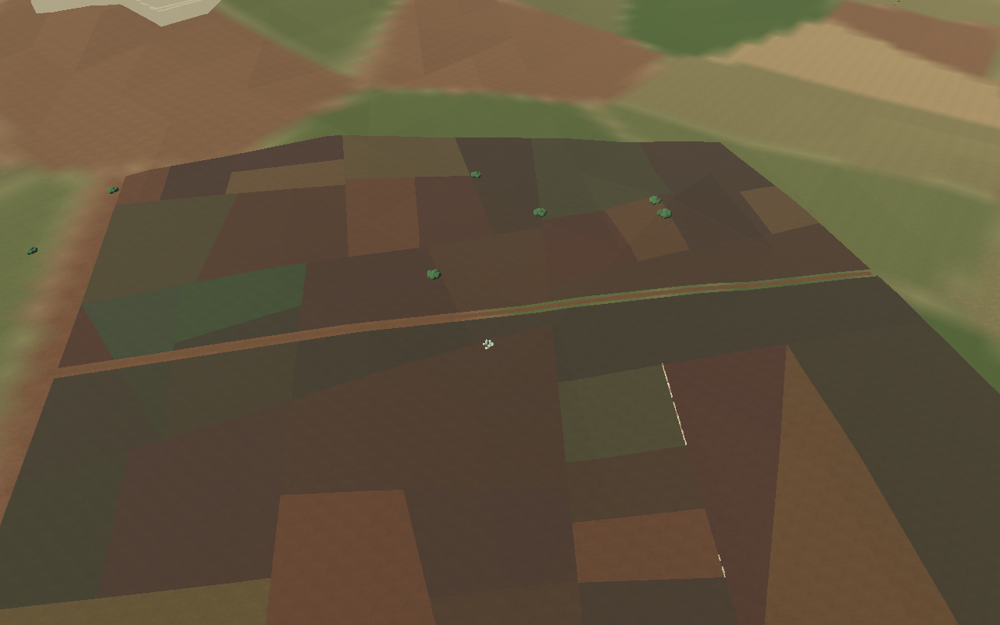
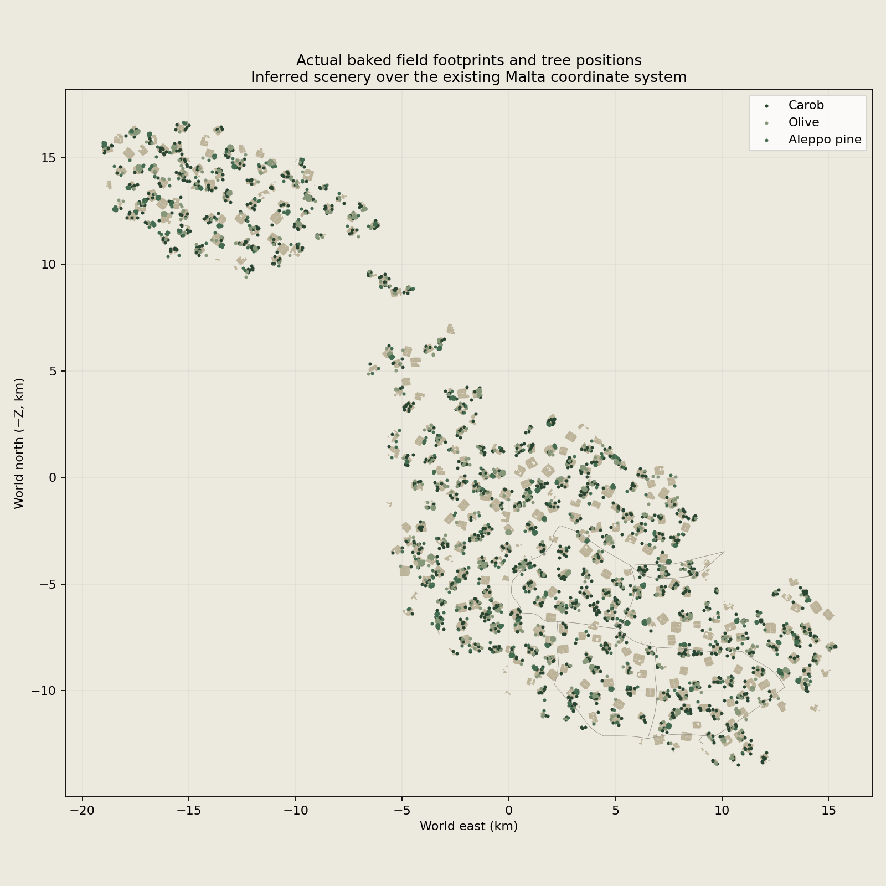
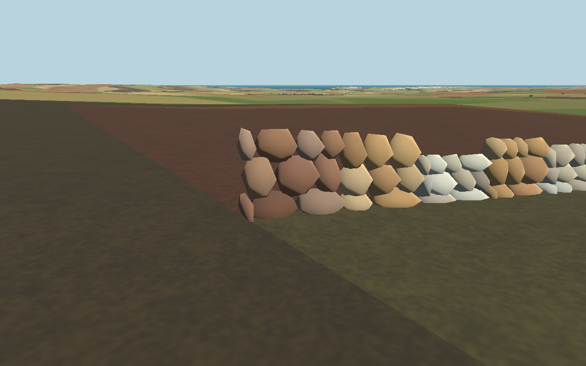
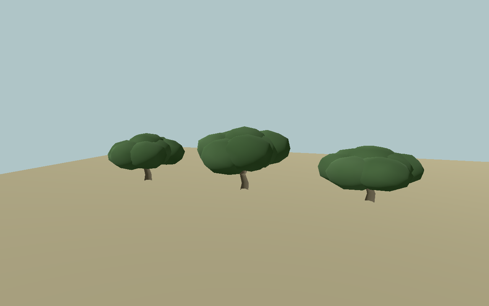
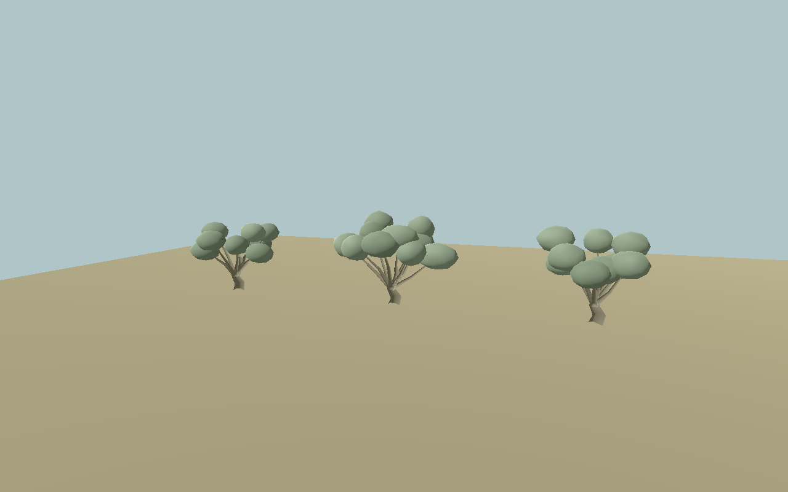
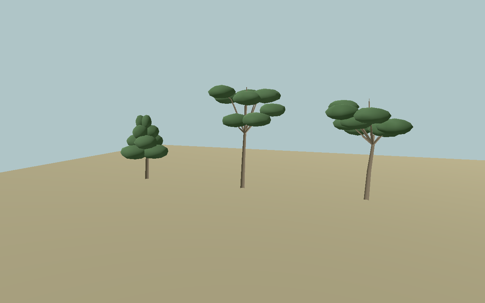
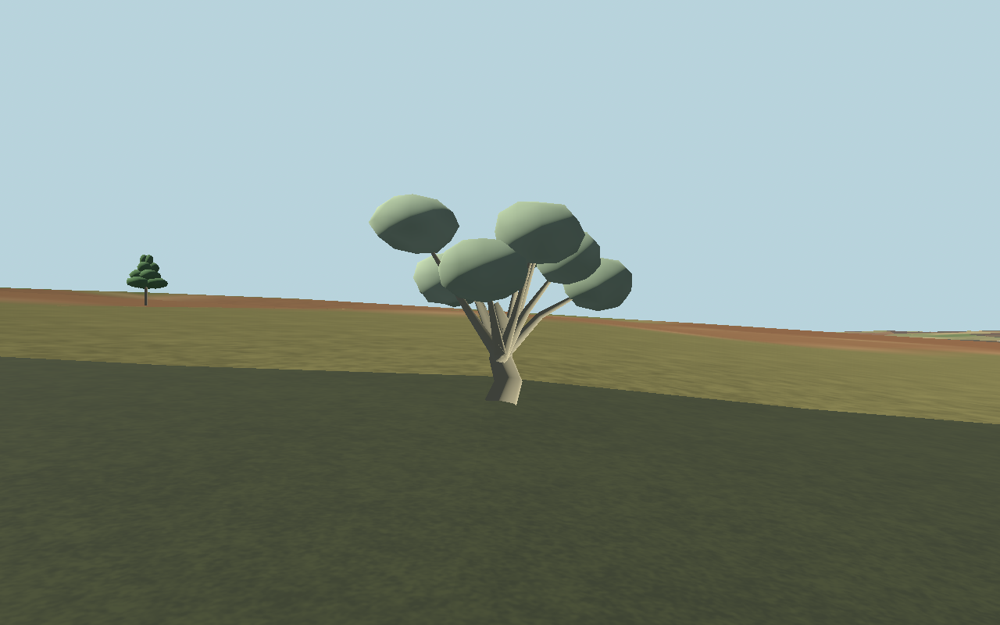
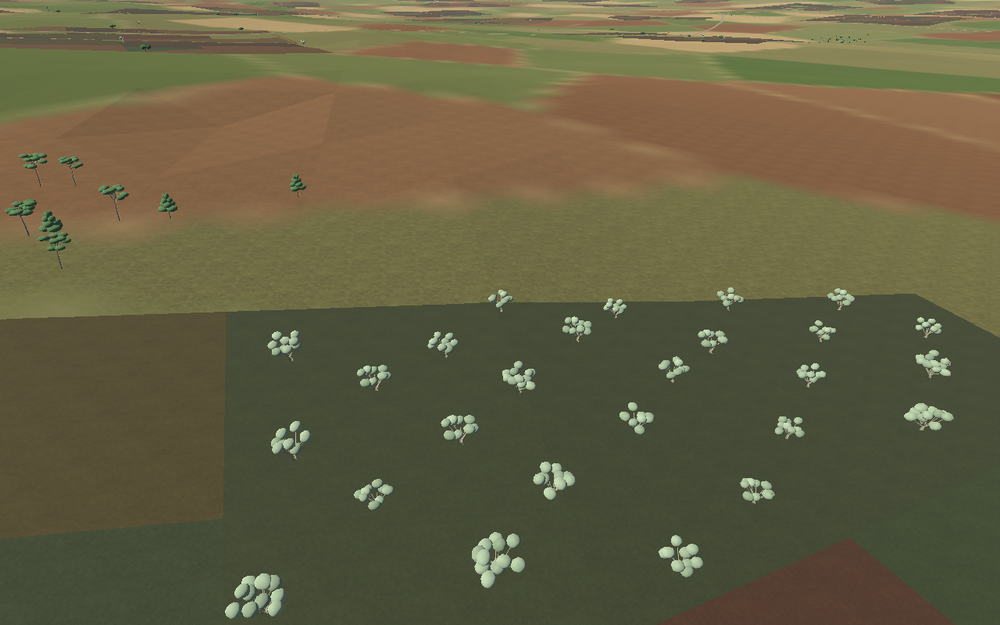
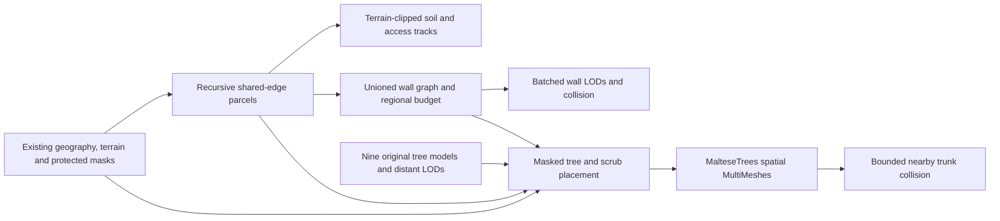

# Maltese countryside — 26 October 2026

The continuous world contains **9,703 inferred plots across 389 groups**, **378 dirt-track pieces**, approximately **45 km of physical rubble walls**, and **4,800 planted trees**. The supplied terrain, coastline, roads, airfields, city/fort geometry and mission coordinates are unchanged.

## Larger, coherent fields

The former layout had 17,977 plots with a median area of 1,212 m². Recursive straight divisions now replace the row/column grid: the median is **4,711 m²**, the 10th/90th percentiles are **1,773 / 10,666 m²**, and **83%** exceed 2,400 m². Total cultivated footprint is about **54.55 km²**, compared with 30.06 km² previously. Fewer plots do not mean less coverage.

The groups mix unequal quadrilaterals, trapezoids, 644 triangular plots and more complex road/track-clipped polygons. Cuts have coherent local orientations and restrained angular variation, rather than random jagged borders. Neighbours share exact division lines; adjoining groups are clipped against earlier groups to prevent overlap. Slopes orient the groups along contours, while flatter areas use nearby road directions.



Muted brown, earth, stubble and olive tones vary by group and plot. The soil shader decodes the GLB's sRGB vertex colours before applying the existing soil detail, avoiding bright pastel/checkerboard colours. The original broad terrain landcover remains underneath and outside these rendered skins.

Groups span 340–540 m. Target area classes are small 900–2,400 m², medium 3,200–7,600 m² and large 8,500–18,000 m², sampled with weights 9% / 49% / 42%. These are subdivision targets, not strict final-area bins: clipping and recursion change the resulting distribution. The minimum retained plot is 650 m². The old `small_width_m` / `medium_width_m` / `large_width_m` settings remain historical metadata; recursive subdivision uses the area classes instead.

The scenery is **inferred artistic agricultural layout**, not cadastral data or a surveyed 1940–1942 landscape. Contour alignment suggests terraced cultivation without cutting level benches into the original terrain.

## Geographic exclusions and grounding

Fields and trees use the existing Malta/Gozo/Comino meshes and geographic coordinate conversion. Full footprints clear:

- The coast plus the existing 70 m inland guard, steep ground and missing terrain.
- Existing roads and their seven-metre field margin.
- Broad rotated airfield operating envelopes, including runways, taxi/parking, hangars, trucks, AA and command posts.
- Valletta/Mdina bounds, the Cottonera generation area and mapped buildings/fortifications.
- Conservative buffers around existing settlement locations.

Soil is clipped to original terrain triangles; it has no extra collision floor. Wall bases and tree roots sample the same terrain. Exported skins were checked against protected masks and ground elevation: the maximum measured height discrepancy, excluding the intentional 45 mm render offset, was **2.87 mm**. At 172 float32-rounded source-edge vertices the checker required a matching adjacent terrain sample within 2 mm, rather than accepting missing heights. Trees remain upright; they are not tilted to hillside normals.



The coverage chart plots actual data, not a fabricated satellite map. All 61 substantial eligible 2.5 km coverage cells retain both plots and physical walls. These cells are validation regions, not a grid of identical field geometry.

## Rubble walls and access

The existing Maltese rural stone style is retained: irregular limestone rocks, broad bases, uneven courses, varied cream/grey/beige/weathered tones, occasional low/collapsed sections and loose stones. Typical height remains 0.7–1.4 m, with a 0.68 m base and 0.38 m top.

Boundaries become one noded edge graph, so shared walls are not duplicated. The 45 km budget is distributed between geographic regions, with a small guaranteed initial allocation before probability-based selection. This prevents edge regions losing all walls as the larger plots change the graph. Only selected boundaries receive walls. Access gaps remain 2.6–4.8 m, and track/road corridors are kept open.



Simple continuous collision strips represent the walls. Individual rocks have no physics bodies. Exact terrain-height sampling, slope guards and midpoint checks prevent obvious floating/buried runs. The default Cottonera wall generator/output remains unchanged.

## Three reusable tree species

There are nine original GLB shapes and nine matching distant LODs under [assets/malta/vegetation](../assets/malta/vegetation). All use metre scale, Y-up roots at ground level, vertex-coloured bark/foliage and actual normal buffers. They have one shared opaque runtime material, without transparent leaf cards, alpha sorting or external foliage textures.

**Carob:** 1,439 placements; broad dense dark evergreen crowns, thick bent trunks and low spreading limbs. Model heights are roughly 5.6–7.1 m before placement scaling.



**Olive:** 2,077 placements; irregular twisted trunks and visible forks, with separate airy grey-green/silvery foliage clusters. Heights are roughly 5.4–6.4 m.



**Aleppo pine:** 1,284 placements; slender taller trunks and asymmetric raised needle crowns. One young variant is conical; mature variants have separated umbrella-like crowns. Heights are roughly 8.1–11.5 m.



Placement adds 0.86–1.14 scale and yaw variation. Olive groves use loose, jittered rows in selected plots; carobs/olives occur near boundaries; pine groups and isolated trees stay off cultivated interiors. Substantial farmland remains open. This is not a historical tree-distribution survey. The pre-existing bush system now uses 62 vetted scrub centres outside fields/walls/routes, rather than jittering plants into newly cultivated areas.

Trunks stay at least two metres from physical walls and clear access tracks. Whole crown envelopes clear the protected-area mask. Minimum tree spacing is 7.5 m, increased for larger crowns. Roots use actual source elevations; excessive slopes are rejected.





## Rendering and physics budgets

- Rural scenery: **936 spatial batches / 3,087 GLBs**, down from 950 / 4,260. Soil has 134,316 triangles; tracks 12,050. Close rocks total 5.46 million across the whole world, with the original maximum six active close batches and two asynchronous loads.
- Detailed rocks below 160 m; mid/far wall tiers and persistent static wall collision retain their original behaviour. Chunk size remains 500 m; detail requests reach 530 m and unload beyond 900 m.
- Trees: **878–1,244 triangles** per near mesh, **330–480** per far mesh. Shared meshes are instanced in 256 m spatial groups, with near/far ranges of 380 / 2,200 m. Corresponding tiers share an origin and range boundary. Shadows are disabled to limit cost.
- Trunks use one simple cylinder each, within 220 m of the active camera, with a **192-body cap**. A spatial lookup refreshes at 0.5 s intervals. Branches and leaves have no collision; distant trunk bodies unload independently of continuous terrain.
- Baked countryside is about 315 MiB; reusable tree assets add about 0.5 MiB. The tested web pack is approximately 343 MiB. Assets still have download and memory costs.

Native software-render counters varied by view: about 30–1,780 draw calls and 232k–362k primitives across the captured aerial/ground/regional views. These are scene counters, not hardware frame-rate guarantees. The regional view includes the broader existing world, not just vegetation.

F4 heatmap mode hides countryside/tree visuals through existing ownership; terrain and wall collision remain intact. Retry frees the old world and creates one stable replacement population.

## Pipeline and tuning



- [generate_malta_countryside.py](../tools/generate_malta_countryside.py): exclusions, terrain draping, regional wall allocation, export, stale-asset cleanup and manifests.
- [rural_parcels.py](../tools/rural_parcels.py): recursive oblique subdivisions and occasional triangular plots.
- [generate_maltese_trees.py](../tools/generate_maltese_trees.py): original reusable species/variant/LOD geometry.
- [rural_vegetation.py](../tools/rural_vegetation.py): masked reproducible planting, grove/edge/pine/scattered contexts and filtered scrub.
- [settings.json](../assets/malta/countryside/settings.json): seed 1942, area classes/weights, slopes, exclusions, wall budgets and vegetation seed 194226/budgets.
- [MaltaCountryside](../scripts/malta_countryside.gd): existing static scenery and asynchronous near-rock ownership, unchanged.
- [MaltaLandscapeDetails](../scripts/malta_landscape_details.gd) and [MalteseTrees](../scripts/maltese_trees.gd): filtered bush visuals and shared opaque tree meshes/LOD/nearby trunks.
- [countryside_soil.gdshader](../assets/malta/materials/countryside_soil.gdshader): bundled soil detail and subdued colour decoding.
- [export_presets.cfg](../export_presets.cfg) and [build_web.sh](../tools/build_web.sh): explicitly include both JSON manifests/model metadata and ship tree attribution.

Example Linux compiler setup:

```sh
python -m venv /tmp/malta-rural-env
/tmp/malta-rural-env/bin/pip install -r tools/requirements-rural.txt
/tmp/malta-rural-env/bin/python tools/generate_maltese_trees.py
/tmp/malta-rural-env/bin/python tools/generate_malta_countryside.py
/tmp/malta-rural-env/bin/python tests/countryside_checks.py
/tmp/malta-rural-env/bin/python tests/maltese_vegetation_checks.py
/tmp/malta-rural-env/bin/python tests/countryside_regeneration_checks.py
```

Generation is offline. Runtime loads baked assets; it never re-rolls agricultural layout. The full rebuild test compares every GLB byte and both manifests. The GIS overlap checker uses micrometre-precision overlay for coincident edges; independently snapping parcel vertices was rejected because it introduced actual narrow wedges.

Run `tests/countryside_checks.gd`, `tests/maltese_vegetation_checks.gd` and `tests/rural_flight_checks.gd` in Godot, plus existing ground-control/departure checks. Native captures are generated by `tests/countryside_capture.gd` and `tests/maltese_tree_capture.gd`. After web export, use [rural_vegetation_web_smoke.cjs](../tools/rural_vegetation_web_smoke.cjs).

The [dated development/validation record](development-updates/2026-10-26-rural-fields-and-trees.md) states the exact checks and limitations. Native captures use controlled cameras; the low-flight test has an explicit initial pose and then uses normal aerodynamic control inputs. Browser checks verify real game integration, export/resource loading and normal boarding/help/resize/dismount; they do not claim a full browser flight through every rural group or a hardware performance benchmark.
