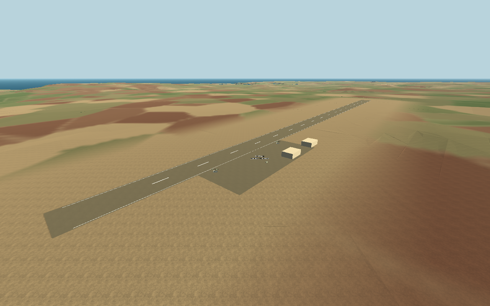
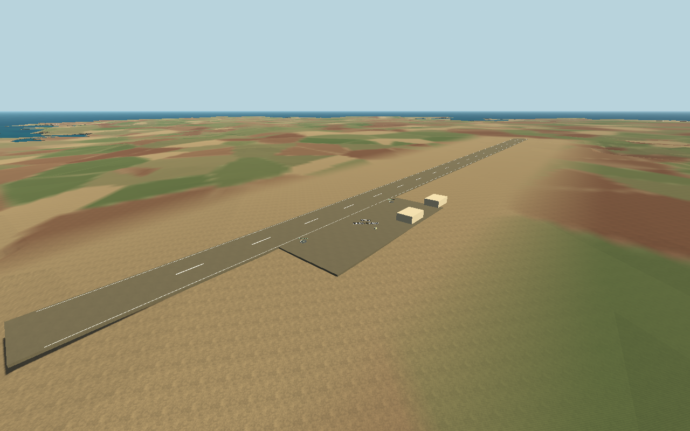
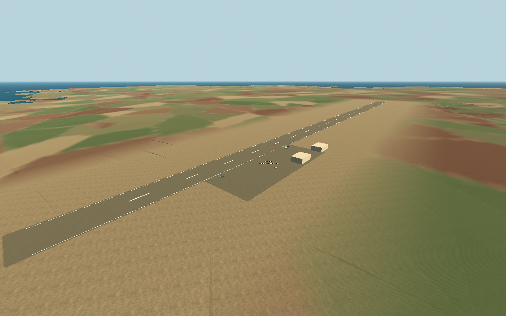
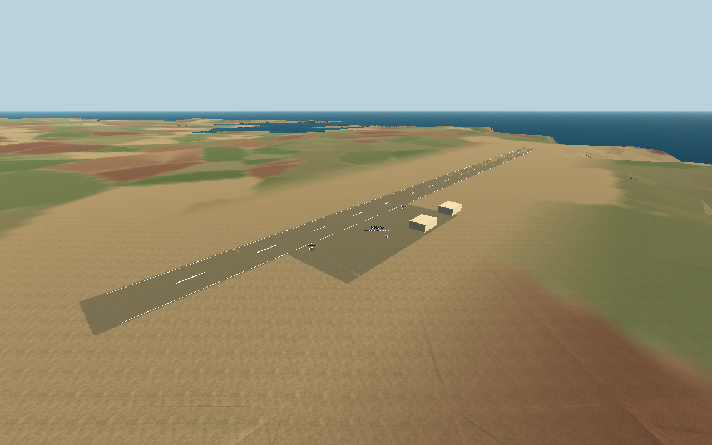

# Malta airfield terrain integration

The previous layout chose each runway's height as the highest nearby sampled terrain height plus clearance, then put solid two-metre slabs above the island mesh. That left exposed sides and drops at the edges. Airfields now use a least-squares grade fitted to their original terrain footprints, backed by locally edited island geometry. Their geographic centres, headings, lengths and 54 m runway widths are retained.

| Airfield | Previous elevation | Fitted elevation | Grade |
|---|---:|---:|---:|
| Ta' Qali | 123.98 m | 109.33 m | 0.506% |
| Luqa | 79.32 m | 76.69 m | 0.716% |
| Ħal Far | 67.90 m | 62.66 m | -0.800% |

The usable footprint combines the runway, end clearance, apron and base grounds rather than a regional rectangular plateau. It blends back to measured terrain over 360 m using a quintic smoothstep. A coastal protection mask preserves existing coastline vertices. The original input GLB remains in `assets/malta/source/terrain_original.glb`; `tools/grade_malta_terrain.py` regenerates the runtime asset from it. Settings and the quantitative report are in `assets/malta/grading/`. The original 80 m interior grid is locally refined to 8 m in the usable core and 24 m in transition regions. Original triangle-edge constraints preserve the original land surface outside modified regions.

Only Y is edited locally: original X/Z and the coastline remain unchanged, as do Gozo, Comino and the other island meshes. 845 original vertices change; 45,309 original top vertices remain untouched. Malta's triangle count increases from 107,714 to 143,134. Maximum local cut/fill is 44.46 m, including the wider Ħal Far transition; this is prototype grading, not a historical civil-engineering survey. The source terrain is a 32 m elevation raster on an approximately 80 m interior mesh, so it cannot resolve surveyed runway details.

Runway/apron meshes now have only a 15 mm visual offset and **no ground colliders**. The edited island terrain is the sole landing/driving ground collider. This avoids overlapping contact surfaces. Spawn points, parking, guns and trucks inherit the fitted base height. Hangars remain upright with their foundation slightly buried to accommodate the gentle grade. The scenery and geographic projection retain their existing locations.

## Before and after

| Base | Before | After |
|---|---|---|
| Ta' Qali |  |  |
| Luqa |  |  |
| Ħal Far |  |  |

These are actual Godot Compatibility renders with matching review cameras.

## Checks

`tests/airfield_ground_checks.gd` samples all runways and aprons against the actual edited collision mesh, verifies smooth side crossings, confirms there are no extra platform colliders, and checks upright buildings and grounded guns/trucks. Measured runway height discrepancies are below 0.14 mm, within float precision. Existing Malta, material/debug, truck/manual-AA, RAF-pilot, interception and actual aerodynamic-departure checks are retained. The latter takes off with ordinary controls, rather than moving the aircraft transform.

Reproduce offline with Python packages numpy, scipy, matplotlib, shapely, triangle and trimesh, then run `python tools/grade_malta_terrain.py`. These are generation dependencies only; Godot has no GIS/Python runtime dependency. Source files are excluded from the game export. Interactive landing at every individual airfield and every surrounding slope is not exhaustively human-tested; automated contact checks and existing flight checks substantiate the supported ground surfaces.
