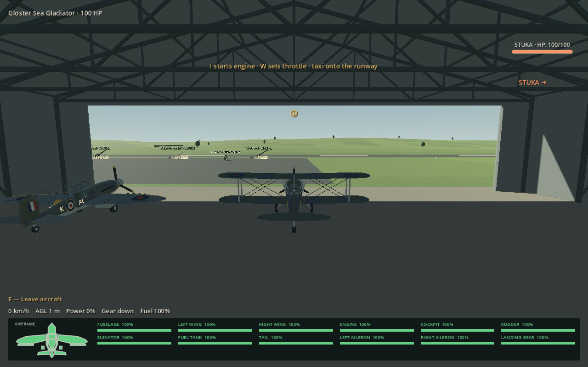
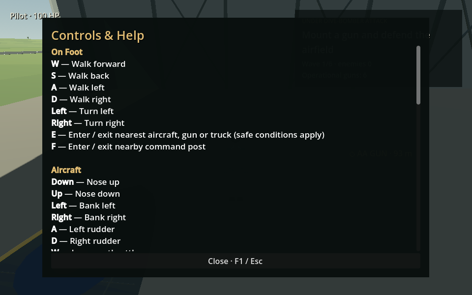
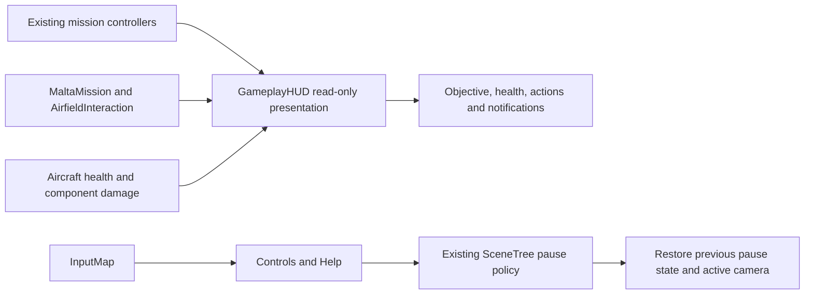

# Minimal gameplay HUD and Controls & Help

The shared [GameplayHUD](../scripts/gameplay_hud.gd) presents the running session across walking, aircraft, guns, command posts and trucks. It reads the existing mission and interaction state; it does not own combat, health, aircraft movement or wave progression.

## Layout and controls

- **Upper left:** current aircraft or pilot health; mounted equipment also shows operator health.
- **Upper right:** restrained mission title, current objective and up to three supporting lines. Free roam has no empty tracker. Mission transitions briefly acknowledge the previous objective; failures are not marked complete.
- **Bottom:** up to three contextual hints, a confirmation button when needed, concise active-vehicle instruments and the existing coloured aircraft component-health display. Nearby entry prompts are suppressed while occupying something. Destroyed/removed/out-of-range objects cannot remain a cached HUD target: the shared interaction query is evaluated again each frame.
- **Notifications:** bounded, wrapping, temporary messages; a five-second initial **F1 — Controls** hint. Enemy tags are kept clear of the objective panel.
- **F1:** open/close the scrollable **Controls & Help** window. It is also available from Pause. Escape closes help first. Help follows the existing pause policy: simulation and mission timers pause, then the previous paused/running state is restored. Cameras and occupied entities are retained. Weapon inputs are released on closure; browser gun control uses the existing click-to-recapture safeguard.
- **F2:** explicit compact HUD diagnostics. Existing F3 developer component inspection remains subject to its existing development-build/flag restrictions.

Help groups On Foot, Aircraft, AA Guns, Vehicles, Radio, Recovery and General. Configured bindings come from `InputMap`, including the web aircraft-fire fallback. Existing raw mouse/predictor controls are documented explicitly. The old large pause control paragraph is hidden along with the other superseded presentation panels.

**T** appears contextually for an available harbour wingman-status request, including its cooldown/pending-request checks. It is not presented in unrelated missions. **Right-click** is described according to the implementation: sight zoom at individual guns, binocular zoom at a Bofors predictor and approximate target/area designation at the heavy command station. The game has no corresponding right-click aircraft aim-estimate action, so none is advertised.

**E/F** interaction hints describe the occupied object immediately after mounting and reacquire nearby objects after a successful exit. A moving truck does not advertise an unsafe exit. An eligible **V** recovery hint and pickup distance/bearing replace the separate recovery paragraph; the existing eligibility, safe-exit and recovery logic remains authoritative.

## Interception duration

`mission_definitions/valletta.tres` now explicitly sets a **180-second result deadline**. The final checkpoint still starts it once; navigation remains untimed. The briefing and current README say three minutes and the tracker starts at **03:00**.

The bomber's established physical approach remains separately configured at **90 seconds**. It can therefore bomb Valletta before the result deadline if not stopped. This preserves the existing bomber path, safe 1,200 m formation insertion, aircraft performance and bombing/failure conditions; it does not slow the bomber below its flight envelope. The additional time extends the mission deadline, including time to finish the escort, rather than delaying the bomber's established attack. Other mission timers are unchanged.

## Integration

Changed runtime/configuration files:

| File | Change |
|---|---|
| [gameplay_hud.gd](../scripts/gameplay_hud.gd) | Shared responsive layout, objective adapter, contextual actions, pause/help, diagnostics |
| [main.gd](../scripts/main.gd) | One session-owned shared HUD |
| [project.godot](../project.godot) | F1 Help and F2 HUD-debug actions |
| [hud.gd](../scripts/hud.gd), [malta_mission.gd](../scripts/malta_mission.gd), [enemy_encounters.gd](../scripts/enemy_encounters.gd), [component_damage_debug.gd](../scripts/component_damage_debug.gd) | Suppress gameplay shortcuts while Help has focus; original state remains available |
| [mission_radio.gd](../scripts/mission_radio.gd) | Subtitle offsets clear the compact bottom instruments |
| [dive_defence_mission.gd](../scripts/dive_defence_mission.gd) | Distant gun locator no longer advertises an unusable remote mount key |
| [interception_definition.gd](../scripts/interception_definition.gd), [valletta.tres](../mission_definitions/valletta.tres), [valletta_interception.gd](../scripts/valletta_interception.gd) | Separate deadline from established physical approach duration |
| [web_support.gd](../scripts/web_support.gd) | Opt-in read-only HUD smoke-test telemetry |

The presentation adapter hides old visual panels while retaining their state/labels for existing test and diagnostic consumers. Consolidating those legacy presenters further is possible later; this change does not rewrite working mission controllers. Reparented AA pause settings are explicitly freed with their mission.

## Verification procedure

1. Enter free roam, Survival and each authored mission. Confirm separated health/objective/action regions and no empty free-roam tracker.
2. Resize the window. Open F1, scroll through all sections, close using F1, Escape and the button. Open it again from Pause: closing must leave Pause active.
3. Repeat on foot, airborne, at both gun types/posts and in a truck. Try E, F, C, I, M, V, R and fire while Help is open: no game action should occur.
4. Mount/dismount aircraft, guns and trucks; walk out of range or destroy the target. Entry hints must disappear while mounted and return only for eligible nearby objects.
5. In Faith, Hope and Charity, verify T only when a status request is available. Compare gun zoom with heavy-post right-click designation.
6. Follow both interception checkpoints: timer remains stopped until the final one and then shows 03:00. Early kills still wait for expiry; bombing, pilot loss and retry retain their existing rules.
7. Survive an aircraft loss and request recovery. Approach the pickup using its distance/bearing, enter it and board a replacement; the HUD must follow the new occupied entity.

Run `tests/minimal_hud_checks.gd` plus the relevant mission/recovery suites. `tests/minimal_hud_capture.gd` renders previews. After `bash tools/build_web.sh`, `node tools/minimal_hud_web_smoke.cjs` exercises the production export. See the [dated report](development-updates/2026-10-25-minimal-hud.md) for exact checks and limitations.
