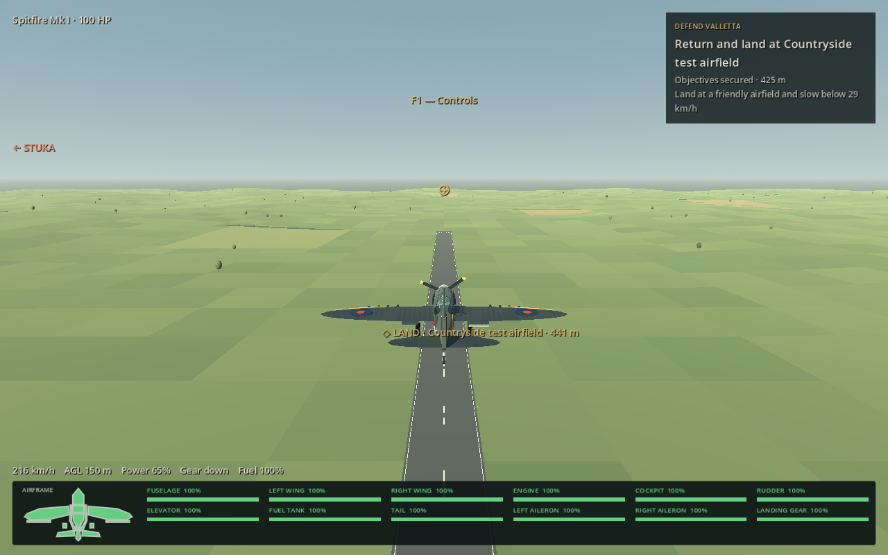
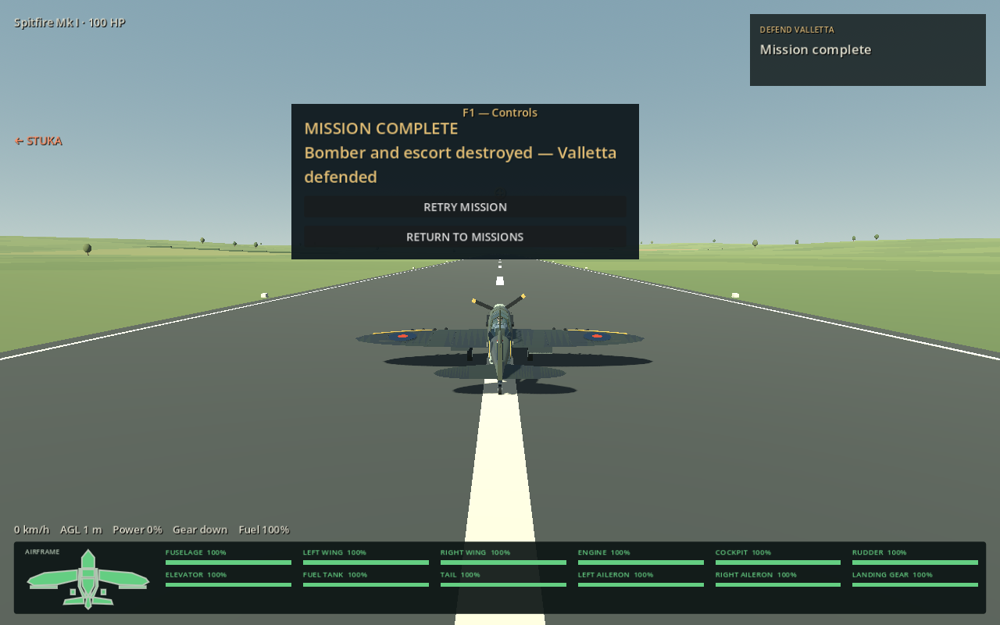
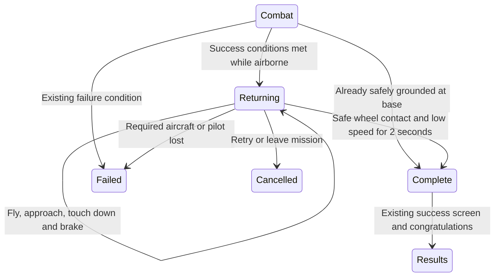

# Return and land before mission success

Combat victory now starts a **return-and-land** phase if the player is still flying. The completion panel and any existing success/congratulations recording remain pending until a safe landing. Flying remains manual; there is no new autopilot, teleport, forced engine shutdown, repair or scene reload.

The HUD says **Objectives secured — return and land**, with an airfield name, distance and speed guidance. A gold world marker and navigation-map objective point to the home airfield. Landing at any of the world's friendly runways or aprons is accepted, including a different airfield from departure.

A successful return requires:

- The same occupied aircraft remains intact, with its pilot alive.
- Extended gear and at least two real wheel contacts.
- A runway/apron footprint, within three metres of the airfield's local ground datum; countryside, water and roofs do not qualify.
- Speed at or below **8 m/s (about 29 km/h)**, vertical speed at or below **1.5 m/s**, and a reasonably upright attitude.
- Those conditions held for **two continuous seconds**. A bounce or renewed speed resets the settling period; Pause and F1 Help freeze it.

Then the existing mission controller awards success once and shows its results. Faith, Hope and Charity queues the supplied congratulations recording at that point. Other missions keep their existing audio; no substitute congratulations speech is generated.

## Scope and failures

| Mode | Behaviour |
|---|---|
| Defend Valletta interception | Existing timer and combat rules run first; a successful airborne outcome then requires landing |
| Faith, Hope and Charity | Final formation resolved, then return and land; success screen and commander congratulations wait |
| Malta Survival | Final stage cleared, then return and land; no sixth stage; a completion panel appears after landing |
| Under Dive-Bomber Attack | Ground-based victory finishes at the AA position; if the player is flying the fallback aircraft, return and land first |
| Free roam / repeat encounters | Existing optional next-enemy confirmation remains unchanged; these are not finite missions |

A pilot already safely grounded at a friendly duty station is not forced to take off solely to land again. If combat ends on foot away from base, return to a friendly base using the existing travel/recovery systems. An aircraft recorded as airborne at victory must itself land: exiting, remote travel or changing aircraft cannot bypass that requirement.

Failure screens remain immediate. Losing the required aircraft or pilot during the return cancels success; congratulations cannot play. Existing harbour sea-loss and fort-loss rules still apply. Retry/menu exit frees the return controller and invalidates queued awards. A returning player keeps normal control, health, fuel and damage, and the ongoing world is preserved.

## Implementation

- [MissionReturn](../scripts/mission_return.gd): shared success gate, landing validation, two-second latch, navigation marker, pending-award cancellation and hostile/wingman stand-down. Its exported speeds/settling interval are the tuning points.
- [MaltaMission](../scripts/malta_mission.gd): owns one return controller and exposes its destination on the existing chart.
- [VallettaInterception](../scripts/valletta_interception.gd), [HarbourInterception](../scripts/harbour_interception.gd) and [DiveDefenceMission](../scripts/dive_defence_mission.gd): defer only successful finalization; failure/cancel clears the pending return. Existing success UI/radio execute after approval.
- [EnemyEncounters](../scripts/enemy_encounters.gd): final Survival success uses the same gate and a small results panel; ordinary encounters retain their current confirmation flow.
- [GameplayHUD](../scripts/gameplay_hud.gd): prioritizes the return objective over the secured combat objective.

## Testing

`tests/mission_return_checks.gd` uses live controllers and collision systems. A disclosed short-final fixture sets the initial approach; ordinary flight controls, aerodynamic forces, suspension and brakes produce the descent/touchdown and award. Additional pose fixtures isolate outcome, damage, radio and retry branches. They are not a claimed complete human mission playthrough.

`tests/return_landing_fixture.gd` sets up a clear runway, then lets real suspension and braking settle; it is used in the updated interception regression. The fixture uses the existing integration-safe pose/reset API and restores saved damage/fuel after setup; this avoids render/physics synchronization overriding a test teleport. Runtime landing never invokes that reset.

`tests/mission_return_capture.gd` renders previews and requires success before saving the landed capture. `tools/build_return_web_fixture.py` exports an isolated copy with explicit victory/landing buttons; `tools/mission_return_web_smoke.cjs` checks production controllers, the real congratulations recording and failure/retry. This fixture is excluded from the normal browser game.

Manual check: finish combat normally, follow the return marker, lower gear, land at a friendly airfield and slow down. Verify the panel and congratulations appear only after settling; retry once and repeat with a crash before landing. See the [dated validation report](development-updates/2026-10-25-mission-return.md) for actual results and limits.
