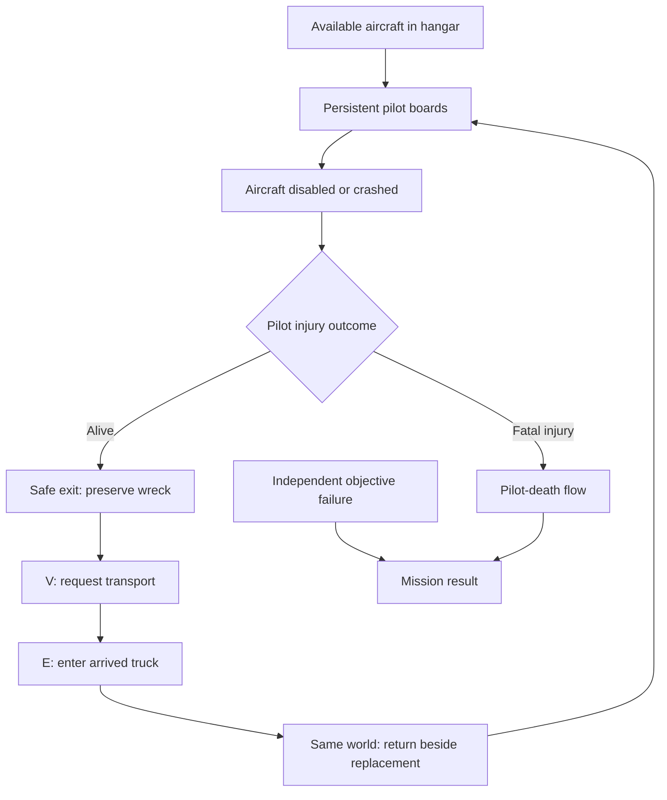
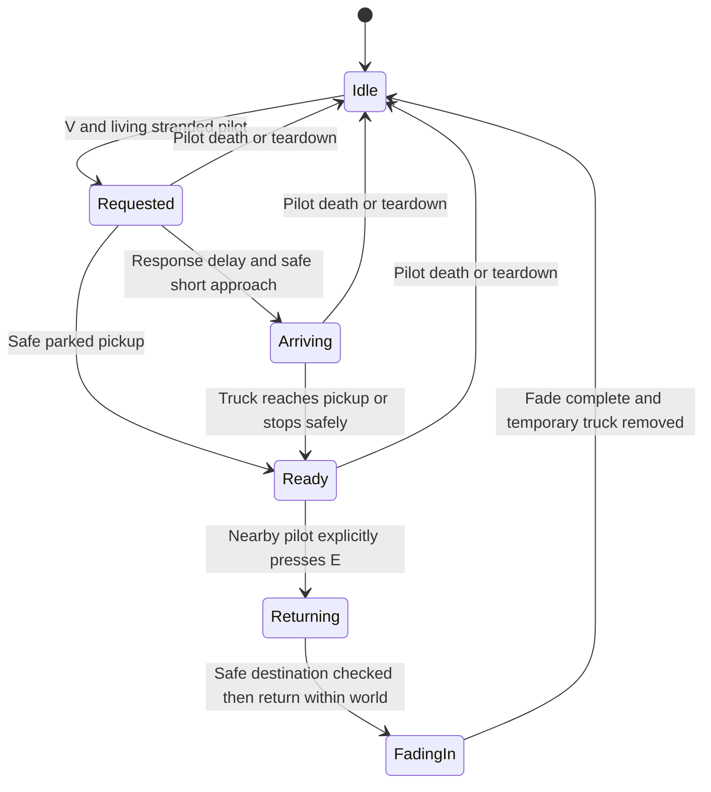
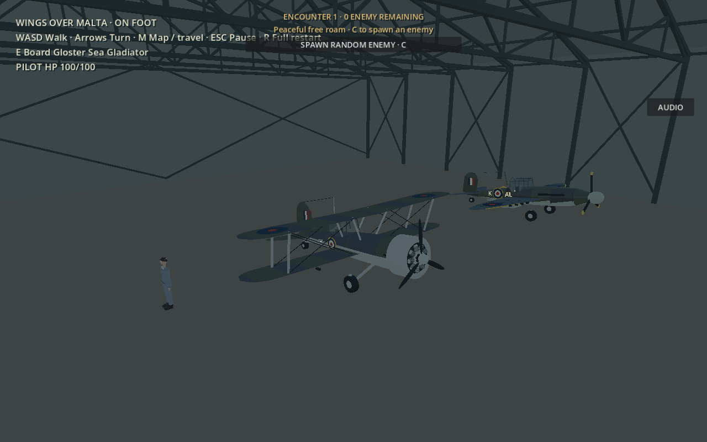

# Hangar departures, independent pilot survival and recovery

All public departures now use the same persistent pilot/fleet owner. **Free Roam** on the main menu starts Malta directly, with the selected fighter and the remembered airfield (Ta' Qali if unset). The separate Malta configuration menu remains. **Countryside Flight Test** retains the original test terrain and now also starts on foot inside its existing hangars.

## Controls and normal flow

| Control | Action |
|---|---|
| E beside a serviceable aircraft | Board it |
| I / W / S | Existing manual engine start and throttle |
| E in a stopped aircraft | Exit after shutting the engine down |
| E in a disabled/crashed aircraft | Find a safe nearby exit; engine shutdown is automatic |
| V while stranded or still inside a wreck | Call transport assistance |
| E beside the marked recovery truck | Explicitly enter and return to the recorded departure base |
| R | Full attempt restart; clears old wrecks/transport and restores the pilot/fleet |
| M in Malta | Existing navigation and on-foot travel |

The HUD shows pilot HP separately from aircraft hull HP. Recovery messages include **Transport requested**, **Truck arriving**, and **Enter truck to return to base**, with pickup distance and a compass bearing. Unavailable aircraft are never silently repaired or duplicated. If no usable aircraft remain, the HUD says so without declaring the pilot dead.

## Parking and spawning

[AircraftHangar](../scripts/aircraft_hangar.gd) has six editable `parking_points` and generated `AircraftParking1`…`6` markers. Three lateral stands have 14 m spacing; two rows have 14 m spacing. Each pose uses the existing floor grade, a small slab offset and the aircraft's existing parked pitch. Aircraft face out through the clear door.

[MaltaAirfield](../scripts/malta_airfield.gd) builds `parking` transforms from those markers, consuming a second hangar if needed. [MaltaMission](../scripts/malta_mission.gd) creates each available aircraft once, places it at its assigned pose, stops its engine, applies its parking brakes and places the pilot beside the selected aircraft. Available aircraft in every Malta mission, Survival and free roam use these stands. Authored airborne enemies and formations are unaffected. The AI-only Hope/Charity runway starts remain authored AI starts; those aircraft are not player-available parked replacements.

[CountrysideWorld](../scripts/countryside_world.gd) adapts the existing `Airfield` terrain, runway and three hangars to that same session owner. It has two available fighters, one normal truck and six manual AA guns. It does not load Malta cities or pretend its test coordinates are geographical. Malta navigation/travel stays exclusive to Malta. The low-level `start_flight` method remains an isolated legacy regression fixture; no public menu button uses it.

## Pilot injury and mission outcomes

[PilotSurvival](../scripts/pilot_survival.gd) owns one human life using the existing `GroundPilot.health` component. Aircraft HP and component integrity remain independent. An unoccupied aircraft can be destroyed without injuring the pilot. Zero hull HP disables that airframe's controls, engine and guns; it does not create a pilot-death event.

Actual terrain/water impact assessments feed pilot injury through `FlightAircraft.impact_assessed`. Injury depends on the existing impact severity, with an exported safe allowance and damage scale. Cockpit hits transfer configurable injury. Nearby aircraft fire and actual explosive ignition can still injure or kill the pilot. The hidden on-board pilot retains a damageable capsule at the seat; friendly-fire checks continue using its player team.

The contact-normal calculation was corrected: this engine's returned contact normal was being rotated by the aircraft basis again. In the nose-down test this reduced the apparent normal speed to about 2.63 m/s despite a 62.46 m/s impact. The corrected assessment measured about 62.41 m/s normal speed and severity 5.41, producing a fatal injury. This changes crash assessment, not aerodynamic forces or flight controls. Level belly-first impacts that lose speed to drag can remain survivable; a crash flag alone is not evidence of fatal injury.

| Pilot-survival tuning | Default |
|---|---:|
| Safe impact severity allowance | 0.18 |
| Impact injury scale | 42 HP per severity unit beyond allowance |
| Cockpit-hit injury scale | 55 HP at full hit severity |
| Fire exposure | 9 HP/s at source, falling with distance |
| Close explosive ignition | Up to 110 HP, falling within 15 m |

The encounter director and Survival use pilot life for loss/spawn blocking. Interception still resolves at its 90-second deadline and fails immediately on pilot death; losing a recoverable airframe does not reset or stop its timer. Harbour defence retains fort loss and formation/wave rules, with one explicit mission-specific exception added on 20 October: a sea crash in the currently occupied aircraft fails harbour defence even if the pilot survives. Survivable land losses remain recoverable. The dive-defence mission retains loss of all six emplacements as a separate failure condition. A surviving operator can use the parked aircraft; no automatic gun crew or firing was added.

Pilot death triggers one shared death panel and blocks boarding, leaving, transport and further enemy/stage confirmations. Mission result handlers remain idempotent. Full restart is explicit.

## Safe exit and persistent wrecks

Exit searches use horizontal directions even if the aircraft is inverted, expanding out to 24 m. Downward terrain/water rays and capsule overlap checks reject obstructed points. The wreck is excluded only from the floor ray; its collision and other live obstacles still block the final capsule. Exiting a high airborne wreck is refused until a nearby safe surface exists, but V can request help while the pilot waits.

Where the mode permits continuing after a sea loss, the pilot can leave a sinking wreck and use buoyancy/swimming movement to reach pickup. Faith, Hope and Charity instead ends on the player's sea crash. This uses the existing avatar and controls; a dedicated swimming animation has not been added. Sea crashes keep their splash and sinking physics.

Mission-owned player wrecks preserve up to two central geometry sections after short-lived dynamic fragments expire, with at most 64 retained mesh instances and distance culling. Intact/moderate wrecks already retain their original model. Central remnants persist until full retry/menu teardown; sea wrecks continue sinking. This does not retain endless emitters or resurrect an aircraft.

## Transport state and placement

[TransportRecovery](../scripts/transport_recovery.gd) is shared by all public modes, including the countryside test departure. Default response is **6 seconds**, optional short collision-driven approach is **3 m/s**, and each fade is **0.65 seconds**. These are exported properties.

Each request is latched before work begins. A temporary existing `MilitaryTruck` is the only added vehicle; normal base trucks remain available. The system prefers nearby points from the existing mapped road network/base access data, then samples local supported ground. Four footprint support probes and an overlap box prevent cliff overhang, terrain clipping and spawning into buildings/aircraft. Roofs are not treated as normal drivable pickup sites. A short approach uses collision movement when practical.

If no local dry site exists at sea, a simple **rescue pontoon carrying the truck** supplies a reachable above-water pickup. It is a functional placeholder, not a historical rescue-craft reconstruction. In inaccessible dry locations a checked accessible base pickup is selected and its bearing/distance shown. If every checked location is obstructed, the request retries and tells the player to move into open ground/water rather than spawning an overlapping truck.

Arrival alone never moves the player. Nearby E entry starts the fade. The destination is the airfield recorded when the current aircraft was boarded, with the original home as fallback. A safe point beside a surviving replacement is preferred; occupied/obstructed points are rechecked before arrival. The temporary truck/pontoon is removed, the request is cleared, and normal foot control/camera return. Health, fleet identities, wrecks, enemies, waves, timers, fuel and objectives are preserved. If the base has no replacement, the survivor is informed and can use existing Malta travel.

## Poster playback and default menu

The original video carried Theora video **and Vorbis audio**. The presentation also inherited gameplay pause processing. The pause path can freeze presentation/decoder processing; a video coupled to a suspended browser audio clock is an additional pre-gesture dependency.

[GameIntro](../scripts/game_intro.gd) now explicitly processes while paused, initializes layout before starting playback, guards its single instance/transition and restarts only a genuinely stalled decoder. The video is now **video-only Theora**, and its preserved soundtrack loops separately on the Music bus. FFmpeg frame-MD5 comparison verified all **121 decoded frames are unchanged**. No speech or substitute sound was generated.

Native tests verify changing decoded texture data, pause-independent playback, a complete loop, one Play transition and a fresh moving poster on return to the title. The browser smoke checks animation before the first gesture. The original intermittent customer-device startup was not captured directly; no claim is made that every device-specific decoder problem has been reproduced. [Asset provenance and conversion](../assets/intro/README.md).

The primary menu action routes through `start_free_roam` to Malta, without requiring a configuration submenu visit. Backing out of Malta options retains the selected airfield/aircraft. Fort ground-spawn options remain in the separate Malta menu; primary aircraft free roam chooses an airfield so the pilot starts beside the aircraft.

## Previews and testing

[Ground pickup](previews/recovery-truck-pickup.png) · [Sea rescue pontoon](previews/recovery-sea-pontoon.png)

These are native Compatibility renders from the game. Capture fixtures position the aircraft to illustrate ground/sea loss; they are not a record of a manually flown continuous sortie. The capture process reported four llvmpipe texture-cleanup messages on shutdown, after saving the images. The existing keyboard suite also reports resource/ObjectDB cleanup diagnostics at exit; AA checks can report colinear look-at warnings, and the missing-radio-asset negative test intentionally warns. These are recorded separately from successful assertions and the error-free browser smoke.

Automated checks and their actual counts are recorded in the [20 October development update](development-updates/2026-10-20-pilot-recovery.md). New suites cover the full request/entry/return sequence, actual swimming to pickup, inverted exits, persistent wrecks, all mission directors, no-aircraft messaging, remembered options and the countryside adapter. Existing aircraft, weapons, damage, AA, mission, terrain, radio and driving checks were also run. The production browser smoke uses only real menu/keyboard inputs and read-only diagnostics.

For a repeatable manual check:

1. Launch, let the poster loop, press Play, select either fighter and choose Free Roam. Confirm Malta opens on foot inside its hangar. E boards; I starts the engine.
2. For a safe recovery-system check, use the existing H hull-debug input ten times while parked. Confirm hull 0, pilot 100, no automatic mission loss. E exits; V requests help. Arrival must leave the pilot in place. Walk to the marked truck and press E.
3. Confirm return beside a surviving aircraft, unchanged pilot HP, the old aircraft still destroyed, and no duplicated fleet/truck. Board the replacement. Repeat in Survival and an active mission; observe stage/objective/timer continuity.
4. Test a genuinely fatal impact separately and confirm pilot-death flow blocks assistance and further waves. R restarts fully.
5. For sea recovery, use a low-energy ditching scenario, exit, swim to the pontoon pickup and explicitly enter the truck. Verify it remains above water.
6. Return to the title from a paused session; confirm the poster still animates, then Play reaches a working menu.

Not verified by a human end-to-end: a fully manually flown takeoff → survivable crash → recovery → second takeoff in every mission, mobile performance, or arbitrary inaccessible terrain locations. Pickup/exit sampling is finite, not a navigation-mesh proof that every possible obstruction arrangement is reachable. No new swim animation or historical rescue-boat model is supplied.
