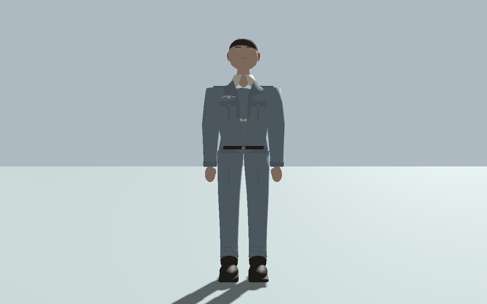
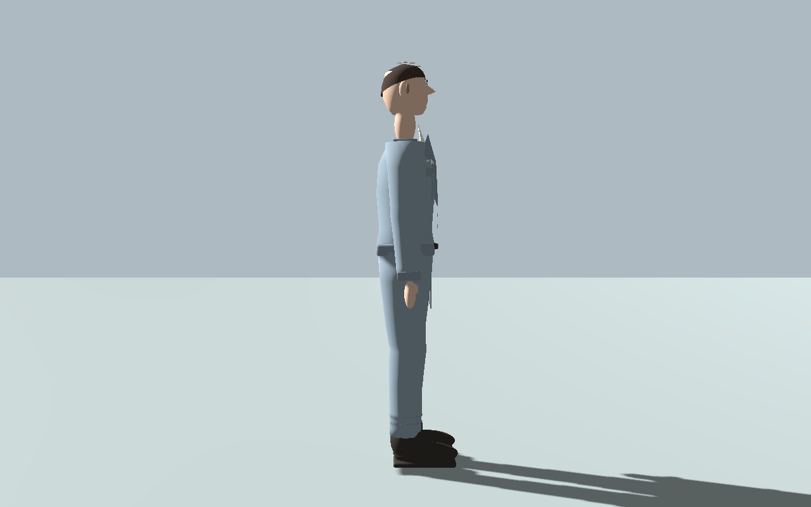
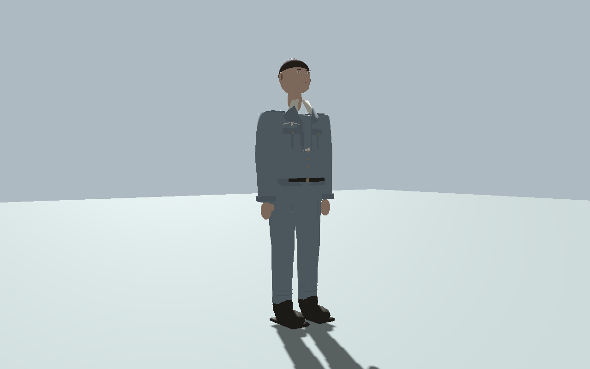
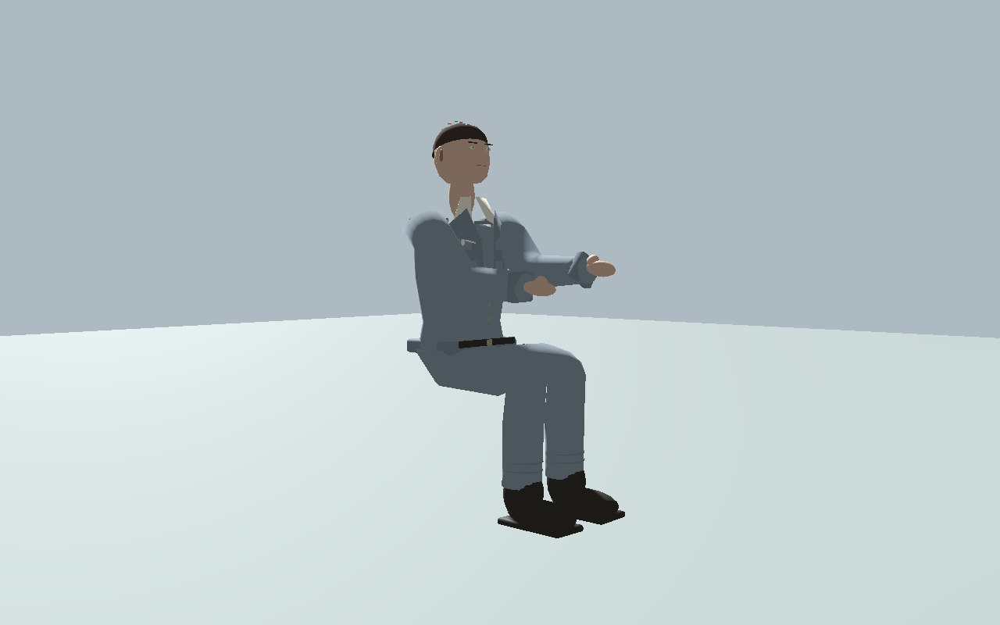
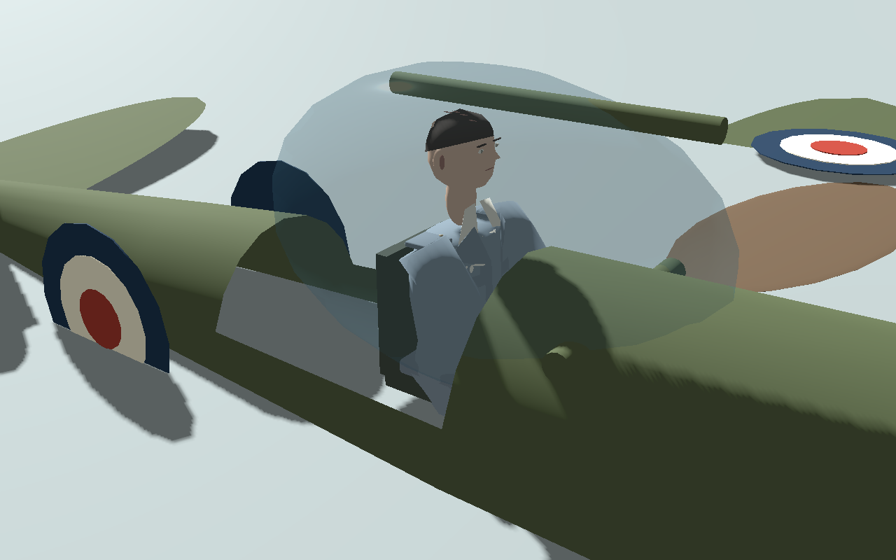
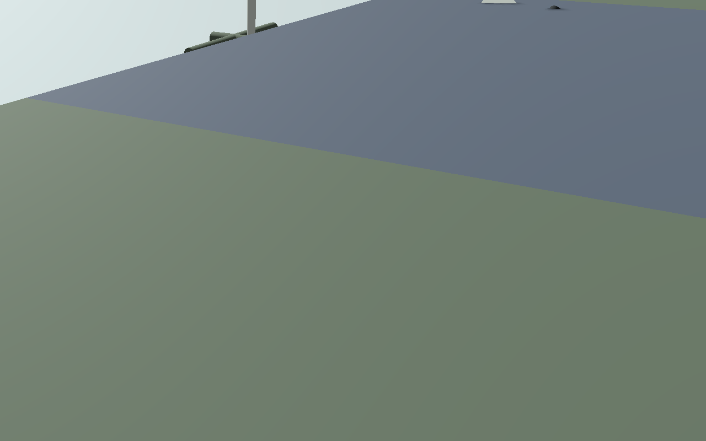

# Reusable RAF pilot

The former box-and-sphere GroundPilot has been replaced by an original, metre-scale
3D character. The supplied photograph guided the open-collar jacket, epaulettes,
flapped chest pockets, wing badge, high waist, straight trousers, dark shoes and
short side-parted hair. It was not used as a texture, lighting bake or seated-pose
projection. RAF blue-grey is an artistic choice; the monochrome photograph does
not establish uniform colours or the subjects' identities.

The runtime asset is [raf_pilot.glb](../assets/characters/raf_pilot.glb). It contains
an 18-bone skin, two combined meshes and Idle, Walk and Seated animations.
Materials use muted colours, rough cloth, cotton and darker leather without
external textures or special shaders. Garment geometry includes collars,
pocket flaps/pleats, buttons, shoulder straps, cuffs, waist and trouser folds.
Face, hands and embroidered insignia remain stylised to match the prototype.

The editable Blender source is in `assets/characters/source/raf_pilot.blend`.
That directory's `.gdignore` prevents Godot from importing Blender files or
requiring Blender to open/export/play the game. Regenerate with:

```sh
blender --background --python-exit-code 1 --python tools/build_raf_pilot.py
godot --headless --path . --editor --import --quit
```

`RafPilotAvatar` exposes `set_pose("Idle"/"Walk"/"Seated")`,
`animate_walk(speed,delta)` and `set_first_person_hidden(bool)`. The pure GLB
and visual component can be reused for friendly AI pilots without depending on
the player controller. GroundPilot retains its existing capsule, gravity,
walking speed, yaw controls, camera placement and interaction distances.

Boarding hides the on-foot body and shows one seated instance in the occupied
Spitfire/Sea Gladiator. Exiting hides the seated instance and restores the same
walking character and camera. Empty parked aircraft have no visible occupants;
enemy aircraft do not receive RAF characters. Cockpit openings, translucent
canopies and visual seats, stick, throttle and pedals fit the seated pose. These
are visual changes: aircraft hulls, forces, gear, weapons, damage and contact
logic are unchanged.

## Previews rendered in Godot Compatibility

| Front | Side |
| --- | --- |
|  |  |






Regenerate these actual asset renders with:
`godot --path . --script res://tests/pilot_preview_capture.gd` using a graphical
display. They contain the current game meshes, not concept art.

## Checks and limits

`tests/pilot_character_checks.gd` exercises real walking input, idle transitions,
boarding, seated bone positions, exit, preserved collision/camera/health and
first-person geometry hiding for both aircraft. Run it after import with:
`godot --headless --path . --fixed-fps 120 --script res://tests/pilot_character_checks.gd`.
Existing Malta and keyboard checks also verify boarding rules and controls.
Browser checks exercise the exported game rather than a model viewer.

No skeleton or animation clips existed in the old placeholder. The new idle,
walk and seated clips are original. **There are no climb-in/climb-out animations:**
entry/exit retain their original instant handoff. Hands have simplified thumbs
and palms rather than articulated fingers, and the static seated hands do not
animate with stick/throttle input. Small garment intersections can occur at deep
joint bends; the jacket covers the hip overlap. Standard seated head/shoulders
fit the canopy and legs stay inside the fuselage; exhaustive extreme-pose and
all-camera-angle clipping checks are not claimed. The first-person hiding API
is verified, but the existing game has chase cameras and no playable first-person
cockpit mode to test. Full manual play on the public site remains unverified.
