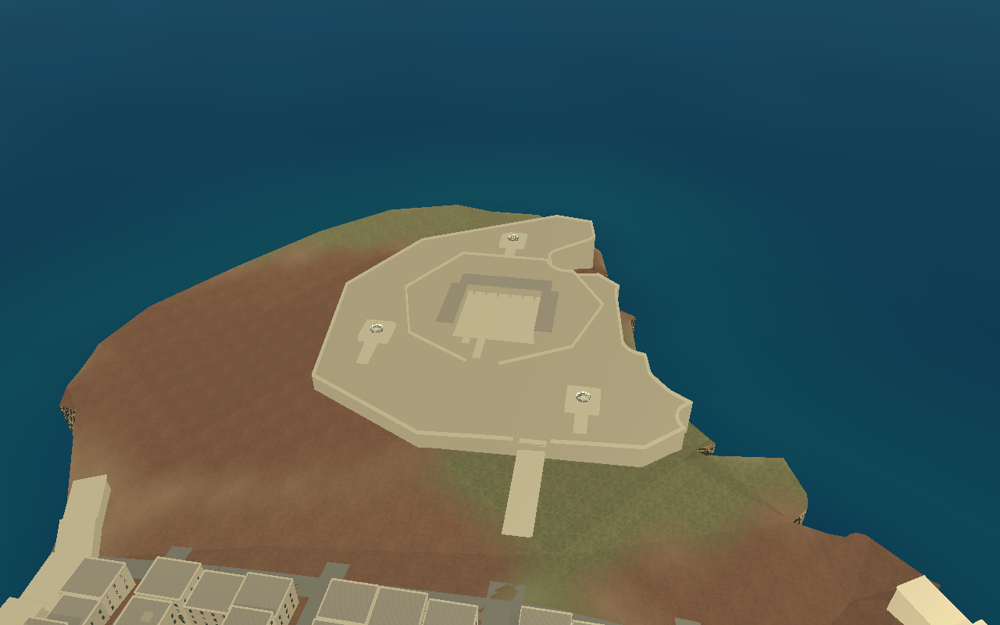

# Fort St Elmo — player-operated Bofors battery and ground travel

Select **Malta → departure dropdown → Fort St Elmo — Bofors Battery**. The same
dropdown offers **St Elmo — Bofors 1 / 2 / 3**. Departure leaves the player on foot
near the chosen position; no gun is automatically mounted. The Malta chart also
has a selectable Fort St Elmo marker.

In a running Malta session, open **M**, choose an airfield or St Elmo destination
in the navigation panel and click **TRAVEL / SPAWN HERE**. This requires an alive,
on-foot player and an unfinished session. Leave the gun, truck or stopped
engine-off aircraft first. Travel checks the live floor and capsule clearance;
it moves only the soldier, preserving fleet damage/fuel, guns, enemies, battle
progress and the environment. Mission retry still resets the whole session and
returns to its originally selected departure point.

## Controls

| Control | Action |
| --- | --- |
| E nearby | Mount / leave an operational gun |
| Mouse / arrows | Existing traverse and elevation |
| LMB (or existing browser F fire) | Hold fire; unlimited ammunition, automatic 0.5 s reload |
| RMB | Sight zoom |
| B while mounted at St Elmo | Individual / Battery Command toggle |
| M | Existing navigation map, now including ground travel options |
| Escape | Pause / release pointer lock; click view to recapture |
| R | Existing full-session retry |

The three new guns share the existing Bofors definition, model, muzzle, recoil,
flash, positional report, swept physical rounds and aircraft component damage.
All **18 existing airfield guns** remain in the airfield battery; the fort owns
**three additional light guns**, for **21 guns** in the continuous world.

Individual mode fires only the occupied gun. Battery mode projects the player's
actual barrel aim into the world. Each other gun calculates its own traverse and
elevation toward that point, obeys its rate/angle limits, and fires only on an
explicit held player trigger with alignment and line of sight. There is no
hostile search, automatic target selection, auto-leading or autonomous firing.
The new mode does not replace the existing heavy battery command posts.

Commands stop on release, pause, menus/map, dismount, operator death, gun loss or
mission completion. Losing a remote gun removes its contribution while leaving
surviving battery members controllable. Losing the occupied gun safely dismounts
the player. Existing gun health persists through mounting and travel.

## Fort and placement




The fort retains the previous Valletta-grid anchor, heading and metre scale.
The original Fort St Elmo landmark remains at world X **10751.7495**, Z
**3168.3800**, derived from the existing `(14.5194 E, 35.9020 N)` tip reference
and its original local offset. The existing city generator keeps every ordinary
building and other landmark unchanged while replacing its previous star/rim.

The supplied photograph informed the irregular perimeter, layered walls,
parapets, open internal court, U-shaped barracks and accessible firing positions.
An elevated drill-court platform has solid steps and a parallel walkable ramp;
an entrance ramp connects the outer deck to the original ground. There is an
actual open ground-floor portico below the barracks' upper storey. Walls, ramps,
steps, decks and platforms have the same static structure collision as the city.

Every platform must be wholly covered by the coastline-clipped fort deck; a
compiler assertion rejects unsupported sites. The inner fort and buildings are
also clipped to supported ground. Existing terrain, coastline, city orientation,
airfield coordinates, public roads and mission definitions are unchanged.

This is an **original reference-inspired approximation**. The picture is not a
survey; footprints, elevations, entrances and three gun sites are authored for
playability and are not claimed to reproduce verified wartime emplacement
positions. The modern footbridge, lighthouse extension, cars and modern signs
in the image were not copied. There is no precise historic moat excavation,
complete interior reconstruction or surveyed facade detail.

## Crews and handoff

Each gun starts with one British operator, using the existing skinned RAF rig,
khaki cloth overrides and an original simple steel helmet. No new character
asset download is needed. The seated avatar is attached to the imported gun's
YawPivot, so it follows actual traverse. There are no extra autonomous loaders
or ammunition limits.

Mounting sends the operator to a collision-checked waiting point with a brief
walking transition. Firing waits until the operator has cleared the seat.
Dismounting checks for both solid obstacles and friendly crew before returning
the player to walking; the living operator then walks back to the seat. A dead
operator stays unavailable and is not resurrected by boarding. Destroyed-gun
crews stop operating and use a simple fallen pose. The existing ground-health
component and bomb receiver group provide blast damage; this is not a ragdoll.

The rig's existing Walk/Idle/Seated animations are reused. A dedicated AA boarding,
hand-on-crank animation and carefully fitted infantry uniform are not supplied;
minor pose/hand fitting and interrupted-transition clipping need manual review.
No separate traverse-mechanism recording is available, so no mechanical sound
is claimed. Reports use the existing `aa_cannon_shot.ogg` on the Guns bus, at
−16 dB per fort gun by default, with existing concurrency limits/radio ducking.

## Files and tuning

- `tools/fort_st_elmo_geometry.py` and `tools/generate_valletta.py`: original
  procedural structure, supported platforms and generated spawn/gun metadata.
- `assets/malta/valletta/st_elmo.json`: offline-generated metre-scale placements.
- `StElmoLocations`: departure and travel entries using that same metadata.
- `StElmoBattery`: three guns, shared aim point, 2° alignment tolerance, 0.07 s
  stagger, 1,500 m designation ray and −16 dB report volume; exported tuning.
- `StElmoBofors`: scoped B toggle, handoff, muzzle clearance and original gun logic.
- `StElmoCrew`: existing rig, helmet, waiting/return/death presentation.
- `MaltaWorld`, `MaltaMission`, `MaltaDepartureMenu`, `MaltaChart`, `main` and
  `AirfieldInteraction`: same-world spawning, map travel and exclusive controllers.
- Read-only opt-in `WebSupport` telemetry and native/browser checks cover the new
  controls without exposing gameplay mutation shortcuts.

To rebuild geometry, use the existing geographic Python environment:

```sh
/tmp/malta-geo-venv/bin/python tools/generate_valletta.py
godot --headless --editor --import --quit
godot --headless --fixed-fps 120 --script res://tests/st_elmo_checks.gd
bash tools/build_web.sh
node tools/st_elmo_web_smoke.cjs
```

## Validation and remaining manual checks

The dedicated native suite checks counts, all spawn destinations, preserved world
and aircraft health, all three gun interactions, crew handoff/return, individual
fire, coordinated physical shots, an actual blocking shape, release, pause,
remote destruction, occupied destruction and clean retry. Existing AA, Malta,
Valletta, heavy/light and dive-defence/mouse checks cover regressions. Captures
above were actually rendered with native Compatibility.

Manual checks still needed: walk the full entrance/steps/ramps route, inspect
crew hands and interrupted handoffs from every angle, and listen to a three-gun
battery alongside radio speech on real speakers. The views are schematic and
can show existing Compatibility shadow/moire artifacts on close flat masonry.
No frame-rate guarantee or fully surveyed historical reconstruction is claimed.

Recorded native results: St Elmo **34/34**, original AA **114/114**, Malta
flight/boarding/persistence **36/36**, Valletta **17/17**, heavy/light AA
**55/55**, dive defence **47/47**, and mouse tracking **32/32** — **335 native
checks passed**. The mouse suite actually tracked a simulated Stuka in its
approach, dive and pull-out through the existing mouse controller. Native
Compatibility captures and protected Valletta building/grid/landmark comparisons
also passed. The production web export reported no script/resource errors.
