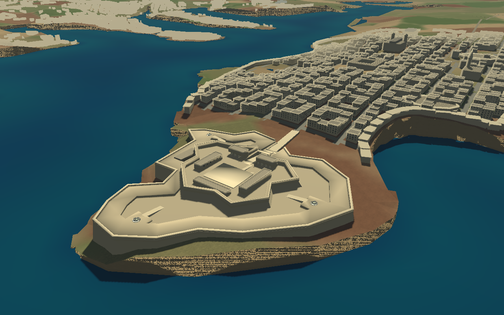
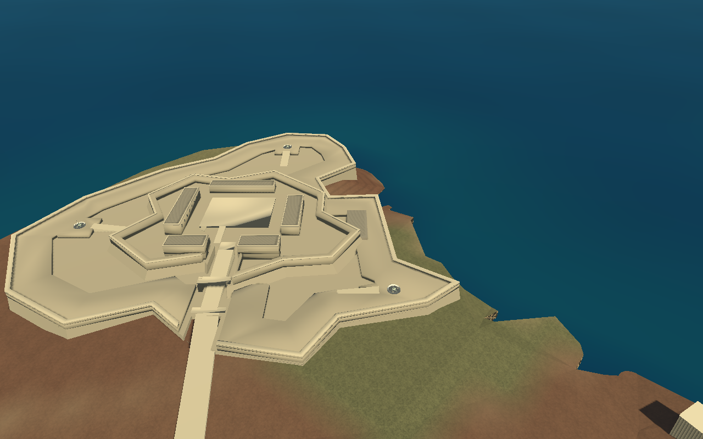
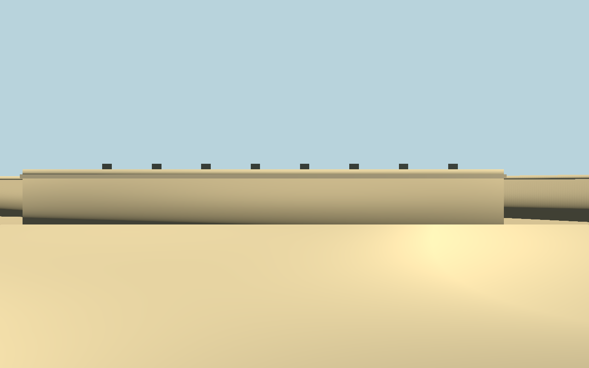
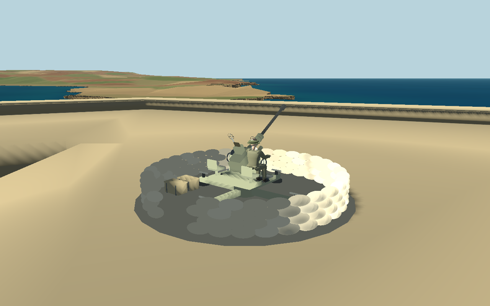

# Fort St Elmo — northern-reference reconstruction, 17 October 2026



The modern photograph is an architectural reference viewed **from the north toward Valletta**, not a north-up plan. This is an original, simplified reconstruction fitted to the existing island, not photogrammetry or a surveyed historical model.

## Geometry and geographic frame

The previous flat polygonal platform and small inner rim were replaced in the existing generated city assets. There is one fort, not a second overlapping landmark. Its plan now has separate irregular outer and upper enclosures, angular projecting corners, battered escarps, a raised continuous defensive terrace, lower ditch-like circulation space, four unequal barracks/service ranges, an open court, parapets, entrance passages, stairs and access ramps. Masonry has shared limestone tones, darker service walls/roofs and restrained horizontal courses. Faceted normals are calculated after the existing world transform; smoothing those large masonry faces caused severe self-shadow banding during the first render.

The outer authored envelope is approximately **282 × 271 metres**. These are reconstruction dimensions, not measured historical dimensions. The lower deck is **24.8603 m**, upper court level **30.3603 m**, raised drill floor **31.5603 m**, and gun terraces **27.6603 m**, in the existing metre-scale world. Foundations begin below the sampled local terrain. Terrain is sampled throughout the interior as well as along the perimeter to avoid burying floors beneath the hilltop. The envelope is clipped inside the supplied coastline and the upper wall faces contract inward to create actual batter.

The original anchor remains **X 10751.7495, Z 3168.3800**. `generate_valletta.py` still projects WGS84 into **UTM EPSG:32633**, subtracts the existing `(14.4 E, 35.93 N)` origin, and reverses northing for Godot Z. The unchanged peninsula frame runs from `(14.5092 E, 35.8951 N)` to `(14.5194 E, 35.9020 N)`. Its grid-forward vector is approximately `(0.772115, -0.635483)` in world XZ; it points northeast, not screen-up. The fort keeps the pre-existing five-metre local offset from that tip. Neither the geographic transform nor the fort was mirrored or rotated to imitate the photograph.

The generator preserves all non-fort buildings, roads and landmarks. A canonical comparison against the preceding asset confirmed **147,290 triangles outside the fort region unchanged**. The terrain file hash, city anchor/axes, ordinary-building records, road records and landmarks also matched. No airfield, flight, engine, mission, soldier, vehicle or weapon-control source was changed.

## Traversal and guns

The same three additional Bofors guns and British operators remain. Their placements now come from the rebuilt defensive terraces, with model support, collision, clear space around crews and access ramps. All eighteen airfield guns remain, for 21 friendly guns in the world. Existing E mounting/dismounting, mouse aiming, B battery toggle, manual firing, health persistence, crew handoff, map travel, spawn choices and retry remain in place.

The road approach leads through the outer opening and up the inner gate ramp to the upper court. The eight visible courtyard treads use a **baked smooth collision ramp** because the existing soldier controller has no step-up solver. This keeps the visual staircase and ordinary walking usable without rewriting movement. The side ramp remains available. Gun-platform ramps meet their floors without the vertical lips found by the first traversal checks. Collision-only ramp geometry is exported into `collision.glb` and omitted from `city.glb`.

The same shared city renderer retains chunked static collision, imported LOD, 1.6 km decorative-detail culling and 14 km structural visibility. The complete city remains below its existing 250,000-triangle budget (approximately 163,000 visual triangles). The extra debug camera is passive during gameplay.

## Reference and inspection cameras

In a running debug session, find `ContinuousMalta/StElmoBoforsBattery/FortStElmoReferenceCamera` in the **Remote** scene tree and enable **Current**. It is north of the fort, facing south/southwest toward the city, using the recorded world-space camera settings in `st_elmo.json`. Restore Current on the player/gunner camera afterward. No new gameplay key captures input.

Run:

```sh
DISPLAY=:99 godot --path . --audio-driver Dummy --fixed-fps 120 --script tests/st_elmo_capture.gd
```

The script renders the actual world from north, south, court and gun positions. For aerial inspection only, it extends the existing sun's shadow distance to 1,200 m; it does not change production lighting or overlay the photograph. The reference camera uses a 0.5 m near clip to improve aerial depth precision. Lens/elevation matching is approximate because no calibrated camera information was supplied.







## Reconstruction assumptions

- Plan vertices, bastion depths, wall batter, heights and hidden wall returns are authored conservatively from the single oblique photograph and existing coastline. They are not survey data or verified historical outlines.
- Barracks ranges and service rooms reproduce the visible architectural arrangement at game scale; unseen interiors and exact facade details are not reconstructed.
- The photograph does not establish WWII building survival, roof changes or exact materials. No speculative bomb damage was added. Clearly modern vehicles, signs, exhibition objects and street furniture were not modelled.
- Gun pads are playable defensive placements, not claims about historical Bofors sites. Their locations were adjusted to suit the architecture.
- The existing coarse island/coast mesh limits the rock apron and waterfront precision. It was deliberately not regenerated. Terrain shadow/LOD artefacts and coarse nearby city facades can remain; this is not a photoreal city replacement.

## Files and validation

- `tools/fort_st_elmo_geometry.py`: authored plan, battered walls, terraces, buildings, supported placements, walking routes and faceted normals.
- `tools/generate_valletta.py`: existing generator, with collision-only mesh handling for the stair ramp.
- `assets/malta/valletta/{city.glb,collision.glb,layout.json,st_elmo.json}`: regenerated visuals/collision and layout/camera metadata.
- `scripts/st_elmo_battery.gd`: passive reference camera; the existing three-gun spawning/control logic remains.
- `tests/st_elmo_checks.gd`, `tests/st_elmo_capture.gd`: traversal/control checks and four real rendered viewpoints.
- README, fort guide, incremental history and preview PNGs document the update.

Native Godot **4.6.3 Compatibility**: **43/43 St Elmo**, **17/17 Valletta** and **36/36 Malta** checks passed (**96 total**). This includes road-to-court movement using the normal soldier controller, stair/ramp traversal, all gun access ramps, physical gun support, all spawn/travel destinations, all three gun interactions, individual/battery firing, obstruction checks, crews, destruction handoff and retry. Fixture initial poses and directed walking headings are used for reproducible checks; this was not a human-flown end-to-end mission.

Four views were rendered under Xorg dummy/llvmpipe and inspected. The offline generator completed and Python compilation checks passed. No final Godot script/resource errors were recorded. The web game was **not exported or run for this revision**: this fresh environment lacks web export templates. Previous browser results in the battery guide describe the earlier version, not a retest of these new placements. Fine hand/barrel clearances through every possible traverse angle and exact historical geometry still require manual review.
