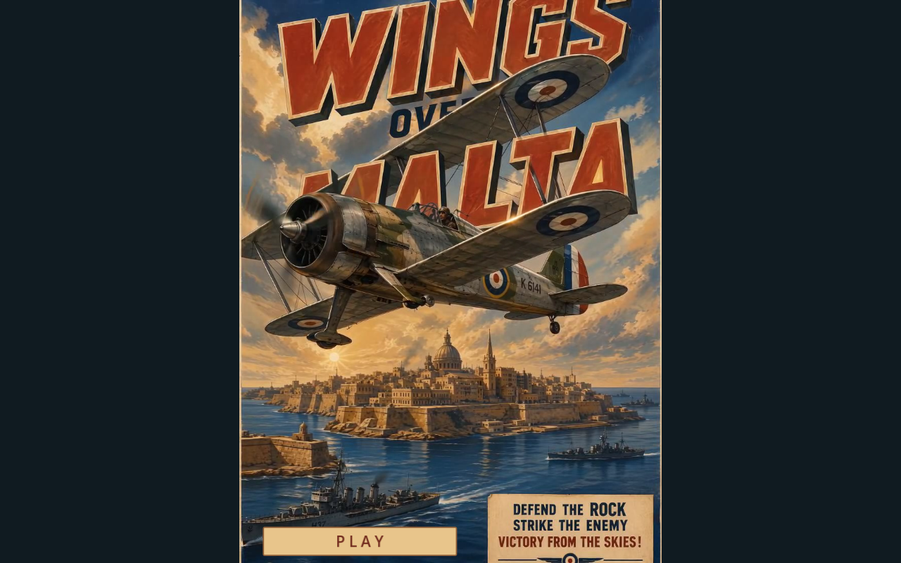
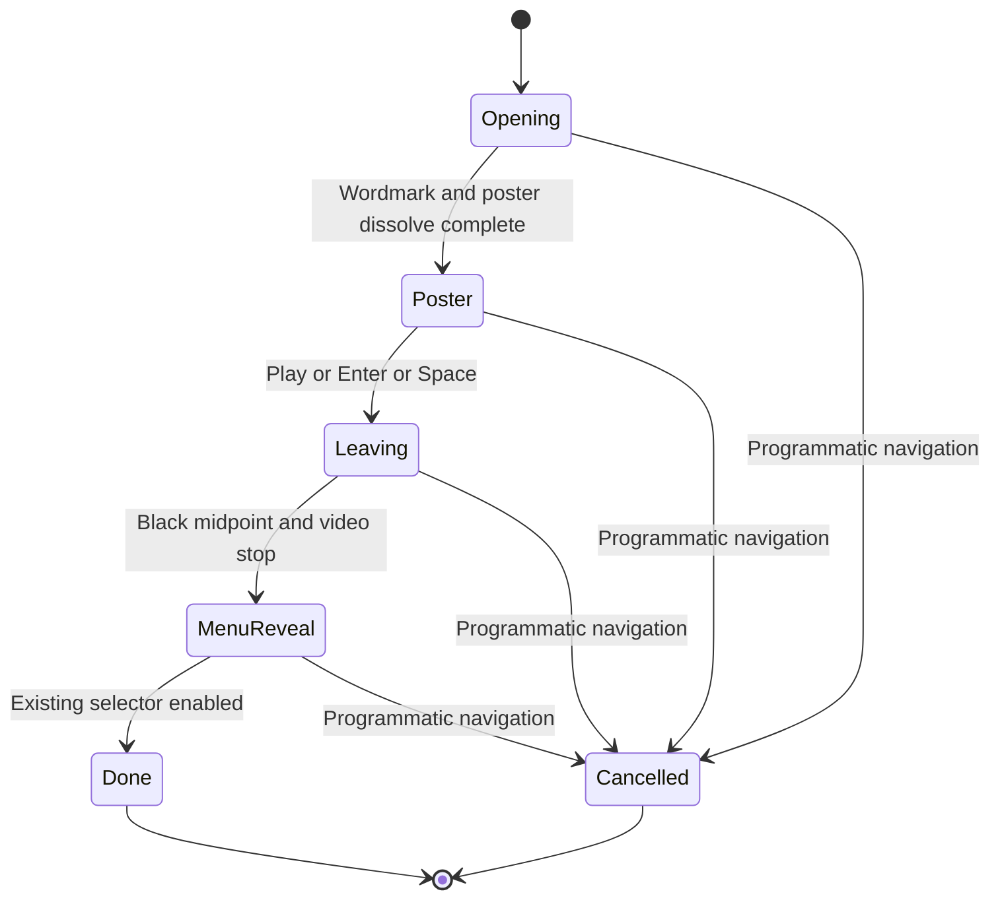

# Live poster startup

The initial wordmark fades into the supplied animated **Wings Over Malta** poster. A cream/red **PLAY** panel sits within its lower-left sea area, leaving the original lower-right slogan visible. The full portrait fits the viewport with dark side margins on widescreen displays. Click Play, Enter or Space to fade through black into the existing aircraft/main menu.

`GameIntro` ([source](../scripts/game_intro.gd)) owns the CanvasLayer, still fallback, looping VideoStreamPlayer, button and fade state. [Main](../scripts/main.gd) creates the existing selector first, disables its input underneath the intro and enables that same selector after the reveal. The title is shown on startup and again when returning to the main title from gameplay. Programmatic mission retries bypass it. Programmatic navigation cancels the presentation and stops decoding. No aircraft or mission starts when Play is pressed.

The supplied clip's preserved soundtrack now plays independently from the video through the existing Music bus at a modest level. The video contains no audio track and uses always-on presentation processing, avoiding gameplay-pause inheritance and a pre-gesture audio-clock dependency. Menu music is suppressed during the poster and returns at the black midpoint. The video fades audibly with its image and stops before menu reveal. Existing audio settings are preserved; the floating audio-settings button returns with the menu. Browser autoplay policy may require a user gesture for sound; video motion before a user gesture is covered by the current production-browser smoke test; audible sound still depends on browser policy.

Tune exported `GameIntro` properties: opening **1.2 s**, poster dissolve **2.8 s**, fade to black **1.6 s**, menu reveal **1.6 s**, and `decode_video`. Adjust `_layout()`'s normalized button position/size for future artwork. The source clip remains intact. Asset identity and conversion are recorded in [the asset inventory](../assets/intro/README.md).

## Validation

- Godot 4.6.3 Compatibility imports and loads the Theora/Vorbis resources.
- [Intro checks](../tests/intro_checks.gd): 18 assertions cover menu input shielding, click/Enter, duplicate suppression, fade phases, media stop, audio-control restoration, navigation cancellation and no replay. Layout assertions cover wide and narrow viewports.
- [Native capture](../tests/intro_capture.gd) renders actual playback under X11/llvmpipe, checks advancing/looping video position and clicks the real button. These are scripted rendering checks, not a listening test.
- Existing aircraft-selection regression: **31/31** assertions pass, including input, aircraft switching, takeoff/landing, weapons, damage/reset and measured aircraft performance. Combined with the intro suite: **49 assertions**. Native capture exits cleanly apart from the display driver’s unsupported V-Sync warning; audio uses Dummy output, so audible quality is unverified.
- [Main menu after the fade](previews/intro-menu.png) and [opening](previews/intro-opening.png).
- Headless automated gameplay fixtures skip the visual introduction; a normal native/web application does not. Developers may also pass `-- --skip-intro` on a native launch.
- Web export was attempted but blocked by absent matching Godot 4.6.3 web templates. Actual browser video, autoplay/audio and pointer behaviour remain unverified here. CI installs matching templates and runs the intro suite before export. Both media resources are explicit preloads, and the Web preset exports all resources.

Manual verification: launch normally, wait for the full moving poster, click the integrated Play panel and observe the slow menu reveal. Choose aircraft/Malta/Missions normally; return to the main menu and confirm the poster does not replay. Repeat on the published browser build, testing sound after the first gesture and resizing the page.
