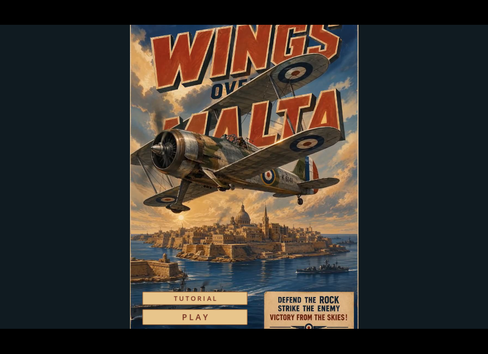
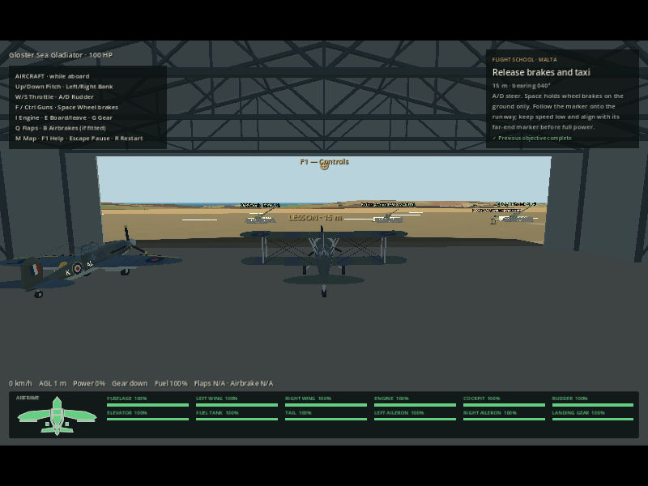
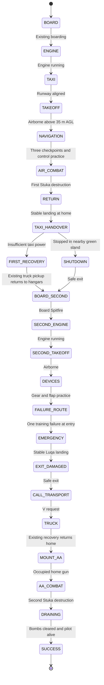
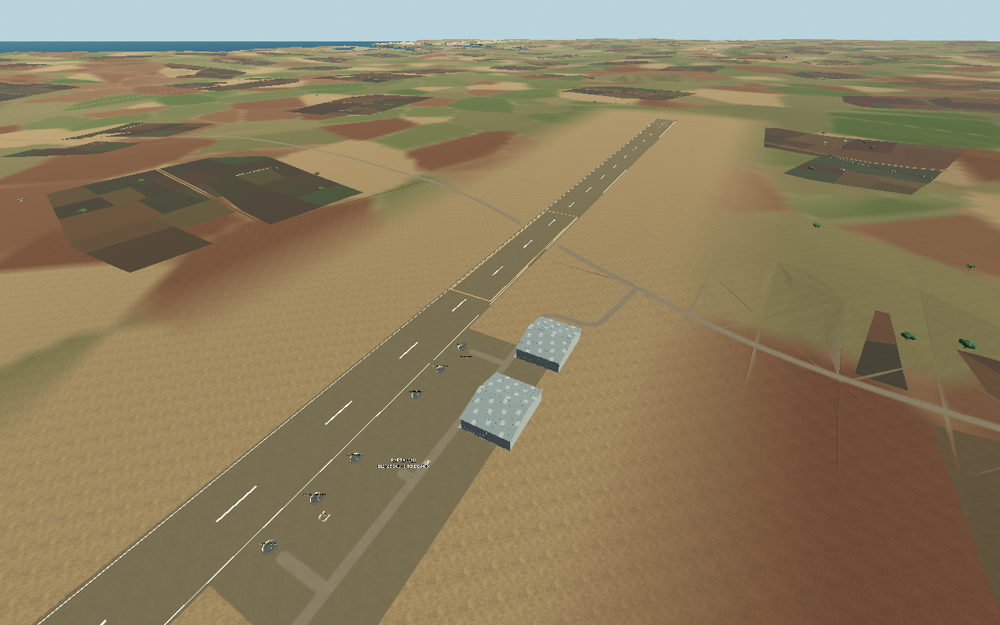

# Flight school tutorial and always-visible aircraft controls

Choose **Tutorial** inside the live poster, just above Play. Tab switches between the two buttons; Enter/Space activates the focused button. The normal Play/main-menu route remains available. The poster and march fade out before the tutorial starts.

The player starts on foot beside a **Gloster Sea Gladiator at RAF Ta’ Qali** in the existing continuous Malta world. Instructions are on-screen text, not generated radio speech. There is no lesson timer or autopilot. Normal flight, weapons, health, damage, gear, flaps, on-foot movement, vehicles and AA inputs remain authoritative.

## Controls reference in all running modes

Upper left, beneath player/aircraft health, a compact **AIRCRAFT · while aboard** panel now shows pitch, bank, throttle, rudder, guns, wheel brakes, engine, boarding/exit, gear, flaps, airbrakes, map, help, pause and restart. It reads the project's current InputMap rather than assuming old bindings. It appears in free roam, Survival, interception, harbour defence, AA defence and the tutorial, including on foot as a reference. Full explanations remain in F1 / Pause → Controls & Help; the reference hides behind those modal views.

Current keys: arrows pitch/bank; W/S throttle; A/D rudder/ground steering; F/Ctrl aircraft guns; Space ground wheel brakes; I engine; E board/leave; G gear; Q flaps; B airbrakes where fitted; M map; F1 help; Escape pause; R restart. Gladiator gear is fixed and it has neither landing flaps nor dedicated airbrakes. The Spitfire provides the gear/flap lesson; it has no dedicated airbrakes.

## Complete lesson sequence

1. **Board:** walk to the marked Gladiator and press E. Other aircraft are rejected while the lesson requires the assigned one.
2. **Engine and taxi:** I starts the engine; W/S sets power; A/D steers; Space brakes. Follow the ground marker through the hangar/apron to the runway. The full-power takeoff lesson begins only after runway alignment (or if already safely airborne).
3. **Takeoff:** accelerate to approximately 115–135 km/h, gently raise the nose with Down Arrow, and climb through 35 m AGL.
4. **Navigation and handling:** fly three generous checkpoints toward Valletta. Practise pitch, bank, rudder and reducing power, and open/close M. The current lesson target appears on the 3D marker and map, with distance and bearing in the HUD. Checkpoints require actual airborne clearance; taxiing through their horizontal positions does not count.
5. **Air combat over Valletta:** one airborne Stuka appears near the final checkpoint. Fire ordinary physical bullets, lead the target, and avoid its rear gunner. The tutorial sets locally forgiving front aim and a Cadet rear gunner; it does not alter normal enemies or aces. Smoke and low HP do not complete the objective; a real destruction event does.
6. **Return and land:** approach Ta’ Qali from the southeast toward the hangars and touch down in the gold runway sector before the apron. Brake to a safe stop; keep the engine running. Follow the taxi markers through the clear gap between the AA positions, then park in the green circle outside the Spitfire hangar. Stop below 1.5 m/s for two seconds, then S idle, I engine off, E exit. The stand is about 32 m from the actual Spitfire; exiting earlier on the runway is blocked. Damage and fuel remain. A safe landing elsewhere on the home runway is accepted, followed by taxi guidance. If engine power is below 15%, an existing recovery-truck pickup replaces the impossible taxi.
7. **Second aircraft:** walk to the marked Spitfire, board, start, taxi and take off. The Gladiator stays parked.
8. **Gear and flaps:** retract gear with G. Below 70 m/s (252 km/h), use Q to deploy flaps, allow them to extend, then retract them. Actual device states complete the lesson; a rejected overspeed request does not count. B is explained as unavailable on this aircraft.
9. **Emergency exercise entry:** climb toward roughly 600 m above sea level and fly to the marked northwest approach to Luqa. The configurable setup is 1,800 m before the runway threshold and at least 450 m above the local surface.
10. **Scripted mechanical failure:** the engine component fails once, each wing loses 20% integrity, the elevator loses 15%, and hull HP is reduced to 45. This is explicitly announced as training damage, not claimed to be an enemy hit. Shared component/health methods apply the damage; position and velocity are untouched. There is no repair or flight assist.
11. **Emergency landing:** lower the nose to preserve energy; initially aim around 180–200 km/h. Keep devices up until the runway is assured, lower the gear, and delay full flaps until final approach. Flare progressively, then brake on the runway. The designated area is the existing Luqa runway/apron, not a newly flattened rural field. A crash or sea impact fails the attempt.
12. **Recovery truck:** once stopped, I can shut down even the failed engine, E exits, and V calls the existing recovery vehicle. The tutorial permits pickup at the alternate airfield after this lesson; ordinary recovery eligibility elsewhere is unchanged. Approach the arriving truck and E to return to Ta’ Qali. This reuses the existing recovery fade/transfer, not a new AI drive across the island. The world, aircraft damage, fuel and parked planes are retained.
13. **AA defence at home:** approach the marked operational base gun and E to mount it; a Bofors is recommended. A second Stuka then spawns, using the existing DiveAttackPilot, real bombs, guns, physics and damage. Mouse aims, LMB fires, RMB zooms, B toggles Bofors assistance, E dismounts. Heavy AA retains single shots and a five-second reload. Unoccupied guns remain idle. Another surviving gun can be used if one is lost.
14. **Finish:** destroy the second Stuka and survive until any remaining physical bomb clears. The result appears on the ground. Retry resets the entire tutorial cleanly; duplicate retry presses are latched. Return to poster restores the existing title flow.

## Implementation and tuning

- [TutorialMission](../scripts/tutorial_mission.gd) owns lesson progression, text, objective markers, training damage and the two encounter triggers. It does not own aircraft movement or weapon collision.
- [TutorialDefinition](../scripts/tutorial_definition.gd) / [tutorial.tres](../mission_definitions/tutorial.tres) expose route points, checkpoint radius, takeoff AGL, settled-landing duration, emergency entry position/height, damage fractions and forgiving enemy parameters. Route coordinates use the existing Malta metre projection and retain the existing terrain/world scale.
- [main.gd](../scripts/main.gd) owns the tutorial lifecycle just as it owns the other mission directors; restart reuses the existing full-session reset. Tutorial enemy settings are excluded from remembered normal encounter difficulty.
- [MaltaMission](../scripts/malta_mission.gd) supplies a tutorial-local Gladiator/Spitfire home roster, existing boarding and map navigation. On-foot map teleport is disabled during active training so it cannot bypass the recovery lesson. Ordinary map travel is unchanged.
- [TransportRecovery](../scripts/transport_recovery.gd), [AirfieldInteraction](../scripts/airfield_interaction.gd), shared enemy tracking, aircraft component damage, manual AA projectiles and [MissionReturn.landed_field](../scripts/mission_return.gd) are reused.
- Engine shutdown now rejects an unserviceable **start** but allows stopping an already-running failed engine. This fixes the otherwise impossible normal exit after an engine-out landing.
- The existing airfields, roads, terrain, cities, collision geometry and aircraft meshes are unchanged. No new voice asset is supplied or synthesized.

Pilot death and loss of the required lesson aircraft lead to FAILED; total AA loss also fails the final exercise. The failure path has one result panel, and further spawns stop.

## Gladiator landing and handover placement

The return marker and M map label **LANDING SECTOR** identify a 240×46 m runway region. Its centre is derived from the parked Spitfire's airfield-local Z coordinate, 250 m before the stand to allow rollout toward the apron. The **TAXI / PARK** marker then follows the runway to the central AA gap, crosses the apron and ends at a green 8 m radius parking circle at local X=61 m, aligned with the Spitfire. It stays clear of the hangar wall, the X=78 vehicle lane and the gun emplacements.

The plane must be grounded, upright, within the circle, below 1.5 m/s and no more than 45 m horizontally from the Spitfire for two seconds before the exit lesson unlocks. The safe dismount is also checked by the existing interaction system. Drifting out returns to taxi guidance. Only this first tutorial handover restricts exit; ordinary modes and the second emergency landing retain their existing rules. No aircraft is moved, spawned again or repaired.

These tutorial-only unlit, non-colliding visual overlays are shown during return/parking and removed with the director. Configurable return settings live in TutorialDefinition alongside the existing lessons. [Handover change and exact verification](development-updates/2026-11-09-tutorial-handover.md).

## Verification and honest limits

[The staged test](../tests/tutorial_checks.gd) exercises real interaction, state, damage, recovery and destruction APIs using explicit setup poses between flight stages. It validates the whole sequence, persistence and reset, but does **not** claim to physically fly every leg. [The separate glide test](../tests/tutorial_glide_checks.gd) actually flies the configured failed-engine Spitfire from the exercise entry through touchdown and wheel-brake stopping using only normal pilot torques after its initial setup. Its scripted pilot exists only in the test. Early test flare attempts were unsuccessful; the final verified exercise uses the 450 m setup, retains energy, delays flap deployment and progressively flares, without changing flight physics.

Run `python tools/run_godot_checks.py --only tutorial_checks tutorial_glide_checks`. After web export, `node tools/tutorial_web_smoke.cjs` uses real poster and keyboard inputs for tutorial entry, boarding, engine start, help blocking and controls visibility. Full hardware-browser handling, a human-flown continuous completion, and subjective difficulty remain for interactive review. See the [development update](development-updates/tutorial-flight-school.md) for exact results and source boundary.
