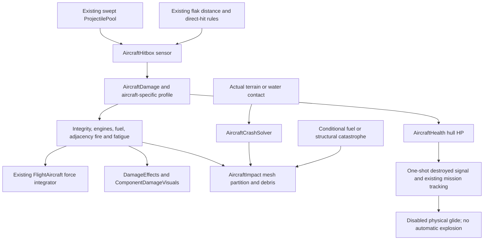
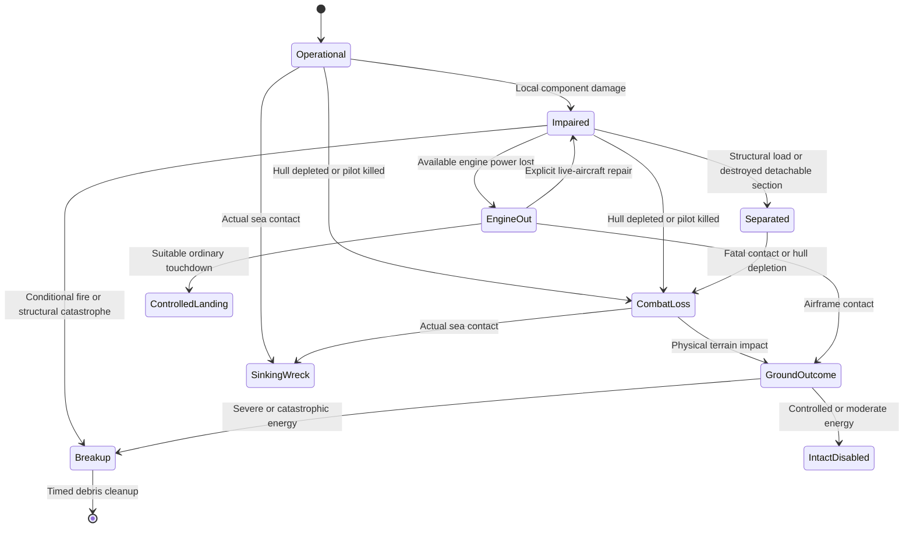
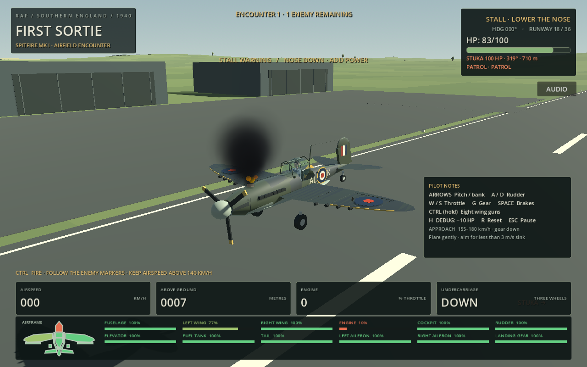
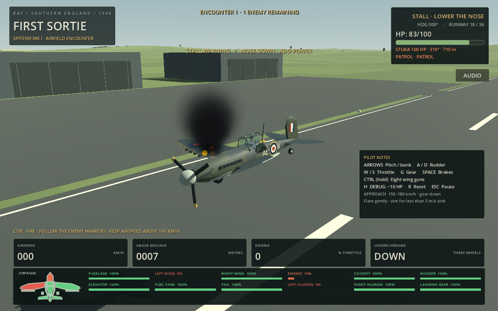
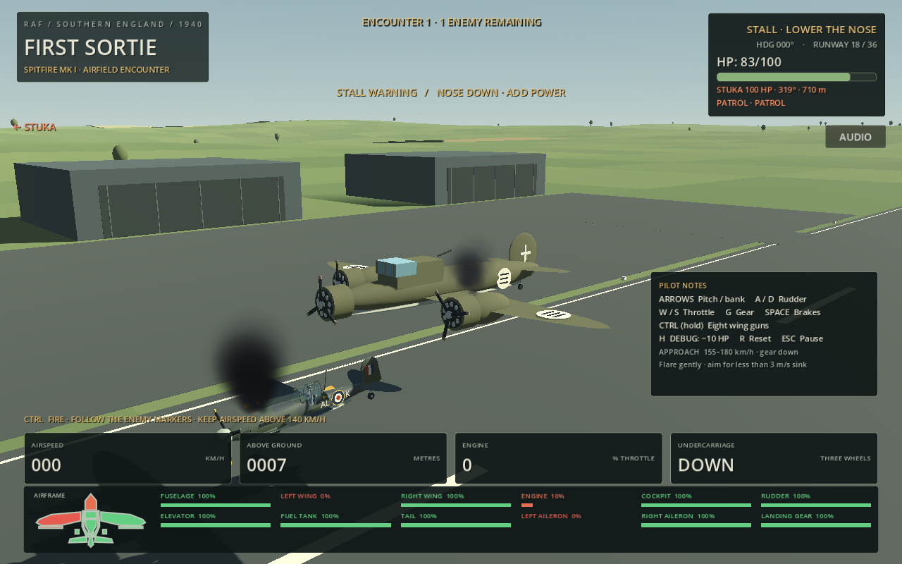
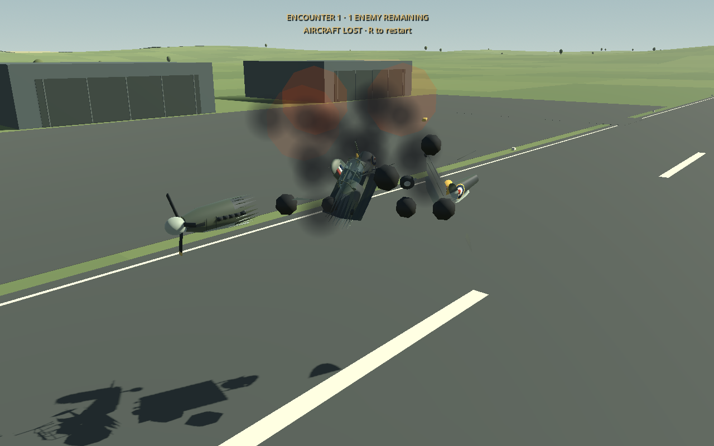

# Universal aircraft failures and crash outcomes

## Audit before implementation

The inspected source baseline is `7749042`. `FlightAircraft` (`scripts/aircraft.gd`) is the shared force-driven RigidBody3D for Spitfire, Sea Gladiator, Stuka and Italian aircraft. Current Italian definitions contain CR.42, C.200, C.202 and the three-engine SM.79. No Ju 88 scene, model or definition exists.

Reuse: `AircraftDamage` owns independent integrity and sensor hitboxes from aircraft-specific `.tres` profiles; `AircraftHitbox` forwards swept projectile hits; existing lift/drag/balance/power/control factors feed the original force integrator. `AircraftHealth` owns hull HP and one-shot depletion. `DamageEffects` pools 128 CPU mesh particles per aircraft in world space. `AircraftImpact` fragments actual model triangles into physical chunks; `AircraftImpactService` caps positional audio/effects and clears session ownership. Terrain, water exceptions, pilot interaction and mission destruction signals already work.

Gaps: engine/tank damage is aggregated, including all three SM.79 nacelles; health depletion always requests an airborne fireball; all dry crashes use one breakup; no load-dependent detachment, adjacency fire, component scars, landing-gear health, independent propellers or configurable crash categories exist. Fuel leaks already reduce endurance without reducing power until empty. AI already trims damaged wings using pilot commands. No existing high-fidelity metal/fabric tear, seizure or scraping recordings were found in the aircraft impact profile; existing synthesized impact/water/explosion assets must remain labelled placeholders.

The implementation extends these owners rather than replacing flight, projectiles or missions. `destroyed` remains the one-shot combat/mission loss event; it must not imply a fireball. Mechanical engine failure alone must not emit it. New resources and tests document the intended change from the former uniform explosion behaviour.

## Implemented ownership and lifecycle

The same [`AircraftDamage`](../scripts/aircraft_damage.gd) instance owns integrity, tank quantities, leaks, fires, heat, seizures, fatigue and detachment latches on every aircraft. Aircraft-specific resources live in [`damage_profiles/`](../damage_profiles/). There is no second hit-damage system. Spitfire/Gladiator/CR.42/C.200/C.202 have 12 parts, Stuka has 13 including its rear crew, and SM.79 has 19 including three engines, three tanks, two gun crews and the bomb-bay sensor. Positions are fitted to the game's procedural models; internal tank/crew volumes and connections are gameplay approximations, not archival engineering drawings. Original eight component IDs remain available for existing consumers.

Normal bullets identify the actual sensor, apply its local multiplier and transfer accepted damage to hull HP. Ordinary component overkill is capped to remaining local integrity, allowing an engine to fail without an inevitable hull kill. Crew loss at the pilot cockpit is fatal. Existing AA direct hits and proximity damage retain their established final hull-damage calibration and are not reduced by this overkill cap; blast damage still selects the nearest component, checks terrain and skips the direct victim to prevent double damage. Generic `take_damage(amount)` remains a hull interface for legacy callers and debug H; anonymous damage does not invent a component location.

Hull depletion still emits the authoritative combat loss once, disables thrust/normal controls/guns/AI and allows passive physics. It **does not automatically explode or fragment**. Engine loss alone emits no mission kill. Fuel/structure failures explicitly request catastrophic presentation, and actual impacts use severity. Fire consuming structure can cause non-explosive breakup; a still-fuelled tank may ignite catastrophically. Empty fuel cannot create a fuel fireball. Existing success/failure, timer, restart and kill-credit semantics remain tied to the original mission signals.

## Components, fire and physical response

- Component states use per-definition thresholds (default 75/50/25%, zero = destroyed). Wing efficiency, drag and moment imbalance feed the original force equations. A separated wing has zero contribution to lift; ailerons lose authority and have asymmetric response. Tail separation reduces passive pitch/yaw stability and removes rudder/elevator authority. Failed control surfaces do not retain the old minimum authority.
- Each engine supplies a configurable share of thrust. The existing propeller model receives an individual power factor; other engines keep their own RPM after one fails. Off-centre engine forces create yaw through `r × F`. Critical engines run roughly, accumulate heat under high throttle, cool when shut down and can seize before reaching zero integrity. Heat and seizures reset only through existing reset/explicit developer repair.
- Tanks retain separate quantities. Normal consumption drains available fuel without refilling an emptied tank or equalising its distribution. A leak reduces endurance, not thrust while deliverable fuel remains. A destroyed tank becomes unavailable for delivery and drains faster. Engine power fades only near the configured delivery-pressure threshold; remaining intact tanks can feed the engines through a simplified shared manifold.
- Fire updates at configurable fixed intervals. It progressively damages the source and only considers configured adjacent, already compromised combustible neighbours. Engine shutdown does not instantly extinguish it. Tank fire stops when its own fuel empties; engine/oil fire decays once fuel is exhausted. Catastrophic tank ignition requires severe damage, active fire and remaining fuel. The bomb-bay sensor is damageable but **sympathetic payload detonation and new bomb-release failures are not implemented**; mission payload ownership/rules remain intact.
- Structural stress uses measured acceleration minus gravity (G load), airspeed, angular motion, remaining integrity and fatigue. Critical sections can stay attached under gentle flight and fail under excess load/speed. Seeded random draws happen at damage/fire/structural events, not in rendering. Zero-integrity detachable sections separate once. Geometry selection uses each definition's region alias and actual model-local triangle positions; attached meshes are partitioned, not replaced with arbitrary detached boxes at close range.
- Surface punctures and ragged tear marks are small pooled geometry on the aircraft; they darken/enlarge with damage. These are visual marks, not volumetric bullet tunnels or a full deformation solver. Smoke distinguishes light engine/oil grey, dark engine smoke, black fuel/fire smoke and pale fuel streaming. Flames originate near the top of the damaged component rather than inside its cowling. These complement the existing strict below-50-hull-HP effect rule, rather than removing that legacy rule.

[`ComponentDamageVisuals`](../scripts/component_damage_visuals.gd) shares puncture meshes/materials and caps marks. [`DamageEffects`](../scripts/damage_effects.gd) reuses the original 128-slot world-space particle pool. [`AircraftImpactService`](../scripts/aircraft_impact_service.gd) adds global conservative particle-lifetime reservations, so multiple aircraft cannot emit unbounded smoke/flames.

## Impact severity and physical debris

[`AircraftCrashSolver.assess`](../scripts/aircraft_crash_solver.gd) resolves velocity into contact-normal and tangential components. Its dimensionless energy is:

`mass / 3000 kg × (normal_speed² + horizontal_fraction × tangent_speed²) / (30 m/s)²`

Surface hardness, existing structural damage and aircraft alignment modify that energy. Fuel and active fire affect conditional ignition probability; they cannot promote a gentle landing into a random giant explosion. Thresholds produce **controlled**, **moderate**, **severe** and **catastrophic** outcomes. Identical total speeds at shallow and steep angles therefore differ substantially. The flight integrator retains the immediately preceding physical velocity because the collision solver can remove normal velocity before reporting contact.

Controlled contact retains the fuselage and uses dust/scrape-like impact audio. Moderate contact collapses gear, seizes the centre engine/propeller and may separate gear. Severe/catastrophic dry impacts split the remaining actual mesh into bounded rigid chunks, with dust, debris and conditional ignition. Building/road contacts use the hard-surface classification; terrain bodies have classification tags only, with no geometry changes. Water uses the existing actual-surface ray/sweep, splash/foam and sinking hull physics. No hydrodynamic or floating-wreck simulation was added.

[`AircraftImpact`](../scripts/aircraft_impact.gd) preserves the original mesh resources for reset, partitions actual surfaces and creates one compact collider per major fragment. Component separation inherits linear velocity plus angular velocity at the piece's centre (`v + ω × r`), a small outward separation impulse and tumble. Full crashes likewise inherit motion, rather than arbitrarily discarding 55% of velocity. UV/color channels are retained for individually detached geometry; full-crash legacy triangle buckets regenerate normals and retain surface materials. The spatial full-crash buckets remain a simplified eight-piece layout, not aircraft engineering joints.

[`AircraftDebrisPiece`](../scripts/aircraft_debris_piece.gd) supports secondary ground/water impacts, capped burning-debris smoke and lightweight drag/buoyancy. Detached fabric wings can float briefly before flooding; metal chunks sink. This is a surface-force approximation. Component debris and full-crash pieces share global fragment/collision budgets; distant/excess detailed meshes use coarse bounds proxies and reduced collision/simulation detail. Lifetimes and session ownership remove them after a delay. Detached geometry cannot detach twice; reset restores original meshes and clears owner effects/reservations.

A controlled **belly contact** still enters the existing `is_crashed` state and preserves the mission's immediate player-crash failure rule. “Controlled” describes physical wreck severity, not a new mission-survival rule. An ordinary wheels-down engine-out landing can remain a normal landing. Sea contact retains the existing fatal mission loss/plunge behaviour.

## AI and cockpit/crew integration

[`EnemyPilot._handle_damage`](../scripts/enemy_pilot.gd) evaluates emergency priorities twice per second. Engine-out glide, reduced-power withdrawal, fire escape, critically low leaking fuel and severe wing damage cancel aggressive forward fire, reduce bank demand and use existing slew-limited pilot controls and terrain avoidance. Bomber, escort, dive-attack and friendly harbour controllers invoke the same response. It does not assign transforms/velocities, repair parts or promise a newly implemented emergency landing/return-to-base planner.

Rear guns retain normal human aim, ballistics and self-occlusion. Each gunner references a configurable crew component. Stuka rear crew is separate from the pilot; SM.79 dorsal and ventral operators are separate. The new crew volumes sit behind their muzzles; an earlier test iteration enclosed the dorsal muzzle and correctly triggered the gunner's safety ray, which was corrected by fitting the volume to the operator rather than bypassing occlusion.

## Audio and visual evidence

Existing penetration/heavy-hit, water-plunge and explosion assets remain routed through the capped positional impact service and existing radio-ducked buses. Ten new **deterministic synthesized placeholder** SFX distinguish metal/fabric tearing, misfire/seizure, ignition, breakup, propeller contact, hard landing, ground crash and secondary debris impact. [`tools/generate_failure_audio.py`](../tools/generate_failure_audio.py) uses Python's standard library and FFmpeg only during regeneration. Runtime needs neither. See [attribution](../assets/audio/ATTRIBUTION.txt). Replace `event_sounds` in [`audio_profiles/aircraft_impacts.tres`](../audio_profiles/aircraft_impacts.tres) with licensed production recordings. These are not authentic recordings or human-listened sound validation.

Native Compatibility/llvmpipe scripted previews (fixtures freeze the aircraft for comparison):

The bomber preview retains the player's HUD; it is a model/effect view, not a claim that the player can fly SM.79.

## Developer tools and manual verification

**F3** opens the existing component inspector in debug native builds. It is disabled by default in release/web museum gameplay. Developers can explicitly enable `gameplay/enable_damage_debug` or use native `-- --damage-debug`. The panel scrolls for large bombers and shows every configured component's HP/state, hull HP, individual engine power/seizure, fuel, leak rate, fire, G load, crash category/severity and active debris. The normal bottom HUD adds tail, ailerons and gear while retaining continuous green→amber→red interpolation.

Select PLAYER/ENEMY, choose the component, then apply damage or live-aircraft repair. Scenario options shut down a selected engine, ignite a combustible part, force a fuel leak, detach a supported part, set up a shallow/steep contact fixture or force non-explosive structural breakup. Scenario pose resets are explicitly developer fixtures; normal damage and AI never teleport aircraft. Existing H and flight/vehicle/soldier/AA controls remain intact.

| Scenario | Short procedure and expected observation |
|---|---|
| Spitfire engine failure | Damage ENGINE to zero. Its propeller and thrust stop; it glides without automatic explosion. Ordinary wing/control commands still act. |
| Wing failure | Damage LEFT WING to ~15%, fly gently, then pull a fast turn. Under excess load/speed it can separate, become debris and produce asymmetric roll/lift loss. Use DETACH for deterministic visual testing. |
| Fuel leak | Force FUEL TANK leak without ignition. Fuel decreases while engine power remains available. Drain deliverable tanks: power fades/starves. |
| Progressive fire | Damage engine/tank and an adjacent part, then ignite. Fire damages its source, may spread through adjacency, persists with engine off and can lead to conditional catastrophe. |
| Rudder/elevator/ailerons | Damage each separately and compare yaw, pitch and roll response. At failure the relevant authority is lost; tail separation removes pitch/yaw stability. |
| Gear/belly landing | Damage LANDING GEAR or use shallow fixture. Gear can jam/collapse; low-energy contact retains the fuselage and dust rather than a fireball. Existing mission crash rules still apply. |
| High-speed Stuka | Dive steeply into terrain or use steep fixture. Inspect high severity, separated physical chunks and a conditional rather than guaranteed fireball. |
| SM.79 multi-engine | In an SM.79 encounter/mission, select ENGINE LEFT, then centre/right separately. Remaining engines keep power; wing-engine failure generates yaw. Both failed wing engines plus centre failure produce a powerless bomber, not an automatic hull kill. |
| Crew | Damage one SM.79 gunner. Only that operator's gun goes offline; the pilot/other crew retain their own health. |
| Sea and concurrent losses | Hit the real sea: splash, sinking hull, separate debris impacts. Destroy several aircraft: inspect caps, cleanup and clean full-session retry. |

## Configuration reference

Profiles are shared **data**; runtime dictionaries belong to each aircraft. Do not mutate a shared profile for an individual encounter—duplicate it first. Hitbox positions/sizes are model-local metres. Resource `script` assignment must precede its exported properties, or Godot can ignore custom properties during loading.

### aircraft_component_definition.gd

| Export | Default |
|---|---|
| `id` | `&"fuselage"` |
| `display_name` | `"Fuselage"` |
| `max_integrity` | `100.0` |
| `damage_multiplier` | `1.0` |
| `airframe_multiplier` | `1.0` |
| `debug_color` | `Color.CYAN` |
| `hitboxes` | `[]` |
| `role` | `"structure"` |
| `adjacent` | `[]` |
| `state_thresholds` | `Vector3(0.75, 0.50, 0.25)` |
| `combustible` | `false` |
| `detachable` | `false` |
| `fragment_region` | `&""` |
| `material_kind` | `"metal"` |
| `propeller_index` | `0` |
| `thrust_weight` | `1.0` |
| `tank_capacity` | `1.0` |
| `structural_limit_g` | `6.0` |
| `structural_speed` | `150.0` |
| `minimum_failure_ratio` | `0.30` |
| `jam_threshold` | `0.08` |

### aircraft_damage_profile.gd

| Export | Default |
|---|---|
| `components` | `[]` |
| `wing_lift_loss` | `0.65` |
| `wing_drag_gain` | `0.04` |
| `fuselage_drag_gain` | `0.035` |
| `lift_lever_arm` | `2.3` |
| `asymmetric_drag_gain` | `1.0` |
| `engine_power_exponent` | `1.3` |
| `minimum_rudder_authority` | `0.1` |
| `minimum_elevator_authority` | `0.1` |
| `minimum_cockpit_authority` | `0.45` |
| `fuel_leak_probability` | `0.4` |
| `fuel_fire_probability` | `0.12` |
| `fuel_random_seed` | `1944` |
| `fuel_leak_rate` | `0.02` |
| `fuel_burn_rate` | `0.03` |
| `fuel_fire_damage_per_second` | `2.0` |
| `fuel_component_burn_per_second` | `4.0` |
| `damage_seed` | `1944` |
| `fire_step_seconds` | `0.5` |
| `fire_damage_per_second` | `4.0` |
| `fire_spread_probability_per_second` | `0.12` |
| `tank_ignition_probability` | `0.08` |
| `structural_failure_probability` | `0.35` |
| `structural_check_seconds` | `0.25` |
| `structural_fatigue_rate` | `0.12` |
| `low_fuel_pressure_threshold` | `0.01` |
| `engine_asymmetry_lever` | `1.0` |
| `failed_propeller_drag` | `0.008` |
| `gear_collapse_ratio` | `0.20` |
| `horizontal_impact_fraction` | `0.018` |
| `controlled_crash_limit` | `0.18` |
| `moderate_crash_limit` | `0.9` |
| `severe_crash_limit` | `3.0` |
| `fuel_impact_ignition_probability` | `0.4` |
| `maximum_debris` | `64` |
| `maximum_colliding_debris` | `32` |
| `maximum_detailed_debris` | `32` |
| `detailed_debris_distance` | `1800` |
| `minor_debris_lifetime` | `8` |
| `major_debris_lifetime` | `22` |
| `maximum_damage_marks` | `24` |
| `maximum_smoke_emitters` | `6` |
| `maximum_fire_emitters` | `4` |
| `engine_heat_rate` | `0.12` |
| `engine_cooling_rate` | `0.06` |
| `engine_seizure_temperature` | `1.0` |
| `destroyed_tank_loss_multiplier` | `8.0` |
| `debris_float_seconds` | `8.0` |

### aircraft_impact_profile.gd

| Export | Default |
|---|---|
| `metal_hits` | `[]` |
| `own_hit_db` | `-2` |
| `other_hit_db` | `-12` |
| `hit_range` | `180` |
| `own_hit_range` | `120` |
| `hit_unit_size` | `10` |
| `hit_attenuation` | `1.35` |
| `hit_interval` | `0.045` |
| `pitch_variation` | `0.12` |
| `volume_variation_db` | `2` |
| `water_db` | `-9` |
| `water_range` | `2200` |
| `explosion_db` | `-8` |
| `explosion_range` | `2200` |
| `water_effect_minimum` | `0.35` |
| `water_effect_maximum` | `2.3` |
| `full_water_impact_speed` | `100` |
| `water_hull_clearance` | `0.6` |
| `explosion_strength` | `1.8` |
| `cluster_headroom_db` | `3.0` |
| `audio_voices` | `12` |
| `maximum_effects` | `24` |
| `event_sounds` | `{}` |
| `maximum_smoke_particles` | `512` |
| `maximum_flame_particles` | `192` |

`AircraftImpact` retains per-instance `debris_lifetime`, `fragment_speed`, `water_drag`, `sinking_speed` and optional `crash_sound`. Component-separated pieces use `major_debris_lifetime`; full-crash buckets retain the existing `debris_lifetime`. `minor_debris_lifetime` is a reserved tuning field; there is no separate spawned minor-fragment system. `maximum_detailed_debris`, collision/debris limits and visibility distance govern the existing chunks. Surface marks and particles have separate fixed local pools and exported emission/lifetime settings in `DamageEffects`. AI defaults on `EnemyPilot`: `damage_decision_interval=0.5` s, `engine_out_threshold=0.30`, `emergency_power_threshold=0.70`, `emergency_fuel_threshold=0.15`, `emergency_wing_threshold=0.25`, `emergency_bank_limit=20` degrees. Normal pilot flight/avoidance tuning remains on that same component.

## Validation and limits

The [per-suite validation inventory](development-updates/validation/universal-damage-2026-10-17.json) records **1636 native assertions across 48 suites**, plus **9 production-browser and 22 isolated release-WebGL checks: 1667 assertions total**, excluding repeated runs and inherited duplicate summary lines. The initial sweep exposed failures; those were corrected and the affected suites rerun. These are combined latest results, not a claim that the initial sweep exited successfully. The exact source boundary is recorded in the accompanying incremental development update. Fixed wing guns stop when their supporting wing separates, while remaining fixed/nose guns and separately crewed defensive mounts retain their existing ballistics.

New suites: `universal_damage_checks.gd`, `aircraft_failure_flight_checks.gd`, and `aircraft_failure_ai_checks.gd`. Existing component, impact, weapons, HUD, Italian aircraft, mission, AA, geography and ground-control suites are retained. Old tests requiring automatic hull-depletion explosions now explicitly test the new non-explosive loss path and a separately requested catastrophic ignition. The harbour kill-credit fixture now hits an actual fuselage sensor while matching target motion, rather than relying on an engine/upper-wing hit being a guaranteed kill.

No Ju 88 is present, so a Ju 88 flight/model test cannot be performed. New aircraft can configure any number of engines/tanks/crew using the same roles and propeller indices; their actual meshes, hitboxes, mass, load limits and detachment aliases must be fitted and tested. Payload sympathetic detonation, a fully deformable skin, exact aircraft structural joints, advanced water hydrodynamics, new AI emergency-landing planning and measured production hardware frame-rate targets are not claimed.

The official 4.6.3 export-template archive was downloaded and verified against the official SHA-512 manifest, then the release web build exported successfully. Chromium/ANGLE/SwiftShader exercised real poster-Play/menu input, the 12-part HUD, release debug-tool gating, non-explosive hull loss and reset using the production export (`tools/aircraft_impact_web_smoke.cjs`). A separately exported, explicitly isolated fixture (`tools/build_damage_web_fixture.py`, `tools/universal_damage_web_smoke.cjs`) ran actual engine failure, independent SM.79 power, physical wing geometry separation and mesh restoration for all seven airframes. Both browser runs report zero script/resource/WebGL errors; the fixture is never the production main scene and provides no production state-mutation API. Read-only `?smoke=1` telemetry gained only startup state/button coordinates.

Native rendering captures were inspected under Compatibility/llvmpipe; automated physics tests include ordinary landing, gliding, loaded wing failure, asymmetric multi-engine flight, severe terrain/sea crashes, mission outcomes/retry, manual AA, flak damage, aircraft switching, soldier/vehicle interaction and ten concurrent losses. Keyboard and native battery UI tests retain shutdown resource diagnostics despite passing assertions and exiting 0. These existing diagnostics were not hidden or treated as clean shutdown. New failure suites and native damage capture report no script/resource errors. Browser sound quality was not listened to and no full human dogfight or production-hardware frame-rate claim is made. Brief floating fabric debris and the fine visual tuning of each crash category still benefit from interactive playtesting.
