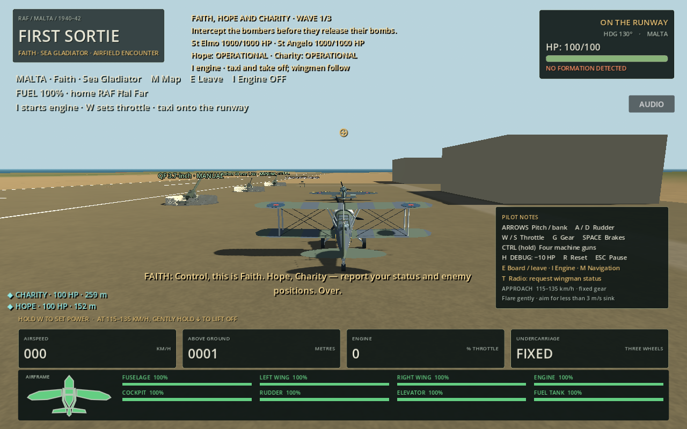
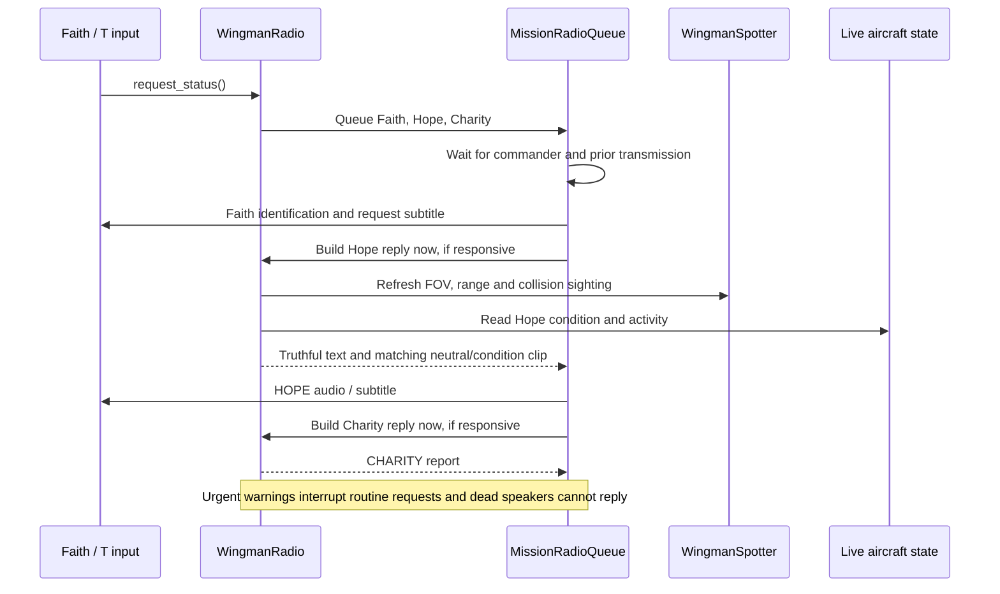

# Faith, Hope and Charity: interactive wingman radio

Press **T** while piloting Faith to request both surviving wingmen's condition and observed enemy information. This is a radio action, not a pause/menu: existing steering, throttle, weapons and cameras continue working. The action is `wingman_status` in **Project Settings → Input Map**; both physical and logical T are bound, and the briefing/HUD derive their label from the current mapping.

## The three supplied voices

These are **recorded dialogue**, not reusable speech-generation models. Their spoken identifications establish the roles independently of the voice-preset filenames:

| Pilot | Supplied file | Runtime status audio |
|---|---|---|
| **Faith — player** | `ElevenLabs_2026-10-17T18_35_14_RAF Pilot 2_gen_sp100_s50_sb75_v4.mp3` | `assets/audio/harbour/status/faith_identification.ogg` |
| **Hope** | `ElevenLabs_2026-10-17T18_37_16_Walke Talkie Commander Dude_gen_sp100_s50_sb75_v4.mp3` | `assets/audio/harbour/status/hope_identification.ogg` |
| **Charity** | `ElevenLabs_2026-10-17T18_36_35_RAF Pilot voice_gen_sp100_s50_sb75_v4.mp3` | `assets/audio/harbour/status/charity_identification.ogg` |

The neutral openings say **“Control, this is Faith/Hope/Charity.”** Each request plays Faith's supplied voice first; the player subtitle adds **“Hope, Charity — report your status and enemy positions. Over.”** Hope and Charity then play their own identification with their live report caption.

**The detailed status and request sentences are not fully spoken.** The supplied full takes contain fixed tactical statements: Faith announces one bomber/three escorts and an attack, Hope says he will follow Charity, and Charity says he will distract fighters. Those statements cannot truthfully be replayed for every wave, damaged condition or empty sky. Only their complete, naturally paused identification sentences are used universally. The full takes are preserved as separate `*_full.ogg` assets for future appropriately gated cues; this feature does not issue those fixed attack/follow orders or alter AI to justify an audio line.

Role/prefix identification was checked with local automatic transcription, including a second recognition pass over all three cropped files. This is not a human listening or verbatim full-take transcription claim. No voices, speech or replacement beeps are synthesized; no speech-generation service, API key or network call is required by the game.

[`prepare_wingman_radio.py`](../tools/prepare_wingman_radio.py) prepares these supplied takes with mono conversion, -16 LUFS normalization and small fades, preserving their existing radio treatment. The provided files have very little energy above 5 kHz (roughly -57 to -62 dB relative to the 200–3,500 Hz band), so another heavy radio band-pass/static layer is deliberately avoided. JSON sidecars retain original filenames, SHA-256 hashes, crop bounds and processing notes. The authored cuts are 1.70 s for Faith, 1.78 s for Hope and 1.88 s for Charity, ending in the pause before tactical dialogue. New replacement recordings need their own cut-point review.

## Live reports

Each report is constructed **when its entry starts playback**, not when T was pressed. It contains:

- The pilot's identity and sound/minor/significant/critical condition, using hull HP and actual component integrity. Engine/control damage, fuel leakage/exhaustion and existing smoke/fire state are reported when relevant. The same below-50-HP fire rule and fuel-fire state are used; fire is not inferred at exactly 50 HP unless fuel is actually burning.
- Existing activity: waiting/takeoff, formation/rejoin, fighter/bomber engagement, evasion/terrain avoidance or withdrawal. A target outside visual contact is described as manoeuvring without visual, rather than asserting a hidden target position. Radio queries never change AI targets, throttle or flight commands. Unsupported emergency-landing/RTB orders are not invented, and infinite-ammunition guns never report an empty magazine.
- The most useful observed contact: target type, approximate distance and bearing; a geometry-supported threat to Faith/another wingman; a visible bomber nearing its fort; or a useful spotted-contact count. No enemy HP or future-wave data is read into reports.

`WingmanSpotter` gives each wingman independent perception. Every 0.35 s it checks actual live hostiles within 3,000 m, a 220° field of view, and an unobstructed ray against terrain/active building collision on layer 1. Reports refresh that scan immediately before assembly. The radio does not treat the AI director's assigned target or the global HUD roster as proof of visibility.

Observed records contain a position/type snapshot and observation time. Lost contacts retain that **old position**, explicitly labelled “Last seen … lost visual”, for at most 15 seconds; their hidden current coordinates are never refreshed. Threats are inferred from visible heading, relative closure and proximity, not from secret enemy AI intentions. A fort approach is mentioned only when the visible bomber's geometry supports it.

Clock directions use **Faith's current forward heading** at reporting time. Near-stationary flight or an unreliable near-vertical heading falls back to world compass directions. Distances are rounded to 100 m. Enemy selection prioritises immediate threats, a visible fort approach and the current visible target, keeping reports short.

## Queue, priority and losses

The existing `MissionRadioQueue` owns one non-positional `AudioStreamPlayer` and the shared subtitle area. FAITH, HOPE and CHARITY labels use distinct colours; the commander retains its original presentation. Intro/congratulations and status transmissions cannot talk over one another. Existing commander one-shot behaviour remains compatible.

A request queues Faith, Hope and Charity in that order. A **20 s cooldown** and the pending-request latch stop key repeat/spam from stacking requests. Captions remain for their configured reading window (nine seconds for detailed replies), with a **0.45 s packet gap**. Because current audio is only a brief identification, there is intentional reading time before the next reply. Optional longer condition recordings extend the display window as necessary.

The existing mixer ducks Aircraft and Guns by 4 dB while actual supplied speech plays, restoring prior settings when it finishes or is interrupted. Subtitle-only time does not keep the mix ducked. A killed speaker's audio stops immediately; pending dead/unresponsive pilots are skipped at playback. If only one survives, only that pilot replies. If both are lost, a subsequent request gets a brief, silent **“No response”** after a short pause, without repeating death announcements.

Attack-run and wingman-loss commander warnings now preempt routine status entries while preserving other queued commander cues. Mission results retain their existing full-priority behaviour. Exit/retry clears transmissions, cooldown/request IDs and spotting memory; a retry restores the same three voice assignments and the normal mission intro.

## Tuning and missing recordings

Edit [`HarbourDefinition`](../scripts/harbour_definition.gd) or [`harbour.tres`](../mission_definitions/harbour.tres):

| Setting | Default |
|---|---:|
| `wingman_radio_volume_db` | 0 dB |
| `radio_subtitle_seconds` | 9 s per detailed reply |
| `radio_request_cooldown` | 20 s |
| `radio_reply_gap` | 0.45 s |
| `radio_spotting_distance` | 3,000 m |
| `radio_spotting_fov` | 220° |
| `radio_spotting_interval` | 0.35 s |
| `radio_memory_seconds` | 15 s |

`faith_status_voice`, `hope_status_ack` and `charity_status_ack` hold the three supplied identifications. The existing `radio_duck_db` controls temporary bus ducking. `hope_status_variants` and `charity_status_variants` expose optional short, **condition-only** recordings. Unassigned variants use the neutral identification, or subtitles if even that recording is absent.

To speak more than the supplied identification, the following recordings are still needed. For both Hope and Charity, replace `<pilot>` with the correct name and use that pilot's consistent voice:

| Slot | Requested dialogue |
|---|---|
| `faith_status_voice` replacement | “Hope, Charity — report your status and enemy positions. Over.” |
| `sound` | “Control, this is <pilot>. Aircraft sound. Over.” |
| `minor` | “Control, this is <pilot>. Minor damage. Over.” |
| `significant` | “Control, this is <pilot>. Significant damage. Over.” |
| `critical` | “Control, this is <pilot>. Critical damage. Over.” |
| `engine_damage` | “Control, this is <pilot>. Engine damaged. Over.” |
| `controls_damage` | “Control, this is <pilot>. Controls damaged. Over.” |
| `fuel_empty` | “Control, this is <pilot>. Fuel exhausted. Over.” |
| `fuel_leak` | “Control, this is <pilot>. Fuel leaking. Over.” |
| `fire` | “Control, this is <pilot>. Fire on board. Over.” |

Do not include a fixed bearing, target number, attack order or enemy count in a condition recording. Those facts remain dynamic subtitles until suitable context-gated phrase variants are recorded. Existing supplied commander recordings are retained unchanged.

## Implementation and checks

Added: [`wingman_radio.gd`](../scripts/wingman_radio.gd), [`wingman_spotter.gd`](../scripts/wingman_spotter.gd), the six prepared audio assets/three manifests and preparation script, [`wingman_radio_checks.gd`](../tests/wingman_radio_checks.gd), and [`wingman_radio_capture.gd`](../tests/wingman_radio_capture.gd). Updated the shared radio queue, mission definition/resource and coordinator, Input Map, briefing, HUD controls and publishing checks. Aircraft physics, damage, weapons, targets and wave composition are preserved.

**40 new checks** cover voice slots/playback, live damage/activity, target identity, Faith-relative bearings, stationary fallback, FOV/range/obstruction, last-known snapshots/expiry, observed threat/fort approach, remapping, cooldown/pending latches, commander serialization and priority, active/pending pilot death, survivor-only/no-response, missing audio, retry and leaving. Native capture injects the actual **T** event (`KEY_REQUESTS=1`) and renders all three speaker captions, using an explicit engine-damage fixture for Hope.

Existing regressions: harbour mission 48, prior harbour radio 13, original commander radio 22, keyboard controls 24, ground/vehicle/AA controls 61, full harbour ground departure 9 and physical wingman/bomber/bomb flight 7 — **224 assertions total including the new suite**, excluding repeat runs. Import and preparation-script compilation, new Markdown links and Mermaid syntax are checked separately. The keyboard runner passes its 24 assertions but logs resource teardown warnings at process exit. Native capture also reports two GLES texture allocations at shutdown; the rendered previews have no script/shader errors. Those shutdown warnings were not resolved by this radio feature.

**Not verified:** human combat usability, audible mixing/voice quality on speakers, or browser runtime. Web export templates remain unavailable here; audio uses the existing native-stream/web-sample path. Recognition checks verify the supplied identification wording, not subjective sound quality. The screenshots are native scripted fixtures, not a human-flown conversation or a claim of generated full dialogue.
