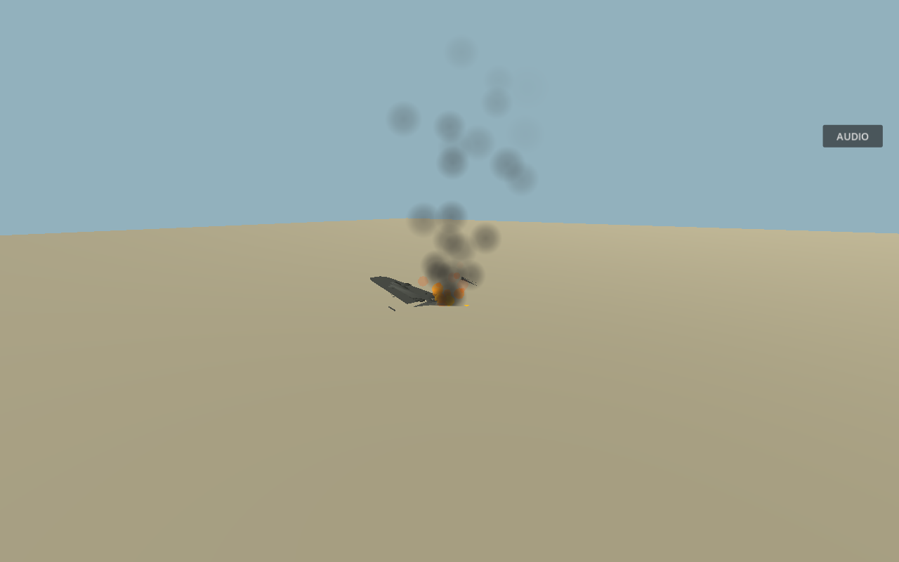

# Wreck fires and optional Bofors assistance

## Burning land wrecks

Fueled land-crash wrecks now leave orange flames and dark smoke among actual aircraft debris. The effect is world-owned through `AircraftImpactService`, so an enemy's normal twelve-second cleanup does not abruptly remove the fire. It retains at most sixteen nearby fragment meshes as charred visual remains; it adds no new collision bodies or repeated damage, explosions or kill events.

`AircraftImpact.start_ground_fire` is latched per aircraft and checks a real support ray. Water is excluded; aircraft with no meaningful fuel remaining do not create a new fuel fire. A controlled, non-burning healthy landing does not ignite merely because it touches the ground. Existing physical sea splashes and sinking remain unchanged.

`AircraftImpactProfile.wreck_fire_seconds` defaults to **75 seconds**, including five seconds to let emitted particles fade. `maximum_wreck_fires` defaults to **four globally**. Each effect uses 24 CPU smoke particles and 18 flame particles, with simple shared geometry and no shadow casting. These effects are compatible with the project's Compatibility renderer. Retry/menu teardown clears them through the existing session effect service. This lingering layer is visual presentation; it does not add a second fire-damage source.

## Bofors option and controls

Mount a Bofors using **E**, press **Esc**, and enable **Bofors aim assist** beside the existing AA sensitivity slider. Press **Esc** to resume, then click the view to recapture the mouse. Assist defaults off and is saved with sensitivity. The gun status shows ON/OFF. **Mouse aims, LMB fires, RMB zooms**; arrows remain available.

Assist only helps with a visible hostile already within 8° of the barrel's sight and within 2,400 m. It predicts whole-aircraft lead using target velocity, the real shell speed and gravity. It nudges the requested aim at a capped rate through the existing mechanical traversal, rather than rotating instantly, auto-firing, bending rounds or directly applying damage. Friendly aircraft, terrain/buildings, destroyed aircraft and targets outside the sight cone prevent acquisition. Unoccupied guns remain idle.

Tune `assist_cone_degrees`, `assist_degrees_per_second` and `assist_strength` in `AAWeaponDefinition`. Heavy AA ignores the preference and retains its five-second single-shot reload. Bofors retain infinite ammunition, automatic reload and one physical round every 0.5 seconds while the player holds fire.

## Harbour enemy balance

In Faith, Hope and Charity only, normal CR.42 escorts now have 4× aim error, 1.6× dispersion, half-second bursts, two-second rests and three seconds of initial engagement grace. The normal SM.79 defensive gunners use the existing Cadet observation/tracking profile. Damage, projectile speed, weapon rates and aircraft physics remain unchanged.

Final-wave aces retain their previous 0.2× aim-error scale, 0.25× dispersion scale, burst/rest timing, immediate engagement grace and five-second navigation prediction. `HarbourDefinition` exposes all normal adjustments separately from the existing ace scales. Other modes retain their own difficulty.

## Verification procedure

1. In harbour interception, observe ordinary escorts' shorter bursts and gaps; compare the final two aces, which should remain substantially more accurate.
2. In the AA defence mission, shoot down a fueled Stuka over land. Inspect flames/smoke and debris after the original enemy is removed; wait for fade, then retry to check cleanup. A sea crash should produce no lingering land fire.
3. Mount a Bofors, pause and toggle assist. Resume and bring a hostile close to the sight: the barrel should gently help with lead. Sweep away to break acquisition. Fire remains your decision.
4. Place a friendly or building in the line of sight: assist must not acquire through it. Dismount and confirm no automatic aiming/firing.
5. Mount heavy AA: its aim and reload should be unaffected by the Bofors preference.

Automated validation and evidence boundaries are recorded in the [20 October update](development-updates/2026-10-20-harbour-hangar-camera.md). The preview is an isolated native capture fixture, not a complete manually flown combat session.
